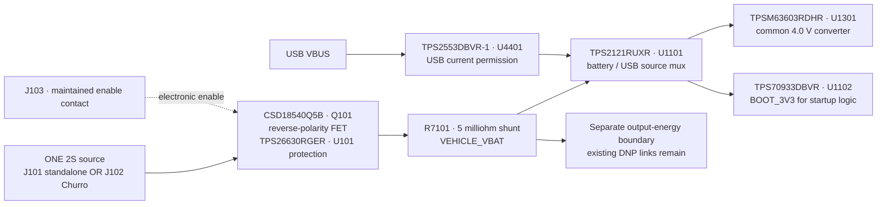
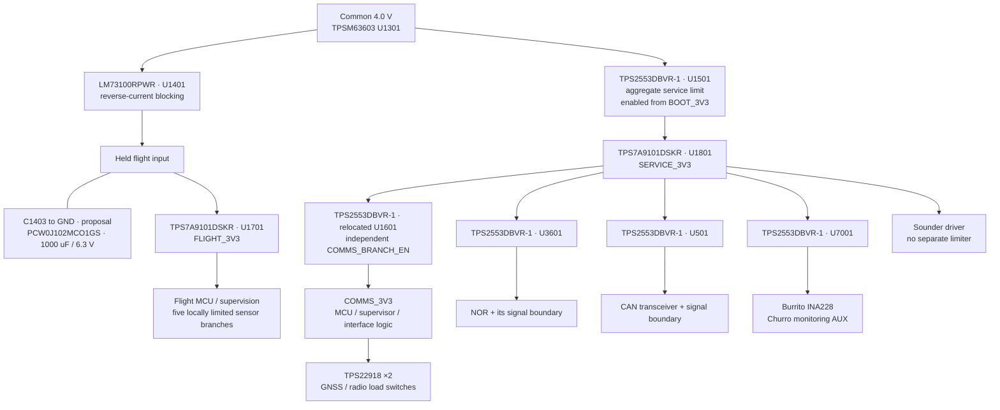
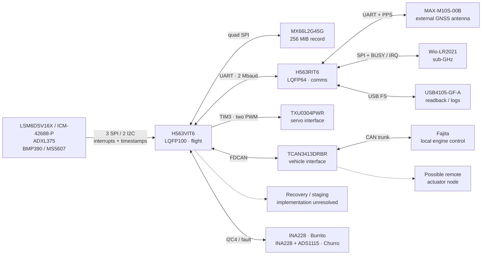

# Ogma 2 — component review

**19 September · proposed design for review. CAD/contracts remain the preserved
implementation.** Burrito = Croí2; Churro = Foinse2; Fajita = propulsion controller.

This page contains the source path, regulated branches, signal connections,
connector choices and disputed decisions. Detailed chapters supply pin maps,
calculations and datasheets. **Output circuitry/physical arming is incomplete**;
that omission prevents calling this a complete hardware design.

[Power](#power-from-source-to-load) · [Signals](#signals-and-processors) ·
[Connections](#external-connections) · [Operation](#power-and-service-states) ·
[Choices](#choices-to-settle)

## Power from source to load

**Solid arrows = power; dashed = enable control.** Common ground throughout;
the capacitor is a shunt to ground. Output circuitry is outside these logic paths.

### Entry and the FC enable plug

J101 standalone **or** J102 from Churro: one 2S source, 8.4 V fully charged.
Nominal protection thresholds: 6.63 V start / 6.20 V stop / 8.99 V overvoltage;
tolerances and sag still determine the usable range.

**J103:** maintained two-contact JST GH enable. Closing it enables the electronic
battery entry; opening it commands that entry off. USB can still power logic.
The connector carries control current; upstream battery circuitry remains live.
On Churro-fed builds, retain the closed Croí enable plug and switch at Churro.

### The shared buck and both regulated branches

| Part / branch | Why it exists | Cost or limit |
| --- | --- | --- |
| Q101 + U101 | Reverse-polarity protection and protected battery entry | Still one upstream source path |
| U1101 + U4401 | Battery/USB selection and USB-current control | USB enumeration constrains startup loads |
| U1301 | One 4 V conversion stage | Shared failure point for both LDO branches |
| U1401 + C1403 | Prevent flight capacitor discharging back into a collapsing upstream node | ~0.98 ms illustrative hold-up; not a loose-battery ride-through |
| U1701 | Flight MCU, supervisors, sensors | Its own failure still loses flight |
| U1501 + U1801 | Separately limited and regulated service group | Group failure loses comms, NOR, CAN and monitoring |
| U1601 downstream | Cycle/limit comms without switching NOR or CAN off | USB-only operation forces comms on for enumeration |
| Individual sensor/NOR/CAN/AUX limits | Bound a device-branch fault and allow deliberate restart | Selectivity and signal back-power must be checked |
| GNSS/radio TPS22918 switches | Restart individual peripherals | No individual current limit; share comms limit |

**Why two rails?** One rail can also contain an ordinary load short with local
limiters. The second LDO additionally separates the regulated flight and service
nodes. Recommend that separation to preserve flight execution through a service
supply fault; accept losing the services together. This is a chosen fault
boundary, not evidence of higher overall reliability. Three rails add continued
NOR/CAN operation through a comms-LDO fault; that requirement has not earned the
extra regulator. All versions still share the buck, source, ground and board.

**Budget:** 200 mA flight + 300 mA comms + 100 mA other service. U1501:
32.4 kΩ → 729–882 mA; U1601: 66.5 kΩ → 351–449 mA. A limited comms short
plus 100 mA services is below U1501's minimum. The ~1 ms hold-up does not bridge
the 5–10 ms latch-off delay: the common buck must sustain the limited fault.
[Full fault comparison, startup and calculations](02-power.md).

## Signals and processors

**Solid arrows = signals; dashed = control or proposed extension, labelled.**
The named supply nodes above power these same devices.

| Choice | Work it performs | Reason / conceded limit |
| --- | --- | --- |
| Flight STM32H563VIT6, 100 pins | 3 sensor SPI + 2 pressure I²C; NOR; CAN; timing/local interfaces | Existing dense map fits; removing servo3 frees one pin |
| Comms STM32H563RIT6, 64 pins | 2 UARTs, radio SPI, PPS, USB, enables/status | Complete map; same software family. 640 KiB is headroom, not a measured need |
| Separate MCUs | Keep USB/radio work outside flight scheduling | Shared power/PCB; no independent recovery |
| Two low-g IMUs + ADXL375 | Dissimilar observations plus high-g record | Two agreeing sensors do not establish truth; both low-g channels can clip |
| BMP390 + MS5607 | Pressure record through separate interfaces | Range/vent limitations; not full-envelope altitude evidence |
| MX66L2G45GMI00 NOR | 256 MiB local record, flight-owned | Comms recording depends on flight MCU and UART |
| MAX-M10S + Wio-LR2021 | Position/time and external telemetry | GNSS ≤4 g / 500 m/s / 80 km; ground radio compatibility still to verify |
| TCAN3413 + TXU0304 | External vehicle bus with powered-off signal boundary | FD requires peer agreement; remote-control timing depends on mechanism |
| TXU0304 servo interface | Two direct timer PWM outputs; prevent signal back-power when supply is off | Actual servo chooses voltage/current/update rate |

Flight recording: 96,672 B/s, 128 KiB staging; proposed comms diagnostics ≤1 KiB/s.
Continuous prepared record + ten-second lead-in/event markers. After thirty-minute
ledger, additions and 64 MiB reserve: **17,918,656 B unallocated**. No second comms
flash: accept missing new comms records if flight/UART fails.

Service: two 4 KiB payload buffers and backpressure; no requirement to hold a
whole log or 32 KiB block. At 2 Mbaud, full NOR download takes **at least 22.4 min**.
A faster disarmed service mode needs a measured implementation.

Radio RSSI/SNR belongs to the **receiver**. Ground measures vehicle transmissions;
vehicle measures ground transmissions. Log direction, sequence and receiver.

## External connections

| Connection | Part / retained arrangement | Decision visible here |
| --- | --- | --- |
| Standalone battery J101 | 1053111102 | Exclude simultaneous J102 source |
| Churro J102 | Samtec MPT/MPS-08-01-01-L-RA-SD | Battery/return + AUX + I²C/fault; no Churro MCU |
| FC enable J103 | BM02B-GHS-TBT(LF)(SN) + GHR-02V-S | Maintained contact; electronic battery enable described above |
| Physical output arm | Assembly incomplete | Separate operator function; not supplied by J103 or output-harness plug |
| Output harness J6601 | Existing Molex 430450600 | Retained interface; output/arming implementation incomplete |
| Servos J6602 | **Retain 430451000 + 430251000**, ten contacts | Two groups used; avoid six-contact substitution matching J6601 |
| CAN J501 | Three-contact JST GH | H / L / reference; no power contact |
| USB J4401 | USB4105-GF-A | Comms service + logic supply |
| GNSS J4501 / radio J4601 | Amphenol 132134 SMA each | Different labelled antenna paths; antenna assemblies unselected |
| Flight/comms debug | TC2030-NL-FP ×2 | Independent access if USB firmware fails |

Two-servo harness: contacts 1/2/3 = PWR1/PWM1/GND1; 4/5/6 = PWR2/PWM2/GND2;
7–10 unwired in the proposal. Existing third-channel CAD remains until revision.
[Connector details and evidence](09-connectors-arming.md).

## Power and service states

| Situation | Expected behavior / useful observation |
| --- | --- |
| Battery, FC enable open, no USB | Entry commanded off; upstream circuitry still live |
| Battery enabled | Flight starts independently; flight controls comms enable |
| USB only, before configuration | Comms enumerates; flight/sensors/NOR/CAN/GNSS/radio off; startup current must fit allowance |
| USB configured | Start required service loads within allowed current; read both MCU identities/builds/config |
| Battery + USB | Battery-valid logic preserves flight control of comms |
| Comms reset / branch cycle | Flight task continues; already-enabled NOR/CAN remain supplied; record reset/gap |
| Flight reply stale while USB works | Show unknown/stale flight state; a responsive comms MCU is insufficient |
| Power lamp on / firmware green | Rail presence / reported readiness respectively; neither establishes physical output-arm state |

Retain simple power + flight red/green + comms amber + ground-only sounder.
USB supplies the detailed sensor, logger, peer, timing and configuration view.
An independent physical-arm indication is **not implemented by those lamps**.

## Choices to settle

| Question | Recommendation / present answer | Evidence that could change it |
| --- | --- | --- |
| One, two or three LDOs? | Two; preserve separate flight node, share services | Accepting shared regulated-output loss permits one; required recorder/CAN survival through comms-LDO failure favors three |
| Smaller comms processor? | H563RIT6 for family reuse and mapped package | Comparable cost/power or measured workload justifies another family |
| Two servos, new connector? | Two channels; retain ten-contact housing | A documented packaging constraint, not channel count alone |
| Remote controller split? | Keep central/local/hybrid alternatives open | Mechanism feedback, maximum command age/jitter and loss-of-link behavior |
| Extra comms flash? | No; forward diagnostics to NOR | Requirement to record while flight/UART is failed |
| Physical output-arm assembly? | Incomplete; no selected assembly or implementation claim | Separate responsible design review; this pack has not closed it |

**External inputs:** actuator/mechanism data; actual ground-receiver firmware and
antenna installation; CAN peers/harness/allowed command age. **Hardware evidence:**
startup current, dynamic fault droop, concurrent firmware load, sustained recording
and installed signal behavior. Those measurements are distinct from desk research.

## Supporting detail

[MCU map and alternatives](01-mcus.md) · [Power calculations](02-power.md) ·
[Output status](03-energetic-outputs.md) · [Servo interface](04-servos.md) ·
[Status/time](05-service-status-time.md) · [GNSS/radio](06-gnss-radio.md) ·
[Sensor/recording budgets](07-sensors-logging.md) · [Churro/CAN](08-foinse-can.md) ·
[Connector inventory](09-connectors-arming.md).

Source roles: current part/net evidence from the preserved CAD and linked
manufacturer documents; presentation requirements from the 13 and 18 September
reviews. Proposed values remain labelled. Earlier understood material is retained
as reference; no new section is marked understood or accepted on the team's behalf.
