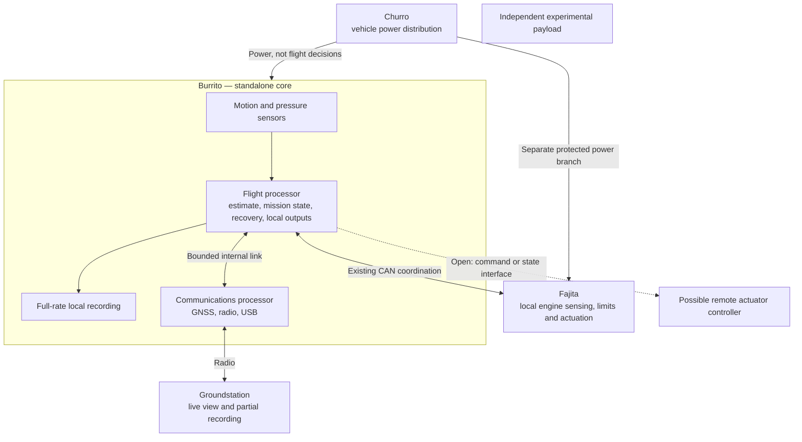

# 0. The whole system

**Retained:** a standalone flight computer, optional vehicle power companion and
independent engine controller. **Open:** the final output, processor, power and
external-actuation allocation. No schematic or PCB changes until the final
stack is authorized.

## What we are making

Ogma is a reusable flight-computer system for HiPR vehicles. **Burrito** is the
core: it senses motion, estimates the flight state, records what happened and
handles its assigned recovery and actuator functions. It also communicates
with the ground. It must work without the other two boards.

**Churro** adds vehicle-specific power distribution. **Fajita** controls the
engine using its own measurements and local safety decisions. These are working
names for Croí2, Foinse2 and the separate propulsion controller respectively;
the existing CAD names have not changed.

Rev 1 divided the computer across several boards. That brought duplicated
functions, version coordination and extra connections. The new direction wraps
the core functions together without forcing every vehicle's power and engine
requirements onto the same PCB.

## Who owns what?

This is a responsibility map, not a wiring diagram. The dashed connection is
a proposal. Churro does not need a flight-state machine. A payload does not gain
control authority because it flies in the same rocket.

Fajita must enforce engine limits locally. Burrito requests an allowed state
transition; it does not remotely switch individual engine valves through CAN.
The remote fin/canard question remains open: reusing Burrito's estimate and
closing a loop locally have different costs. Chapter 4 explains both.

## What happens when something fails?

The two processors separate variable communications work from time-critical
flight work. They share a PCB and upstream power: this is **not redundant
recovery**.

| Failure | Intended behaviour | Limit |
| --- | --- | --- |
| Communications stops | Essential local flight work continues | GNSS aiding and radio may be lost |
| Bulk recording fails after launch | Flight work continues with explicit missing evidence | No claim that the full record survives |
| Flight processor resets | Validate retained state and flight phase before any permitted recovery continuation | Further sustainer ignition remains inhibited |
| Whole core loses power | Primary core functions are unavailable | Independent vehicle recovery must cover its allocated hazards |

Before launch, an unexplained fault stops preparation. A failure tolerated
during flight is not automatically acceptable on the pad.

## Ordinary flight versus a space-shot recorder

Our primary job is ordinary competition and development flights, broadly the
existing 3–9 km planning envelope. These still need mission-specific loads,
simulation and qualification.

The separate bounded 100 km concept is a recorder configuration with its
energetic and servo energy paths physically unpowered. Independent vehicle
systems provide recovery and full-envelope altitude evidence. The current GNSS
receiver does not prove 100 km apogee. Nothing here claims orbital lifetime.

The existing planning envelope also includes eight hours operating, four hours
reduced-duty recovery and thirty minutes of full-rate recording. These are
requirements/budgets to test, not measured endurance. They must remain visible
when reducing cost, memory or power.

Other provisional budgets are five years of service, 25 inspected flights,
powered operation from −20 to +70 °C, 50 g quasi-static loading and a 200 g
shock target whose waveform is unresolved. The actual vibration spectrum
still needs vehicle evidence. Closed-bay splash protection is not permission
for a wet exposed board. Pressure survival and useful pressure measurement
are different requirements. None of these numbers is a qualified result.

## How it fits in a rocket

Use a serviceable supported assembly, retained wiring and keyed locking
connectors. Do not return to a tower that obscures components. Routine
configuration, log extraction and charging need deliberate external access;
opening or disturbing an integrated bay can require repeating readiness checks.

A custom L1 vehicle and repeated launches could provide useful development
flights. Available volume, recovery clearance, mass, mounting and permission
still need agreement. Bring-up, fault tests and installed qualification do not
disappear once a PCB goes to fabrication.

The food names and possible food illustrations make this a shared project.
Artwork, board colour and spiciness markings can wait; they do not decide the
electrical stack.

## Next pass through this chapter

Confirm the overall division, then carry unresolved details into their chapters.
We should be able to explain the whole vehicle without knowing any component
reference numbers. If a proposed feature has no vehicle job, failure boundary
or useful experiment, ask why it belongs.

[Next: processors](01-mcus.md) · [Detailed implementation reference](implementation-reference/00-overview.md)
