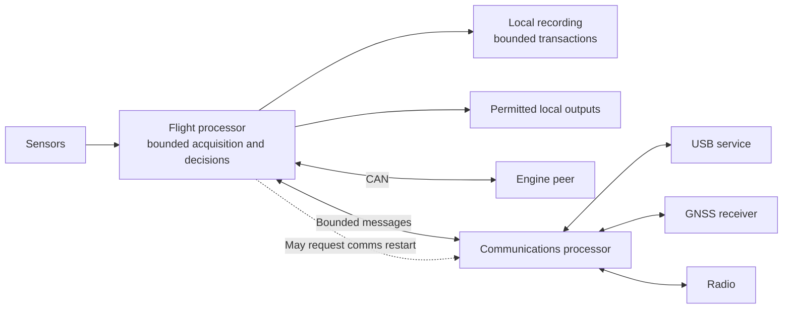
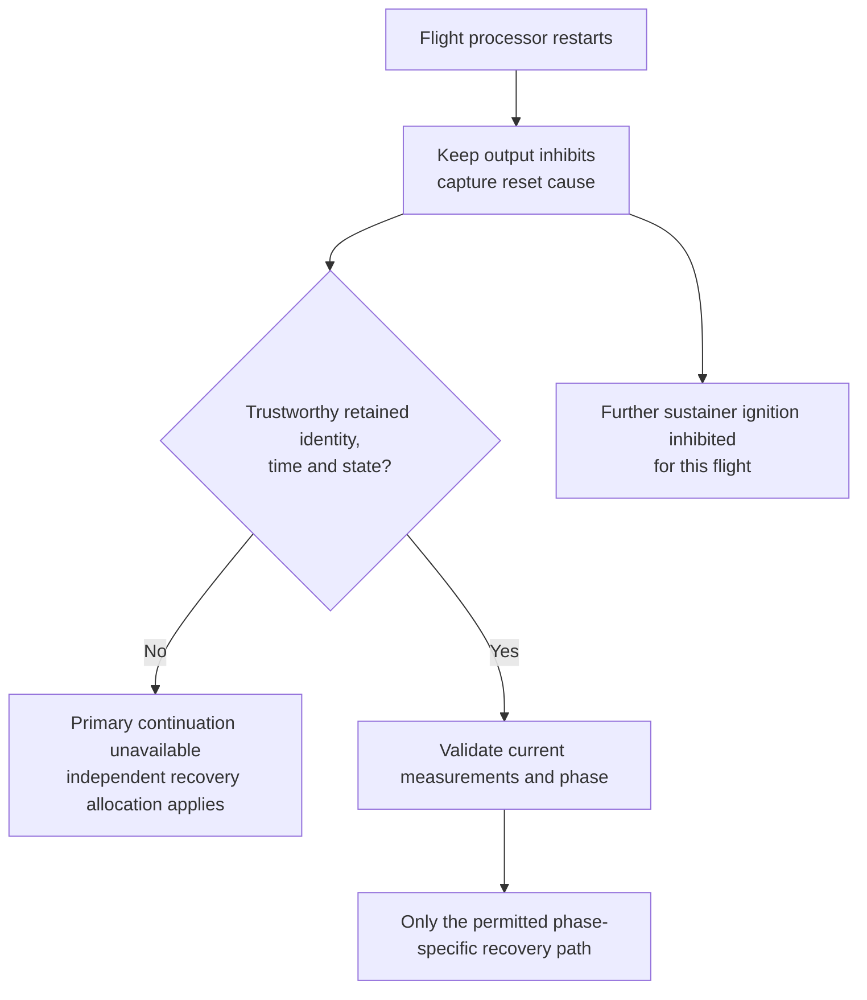

# 1. Processors, timing and restarting

**Retained:** separate flight and communications responsibilities; flight owns
vehicle CAN and recovery authority. **Open:** exact processor choice per role
and firmware scheduling approach.

## Why two processors?

Radio handling, USB transfers and GNSS parsing can take variable amounts of
time. The flight processor must not miss a measurement or decision deadline
because the other processor is busy servicing a laptop.

The dotted arrow is a reset-request relationship, not another data bus.
Communications has no reciprocal authority to reset flight or arm its outputs.
The intended test is simple to state: hold communications in reset and show
that the essential flight functions still work.

There are limits. Both processors share the board, upstream conversion and
installation. Two chips do not protect against all common power, mechanical
or software mistakes.

## Do both jobs need the same chip?

The existing draft uses two STM32H563 devices. Using the same part simplifies
tools, spare parts and bring-up. The meeting correctly reopened whether the
communications role needs the same resources.

| Approach | Gain | Cost / evidence needed |
| --- | --- | --- |
| Keep identical processors | One maintained target and familiar tools | May spend unnecessary area and cost on communications |
| Smaller communications processor | Potential area/cost saving | Check real USB, radio, GNSS, buffering and debug needs; maintain another target |
| One processor for everything | Removes a processor and support circuitry | Must demonstrate timing and fault separation inside one device |

**Recommendation for comparison, not a part decision:** retain the two-role
split while checking resources separately for each role. Start with actual
peripherals, pins, memory and workload. A smaller package is useful only if it
fits those needs. Fewer pins alone do not establish greater reliability.

The current flight allocation is full. New LEDs, outputs or interfaces cannot
be allocated to imaginary spare pins. The detailed pin map is supporting
evidence, not material we should have to read aloud.

## What makes the execution predictable?

The draft budgets a 1 kHz essential schedule and 200 Hz estimation/policy at
128 MHz. A 700 microsecond essential-work allowance leaves 300 microseconds of
each millisecond reserved. These are **unmeasured allocations**, not proof the
code fits.

An RTOS schedules tasks; bare-metal firmware schedules work without that layer.
Neither is automatically faster or safer. Anav's architecture needs to show
which work runs when, how long it can block, and how failed peripherals are
abandoned without stalling flight.

The watchdog is an independent timer that can force a reset if required
execution stops progressing. It should be fed because essential tasks actually
completed, not merely because an interrupt still runs. Losing a nonessential
logger after launch must not create an endless reset cycle.

## Three kinds of memory

| Memory | What it does | What not to assume |
| --- | --- | --- |
| Program memory | Holds executable firmware | Correct storage does not make the program correct |
| Working RAM | Holds current estimates, buffers and execution state | Contents need not survive power loss |
| External nonvolatile NOR | Holds the flight record | A write interrupted by power loss may be incomplete |

ECC is error-correcting coding for specified memory regions and error patterns.
It does not correct arbitrary software decisions or make a processor
radiation-qualified. The existing device has both protected and unprotected
RAM regions; placement of critical state and buffers must follow that map.
Two retained checkpoint copies help with interrupted updates, not loss of
their common supply or a writer corrupting both.

## Reset is not a new flight

“Staging” here means igniting a subsequent rocket stage. It does not mean boot
calibration. An in-flight reset must not declare the rocket stationary,
recalibrate its launch height or replay every event. Recovery continuation and
sustainer ignition have different hazards.

A surviving clock does not prove that the estimate survived. A valid checksum
does not prove that its timestamp is recent. Complete power loss is different
from a processor-only reset with valid supplies.

## Next pass through this chapter

Can everyone explain why the two roles exist and what each failure loses?
Then compare the processor resources and scheduling options. Close the choice
with compiled allocations and measured timing, including unavailable peripherals
and communications held in reset—not a headline clock speed.

[Next: power](02-power.md) · [Detailed devices, memory and timing evidence](implementation-reference/01-mcus.md) · [Reset contract](../../interfaces/reset-recovery-contract.md)
