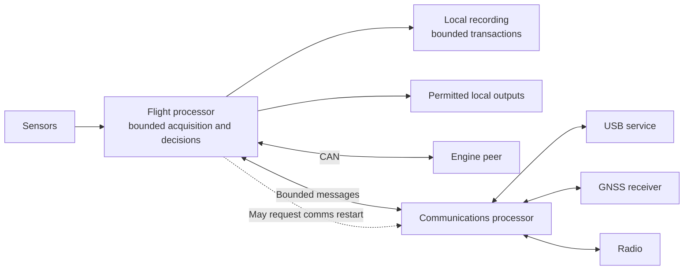
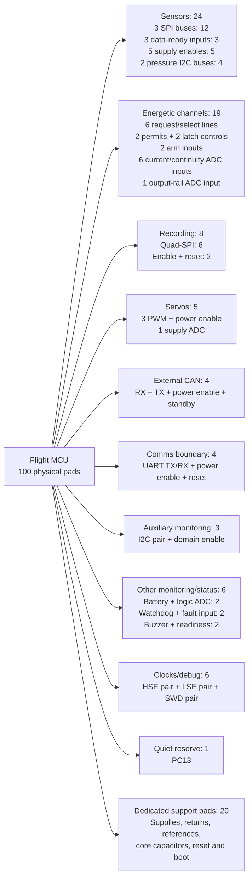
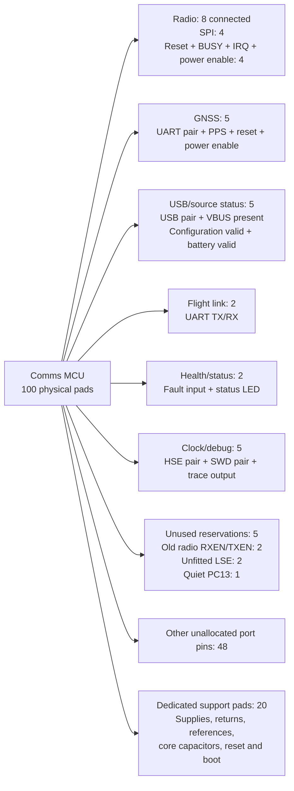
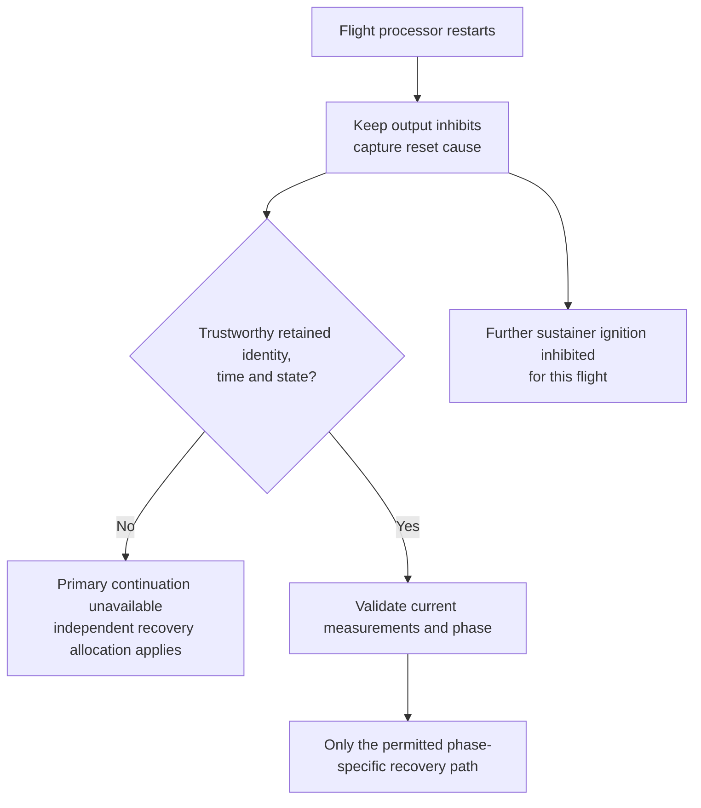

# 1. Processors, timing and restarting

**Next-review answers:** [18 September investigation](2026-09-18-review-investigations.md#1-mcu-comparison-and-pin-rationale) supplies recommendations and supporting comparisons for this chapter.

## 13 September review: explanation corrections

The two-processor rationale was understood; processor selection remains open.
The pin audit counts connections, not justified requirements or CPU load.
For every enable/sense pin, identify its trigger, failure benefit, fixed-state
alternative and discriminating test.

Pressure sensors use I2C1/I2C2; Churro monitoring uses I2C4. The six energetic
ADC inputs are three current and three continuity inputs, not servo feedback.
The six request/select outputs serve three energetic channels. Arm sense observes
physical permission. OCTOSPI1 uses four data wires in this draft. DRDY announces
a sample; it is not an extra bus. An aggregate fault line cannot identify its
source. External/internal watchdogs and complete power removal test different
failures; reserved DMA channels do not establish concurrent timing.

Broaden the MCU comparison by memory, peripherals, routing, execution budget and
software burden. Exact LSE/PC13 restrictions need device-specific errata evidence.
A full mock firmware exercise was discussed, not agreed.

**Retained:** separate flight and communications responsibilities; flight owns
vehicle CAN and recovery authority. **Open:** exact processor choice per role
and firmware scheduling approach.

## Why two processors?

*Reviewed 13 September, A 08:58–09:12: rationale understood. Brief revisit only
unless the responsibility split changes; this does not approve an MCU part.*

Radio handling, USB transfers and GNSS parsing can take variable amounts of
time. The flight processor must not miss a measurement or decision deadline
because the other processor is busy servicing a laptop.

“Local recording” means writing the flight record to board-mounted NOR flash.
“Bounded transactions” means the acquisition loop cannot wait indefinitely for
a flash operation: it needs a deadline and a defined error/degraded response.
The final firmware must establish that deadline; the label alone proves nothing.

The dotted arrow is a reset-request relationship, not another data bus.
Communications has no reciprocal authority to reset flight or arm its outputs.
The intended test is simple to state: hold communications in reset and show
that the essential flight functions still work.

There are limits. Both processors share the board, upstream conversion and
installation. Two chips do not protect against all common power, mechanical
or software mistakes.

## Do both jobs need the same chip?

The existing draft uses two STM32H563 devices. Using the same part simplifies
tools, spare parts and bring-up. The meeting correctly reopened whether the
communications role needs the same resources.

| Approach | Gain | Cost / evidence needed |
| --- | --- | --- |
| Keep identical processors | One maintained target and familiar tools | May spend unnecessary area and cost on communications |
| Smaller communications processor | Potential area/cost saving | Check real USB, radio, GNSS, buffering and debug needs; maintain another target |
| One processor for everything | Removes a processor and support circuitry | Must demonstrate timing and fault separation inside one device |

**Recommendation for comparison, not a part decision:** retain the two-role
split while checking resources separately for each role. Start with actual
peripherals, pins, memory and workload. A smaller package is useful only if it
fits those needs. Fewer pins alone do not establish greater reliability.

## Where the pins actually went

The 11 September audit checked both 100-pad allocations against a fresh
schematic netlist. **Flight is pin-full in this draft; comms is not.**
This says nothing about CPU utilisation.

| Of each package's 100 pads | Flight | Comms |
| --- | ---: | ---: |
| Supply, ground, reference, core-capacitor, reset and boot pads | 20 | 20 |
| Connected port pins, including clocks/debug | 79 | 27 |
| Labelled but unused radio reservations | 0 | 2 |
| Unfitted low-speed crystal reservations | 0 | 2 |
| Quiet PC13 reservation | 1 | 1 |
| Other unallocated port pins | 0 | 48 |
| **Total** | **100** | **100** |

The two comms radio reservations are remnants of the earlier radio interface:
their nets contain only the MCU pin. They are not driving the current module.
The low-speed comms crystal pins are also unconnected in the schematic.
These are possible reclamations, not changes made by this audit.

### Flight allocation

Each branch below is a **pin budget**, not a data or power connection.
Counts include peripheral signals, chip selects, enables and diagnostics.

**The big consumers are sensors and output supervision: 48 pins together.**
Three energetic channels alone use 19, not three. Each independently switched
sensor adds supply control and often a data-ready line on top of its bus.
This is the cost of the current observability and fault-containment choices,
not proof that every choice is necessary.

The early 6 September study reserved only 40 flight port pins and explicitly
left diagnostics and protection controls unallocated. That preliminary count
is not the current design. The later complete allocation consumes 79.

### Communications allocation

Port-by-port allocation, including actual pad numbers and net names, is in the
[pin audit](../mcu-pin-capacity-audit-2026-09-11.md). The diagrams deliberately
group by job so the reason for each allocation is visible.

## The 11 September result — comparison scope reopened on 13 September

The earlier recommendation was to keep flight H563 and investigate a smaller
H563 package for comms. **The meeting requested a broader candidate table; the
two examples below do not fulfil that request.** Reuse of tools is one comparison
criterion, not a reason to exclude other parts before comparing resources.
The actual shortlist, prices/availability and role-specific resource fit remain
open research work; no new part has been selected.

The H563 LQFP64 candidate keeps the same processor and memory class in a smaller
package. The current comms signals can be mapped at the desk-check level:
keep the existing functional port choices except move the flight-link UART
from PD8/PD9 to PC10/PC11, both USART3 AF7. Those current pins are unallocated
on comms. The exact candidate allocation is in the audit.
This is a proposal, not a drop-in footprint or an approved remap.
[ST package and alternate-function tables](https://www.st.com/resource/en/datasheet/stm32h563vi.pdf).

A genuinely smaller device such as H503 also has USB, but its 32 KiB main RAM
makes the current 32 KiB service-block contract an immediate design question.
Streaming may avoid buffering a whole block; that would need an explicit
implementation, not an assumed fit. Start with package reduction unless a
measured cost/power benefit justifies tighter memory and another target.
[ST H503 datasheet](https://www.st.com/resource/en/datasheet/stm32h503cb.pdf).

For flight, reclaim pins by reviewing functions, not weakening protection merely
to make a count fit:

- Removing an unnecessary third local PWM would recover **one** pin.
- SPI rather than quad-SPI recording could recover **two**, but needs throughput
  and NOR-mode validation.
- Sharing sensor buses could recover pins, at the cost of shared fault and timing
  dependencies. It is not a free simplification.
- Comms can own noncritical display work, but moving flight-owned authority to
  exploit spare comms pins would contradict the intended failure boundary.

These savings are alternatives, not additive approved changes. PC13 remains
reserved; spare comms pins cannot be used as flight-local pins without a new
interface and dependency.

### What can be settled without hardware?

The pin count, proposed package mapping and resource budget can be investigated
now; this audit does that. Firmware size, stack usage, execution time and actual
power need a build or measurement. No Ogma2 target firmware build is present in
this repository, so there is no evidence yet that either CPU is compute-full
or that a slower part meets the deadlines.

The draft reserves 11 DMA channels for flight and six for comms, but a reservation
is not a tested request/arbitration configuration. The H563 same-peripheral
package change avoids inventing a new DMA architecture; it still needs target
configuration and bring-up.

## What makes the execution predictable?

The draft budgets a 1 kHz essential schedule and 200 Hz estimation/policy at
128 MHz. A 700 microsecond essential-work allowance leaves 300 microseconds of
each millisecond reserved. These are **unmeasured allocations**, not proof the
code fits.

An RTOS schedules tasks; bare-metal firmware schedules work without that layer.
Neither is automatically faster or safer. Anav's architecture needs to show
which work runs when, how long it can block, and how failed peripherals are
abandoned without stalling flight.

The watchdog is an independent timer that can force a reset if required
execution stops progressing. It should be fed because essential tasks actually
completed, not merely because an interrupt still runs. Losing a nonessential
logger after launch must not create an endless reset cycle.

## Three kinds of memory

| Memory | What it does | What not to assume |
| --- | --- | --- |
| Program memory | Holds executable firmware | Correct storage does not make the program correct |
| Working RAM | Holds current estimates, buffers and execution state | Contents need not survive power loss |
| External nonvolatile NOR | Holds the flight record | A write interrupted by power loss may be incomplete |

ECC is error-correcting coding for specified memory regions and error patterns.
It does not correct arbitrary software decisions or make a processor
radiation-qualified. The existing device has both protected and unprotected
RAM regions; placement of critical state and buffers must follow that map.
Two retained checkpoint copies help with interrupted updates, not loss of
their common supply or a writer corrupting both.

## Reset is not a new flight

“Staging” here means igniting a subsequent rocket stage. It does not mean boot
calibration. An in-flight reset must not declare the rocket stationary,
recalibrate its launch height or replay every event. Recovery continuation and
sustainer ignition have different hazards.

A surviving clock does not prove that the estimate survived. A valid checksum
does not prove that its timestamp is recent. Complete power loss is different
from a processor-only reset with valid supplies.

## Next pass through this chapter

Can everyone explain why the two roles exist and what each failure loses?
Then compare the processor resources and scheduling options. Close the choice
with compiled allocations and measured timing, including unavailable peripherals
and communications held in reset—not a headline clock speed.

[Next: power](02-power.md) · [Detailed devices, memory and timing evidence](implementation-reference/01-mcus.md) · [Reset contract](../../interfaces/reset-recovery-contract.md)
