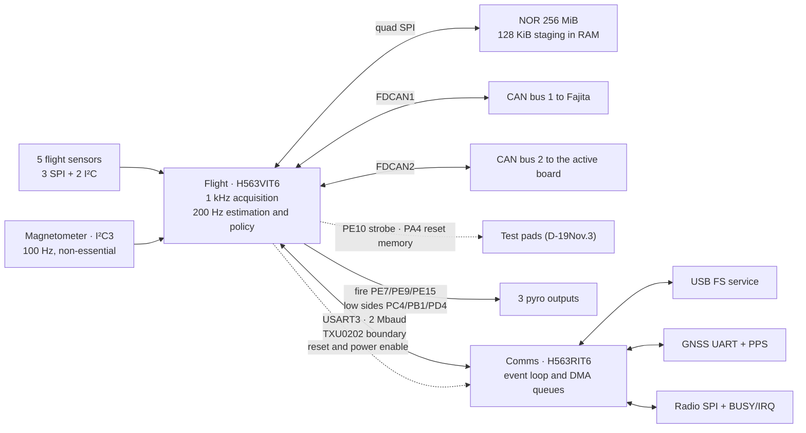

# 01 Processors

Two STM32H563s: **H563VIT6 (LQFP100) for flight**, **H563RIT6 (LQFP64) for
comms**. Two processors ([D-6.12](../../decisions.md)) and the comms package
(D1, accepted 2 November) are decided. The CAD still has two H563VIT6.

Both are Arm Cortex-M33 with a single-precision FPU, 2 MiB flash and 640 KiB
RAM. Firmware builds with `-mcpu=cortex-m33 -mfpu=fpv5-sp-d16 -mfloat-abi=hard`
whichever comms package is fitted.

## Why two, and why these

| Role | What it must do | Why this part |
| --- | --- | --- |
| Flight | Three sensor SPI buses, two pressure I²C buses, the magnetometer's I²C3, monitor I²C4, quad NOR, two CAN buses, UART, timing, outputs | The existing LQFP100 map fits; independent buses use the pins, and none is spare since D-5Nov.3 |
| Comms | Radio SPI, two UARTs, PPS, USB, enables and resets, status, HSE, SWD | Every function fits LQFP64; same family, so one driver and DMA target |
| Split | Flight keeps flying with comms held in reset | USB, radio and GNSS parsing and service stalls stay off the flight schedule |

The H563 is chosen for one software target with headroom, not for lowest cost
or power. No measured CPU load or memory budget exists yet. The flight budget
stays at 128 MHz; the part's maximum clock is not a requirement.

| Resource | Flight | Comms |
| --- | --- | --- |
| Acquisition | 3 SPI + 2 I²C sensor buses, 1 kHz schedule; magnetometer on I²C3 at 100 Hz | GNSS UART/PPS, radio SPI, flight UART, USB |
| DMA | 11 streams: 6 SPI, 2 ADC, 2 UART, NOR | 6 streams: 4 UART, 2 SPI; request routing to build-test |
| RAM | 128 KiB recorder staging | 8 KiB service buffers proposed; parsers, queues and stacks to measure |
| CPU | 200 Hz estimation/policy, 128 MHz budget | No benchmark sets a clock |

| Comms alternative | Comparison | Position |
| --- | --- | --- |
| H563VIT6 (in CAD) | Same software, no pin migration, bigger package | Keep if the smaller package buys little layout |
| **H563RIT6** | Same resources, 64 pins, fully mapped | Decided (D1) |
| G474RE | 512 KiB flash, 128 KiB RAM in several regions | New family and DMA work; no quote |
| H503 | 128 KiB flash, 32 KiB RAM | Streaming removes the old 32 KiB-buffer objection; fit unproven |

Revisit a smaller comms part only for a real cost or power constraint or a
measured resource budget. Sources: [pin audit](../archive/mcu-pin-capacity-audit-2026-09-11.md),
[MCU comparison](../archive/architecture/2026-09-18-review-investigations.md#1-mcu-comparison-and-pin-rationale),
[earlier two-MCU rationale](../archive/architecture/implementation-reference/01-mcus.md#why-keep-this).

## Comms LQFP64 map

[Full 64-pad allocation](proposed-comms-pinout.csv), checked against ST DS14258 Rev 6.

| Function | Pads / ports | Change from CAD |
| --- | --- | --- |
| Flight UART | 29 PB10 TX, 52 PC11 RX, USART3 AF7 | Moves from PD8/PD9; flight end unchanged; TX on PB10 since D-22Nov.25 |
| GNSS | 42 PA9 TX, 36 PB15 RX (AF4); 14 PA0 PPS; 17 PA3 reset; 25 PC5 enable | RX, reset and enable moved (D-22Nov.25) |
| Radio | 21–23 PA5–PA7 SPI, 33 PB12 NSS; 28 PB2 reset, 20 PA4 BUSY, 26 PB0 IRQ, 27 PB1 enable | NSS, reset, BUSY and IRQ moved (D-22Nov.25) |
| USB | 44 PA11 DM, 45 PA12 DP; 15 PA1 VBUS sense | VBUS sense moved (D-22Nov.25) |
| Source status | 10 PC2 `CC_BAT_VALID`, 9 PC1 `CC_BRANCH_FAULT_N` | Moved from PA2 / PB5 (D-22Nov.25) |
| Status lamp | 8 PC0 | Moved from PB4 (D-22Nov.25) |
| Debug / clock | 46 PA13, 49 PA14, optional 55 PB3; HSE 5 PH0, 6 PH1 | Same |

- LQFP64 has no VDDUSB pad; VDDUSB is tied to VDD inside, so COMMS_3V3 must
  stay within 3.0–3.6 V for USB.
- VCAP pads 30 and 62 each need 2.2 µF.
- PC3/PC4 radio reservations need no connection. Comms LSE stays DNP.
- Flight PC13 stays quiet (LSE erratum).
- The CSV `net` column is the electrical net name: comms PB10/PC11 use
  `CC_COMMS_TO_FLIGHT`/`CC_FLIGHT_TO_COMMS` through U4301; PC1/PC2 keep their
  `CC_` nodes; analog supplies keep `COMMS_VDDA`/`FLIGHT_VDDA`; ADC inputs keep
  their `ADC_` front-end nodes. `NC` means unconnected, never a shared net.

## Flight pins

The [flight map](proposed-flight-pinout.csv) holds the 22 September nets. The
October and November decisions change these pads (detail in the
[capture delta](schematic-capture-spec.md#burrito-changes); every pin by function
in the [firmware interface](../firmware-interface.md#flight-mcu-pins)):

| Pad | Port | Now | Decision |
| --- | --- | --- | --- |
| 45 | PE14 | `FC_POWER_HOLD` | D-6.3, D-2Nov.4, D-22Nov.25 |
| 38 / 40 / 46 | PE7 / PE9 / PE15 | `PYRO1_FIRE` / `PYRO2_FIRE` straight to the TPS1H100s; `PYRO3_FIRE` through the staging latch AND gate | D-7.1, D-7.2, D-22Nov.25, D-23Nov.25 |
| 33 / 36 / 85 | PC4 / PB1 / PD4 | `PYRO1_LS_SELECT` / `PYRO2_LS_SELECT` / `PYRO3_LS_SELECT`, on ports C, B and D, away from the port-E fire pins | D-2Nov.1, D-5Nov.3, D-22Nov.25, D-23Nov.25 |
| 91 / 69 | PB5 / PA10 | FDCAN2 RX / TX, CAN bus 2 to the active board | D-5Nov.3 |
| 67 / 66 | PA8 / PC9 | Magnetometer I²C3 SCL / SDA, AF4 | D-2Nov.11 |
| 84 | PD3 | Magnetometer INT (optional data-ready) | D-2Nov.11, D-22Nov.25 |
| 97 / 87 | PE0 / PD6 | Staging latch readback (through 1 kΩ) / staging arm sense | D-7.2, D-22Nov.25 |
| 88 | PD7 | New-flight latch set | D-7.2, D-22Nov.25 |
| 44 | PE13 | Recovery arm sense (moved from PC8) | D-7.2, D-5Nov.3 |
| 39 | PE8 | `SERVICE_POWER_EN` (moved from PD10) | D-7.1 |
| 68 / 70 / 71 | PA9 / PA11 / PA12 | Spare test pads `TP_PA9` / `TP_PA11` / `TP_PA12`, inputs with pull-downs; the bootloader drives these pins, so a pad and nothing else | D-19Nov.3, D-22Nov.25 |
| 41 / 29 | PE10 / PA4 | `TP_STROBE` timing strobe / `RESET_MEMORY` read at boot | D-19Nov.3, D-22Nov.25 |
| 62 | PD15 | `CAN_STB` for both transceivers | D-5Nov.3, D-22Nov.25 |
| — | — | 36 flight nets in all moved for the placement and four reset-state faults: each in the [firmware interface](../firmware-interface.md#pin-changes-d-22nov25) | D-22Nov.25 |

PA9 and PC9 are also the H563's UCPD dead-battery pins: until firmware sets
`UCPD_DBDIS`, a high level on them switches pull-downs onto PB13 / PB14, the TDK
IMU's SPI clock and data. Set it first thing at boot.

## Why the remaining control pins stay

| Pins | Job | Without it |
| --- | --- | --- |
| Sensor DRDY/INT | Timestamp when a sample is ready | Polling jitter |
| NOR enable / reset | Clear a supply fault / reset the device | Reset can't clear a tripped supply |
| Comms enable / reset | Restart the whole branch / just the processor | Power cycle also restarts GNSS and radio |
| CAN enable / standby | Recover the supply / keep the transceiver quiet | Startup and fault behaviour change |
| Monitor AUX enable | Powers Croí INA228 and Churro monitoring | Lose battery-current readings |
| Battery and rail ADC | Watch supplies against VREFINT | Same-supply reference is only ratiometric |
| Watchdog feed | Proof the essential loop ran | A timer toggle hides a stalled loop |
| GNSS PPS / reset / enable | Time edge / receiver reset / supply restart | UART timing can't replace PPS |
| Radio BUSY / IRQ / reset / enable | Readiness / events / recovery | Polling and weaker recovery |
| USB VBUS / config / battery-valid | Source sequencing | Comms branch logic loses its inputs |
| SWD, reset, clock, supplies | Service and operation | Supply and VCAP pads are not GPIO |

## Firmware starting point

- Flight: DMA acquisition, timestamp and validate, scheduled estimation and
  policy, bounded logger service. No busy-waits on sensors, flash, radio or peers.
- Comms: event loop with DMA queues. No RTOS until a real need shows up.
- Inter-MCU UART: 2 Mbaud 8N1, 20 kB/s telemetry cap, comms diagnostics ≤1 KiB/s.
- Service transfers: 4 KiB chunks, two 4 KiB buffers, sequence/CRC, credit-based
  backpressure. No whole-log buffer.
- At 2 Mbaud the payload ceiling is 200 kB/s, so a full 256 MiB download takes
  at least 22.4 minutes. An 8 Mbaud disarmed mode (~680 kB/s) is a later target.
- Pass condition: flight keeps progressing with comms reset, silent, flooding or
  sending garbage. GNSS and USB are never hidden prerequisites.

First check after capture: a minimal build running USB, GNSS, radio and the
UART together, measuring memory, stalls and reset recovery. Reserve RAM by
owner, initialise ECC memory and bound DMA queue ownership before it.

## Capture notes

Draw the LQFP64 symbol from the 64-pad CSV, not a cut-down 100-pin symbol.
Check every supply, VREF/VDDA, reset, BOOT, HSE and debug pin against AN5711.
Keep the powered-off UART, reset and bootstrap boundaries.

Sources: [ST H563 datasheet](https://www.st.com/resource/en/datasheet/stm32h563ri.pdf)
(Figure 5, Tables 14–16) · [AN5711](https://www.st.com/resource/en/application_note/an5711-getting-started-with-stm32h5-mcu-hardware-development-stmicroelectronics.pdf) ·
[ES0565 errata](https://www.st.com/resource/en/errata_sheet/es0565-stm32h562xx563xx573xx-device-errata-stmicroelectronics.pdf) ·
[installed flight map](../../hardware/croi2/libraries/inputs/flight-pinout.csv) ·
[dependency audit](../archive/architecture/2026-09-22-schematic-readiness.md#dependency-closure)
