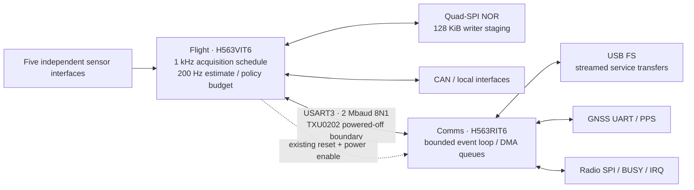

# Processor pair

**22 September · proposal · existing CAD has two H563VIT6 parts.**

Use **STM32H563VIT6, LQFP100, for flight** and **STM32H563RIT6, LQFP64,
for comms**. Keep the H563 software family; remove unused comms package pins.
This is a resource/implementation choice, not a claim of lowest price or power.

## Justification and deeper detail

| Question | Follow through | Source status |
| --- | --- | --- |
| How does this become capture/placement? | [Exact delta and responsibility](schematic-capture-spec.md), [proposed flight map](proposed-flight-pinout.csv) | PD10 service recovery is the sole functional flight allocation change; net names match native circuits |
| Why these packages? | [Pin-capacity audit: flight allocation and package comparison](../mcu-pin-capacity-audit-2026-09-11.md) | 11 September audit of preserved CAD |
| What alternatives were considered? | [MCU family comparison and manufacturer sources](2026-09-18-review-investigations.md#1-mcu-comparison-and-pin-rationale) | 18 September research; old whole-block RAM objection superseded by streaming |
| Why two processors? | [Workload separation and single-MCU alternative](implementation-reference/01-mcus.md#why-keep-this) | Earlier design rationale; current part/package choice is on this page |
| Does the smaller package actually fit? | [Complete proposed 64-pad map](proposed-comms-pinout.csv) | Current proposal; every pad allocated |
| What supports memory/DMA claims? | [DMA, memory and execution evidence](../mcu-pin-capacity-audit-2026-09-11.md#dma-memory-and-execution-scope) | Reservations and budgets; no measured firmware occupancy |

## Why these two

Evidence: [complete flight allocation](../mcu-pin-capacity-audit-2026-09-11.md#flight-complete-grouped-allocation) · [64-pin package comparison](../mcu-pin-capacity-audit-2026-09-11.md#first-comparison-h563-in-lqfp64-for-comms).

| Role | Actual requirement | Selection reason |
| --- | --- | --- |
| Flight | Three sensor SPI buses, two pressure I²C buses, monitor I²C4, quad NOR, CAN, UART, timing and local interfaces | Existing LQFP100 map fits; independent interfaces consume pins. Removing servo3 reallocates PD10 to service recovery |
| Comms | Radio SPI, two UARTs, PPS, USB FS, enables/reset, status, HSE and SWD | All active functions fit LQFP64; same memory/peripheral family avoids a second driver/DMA target |
| Separation | Flight continues with comms held in reset | Keep USB/radio parsing and service stalls off the flight execution schedule |

Both selected H563 variants provide the same 2 MiB flash / 640 KiB RAM class.
That capacity is headroom, not a comms requirement. No measured CPU load or
compiled firmware memory budget exists yet. Retain the initial 128 MHz flight
operating budget; don't confuse the device's maximum clock with required speed.

A smaller H503 or G474 could run this comms job with suitable firmware. Their
benefit is unquantified here; selecting one now adds a second target and pin/DMA
validation. Revisit if a real price/power constraint or measured resource budget
makes that worthwhile. **32 KiB service blocks do not justify the H563 by themselves.**

## What actually determines the choice

| Resource | Flight allocation / evidence | Comms allocation / evidence |
| --- | --- | --- |
| Acquisition | 3 SPI + 2 I²C sensor buses; 1 kHz scheduler target | GNSS UART/PPS, radio SPI, flight UART, USB |
| DMA | 11 reserved streams: 6 SPI + 2 ADC + 2 UART + NOR | 6 reserved: 4 UART + 2 SPI; request routing still to build-test |
| RAM | 128 KiB recorder staging already allocated | Proposed 8 KiB service payload buffers; parsers, queues and stacks need measurement |
| CPU | 200 Hz estimate/policy target; 128 MHz operating budget | No benchmark establishes a required clock |
| Package | Dense existing LQFP100 allocation | Complete LQFP64 map below |

The H563 choice is **integration convenience with headroom**. It is not derived
from a measured 640 KiB requirement. A board can be designed around that deliberate
overspecification; a cost/power optimisation claim would need actual measurements.

| Alternative | Relevant comparison | Present disposition |
| --- | --- | --- |
| Existing H563VIT6 for comms | Same software, no pin migration, larger package | Lowest change effort; keep if package reduction has little layout value |
| **H563RIT6** | Same resources/family, 64 pins, mapped | Proposed package reduction |
| G474RE | 512 KiB flash; 128 KiB RAM split across memory regions | Plausible smaller resource target; new family/AF/DMA work, no comparable quote |
| H503 | 128 KiB flash; 32 KiB main RAM | Streaming removes the old whole-block objection; firmware fit unproven |

Published alternative resources: [manufacturer-linked comparison](2026-09-18-review-investigations.md#1-mcu-comparison-and-pin-rationale).
The old H503 rejection based on a mandatory 32 KiB buffer no longer applies.

## Complete comms package proposal

[64-pin proposed allocation](proposed-comms-pinout.csv), checked against
ST DS14258 Rev 6 package/AF tables. It is separate from the installed pin CSV.

| Function | Proposed LQFP64 pads / ports | Change |
| --- | --- | --- |
| Flight UART | 51 PC10 TX / 52 PC11 RX, USART3 AF7 | Replaces comms PD8/PD9; flight end unchanged |
| GNSS | 42 PA9 TX / 43 PA10 RX; 14 PA0 PPS; 25 PC5 reset; 26 PB0 enable | Same ports |
| Radio | 20–23 PA4–PA7 SPI/select; 8 PC0 reset, 9 PC1 BUSY, 10 PC2 IRQ, 27 PB1 enable | Same active ports |
| USB | 44 PA11 DM / 45 PA12 DP; 28 PB2 VBUS sense | Same ports; package-specific supply connection |
| Source/config status | 15 PA1 / 16 PA2 | Same ports; bootstrap boundary retained |
| Debug / clock | 46 PA13, 49 PA14, optional 55 PB3; HSE 5 PH0 / 6 PH1 | Same functions |

LQFP64 has **no external VDDUSB pad**; don't copy the LQFP100 supply pin list.
VDDUSB is internally tied to VDD: keep COMMS_3V3 within **3.0–3.6 V for USB**.
Comms regulation follows its input limiter; verify LDO headroom, tolerance and transients. Unused
PC3/PC4 radio reservations need no external connection. Comms LSE stays DNP.
Flight PC13 remains quiet because of the LSE erratum.

The CSV `net` column is an electrical identifier, not a functional abbreviation.
Comms PC10/PC11 use **CC_COMMS_TO_FLIGHT / CC_FLIGHT_TO_COMMS**, retaining
U4301; PA1/PA2/PB5 likewise retain their **CC_** status nodes. Analog supplies
retain **COMMS_VDDA / FLIGHT_VDDA**. Flight ADC inputs retain their **ADC_**
front-end nodes, never the raw measured supply. `NC` means individually
unconnected. [Exact boundary instructions](schematic-capture-spec.md#burrito-capture-delta).

## Why the extra control pins remain

[Detailed net-by-net rationale and deletion alternatives](2026-09-18-review-investigations.md#every-allocation-has-a-job-and-a-deletion-alternative) (dated supporting research).

| Function | Concrete job | Deleting/tieing it changes |
| --- | --- | --- |
| Five sensor enables | Clear a latched branch fault; restart one sensor | Permanent loss after latch-off if tied on |
| Sensor DRDY/INT | Timestamp availability rather than completion of a later poll | Sampling/timestamp jitter must be bounded by polling |
| NOR enable / reset | Power-fault recovery / device reset are different operations | Reset alone cannot clear every supply latch |
| Comms enable / reset | Whole branch recovery / restart only its processor | Power cycling also restarts GNSS/radio; USB-only uses reset |
| CAN enable / standby | Recover supply / keep a powered transceiver quiet | Tying active changes startup and fault behavior |
| Monitor AUX enable | Supplies local INA228 and Churro monitoring | Also loses standalone battery-current readings when off |
| Battery / rail ADC | Observe downstream supply; use VREFINT for absolute rail measurement | Same-supply ADC reference alone is ratiometric |
| Watchdog feed | Evidence of completed essential work | Unconditional timer toggling can hide stalled firmware |
| GNSS PPS / reset / enable | Time edge / receiver reset / supply restart | UART arrival time cannot replace PPS precision |
| Radio BUSY / IRQ / reset / enable | Command readiness / events / device or supply recovery | Polling and reduced recovery need separate justification |
| USB VBUS/config/battery-valid | Startup current/source sequencing | Must preserve enumeration before enabling larger loads |
| SWD/reset/clock/supply | Independent service and device operation | Supply/VCAP pads are not spare GPIO |

Exact ports/pads: [proposed flight map](proposed-flight-pinout.csv)
and [proposed comms map](proposed-comms-pinout.csv). Output-control allocations
remain in the separate unresolved output block; spare-pin pressure does not
resolve that design.

## Bounded firmware proposal

- Flight: DMA acquisition; timestamp/validate; scheduled estimate/policy; bounded logger service. No busy-wait for sensors, flash, radio or peer replies.
- Comms: bounded event loop with DMA queues. No RTOS required initially; choose one only for a demonstrated software need.
- Routine UART: existing 2 Mbaud, 8N1; 20 kB/s telemetry cap. Add proposed comms diagnostics ≤1 KiB/s.
- Service: start with 4 KiB chunks, two 4 KiB payload buffers, sequence/CRC and credit/backpressure. Endpoint/driver queues and stacks need their own budget. No whole-log or whole-32-KiB-block RAM requirement.
- At 2 Mbaud, ideal UART payload ceiling is 200 kB/s. A full 256 MiB takes **at least 22.4 minutes**, before overhead. An 8 Mbaud disarmed-only mode can be developed later; ~680 kB/s remains a target, not demonstrated performance.

**Next check:** native symbol/netlist migration for the accepted package, then a
minimal concurrent USB/GNSS/radio/UART build measuring memory, stalls and reset
recovery. This can precede complete mission firmware. No new pin map is silently
installed into CAD by this proposal.

Sources: [ST H563 datasheet](https://www.st.com/resource/en/datasheet/stm32h563ri.pdf)
(Figure 5, Tables 14–16), [ST hardware guide AN5711](https://www.st.com/resource/en/application_note/an5711-getting-started-with-stm32h5-mcu-hardware-development-stmicroelectronics.pdf), [ST errata](https://www.st.com/resource/en/errata_sheet/es0565-stm32h562xx563xx573xx-device-errata-stmicroelectronics.pdf),
[existing pin audit](../mcu-pin-capacity-audit-2026-09-11.md),
[installed flight map](../../hardware/croi2/libraries/inputs/flight-pinout.csv).

## Schematic handoff

**Defined enough after accepting the package pair.** Translate the complete
64-pad CSV, not a scaled copy of the 100-pin symbol. Comms VCAP pads 30/62 each
need their specified local 2.2 µF; check every supply, VREF/VDDA, reset, BOOT,
HSE and debug connection against AN5711 and the package table. Keep the existing
powered-off UART/reset/bootstrap boundaries. Spare GPIO does not justify
removing recovery controls or silently adding a mission function.

Firmware fit is a validation task, not a reason to defer the package choice
indefinitely. Reserve RAM by region/owner, initialise ECC-covered memory and
bound DMA queue ownership before the concurrent acquisition/service build.
The acceptance condition is flight progress with comms reset, silent, flooding
or sending malformed input; GNSS and USB must not be hidden prerequisites.
See [system dependency audit](2026-09-22-schematic-readiness.md#dependency-closure).
