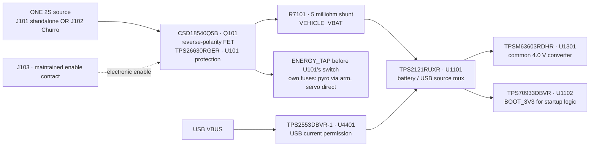
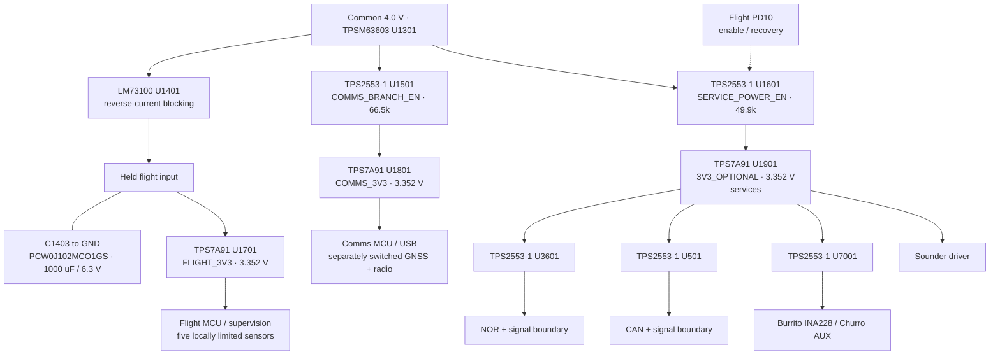

# Power — three regulated domains

**22 September · proposed capture baseline, amended by [D-6.1, D-6.3–D-6.5, D-6.8](../../decisions.md) on 6 October · CAD unchanged.**

Keep **TPSM63603 4 V → TPS7A91 ×3: flight, comms, services**. A comms-regulator
fault must not also remove logging/CAN. Give services their own flight-controlled
restart. This supersedes the two-LDO candidate.

## Justification and deeper detail

| Question | Follow through |
| --- | --- |
| Why three rather than one or two? | [Fault comparison and alternatives](justifications/power-domains.md#decision-and-reason) |
| Exactly what changes? | [Reference/net delta](justifications/power-domains.md#exact-capture-delta), [capture specification](schematic-capture-spec.md) |
| Voltage, limits and energy? | [Calculations and load allocations](justifications/power-domains.md#voltage-and-headroom), [reproducible checks](../calculations/component-proposal-checks.py) |
| Why these converter/regulator parts? | [Component research](../archive/architecture/implementation-reference/02-power.md#options-explored-and-why-this-one-survived) |

## Source entry — retain the existing path

USB powers logic only; no charging or output-energy path. J103's maintained
contact controls electronic source enable, not physical battery isolation.
After launch detect, flight PE5 (`FC_POWER_HOLD`) holds `BAT_SHDN_N` and, over
Samtec pin 8, Churro's `AV_SHDN_N` high, so a broken enable wire or plug can't
switch the computer off in flight. U101 and Churro U1001 auto-retry after an
over-current instead of latching off. Pyro and servo energy leave before U101's
switch through their own fuses, so an output fault can't pull down logic power.
Use the existing 2S boundary: 8.4 V maximum normal charge; nominal protection
thresholds ~6.63 V start / 6.20 V stop / 8.99 V overvoltage. Threshold tolerances
and sag determine actual operating limits; “2S” does not promise 6 V startup.

## Regulator and load connections — proposed

Solid arrows carry power; dashed arrows control enable. Common ground; capacitor
to ground, not in series. Retain all partial-power signal boundaries and DNPs.
U1501/U1601 stay **upstream of their respective LDOs**. No regulator is removed.
Human-facing “services” keeps the existing net identifier `3V3_OPTIONAL`.

## Why three rather than one or two

The third regulator separates a comms-LDO fault from NOR/CAN. That supports
[FF-01](../../interfaces/flight-fault-contract.md) and makes the extra regulator
worth retaining. Local limiters contain downstream shorts but cannot make two
loads on one regulator survive that regulator's output collapse independently.
All domains still share battery/mux/buck/ground/PCB; no independent flight
computer or quantitative reliability claim follows. Regulator pass-through
failure also needs overvoltage assessment; a current limiter is not an OVP.

## Exact delta and startup

- Keep U1501 → U1801 comms. R1504 = **66.5 kΩ 1%**.
- Keep U1601 → U1901 services. R1604 = **49.9 kΩ 1%**.
- U1601 EN (pin 3) and R1602 top move from FLIGHT_3V3 to **SERVICE_POWER_EN**, flight PD10 pad 57. R1602 remains 100 kΩ to GND; default off.
- R1701/R1801/R1901 = **31.9 kΩ 0.1%**, all lower resistors 10 kΩ 0.1% retained. All three rails nominal **3.352 V**.
- Retain `COMMS_BRANCH_EN = BAT_VALID ? FLIGHT_COMMS_EN : USB_PRESENT`. Remove U1203: the flight-core input (U1401) is enabled whenever 4V_PRE is up, from battery or USB (D-6.5).
- Retain C1403 candidate **PCW0J102MCO1GS**, 1000 µF/6.3 V; exact footprint/clearance during capture.

Flight starts without comms and enables services after essential startup.
NOR/CAN/AUX remain individually enabled and default off. Battery mode permits
comms branch cycling; USB-only holds comms on for enumeration, so use reset there.
An initial **100 ms service-off interval, one sequenced restart**, then unavailable
for that power session is the proposed recovery policy. The 100 ms is a bench
starting point, not a guaranteed reset: set the released interval from measured
discharge below peripheral reset thresholds and restart. Active-mission restart
must respect the peer-loss contract. Never reset flight
just to repair services. [Full restart consequences](justifications/power-domains.md#exact-capture-delta).

## Voltage margin, including reset release

| Calculated bound | Proposal |
| --- | --- |
| All LDO nominal / tolerance corners | 3.352 V / **3.310–3.394 V** |
| Conservative TPS3808G33 release upper bound | **3.194 V** |
| Static margin / remaining after 50 mV PCB/transient allocation | **116 / 66 mV** |
| Continuous flight / comms / services allocation | **200 / 300 / 200 mA** |
| Common 4 V power / ideal LDO dissipation | **2.8 W / 0.454 W** before quiescent/path corrections |

The switches drop voltage at LDO **inputs**. Check headroom; do not subtract
that drop again from a regulated output. Effective input/output capacitance must
remain ≥10 µF after derating. All selected rail consumers must tolerate the upper
corner and measured overshoot. Sensor rails now follow the raised flight setting.

Hold-up remains flight-only: 1000 µF from 4.0 V down to about 3.55 V at 200 mA
bridges about 2 ms; measure it. The flight MCU's backup domain gets its own
Schottky and 100 µF on VBAT so checkpoints and the RTC outlive a longer dip (D-6.4). It does not bridge TPS2553's 5–10 ms latch delay or guarantee
NOR flush. The common buck must sustain limited faults without resetting flight.
[Component sources and assumptions](justifications/power-domains.md#voltage-and-headroom).

## USB is a separate load mode

Remove U4402: R4403 60.4 kΩ 1% sets **387–491 mA** from attach (D-6.5). Drawing
more than 100 mA before enumeration breaks USB 2.0 rules; strict hosts may
need a powered hub. The 700 mA full 4 V
allocation needs ~**757 mA VBUS** at illustrative 4.35 V/85% before overhead;
it cannot run on the retained USB path.

| Mode | Required operating ceiling |
| --- | --- |
| USB attach | Flight core and comms at reduced clock; services, RF, GNSS, CAN and sounder off; must start inside 387 mA |
| Configured download | ≤300 mA VBUS; reduced-clock MCUs + NOR; RF/GNSS/CAN/sounder off; other measurements on demand |
| Battery-enabled operation | Full domain allocations, with sequenced GNSS startup and RF peaks |
| Reset/deconfiguration | Withdraw configured permission and shed loads |
| Suspend | Not supported; the board keeps drawing its attach current |

Measure inrush as well as steady load. No USB-PD or charging assumption. Battery
removal while USB remains must trigger restricted service behavior; seamless
full-flight operation from USB is not promised.

## Every local limiter and the aggregate

| Branch | Setting | Calculated limit | Recovery |
| --- | --- | --- | --- |
| NOR U3601 | R3604 100 kΩ | 232–306 mA | Flight branch enable |
| CAN U501 | R502 210 kΩ | 109–152 mA | Flight branch enable |
| AUX U7001 | R7004 210 kΩ | 109–152 mA | Flight branch enable |
| Comms U1501 | R1504 66.5 kΩ | 351–449 mA | Flight in battery mode |
| Services U1601 | R1604 49.9 kΩ | 470–588 mA | PD10, bounded restart |

NOR fault maximum + 135 mA remaining services ≈441 mA, below 470 mA aggregate
minimum. Simultaneous comms/service input limits + 200 mA flight ≈1.237 A;
that is a static source bound, not proven transient selectivity. Healthy mode
allocations and every local fault case are in the [load ledger](justifications/power-domains.md#loads-and-limiter-coordination).

## Endurance and schematic handoff

**Workhorse:** size the pack from measured first-PCBA loads and the vehicle's
pad and flight timeline (D-6.8). **Kármán overlay:** reference **2S 8 Ah**, with **≥30 Wh usable** at installed temperature/load/UVLO.
Eight hours at the conservative active allocation plus four hours at the proposed
recovery allocation require **29.69 Wh**, including assumed conversion losses and
0.10 W overhead. Actuator energy is additional. The 65% nameplate-to-usable
allowance is an assumption to validate, not a battery test.

This supplies a concrete source interface without making a pack purchase or
claiming a tested SKU. [Energy calculation](justifications/power-domains.md#usb-and-endurance-choices).
After acceptance, capture the explicit delta and verify native connectivity/ERC;
then measure first-PCBA startup, droop, fault recovery, noise, temperature and
mode energy. [Connectors](09-connectors-arming.md) owns source variants and the
arm connector.
