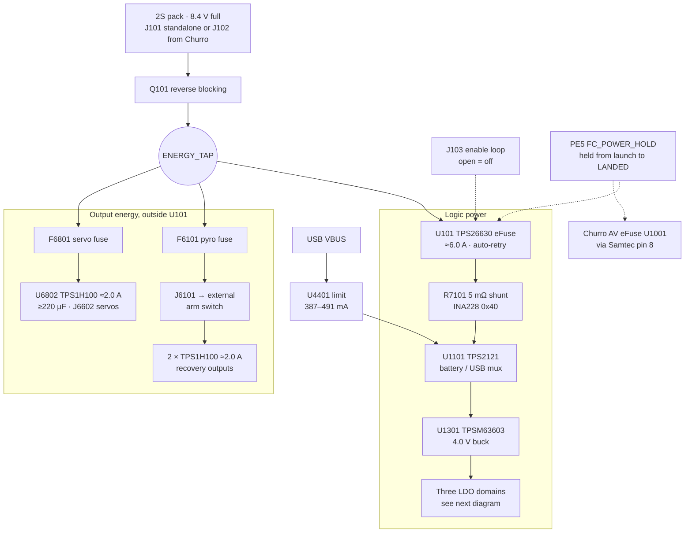
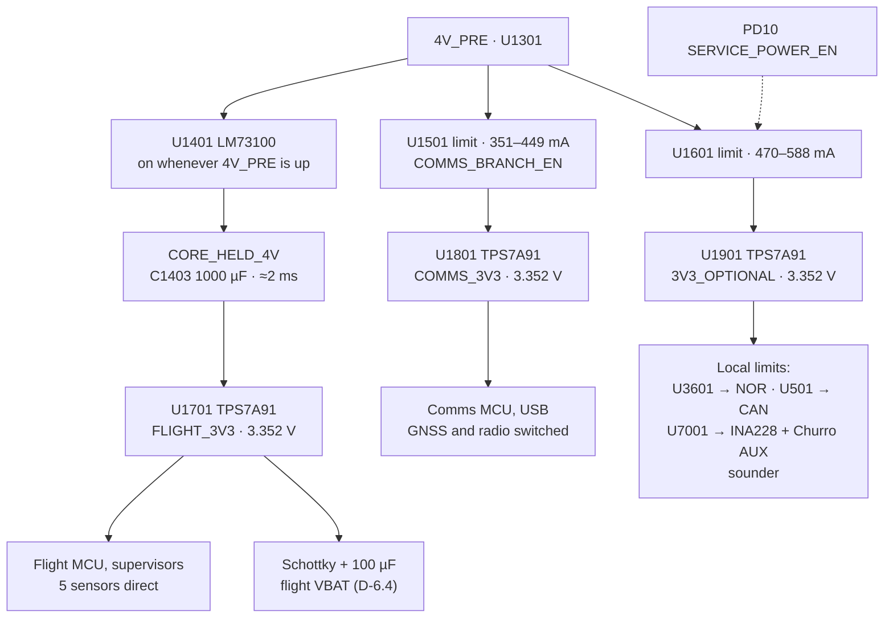

# 02 Power

One 2S pack feeds three things: the logic chain, the pyro outputs and the
servos. Logic goes through the Croí eFuse U101, a 4.0 V buck and three LDO
domains. Pyro and servo energy leave before U101 through their own fuses, so an
output fault can't pull down the flight computer ([D-6.1](../../decisions.md)).

## Battery to everything

Solid lines carry power; dashed lines are enables.

- **Thresholds (U101):** start 6.63 V, stop 6.20 V, over-voltage 8.99 V, all
  nominal. Tolerance and sag set the real range; 2S doesn't promise a 6 V start.
- **J103** is the FC battery enable. Open means off, but upstream circuits stay
  live and USB can still power logic. It is not a disarm.
- **Enable hold (D-6.3):** after launch detect, PE5 holds `BAT_SHDN_N` and,
  over Samtec pin 8, Churro's `AV_SHDN_N` high, so a broken enable wire or plug
  can't switch the computer off in flight. An RC on the hold carries it through
  one watchdog reset.
- **Auto-retry (D-6.3):** U101 and Churro U1001 restart after an over-current
  instead of latching off for the rest of the flight.
- **Energy tap (D-6.1):** shown after Q101. That holds only if TPS26630 keeps
  Q101 on through U101 faults and shutdown; otherwise the tap moves to the
  connector side with reverse-polarity protection per branch.
- **USB** powers logic only: no charging, no output energy.

## Regulated domains

Three domains, so a comms-regulator fault can't also take recording and CAN
([FF-01](../../interfaces/flight-fault-contract.md)), and services can restart
without rebooting flight. All three still share the battery, mux, buck, ground
and PCB; they are not independent computers. A current limiter is not
over-voltage protection: a shorted regulator pass element needs its own check.
"Services" keeps the net name `3V3_OPTIONAL`.

| Case | Survives | Lost |
| --- | --- | --- |
| Comms MCU, branch or regulator fault | Flight, sensors, NOR, CAN, monitoring | GNSS, radio, USB |
| Services regulator or limiter trips | Flight, sensors, comms | NOR, CAN, monitoring, sounder until PD10 restarts it |
| Flight MCU reset | Comms; committed records | Fresh flight state; flight-owned enables return to off |
| Supply dip under ≈2 ms | Flight computation | NOR, CAN, GNSS continuity |
| Source, buck or ground failure | Only independently powered systems | Everything on the board |

## Capture changes

| Item | Change |
| --- | --- |
| Comms limiter | U1501 before U1801; R1504 = 66.5 kΩ 1% |
| Services limiter | U1601 before U1901; R1604 = 49.9 kΩ 1%; EN (pin 3) and R1602's top move to `SERVICE_POWER_EN` (PD10, pad 57); R1602 stays 100 kΩ to GND, off by default |
| LDO set points | R1701/R1801/R1901 = 31.9 kΩ 0.1% over 10 kΩ 0.1%: 3.352 V on all three |
| Core enable | Remove U1203; U1401 EN/UVLO from a divider on 4V_PRE (D-6.5) |
| USB limit | Remove U4402; R4403 = 60.4 kΩ 1% from attach (D-6.5) |
| Comms branch logic | Keep `COMMS_BRANCH_EN = BAT_VALID ? FLIGHT_COMMS_EN : USB_PRESENT` |
| Hold-up | C1403 = Nichicon PCW0J102MCO1GS, 1000 µF / 6.3 V |
| U101, U1001 | MODE to GND (auto-retry) |

Full list: [capture specification](schematic-capture-spec.md#burrito-changes).

## Startup and service restart

Flight starts without comms and enables services after essential startup. NOR,
CAN and AUX start off and are enabled one by one. On battery, flight can cycle
the comms branch; on USB alone comms stays on for enumeration, so use reset.

Service recovery: switch services off for 100 ms, restart once, then leave them
off for that power session. The 100 ms is a bench starting point; set it from
measured discharge below the peripherals' reset thresholds. An in-flight restart
must respect the peer-loss contract. Never reset flight to repair services.

## Margins

| Quantity | Value (calculated) |
| --- | --- |
| LDO output, nominal / tolerance | 3.352 V / 3.310–3.394 V |
| TPS3808G33 release, upper bound | 3.194 V |
| Static margin / after 50 mV layout allowance | 116 mV / 66 mV |
| Allocation flight / comms / services | 200 / 300 / 200 mA |
| 4 V power / ideal LDO dissipation | 2.8 W / 0.454 W |
| Hold-up, 1000 µF from 4.0 to ≈3.55 V at 200 mA | ≈2 ms |

Switch drops happen at the LDO inputs; check headroom there. Keep ≥10 µF
effective capacitance at each LDO after derating. Every consumer must tolerate
3.394 V plus measured overshoot. Hold-up does not bridge the 5–10 ms TPS2553
latch delay or a final NOR flush. The buck must ride through a contained
branch fault without resetting flight.

## Local limits

| Branch | Setting | Limit (calculated) | Restart |
| --- | --- | --- | --- |
| NOR U3601 | R3604 100 kΩ | 232–306 mA | Flight enable |
| CAN U501 | R502 210 kΩ | 109–152 mA | Flight enable |
| AUX U7001 | R7004 210 kΩ | 109–152 mA | Flight enable |
| Comms U1501 | R1504 66.5 kΩ | 351–449 mA | Flight, on battery |
| Services U1601 | R1604 49.9 kΩ | 470–588 mA | PD10, once |

A NOR fault at 306 mA plus 135 mA of other services is ≈441 mA, under the
470 mA services minimum. Comms and services limits plus 200 mA flight make
≈1.237 A: a static bound, not proven transient selectivity.
[Load ledger](justifications/power-domains.md#loads-and-limiter-coordination).

## USB modes

| Mode | Ceiling |
| --- | --- |
| USB attach | Flight core and comms at reduced clock; services, RF, GNSS, CAN, sounder off; must start inside 387 mA |
| Configured download | ≤300 mA; reduced-clock MCUs and NOR; RF, GNSS, CAN, sounder off |
| Battery | Full allocations; GNSS start and RF peaks sequenced |
| Reset or deconfigure | Shed loads |
| Suspend | Not supported |

Drawing over 100 mA before enumeration breaks USB 2.0 rules; strict hosts may
need a powered hub. The full 700 mA allocation would need ≈757 mA of VBUS, so
USB never runs the whole board. Measure inrush. Pulling the battery with USB
attached drops to service behaviour.

## Battery sizing

Workhorse: size the pack from measured first-PCBA loads and the vehicle's pad
and flight timeline (D-6.8). Kármán overlay: 2S 8 Ah reference, ≥30 Wh usable
at installed temperature, load and UVLO; 8 h active plus 4 h recovery needs
29.69 Wh with assumed losses and 0.10 W overhead. The 65% usable-to-nameplate
figure is an assumption. Actuator energy is extra.
[Energy calculation](justifications/power-domains.md#usb-and-endurance).

First PCBA: measure startup, droop, fault recovery, noise, temperature and
energy per mode.
