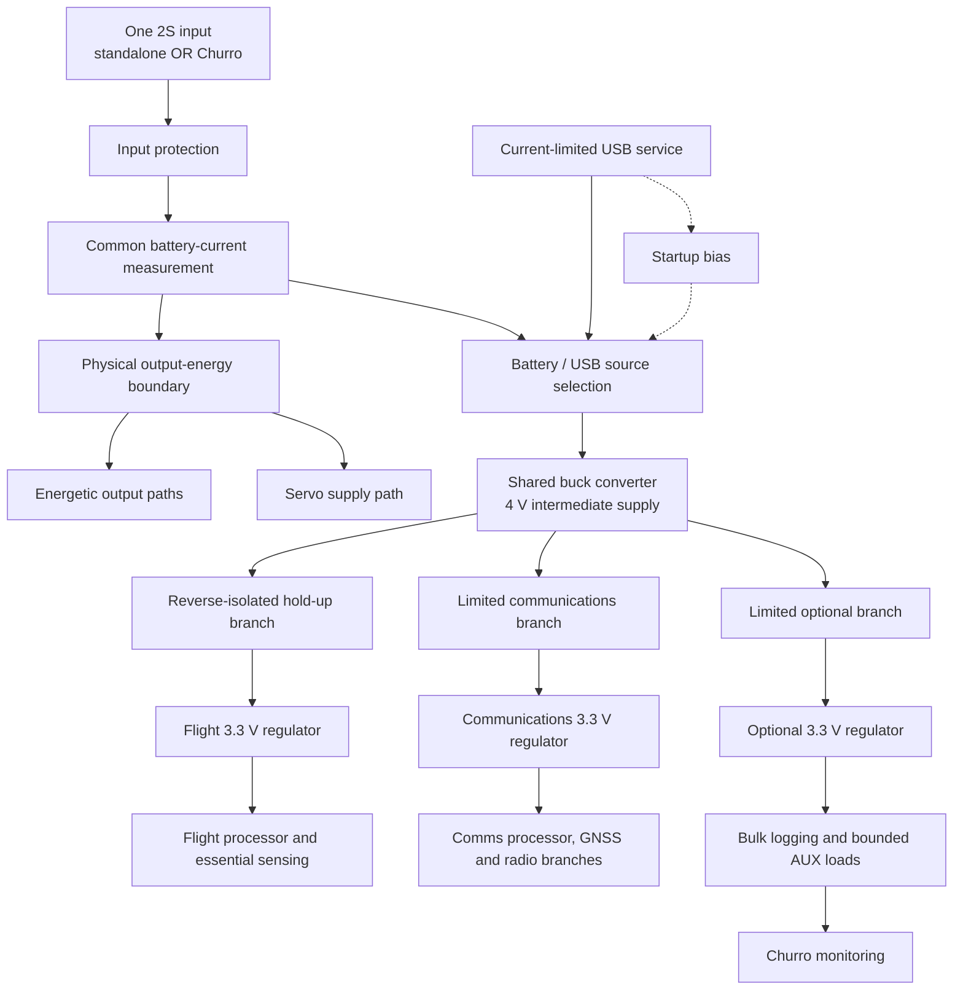

# 2. Power from the source to every load

**Retained:** standalone battery operation, USB-only servicing without output
energy, and separation of essential from nonessential faults. **Open:** whether
every present rail earns its place, hold-up sizing and actual load budgets.

## Follow the energy

Burrito accepts either its own battery or Churro's protected battery feed, not
both together. USB is an alternative source for servicing the electronics. It
must neither charge the battery nor power the energetic or servo loads.

Solid arrows show functional energy flow. Dashed arrows show the USB startup
dependency being broken; this is not a complete bias schematic. The output
grouping is an architectural boundary, not a finalized common arm switch.
Churro monitoring is a load; it must not be required for Churro to start
supplying power.

This shows the **preserved three-rail design**, not approval to keep every
part. Actual signal back-power and return paths also need inspection; they
cannot all be inferred from this functional picture.

## What each mechanism is doing

A **buck converter** efficiently reduces the battery voltage. A **linear
post-regulator**, or LDO, then makes the selected quiet 3.3 V supply. Separate
branches let us try to contain a failed nonessential load rather than letting
it pull the entire computer down.

A **current limiter** bounds current into a fault. **Reverse blocking** prevents
energy flowing back toward a collapsed source. A **hold-up capacitor** stores
a small amount of energy locally. None does all three jobs.

The common converter and essential regulator remain common failure points.
A capacitor cannot fix a permanent short. Turning a sensor's supply off is
also insufficient if a driven signal pin powers it through another path.

## Why does the optional rail exist?

The earlier explanation made this look like an unexplained extra regulator.
Its intended loads include bulk logging and the bounded auxiliary/monitoring
path. A short there should not remove essential flight power.

Three alternatives deserve a real comparison:

| Choice | Benefit | Cost |
| --- | --- | --- |
| Retain the separate rail | Explicit nonessential load boundary | Regulator, limiting, isolation, area and losses |
| Move its loads onto an existing rail with local protection | Could remove a regulator | Must recover equivalent fault containment and startup behaviour |
| Remove an unnecessary load | Removes its complete support burden | Only valid if the function is genuinely unnecessary |

**Recommendation:** trace the actual loads and fault paths before removing the
rail. “Optional” describes mission priority, not proof that nothing uses it.
Keep the distinction between the supply domain and each individually switched
device branch.

## The startup question we got stuck on

On USB alone, firmware must run to negotiate/configure service power. But
firmware cannot run until the power path starts. A small startup bias supply
lets the source-control circuitry begin without waiting for that firmware.
That is the relevant meaning here of “bootstrap bias.”

It is different from the bootstrap capacitor used by some high-side MOSFET
drivers. It is also different from the battery-powered bias for the external
enable switch. Naming those jobs explicitly is more useful than a generic
definition of bootstrap.

## What the numbers mean

A 2S lithium-ion pack is approximately 7.4 V nominal and 8.4 V fully charged;
actual acceptable operating limits follow the pack and protection design.

At first order, a linear regulator's efficiency is output voltage divided by
input voltage. Going from 4 V to 3.3 V gives 82.5% before quiescent losses.
Overall battery efficiency also includes the buck and protection paths.
Dropping the intermediate voltage saves heat but reduces tolerance for dips,
switch losses and regulator headroom.

The existing estimate delivers about 1.98 W to the three 3.3 V domains. Its
assumed conversion losses put converter input around 2.67–2.82 W before other
losses. This is not a measured board current or guaranteed maximum.

The separate endurance example totals 19 Wh across operating, recovery and
event modes. A continuous 3 W load does not fit the same eight-hour allocation.
Peak-current limits, average demand and usable battery energy are different
quantities.

The proposed large hold-up capacitor is still an allowance. Its effective
capacitance, voltage headroom, resistance and actual load determine whether it
buys a useful interruption interval. Do not describe it as a power-loss backup.

## Measure where it remains useful

Keep the common battery-current measurement on Burrito so standalone flights
have it too. Churro can measure its separate propulsion branch. Duplicating
the same avionics measurement on both boards adds little.

The measurement has costs: voltage drop, dissipation and another series
element. It excludes USB, charging and upstream bias current. A current pulse
is evidence of an electrical response, not proof that a servo moved or an
initiator worked.

## Next pass through this chapter

Follow battery and USB startup through to each load, then follow a shorted
logger or communications branch. Is essential flight power actually retained?
Review minimum-source startup, transients, source backfeed, branch selectivity
and useful hold-up with measured loads. Keep charging and arming separate.

[Next: energetic outputs](03-energetic-outputs.md) · [Detailed power calculations and circuits](implementation-reference/02-power.md) · [Power contract](../../interfaces/power-contract.md)
