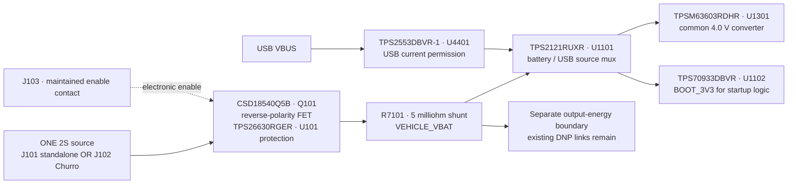
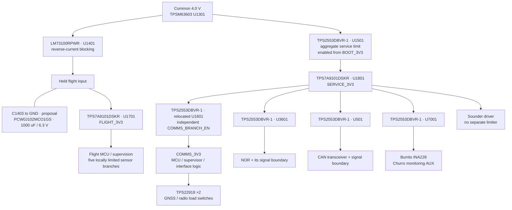

# Power — two regulated domains

**19 September · recommended proposal · CAD still has three LDO rails.**

Keep the shared **TPSM63603 4 V buck**. Use **TPS7A91 ×2** for flight and
service. Put the independently enabled comms branch **after** the service LDO.
Comms power cycling then leaves recording/CAN/AUX enabled.

## Justification and deeper detail

| Question | Follow through | Source status |
| --- | --- | --- |
| Why the buck, LDOs and hold-up? | [Component alternatives and conversion rationale](implementation-reference/02-power.md#options-explored-and-why-this-one-survived) | Historical three-rail topology; current two-rail choice is justified below |
| How are the numbers obtained? | [Reproducible limits, voltage-drop and hold-up checks](../calculations/component-proposal-checks.py) | Current proposal arithmetic |
| How does the enable plug behave? | [Installed source-enable contract](../../interfaces/power-contract.md#8-september-source-enable-implementation) | Preserved electrical definition |

## Source entry — retain the existing path

USB powers logic only; no charging or output-energy path. J103's maintained
contact controls electronic source enable, not physical battery isolation.
Use the existing 2S boundary: 8.4 V maximum normal charge; nominal protection
thresholds ~6.63 V start / 6.20 V stop / 8.99 V overvoltage. Threshold tolerances
and sag determine actual operating limits; “2S” does not promise 6 V startup.

## Regulator and load connections — proposed

Capacitor is connected to ground at the held node, not in series. Common ground
and signal-side protection remain; these arrows show supply paths only.
Unpopulated diagnostic feeds remain DNP, outside operating load budgets.

## Why two rather than one or three

**Recommend two as a fault-containment choice, not a demonstrated reliability
improvement.** The retained requirement is flight execution through a failed
comms branch. Separate current limiting does most of the work for a downstream
short; a second LDO additionally separates the two regulated output nodes.

| Concrete event | One LDO + local limits | Two LDOs + local limits | Third LDO adds |
| --- | --- | --- | --- |
| Radio/GNSS load short | Comms limiter can contain it if selectivity/droop pass | Same mechanism; second LDO alone does not clear it | Little for this fault |
| Service LDO output short to ground | Shared 3.3 V collapses | U1501 limits the service input demand; flight survival depends on common-buck droop | Logger/CAN can remain on a separate service rail |
| Intentional comms power cycle | Possible with downstream switch | U1601 cycles comms while NOR/CAN/AUX remain supplied | Not needed for this operation |
| Flight LDO or common buck/source fails | Flight lost | Flight lost | No independent flight supply |
| Service LDO passes excessive input voltage | Shared loads exposed | Service loads exposed; current limiting is not overvoltage isolation | Smaller exposed load group, subject to exact fault path |

The two-rail proposal accepts loss of **comms + recording + CAN + monitoring**
from a shared service-LDO failure. These services matter to the mission; calling
them “optional” hid this consequence. Essential flight execution has a separate
rail, but some missions also require surviving CAN control or telemetry.

| Selection | Actual trade |
| --- | --- |
| One | Remove another LDO/support set; accept a shared regulated-output failure. Still needs local load switches and USB sequencing |
| **Two** | Retain separate flight supply; remove U1901/support; relocate U1601. No reduction in the ~0.42 W ideal LDO conversion loss |
| Three | Retain separate comms and recorder/CAN regulation; more placement, startup and verification work |

No failure-rate evidence establishes which gives the highest overall reliability.
The reason for recommending two is preserving the specified flight/service fault
boundary with fewer regulators than the draft. **Choose one instead if the team
accepts the common regulated-output loss.** Choose three if recorder/CAN survival
through a comms-regulator fault is a requirement. Those are the actual decisions.

All options share source, mux, buck, ground and PCB. Local limiters failing short,
common return damage and regulator overvoltage need their own fault assessment.

## Exact delta and startup

- Reuse U1501 before U1801 as aggregate service limiter; EN from BOOT_3V3.
- Reuse U1601 **after U1801** as comms limiter, controlled by existing U1202.
- Remove U1901 and its LDO support network. Do not join old regulator outputs.
- Keep U1202's existing mux: `COMMS_BRANCH_EN = BAT_VALID ? FLIGHT_COMMS_EN : USB_PRESENT`.
- Keep `CORE_INPUT_EN = BAT_VALID OR USB_CONFIG_OK` and the existing comms reset boundary.
- With a valid battery, flight controls comms power even with USB attached. USB-only holds comms on for service; use its reset path instead of claiming flight-controlled power cycling in that mode.
- NOR/CAN/AUX enables remain flight-owned and default off. GNSS/radio stay off before USB current permission. Sounder stays silent.

| Source state | Bootstrap / service | Flight / other branches |
| --- | --- | --- |
| Valid battery | Starts autonomously; flight can then enable comms | BAT_VALID starts flight independently of comms |
| USB before configuration | Comms starts for enumeration within the permitted current budget | Flight/NOR/CAN/AUX/GNSS/radio off |
| USB configured | Existing permitted current setting applies | Flight may start; explicitly sequence only service loads required |
| Battery + USB | Existing mux priority/backfeed behavior retained | Comms cannot withdraw flight power while BAT_VALID is true |

Charging service-LDO/comms capacitance still consumes USB startup current.
The 100 mA preconfiguration / 500 mA configured assumptions in the existing
service design require measured compliance; no USB-PD source is assumed.

## Initial electrical budget

| Item | Proposed value / reason |
| --- | --- |
| Existing load allocations | Flight 200 mA; comms 300 mA; other service 100 mA at 3.3 V |
| Aggregate service U1501 | 32.4 kΩ, 1% ILIM: TI Table 2 gives 729.1–882.1 mA |
| Comms U1601 | 66.5 kΩ, 1% ILIM: TI Table 2 gives 351.2–448.7 mA |
| Static comms-short allocation | 448.7 mA + 100 mA other = 548.7 mA, below aggregate minimum before quiescent/inrush allowances |
| Service LDO | 1 A part; 400 mA normal allocation, ~0.28 W at 4→3.3 V before path-drop effects |
| Both LDOs | ~0.42 W combined at 600 mA; removing a rail does not remove this conversion loss |
| Hold-up illustration | 800 µF effective × 0.25 V / 204 mA = 0.98 ms; flight only |

These are component-derived starting values, not measured peak load or trip
selectivity. TPS2553-1 limits current before its 5–10 ms overcurrent latch-off
delay; flight hold-up alone cannot bridge that delay. The common buck must
remain valid under the limited fault. Check dynamic droop and each other local
branch's maximum limit plus simultaneous healthy loads against the aggregate.
At the aggregate maximum, a service short can demand ~3.53 W from the 4 V node
before latch-off. Buck rating alone does not establish its transient response.
An aggregate service latch-off loses all services until source/enable cycling.

The relocated comms switch drops up to ~61 mV at 448.7 mA using TI's 135 mΩ
DBV on-resistance bound. With a 1%-low 3.3 V LDO this leaves ~3.21 V before
trace/transient allowances, above the H563 USB minimum of 3.0 V. This is a DC
budget, not a transient pass. The LDO's ideal conversion efficiency is 82.5%.

TPS7A91 requires at least 10 µF input/output per its datasheet; retain effective
capacitance after bias/temperature derating and verify the actual selected parts.
Its 1 A rating is not an allocated load.

**C1403 proposal: Nichicon PCW0J102MCO1GS**, 1000 µF / 6.3 V, 8 mm diameter ×
10 mm body length, 14 mΩ maximum ESR at 20 °C / 100 kHz. A −20% capacitance
allowance gives 800 µF before other environmental effects; 204 mA produces an
illustrative 2.9 mV ESR step. Allow its 1.89 mA rated maximum leakage in the
budget. This replaces an unspecified volume allowance with a concrete candidate.
Check the manufacturer's land pattern, retained 10 mm-class clearance,
mechanical support and 4 V overshoot; no installed fit or vibration rating is
claimed. No 10 ms outage claim is made.
[Nichicon rating table](https://www.nichicon.co.jp/_assets/images/products/catalog/corporate/digital/sh_pcw_pca.pdf).

**Next check:** minimum-source and USB-only startup, comms cycling with continuous
NOR/CAN operation, controlled branch faults, and measured flight-rail droop.
Reject the simplification if those boundaries cannot be met economically.

Sources: [preserved connected netlist](../../hardware/croi2/output/full-netlist.xml),
[TI SN74LVC1G97 truth table](https://www.ti.com/lit/ds/symlink/sn74lvc1g97.pdf),
[TI TPS2553 datasheet](https://www.ti.com/lit/ds/symlink/tps2553.pdf) Table 2,
[TI TPS7A91 datasheet](https://www.ti.com/lit/ds/symlink/tps7a91.pdf),
[existing power rationale](implementation-reference/02-power.md),
[controlled power contract](../../interfaces/power-contract.md).

See [connectors and physical arming](09-connectors-arming.md) for the FC battery-enable plug, separate unresolved output-arm assembly and complete connector inventory.
