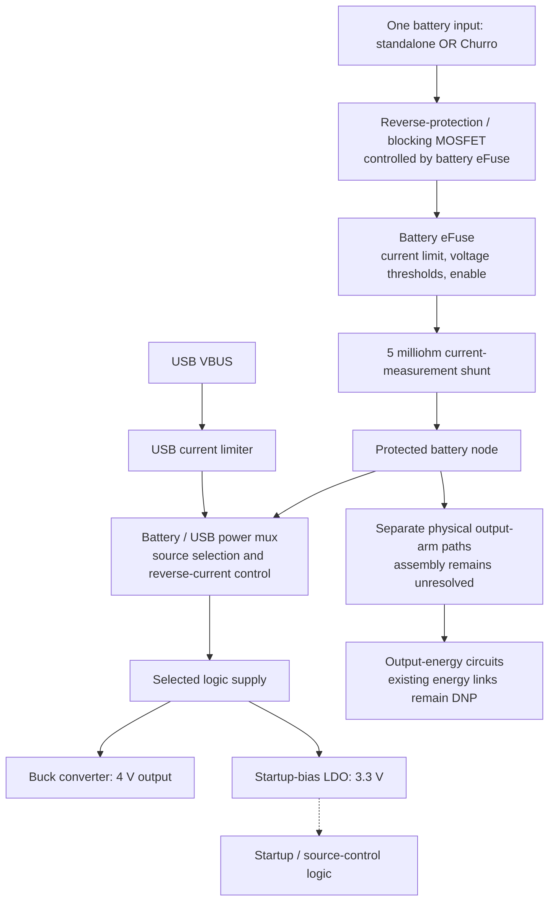
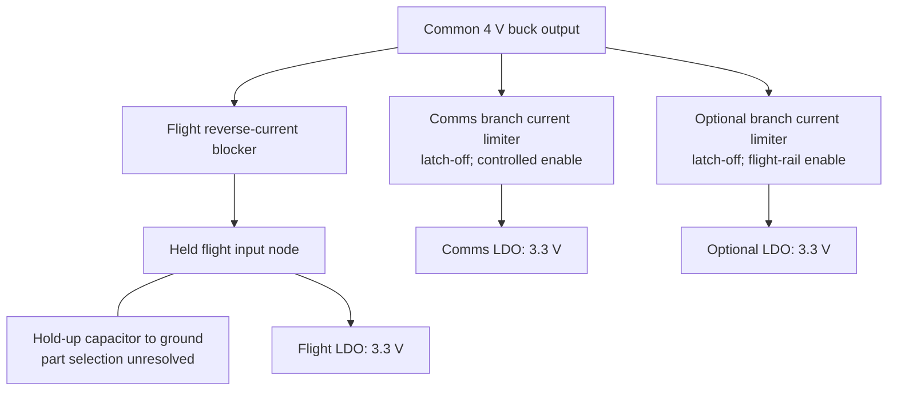
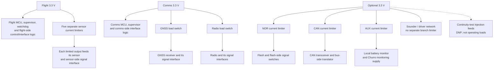

# 2. Power from the source to every load

**Next-review answers:** [18 September investigation](2026-09-18-review-investigations.md#2-power-alternatives-and-input-boundary) supplies recommendations and supporting comparisons for this chapter.

## 13 September review: compare rail allocations

The rail choice remains open. A concrete two-rail candidate puts NOR/CAN/AUX
on individually protected branches of a continuously available non-flight rail,
and moves communications recovery downstream. Cycling that whole rail would
otherwise also remove logging and vehicle communication. Compare the necessary
switches, fault selectivity, startup behavior, losses and area against three
regulators; no measured saving is established. “Optional” does not mean
mission-irrelevant when CAN serves remote actuators.

Specify the accepted minimum and maximum core input, not just 7.4 V nominal.
Narrow 2S input with Churro adapting other packs is a candidate, not a new
voltage contract. Reverse-polarity protection concerns a backwards source;
reverse-current blocking concerns backfeed. Neither is physical arming.
The ordered source, regulator and load diagrams below now expose those
functions separately; their electrical performance still needs verification.

USB startup bias enables startup; it does not itself select negotiated current.
Usable hold-up voltage fall is starting capacitor voltage minus the minimum LDO
input needed for valid flight power, including dropout and path losses.

**Retained:** standalone battery operation, USB-only servicing without output
energy, and separation of essential from nonessential faults. **Open:** whether
every present rail earns its place, hold-up sizing and actual load budgets.

## Follow the energy

Burrito accepts either its own battery or Churro's protected battery feed, not
both together. USB is an alternative source for servicing the electronics. It
must neither charge the battery nor power the energetic or servo loads.

The paths below replace the abstract branch boxes, following the preserved
netlist. Read the source path first, then the three regulator paths, then their
loads. A box is an actual series function; a capacitor is a side connection,
not something the supply current passes through in series. These are supply
paths, not every feedback resistor or signal connection.

### Source entry and selection

USB has no supply arrow to the output-arm paths. Startup bias is derived from
the **selected logic supply**, not a second USB-only source. It lets the control
logic start before firmware is available. The external ordinary power-enable
contact controls battery electronic shutdown; it is not the physical arm path.
Reverse polarity means a backwards battery; reverse current means energy
flowing back toward an upstream source. Neither means optical isolation.

### From the common 4 V supply to each 3.3 V rail

The flight input has a dedicated reverse blocker. The other two branches have
explicit current limiters before their LDOs. Those functions must not disappear
inside a box named “limited branch.” There is no separate pre-LDO branch limiter
shown on flight. Regulator internal protection is not a claim of selective
isolation between these branches.

### What each rail actually supplies

GNSS/radio use load switches; they are not labelled as individual current
limiters. CAN power here means powering the transceiver electronics, not sending
vehicle power along CAN data wires. AUX supplies monitoring circuitry; Churro
supplies main power in the opposite direction. Sensor/data interfaces are shown
because turning off a supply alone does not prove that signals cannot back-power
it. Exact signal paths remain in the schematic.

**Trace evidence:** [preserved netlist](../../hardware/croi2/output/full-netlist.xml):
Q101/U101 → R7101 → U1101; USB U4401 → U1101; U1101 → U1301 and U1102;
U1401/C1403/U1701 flight path; U1501/U1801 comms path; U1601/U1901 optional
path. Downstream: U3101–U3501 sensor limiters, U4502/U4602 load switches,
U3601 NOR, U501 CAN, U7001 AUX. Zero-ohm links, local decoupling and feedback
parts are omitted from the drawings, not claimed absent. Physical arm assembly,
continuity DNPs and fault-selectivity verification remain unresolved.

## What each mechanism is doing

A **buck converter** efficiently reduces the battery voltage. A **linear
post-regulator**, or LDO, then makes the selected quiet 3.3 V supply. Separate
branches let us try to contain a failed nonessential load rather than letting
it pull the entire computer down.

A **current limiter** bounds current into a fault. **Reverse blocking** prevents
energy flowing back toward a collapsed source. A **hold-up capacitor** stores
a small amount of energy locally. None does all three jobs.

The common converter and essential regulator remain common failure points.
A capacitor cannot fix a permanent short. Turning a sensor's supply off is
also insufficient if a driven signal pin powers it through another path.

## Why does the optional rail exist?

The earlier explanation made this look like an unexplained extra regulator.
The schematic audit found more than logging and AUX:

| Actual load | Local boundary | Consequence if the optional rail disappears |
| --- | --- | --- |
| NOR and its interface switches | Separate switched/current-limited branch | Bulk recording stops |
| CAN transceiver and external-side translator | Separate switched/current-limited branch | Engine coordination and any future actuator messages stop |
| Local battery monitor and Churro monitoring return | Shared switched/current-limited AUX branch | Current/auxiliary evidence disappears, including standalone current monitoring |
| Piezo sounder and its discharge resistor | Direct rail connection through the sounder driver | Audible indication disappears |
| Three proposed continuity-test feeds | Unpopulated limiting paths; not operating loads | No continuity-test source; these remain unapproved and DNP |

The last two are not behind the three individual branch switches. A short on
the shared rail can remove every function in this table. Flight is intended to
continue, but that is degraded operation: local logging and engine communication
can disappear together. Physical fault containment still needs testing.

Three alternatives deserve a real comparison:

| Choice | Benefit | Cost |
| --- | --- | --- |
| Retain the separate rail | Explicit nonessential load boundary | Regulator, limiting, isolation, area and losses |
| Move its loads onto an existing rail with local protection | Could remove a regulator | Must recover equivalent fault containment and startup behaviour |
| Remove an unnecessary load | Removes its complete support burden | Only valid if the function is genuinely unnecessary |

**11 September recommendation, challenged on 13 September:** retain the optional
rail for comparison in the next review. Moving its
loads to held flight power weakens the central fault boundary. Moving them to
comms power makes logging and CAN depend on a rail which flight may deliberately
switch off to recover communications. Keeping equivalent independent control
and protection on a merged supply could work, but saves less than simply deleting
the regulator suggests. The downside of retaining it is area, components and a
shared failure point for the loads above; no measured efficiency saving supports
removing it yet.

The 100 mA normal-use allocation and approximately 0.5 A upstream limit are
different budgets. Three branch limits cannot simply be summed and assumed
selective. Trace a short through the branch, optional limiter and common buck;
flight must remain valid until the fault clears or the defined reset occurs.

## The startup question we got stuck on

On USB alone, firmware must run to negotiate/configure service power. But
firmware cannot run until the power path starts. A small startup bias supply
lets the source-control circuitry begin without waiting for that firmware.
That is the relevant meaning here of “bootstrap bias.”

It is different from the bootstrap capacitor used by some high-side MOSFET
drivers. It is also different from the battery-powered bias for the external
enable switch. Naming those jobs explicitly is more useful than a generic
definition of bootstrap.

## What the numbers mean

A 2S lithium-ion pack is approximately 7.4 V nominal and 8.4 V fully charged;
actual acceptable operating limits follow the pack and protection design.

At first order, a linear regulator's efficiency is output voltage divided by
input voltage. Going from 4 V to 3.3 V gives 82.5% before quiescent losses.
Overall battery efficiency also includes the buck and protection paths.
Dropping the intermediate voltage saves heat but reduces tolerance for dips,
switch losses and regulator headroom.

The existing estimate delivers about 1.98 W to the three 3.3 V domains. Its
assumed conversion losses put converter input around 2.67–2.82 W before other
losses. This is not a measured board current or guaranteed maximum.

The separate endurance example totals 19 Wh across operating, recovery and
event modes. A continuous 3 W load does not fit the same eight-hour allocation.
Peak-current limits, average demand and usable battery energy are different
quantities.

### What the hold-up capacitor actually buys

For a capacitor feeding an LDO, a useful first-order calculation is
`time = effective capacitance × usable voltage fall / input current`.
With the existing 800 µF effective-capacitance and 204 mA load assumptions:

| Usable voltage fall, after headroom and losses | Calculated interval |
| --- | --- |
| 0.10 V | 0.39 ms |
| 0.25 V | 0.98 ms |
| 0.50 V | 1.96 ms |

These are sensitivity cases, not verified voltage margins. A 10 ms interval
at 0.25 V would require about **8,160 µF effective**, before further allowance.
The present capacitor is a brief-dip provision, not protection from a loose
battery connector. Exact capacitance, ESR, leakage, regulator dropout, reset
threshold and installed load remain to be established.

**Crucially, the capacitor holds up flight power, not NOR or CAN.** The processor
remaining alive does not guarantee a last log write or a final bus message.
Use continuous committed recording and explicit reset/gap evidence; do not make
an emergency flush depend on this capacitor.

[Calculation and traced circuit evidence](../power-recording-can-audit-2026-09-11.md).

## Measure where it remains useful

Keep the common battery-current measurement on Burrito so standalone flights
have it too. Churro can measure its separate propulsion branch. Duplicating
the same avionics measurement on both boards adds little.

The measurement has costs: voltage drop, dissipation and another series
element. It excludes USB, charging and upstream bias current. A current pulse
is evidence of an electrical response, not proof that a servo moved or an
initiator worked.

## Next pass through this chapter

Follow battery and USB startup through to each load, then follow a shorted
logger or communications branch. Is essential flight power actually retained?
Review minimum-source startup, transients, source backfeed, branch selectivity
and useful hold-up with measured loads. Keep charging and arming separate.

[Next: energetic outputs](03-energetic-outputs.md) · [Detailed power calculations and circuits](implementation-reference/02-power.md) · [Power contract](../../interfaces/power-contract.md)
