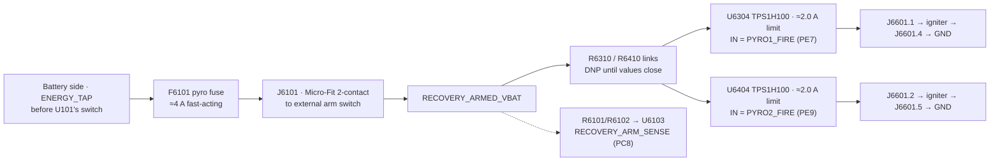

# Recovery and staging outputs

**6 October · decided topology ([D-6.1, D-6.2](../../decisions.md)). Values wait for the igniter.**

Two recovery channels, each a current-limited high-side switch fed through a
physical arm switch. The igniter return goes to ground. Staging stays
unpopulated until a multistage flight is scheduled.

Logic power never feeds these outputs. A fault on an output can blow its fuse
or trip its switch; it cannot pull down U101 or the flight rail.

## What each part does

| Part | Job | Failure it covers |
| --- | --- | --- |
| External arm switch via J6101 | Physically disconnects output energy | Software, switch or wiring fault on the pad; the one barrier that protects people |
| F6101 | Clears a shorted switch or harness | TPS1H100 failed short; short to structure |
| TPS1H100, R6314/R6414 = 1.24 kΩ | Fires one channel; limits it to ≈2.0 A (1.233 V × 2000 / 1240 Ω); thermal shutdown | Shorted igniter after firing; harness short during a pulse |
| U6103 arm sense | Reports energy present after the arm switch | Firmware sees disarmed vs armed, not a guess |
| 06c current sense | Per-channel current to ADC | Evidence that current flowed; not proof the charge fired |
| 06e/06f continuity | Small sense current through the igniter | Open igniter or harness before flight |

## Removed, and why

| Removed | Reason |
| --- | --- |
| LTC6993 one-shots and timing parts | Only shorten a firing already under way; the switch limit and thermal shutdown already bound a stuck channel |
| Low-side CSD17318 per channel | A second electronic barrier adds little behind a physical arm; on the recovery side it adds a way not to fire |
| Recovery and staging permit gates (13 × SN74LVC1G97) | The arm switch removes energy; gating the switch input as well protects nothing more |
| Anav's shared low-side switch | Considered. One open part would stop every deployment |

## Firmware rules

- The flight MCU alone commands outputs. Radio, USB and CAN cannot.
- Fire one channel at a time. With Churro feeding the board, its ≈6.0 A AV
  eFuse also carries logic (≈0.6 A) and servos (2.0 A limit).
- Bound each firing pulse in the per-flight configuration.
- After an in-flight reset: staging stays inhibited; recovery resumes only
  through the phase-specific path in the [recovery logic](10-recovery-logic.md).
- Report arm sense, continuity and current as evidence, never as proof of deployment.

## Staging

Channel 3 (06pyro3), the staging latch U6001, its divider R6103/R6104 and link
R6510 stay DNP. `STAGING_ARMED_VBAT` has no source. Re-open this section when a
multistage flight is scheduled; the reset inhibit in the
[flight fault contract](../../interfaces/flight-fault-contract.md) then applies.

## Still open

1. Igniter: all-fire current well under 2.0 A at minimum battery and harness
   resistance; no-fire current sets the continuity values.
2. Fuse and arm-switch parts. The switch must be maintained, rated above the
   fuse at 8.4 V DC and operable from outside the airframe.
3. Energy-tap point: confirm TPS26630 keeps Q101 on through U101 faults and
   SHDN; otherwise tap the connector side with reverse-polarity protection.

## Bench tests, inert loads only

- Arm open: no voltage at J6601 with the board powered and firmware commanding fire.
- Fire into a resistor at minimum battery: current reaches the igniter all-fire with margin.
- Short an output during a timed pulse: FLIGHT_3V3 and U101 stay up; the switch limits.
- Measure continuity current against the igniter's no-fire figure.

[Capture delta](schematic-capture-spec.md#burrito-capture-delta) ·
[Connectors and arming](09-connectors-arming.md) ·
[Earlier circuit record](../archive/architecture/implementation-reference/03-energetic-outputs.md)
