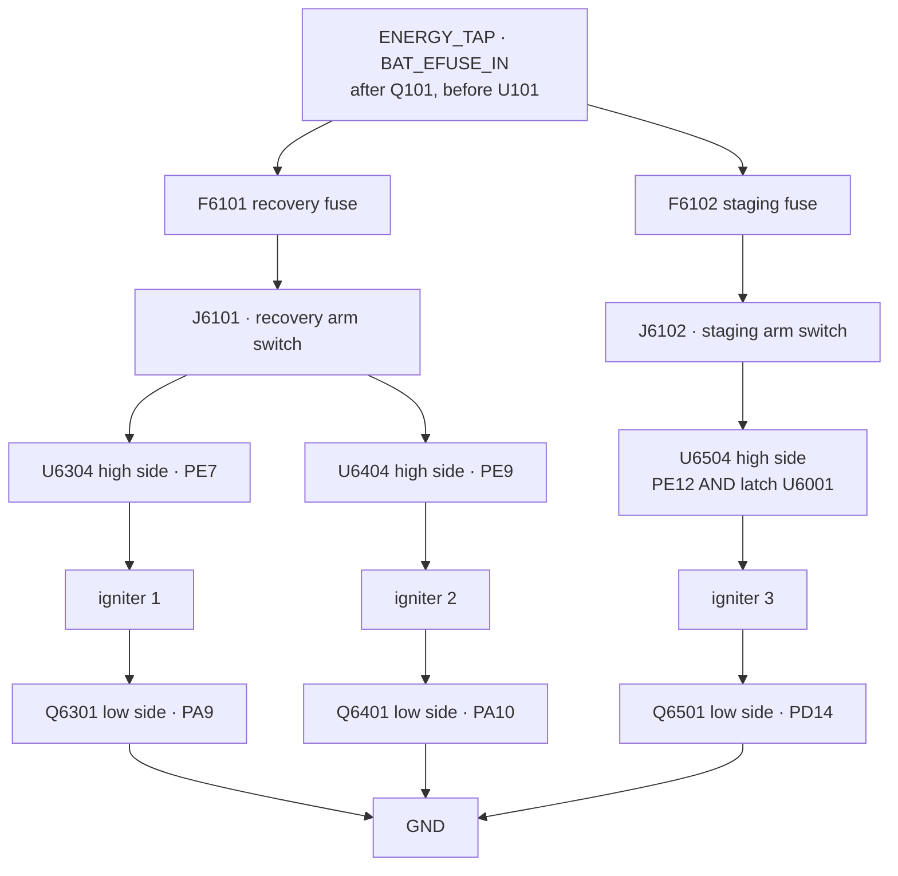
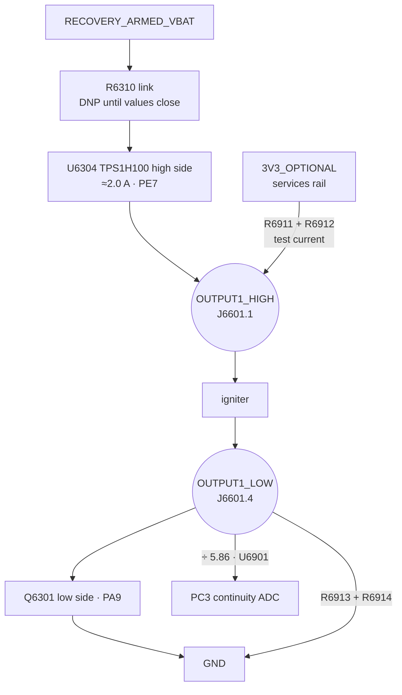

# 03 Recovery and staging outputs

**2 November · three channels ([D-7.1](../../decisions.md)), each with a
high-side and a low-side switch (D-6.2 amended by D-2Nov.1). Recovery and staging
have separate fuses and arm switches (D-6.1, D-2Nov.2, D-7.2). Values wait for
the igniters.**

Three pyro channels. Channels 1 and 2 are recovery, behind the recovery arm.
Channel 3 is staging / air-start, behind its own arm and a hardware latch that
any flight-MCU reset clears. Each igniter sits between two switches: a
current-limited TPS1H100 on the battery side and a CSD17318 FET on the return.
It fires only when the arm is closed and both switches are on.

Logic power never feeds these outputs. A fault on an output can blow its fuse
or trip its switch; it can't pull down U101 or the flight rail. A staging short
blows F6102, not the fuse recovery needs.

## One channel, with its continuity sense

The services rail pushes a small test current through R6911 and R6912 into the
igniter. It comes back through R6913 and R6914 to ground, and the return node is
divided down to the ADC: 22.1 kΩ + 22.1 kΩ over 10 kΩ, with R6714's 100 kΩ
pull-down on the ADC side in parallel while U6901 is on, so ÷5.86, not the ÷5.42
of the rail dividers. Channel 2 uses R692x and PC4; channel 3 uses R693x and
PC5. With the return grounded (the 6 October design), that node would always
have read 0 V, which is why the low side came back.

| Return node reads | Meaning |
| --- | --- |
| Mid-level, set by the resistor ratio | Igniter present, both switches open |
| ≈0 V | Igniter or harness open, or the low side is closed (or shorted) |
| Above its disarmed reading, up to near the armed rail | Arm closed and the high side conducting: leaking or shorted |

## What each part does

| Part | Job | Failure it covers |
| --- | --- | --- |
| External arm switches via J6101 / J6102 | Physically disconnect recovery and staging energy, separately | Software, switch or wiring fault on the pad; the barrier that protects people. The crew can arm recovery without arming ignition |
| F6101 / F6102 | Clear a shorted switch or harness, recovery and staging separately | TPS1H100 failed short; short to structure; a staging fault can't take recovery's fuse |
| TPS1H100 high side, R6314 / R6414 / R6514 = 1.24 kΩ | Switches the battery side; limits to ≈2.0 A (1.233 V × 2000 / 1240 Ω); thermal shutdown | Shorted igniter after firing; harness short during a pulse |
| CSD17318 low side, gate from its own GPIO through 100 Ω, 100 kΩ pull-downs | Switches the return. Off at reset and power-off | One stuck GPIO or one shorted high side can't fire alone. Brings back continuity sensing |
| U6001 latch + U6502 AND (SN74LVC1G08) | Channel 3's high side works only while the latch is set. Any flight reset or power-up clears it; only PD15 can set it again, and only while staging is disarmed | A reset mid-flight re-lighting a motor ([FF-03](../../interfaces/flight-fault-contract.md)) |
| U6103 arm sense | Reports recovery (PC8) and staging (PE15) energy present | Firmware sees disarmed vs armed, not a guess |
| 06c current sense | Per-channel current to ADC | Evidence that current flowed; not proof the charge fired |
| 06e / 06f continuity | Small test current through the igniter, read at the return node | Open igniter or harness; a dead low side; a leaking high side |

One fault, armed, and what happens:

| Single fault | Result |
| --- | --- |
| High-side fire pin stuck high, or a TPS1H100 shorted | No fire: the low side is open and R6913 / R6914 limit the current. The return node reads near the rail, so firmware sees it |
| Low-side GPIO stuck high, or a CSD17318 shorted | No fire: the high side is off. Continuity reads zero, so firmware sees it |
| Low side fails open | That channel can't fire. The pre-arm self-test catches it |
| One bad write to GPIO port E | Only high sides change; the low sides sit on ports A and D |
| A solder bridge between neighbouring pads | No fire pin neighbours its own low-side select (pads 38 / 68, 40 / 69, 43 / 61). A bridge to a fire pin turns that high side on alone, which the armed check sees; PA9 and PA10 are neighbours, so the self-test checks that the other channels don't move |

## Firing and checks

**Fire:** low side on, high side on for the configured pulse, high side off,
low side off. One channel at a time. Channel 3's high side also needs the latch.
If current still flows after the high side is switched off, opening the low
side stops it; report the channel and don't use it again.

**Before arming (arms open):** with no energy on the outputs, close each low
side alone and check its continuity drops to zero while the other channels'
readings stay put, then reopen it and check the reading returns. If an igniter
reads open, the low-side check for that channel can't conclude; report it.

**After arming:** a channel whose return node reads above its disarmed level,
anywhere up to the armed rail, has a high side that conducts: leaking or
shorted. Never close that channel's low side; report it and stop the countdown.
A partial leak counts too: closing the low side takes R6913 / R6914 out of the
path and lets the leak current rise. Set the margin above the disarmed level on
the bench, across temperature: arming alone moves the reading a little (the
TPS1H100 body diode when disarmed, its off-state open-load current when armed;
detail in the [firmware interface](../firmware-interface.md#pyro-outputs)).
Don't run the low-side self-test with an arm closed: if the high side were
shorted, closing the low side would fire it.

## Removed, and why

| Removed | Reason |
| --- | --- |
| LTC6993 one-shots and timing parts | Only shorten a firing already under way; the switch limit and thermal shutdown already bound a stuck channel |
| Recovery and staging permit gates (SN74LVC1G97s; U6502 becomes a 1G08) | The arm switches remove energy. Only channel 3 keeps one gate, for the reset latch |
| Low-side select gates U6303 / U6403 / U6503 | The GPIO drives each low side directly; the gate added a permit input that no longer exists |
| Anav's shared low-side switch | Considered. One open part would stop every deployment; one low side per channel instead |

D-6.2 also removed the low-side FETs themselves; D-2Nov.1 put them back for the
reasons above. They were never deleted from the CAD.

## Firmware rules

- The flight MCU alone commands outputs. Radio, USB and CAN cannot.
- Fire one channel at a time. With Churro feeding the board, its ≈6.0 A AV
  eFuse also carries logic (≈0.6 A) and servos (2.0 A limit).
- Bound each firing pulse in the per-flight configuration.
- Channels 1 and 2 are recovery hardware, channel 3 staging hardware. A flight
  profile can't put ignition on 1 or 2 to dodge the reset inhibit.
- Set a new flight (PD15 edge) only on the pad, with staging disarmed. Read the
  latch on PE14 and report it.
- After an in-flight reset: channel 3 stays inhibited in hardware; recovery
  resumes only through the phase-specific path in the
  [recovery logic](10-recovery-logic.md).
- Report arm sense, latch state, continuity and current at 1 Hz on the pad
  (D-2Nov.10), as evidence, never as proof of deployment.
- Pin map and sequences: [firmware interface](../firmware-interface.md#pyro-outputs).

## Still open

1. Igniters for recovery and air-start: all-fire current well under the limit's
   low corner (≈1.7 A: TI gives ±14% above 1.6 A, plus the resistor) at minimum
   battery, harness resistance, the low side's on-resistance (≤30 mΩ at a 2.5 V
   gate) and one Q101 body-diode drop (D-2Nov.5), and a no-fire current of 25 mA
   or more. R69x1–R69x4 are 3.9 kΩ 1% (D-2Nov.14): with one resistor shorted,
   8.4 V armed and 1% parts, that's 0.88 mA through the igniter on the self-test
   (R69x1 / R69x2, low side closed) and 2.33 mA with a shorted high side
   (R69x3 / R69x4, low side open), a tenfold margin at 25 mA. R69x1 / R69x2 also
   carry 1.3 mA back into the services rail whenever a high side is on; check
   that against the rail's lightest load. "Present" reads about a quarter of a
   volt at the ADC. An igniter rated below 25 mA changes the values, not the
   layout.
2. Fuse and arm-switch parts. Each switch must be maintained, rated above the
   fuse at 8.4 V DC, operable from outside the airframe and reachable from the
   ground with the rocket on the rail (EuRoC LV-0270, 0280, 0540–0550).

## Bench tests, inert loads only

- Arms open: no voltage at J6601 with the board powered and firmware commanding fire.
- Pre-arm self-test: each low side alone pulls its continuity to zero; reopening restores it.
- Arm closed, one high side commanded on with its low side open: load current
  stays below the igniter's no-fire figure and the return node reads near the rail.
- Fire into a resistor at minimum battery, and again with U101 shut down (one
  body-diode drop): current reaches the igniter all-fire with margin.
- Short an output during a timed pulse: FLIGHT_3V3 and U101 stay up; the switch limits.
- Short the staging side: F6102 clears; recovery channels still fire.
- Reset the flight MCU with staging armed and channel 3 commanded: no current at J6601.3.
- Try to set the latch with staging armed: it stays cleared.
- Measure the continuity current with each low side closed against the igniter's no-fire figure.

The full test list and release gates: [11 Verification](11-verification.md).

[Capture delta](schematic-capture-spec.md#output-energy-and-pyro-outputs) ·
[Connectors and arming](09-connectors-arming.md) ·
[Earlier circuit record](../archive/architecture/implementation-reference/03-energetic-outputs.md)
