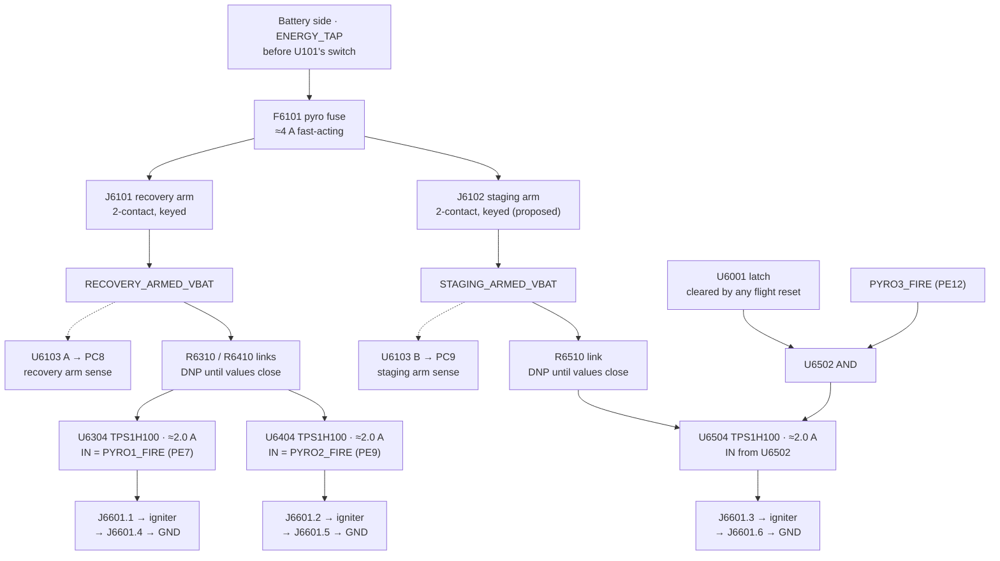

# Recovery and staging outputs

**7 October · three channels ([D-7.1](../../decisions.md)) on the 6 October
topology (D-6.1, D-6.2). Staging arm and latch wiring proposed (D-7.2). Values
wait for the igniters.**

Three pyro channels, each a current-limited high-side switch with the igniter
return to ground. Channels 1 and 2 are recovery, behind the recovery arm switch.
Channel 3 is staging / air-start, behind its own arm switch and a hardware latch
that any flight-MCU reset clears.

Logic power never feeds these outputs. A fault on an output can blow its fuse
or trip its switch; it cannot pull down U101 or the flight rail.

## What each part does

| Part | Job | Failure it covers |
| --- | --- | --- |
| External arm switches via J6101 / J6102 | Physically disconnect recovery and staging energy, separately | Software, switch or wiring fault on the pad; the barrier that protects people. The crew can arm recovery without arming ignition |
| F6101 | Clears a shorted switch or harness on any channel | TPS1H100 failed short; short to structure |
| TPS1H100, R6314 / R6414 / R6514 = 1.24 kΩ | Fires one channel; limits it to ≈2.0 A (1.233 V × 2000 / 1240 Ω); thermal shutdown | Shorted igniter after firing; harness short during a pulse |
| U6001 latch + U6502 AND | Channel 3 fires only if the latch is set. Any flight reset or power-up clears it; it can only be set again by PD15 while staging is disarmed | A reset mid-flight re-lighting a motor ([FF-03](../../interfaces/flight-fault-contract.md)) |
| U6103 arm sense | Reports recovery (PC8) and staging (PC9) energy present | Firmware sees disarmed vs armed, not a guess |
| 06c current sense | Per-channel current to ADC | Evidence that current flowed; not proof the charge fired |
| 06e/06f continuity | Small sense current through the igniter | Open igniter or harness before flight |

## Removed, and why

| Removed | Reason |
| --- | --- |
| LTC6993 one-shots and timing parts | Only shorten a firing already under way; the switch limit and thermal shutdown already bound a stuck channel |
| Low-side CSD17318 per channel | A second electronic barrier adds little behind a physical arm; on the recovery side it adds a way not to fire |
| Recovery and staging permit gates (SN74LVC1G97s other than U6502) | The arm switches remove energy. Only channel 3 keeps one gate, for the reset latch |
| Anav's shared low-side switch | Considered. One open part would stop every deployment |

## Firmware rules

- The flight MCU alone commands outputs. Radio, USB and CAN cannot.
- Fire one channel at a time. With Churro feeding the board, its ≈6.0 A AV
  eFuse also carries logic (≈0.6 A) and servos (2.0 A limit).
- Bound each firing pulse in the per-flight configuration.
- Channels 1 and 2 are recovery hardware, channel 3 staging hardware. A flight
  profile can't put ignition on 1 or 2 to dodge the reset inhibit.
- Set a new flight (PD15 edge) only on the pad, with staging disarmed. Read the
  latch on PD14 and report it.
- After an in-flight reset: channel 3 stays inhibited in hardware; recovery
  resumes only through the phase-specific path in the
  [recovery logic](10-recovery-logic.md).
- Report arm sense, latch state, continuity and current as evidence, never as
  proof of deployment.

## Still open

1. Staging arm and latch wiring (D-7.2): accept, or choose a two-pole switch on
   one connector instead of J6102.
2. Igniters for recovery and air-start: all-fire current well under 2.0 A at
   minimum battery and harness resistance; no-fire current sets the continuity
   values.
3. Fuse and arm-switch parts. Each switch must be maintained, rated above the
   fuse at 8.4 V DC and operable from outside the airframe.
4. Energy-tap point: confirm TPS26630 keeps Q101 on through U101 faults and
   SHDN; otherwise tap the connector side with reverse-polarity protection.

## Bench tests, inert loads only

- Arms open: no voltage at J6601 with the board powered and firmware commanding fire.
- Fire into a resistor at minimum battery: current reaches the igniter all-fire with margin.
- Short an output during a timed pulse: FLIGHT_3V3 and U101 stay up; the switch limits.
- Reset the flight MCU with staging armed and channel 3 commanded: no current at J6601.3.
- Try to set the latch with staging armed: it stays cleared.
- Measure continuity current against the igniter's no-fire figure.

[Capture delta](schematic-capture-spec.md#burrito-changes) ·
[Connectors and arming](09-connectors-arming.md) ·
[Earlier circuit record](../archive/architecture/implementation-reference/03-energetic-outputs.md)
