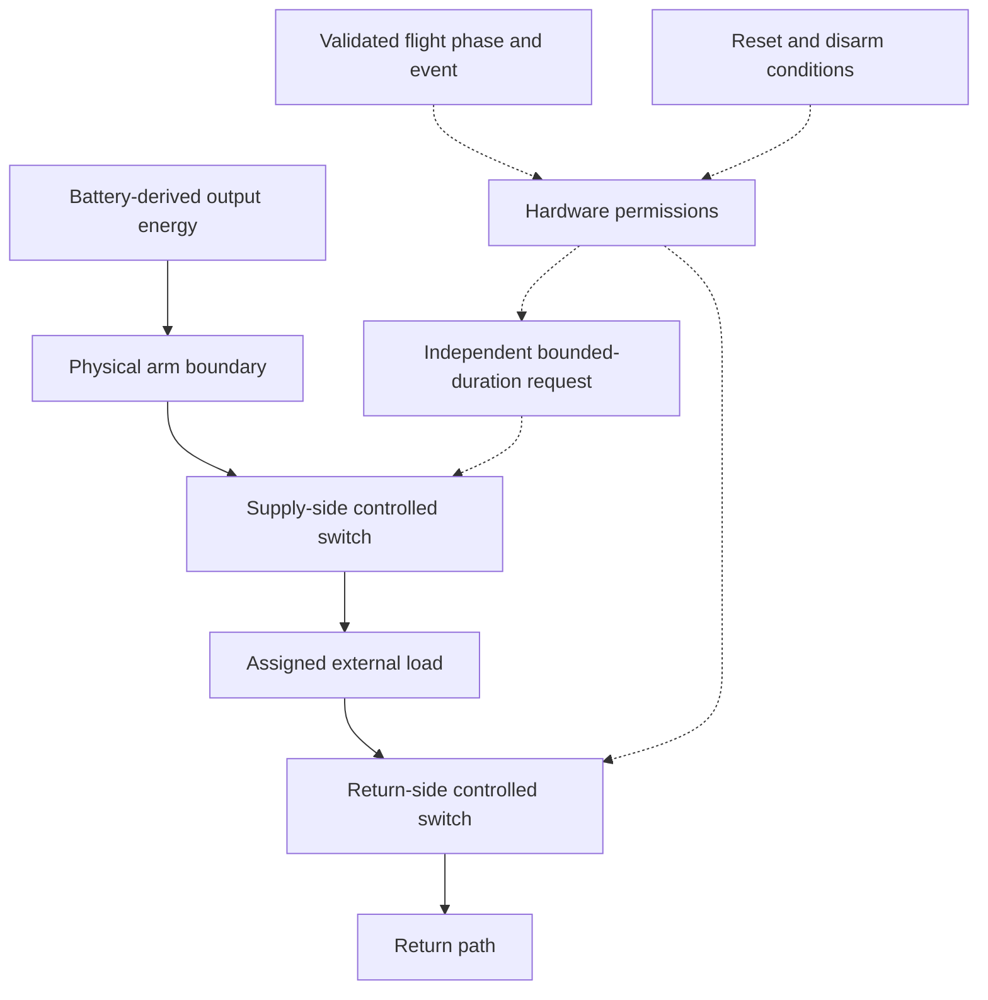

# 3. Energetic outputs: permission, energy and evidence

**Next-review answers:** [18 September investigation](2026-09-18-review-investigations.md#6-energetic-complexity-and-reset-decision-analysis) supplies recommendations and supporting comparisons for this chapter.

## 13 September review: necessity remains challenged

The room challenged whether each mechanism earns its cost. For each, present the
named fault, consequence, simpler alternative and inert validation. Explaining
what a one-shot does does not establish that this system requires one. Nominal
load burnout also does not establish safe behavior under every fault.

Keep physical permission, command issuance, termination and post-reset behavior
separate. No retry policy was decided. Proposed simplification is not approval
to remove the preserved protection. Space-shot recording is a separate mission
configuration, not justification for every workhorse output.

**Preserved contract:** physical isolation, bounded output duration and different
recovery/sustainer reset behaviour. **Challenged on 13 September:** the need for
independent pulse timing and the amount of monitoring. The mechanism review
happened; it did not close these questions. The existing circuit is not newly
approved. Its controls remain until the design decision is reconciled.

## What is an energetic output?

This is an electrical output used to initiate an assigned recovery or staging
event. The existing draft has two recovery channels and a separate sustainer
ignition channel. Their hazards differ: recovering a vehicle after a reset and
allowing another motor ignition are not the same decision.

The task is to make the intended event possible while preventing an unintended
one. “The software says fire” is only one part of that mechanism.

## Separate the energy path from the permission path

This is a functional explanation, not complete wiring, a truth table or
instructions for building an ignition circuit. Solid arrows are the energy
path; dashed arrows describe control relationships. Diagnostic branches and
all fault paths must be included in the actual safety review.

A physical arm boundary makes output energy unavailable independently of an
ordinary software decision. The **high-side** switch is on the supply side of
the load; the **low-side** switch is on its return side. They add distinct
conditions to the current path, with different wiring-fault exposures.

## Why bound the pulse outside software?

If a software request stays active, an independent timing mechanism can limit
how long its accepted pulse lasts. A **one-shot** produces a finite pulse.
**Non-retriggerable** means another trigger does not restart or extend a pulse
already in progress. It does not mean the circuit can operate only once ever.

That duration bound does not decide whether the event was appropriate. It also
cannot stop every failed-short semiconductor or bypass through damaged wiring.
The spent state of an external charge is not a substitute for electrical
fault containment.

## What the extra complexity buys—and what it costs

| Mechanism | Intended job | Remaining limit |
| --- | --- | --- |
| Physical energy isolation | Prevent software alone making energy available | Actual assembly and proof of disarm must be designed |
| Independent duration bound | Limit an accepted pulse despite a stuck software request | Timing tolerances and bypass faults remain |
| Supply-side and return-side control | Distinct conditions along the load path | Added parts and sneak paths; not automatic single-fault safety |
| Continuity/current diagnostics | Observe connection and electrical response | Diagnostic energy itself needs a no-fire safety assessment |

A single switched output would be smaller, but would need another convincing
answer to these failure cases. Do not keep a protection layer merely because
it sounds cautious; name the fault it addresses and test that claim.

## Reset and staging

An ambiguous in-flight flight-processor reset inhibits further sustainer
ignition for that flight. A retained checkpoint or recovered radio link does
not remove the veto.

Recovery may continue only through a validated phase-specific path. Neither
“an event was requested” nor “no current pulse was logged” establishes whether
a physical event happened. This does not define a retry policy.

## Arming and indication

The meeting leaned toward one physical enable for servo and energetic energy,
separate from computer power. That is a working operator-level direction,
not an accepted common-switch design. Grouping must respect recovery versus
sustainer hazards and diagnostic paths.

Continuity means a diagnostic path exists within the conditions tested. It
does not mean the load is correct, the mechanism will operate, or the vehicle
is safe to launch. A power LED cannot establish physical disarm.

## Next pass through this chapter

Walk through normal preparation, a stuck request, reset, a failed switch and
an external wiring fault. Can everyone follow what prevents current and what
evidence remains? If not, improve this diagram or the underlying mechanism.

Existing output-energy links remain unpopulated. Pulse settings, load limits,
continuity margins and the physical arm assembly remain unfinished. No live
energetic testing is authorized. Qualification starts with reviewed circuits
and inert loads, not by populating links to make a demo work.

[Next: servos and remote control](04-servos.md) · [Detailed circuit rationale](implementation-reference/03-energetic-outputs.md) · [Fault contract](../../interfaces/flight-fault-contract.md)
