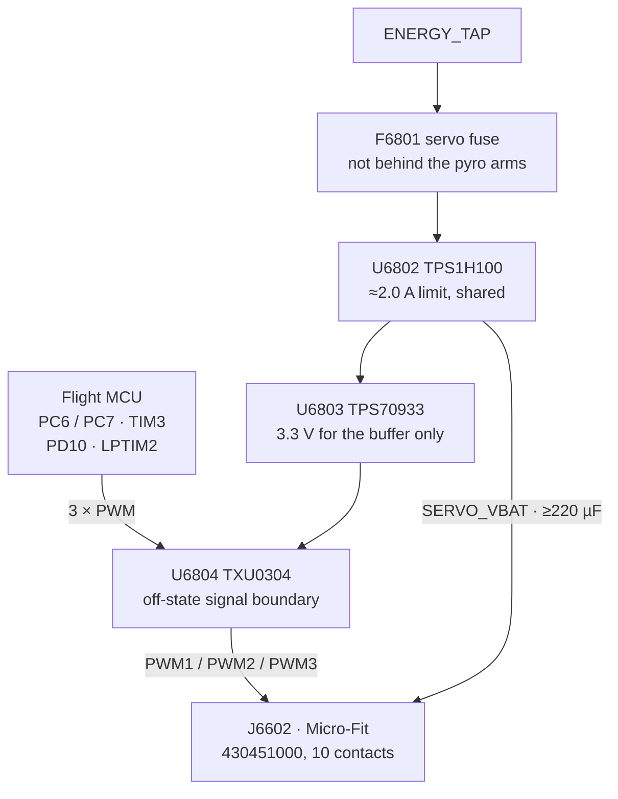

# 04 Servos

Three servo outputs, a core requirement ([D-7.1](../../decisions.md)). Servos 1
and 2 run from flight TIM3 (PC6, PC7), servo 3 from LPTIM2 (PD10) with its own
period. All three are powered from the battery through their own fuse and one
shared 2.0 A switch. This is the CAD's servo circuit as drawn.

Burrito's servos make bounded, event-triggered moves only, such as unlatching a
payload at booster apogee. Anything that moves the vehicle in a closed loop gets
its own node ([below](#closed-loop-actuators-go-on-their-own-node), D-2Nov.8).

| Item | Choice | Why |
| --- | --- | --- |
| Command | Direct timer PWM: TIM3 on PC6 / PC7, LPTIM2 on PD10 | Already mapped; no extra controller or bus. Servo 3 can run a different rate |
| Signal boundary | U6804 TXU0304, channels A1–A3 | Stops back-powering when either side is off |
| Power | Raw 2S through F6801 and U6802 | No new regulator. R6802 1.24 kΩ sets ≈1.989 A for all three; 1.5 A combined normal allocation |
| Bulk | ≥220 µF on SERVO_VBAT at J6602, plus a DNP footprint for 1000–2200 µF (D-2Nov.17) | Stall and regeneration transients. Standalone, regeneration returns to the pack; Churro-fed, the ideal diodes block that, so the bulk and the logic load (under 150 mA in pad mode) absorb it (D-2Nov.5). The back-drive test decides whether the larger part goes on; the ≈9.0 V over-voltage trips stay until then, and there's no clamp (D-2Nov.17) |
| Arm | Not behind the pyro arms | Servos can be checked on the pad with outputs safe (D-6.1) |
| Connector | Keep J6602 430451000, mate 430251000 | Different contact count from the output harness J6601 |

Pins: 1/2/3 = PWR1/PWM1/GND1, 4/5/6 = PWR2/PWM2/GND2, 7/8/9 =
PWR3/PWM3/GND3, 10 unwired. Crimp candidate 430300007, matched to wire size. A
six-contact connector was considered and dropped: it would mate with J6601.

## Limits

- Servos must take 8.4 V on a full pack and a 3.3 V command.
- One fault can take out all three channels; they share U6802.
- Three servos share ≈2.0 A. Pick servos and motion profiles that fit, or
  stagger moves. Don't raise the limit for an unspecified load; a servo needing
  more current or another voltage needs its own interface change.
- Qualify the actual mechanism for current, regeneration, response and
  temperature. Back-drive it on the bench and scope the battery side.
- PC6 and PC7 share TIM3's period; PD10 has its own. Bring up on an inert load;
  a mid-range pulse is not a proven safe position.

## Closed-loop actuators go on their own node

Burrito doesn't run actuator loops. Roll control (RCS, four solenoids) and the
grid fins (servos or steppers, working under drogue) go on a separate node that
follows the D-2Nov.8 rules:

- its own processor and its own fast sensor (a gyro for roll);
- goes to neutral on stop, abort or stale authorisation, through a path that
  survives hung firmware: a servo that loses power holds position, and a hung
  timer keeps sending its last pulse, so neither is a neutral path on its own;
- dormant until Burrito authorises it, with field-adjustable boost dormancy
  (EuRoC LV-0680);
- CAN IDs that lose arbitration to Burrito's and Fajita's (numerically higher),
  on an unterminated stub, so unplugging it leaves the Burrito–Fajita link
  intact;
- its own fused Churro feed with local bulk, never power from Burrito.

Burrito sends it permissions, mode and slow state, and logs the health it
reports. CAN carries nothing a loop depends on at loop rate (D-2Nov.9). Which
board does this waits for Sim Systems' requirements: first a Burrito variant,
then a Fajita-class valve-driver board, before a new design.

## Capture

Keep R6606 / R6607, U6804 A3 → B3Y and the channel-3 branches to J6602.7 / .8 /
.9; contact 10 stays unconnected. Keep the existing fourth-channel
terminations. Add F6801 and the bulk capacitor; fit R6804. The service-power
enable moves off PD10 to PE8. [Capture delta](schematic-capture-spec.md#burrito-changes).

Background: [interface reasoning](justifications/interfaces-and-installation.md#three-local-pwm-interfaces-no-speculative-remote-node) ·
[timer choice](../archive/architecture/implementation-reference/04-servos.md#why-direct-timers) ·
[CAN and stall study](../archive/architecture/2026-09-18-review-investigations.md#4-can-fd-and-servo-investigation) ·
[harness record](../archive/connector-servo-readiness-revision-2026-09-07.md#j6602-servo-harness-new-ten-contact-connector)
