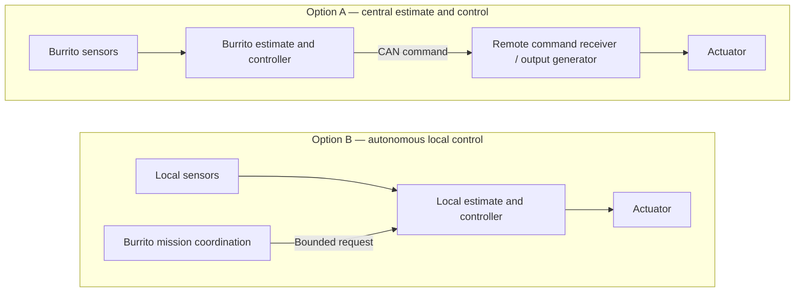

# 4. Local servos and remote control

**Preserved draft:** three local command channels sharing a battery-derived
servo supply. **Open:** how many are needed, where remote loops run and which
actuators/power envelope the vehicles actually require.

## Start with the mechanism

A servo command expresses a requested position. The mechanism determines the
required speed, torque, travel, update rate and safe response to failure. The
board cannot infer those from a three-pin connector.

The draft uses direct timer-generated PWM signals: repeated pulses whose width
encodes the command. A signal buffer handles the powered/unpowered boundary;
otherwise a live control pin may feed energy into an unpowered output domain.
The buffer is not a servo power regulator.

All three current channels share protection and supply. One stalled servo may
affect the others. The provisional 2 A group limit is not a qualification for
three loaded grid fins.

## Which outputs belong near Burrito?

The meeting questioned the third local channel. Two local functions seemed
plausible, but no final inventory was agreed. List each function, its position
in the rocket and its load before retaining or removing a channel.

A distant fin or canard assembly could use a local output controller instead
of long PWM wiring or a second entire flight computer. That opens a separate
question: who computes the command?

## The two arguments from the room

These are candidate allocations, not an approved additional CAN node.

**Anav's argument:** Burrito already computes an estimate. Reusing it avoids
duplicate sensors and another estimator. A remote processor can turn commands
into outputs and handle missing messages.

**Seán's argument:** local sensing/control reduces dependence on CAN timing
and keeps optional control work away from the essential flight schedule.

| Question | Central route | Autonomous local route |
| --- | --- | --- |
| What crosses the bus? | Time-sensitive actuator commands | Higher-level coordination, subject to the chosen design |
| What is duplicated? | Less sensing/estimation | Local sensing, calibration and possibly estimation |
| What must be bounded? | End-to-end age, jitter, traffic and central execution | Local execution plus validity of coordination |
| What happens on link loss? | Defined local command-loss response | Defined autonomous behaviour within its own limits |

Neither argument wins without the actual task. “CAN is too slow” was not
demonstrated. “The estimate already exists” does not establish that its age
and content suit the actuator. A third possibility—central estimation with a
local controller consuming state—is worth comparing if it changes the trade;
it is an added review suggestion, not a decision from the meeting.

Returning to neutral on silence was suggested. Neutral is not universally safe
for every mechanism and flight phase. “Optional” also does not mean an actuator
cannot destabilise the vehicle.

## Power follows the selected actuator

The existing local supply assumes compatible high-voltage servos on raw 2S.
A regulated supply could support other actuators, but needs conversion,
thermal, peak/stall and returned-energy checks. Vehicle-specific regulation
may belong on Churro; no voltage or converter was selected.

A command, a current increase and a measured angle are different evidence.
Loaded tests need travel, stall, reconnect, reset and deceleration behaviour,
not just a servo moving freely on a desk.

## Next pass through this chapter

Bring the proposed vehicle functions into this comparison. For each, establish
required update rate, maximum command/state age and jitter, sensing needs and
safe behaviour on reset, jam, link loss and power loss.

Then compare the allocations using a bounded timing calculation or inert
demonstrator. Only afterwards decide local channel count and the required
network. Keep all existing servo energy links unpopulated meanwhile.

[Next: service and status](05-service-status-time.md) · [Detailed current output implementation](implementation-reference/04-servos.md)
