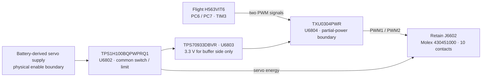

# Two local servo interfaces

**19 September · proposal · CAD still has three channels.**

Use **PC6/PC7, TIM3**, through the existing **TXU0304PWR** powered-off signal
boundary. Two channels match the review direction; no PWM expander is needed.
Release PD10 from the third channel. This does not yet select an actuator.

## Justification and deeper detail

| Question | Follow through | Source status |
| --- | --- | --- |
| Why direct PWM and a buffer? | [Timer choice and interface alternatives](implementation-reference/04-servos.md#why-direct-timers) | Earlier circuit reasoning; current target is two channels |
| What determines remote control and supply? | [CAN FD, latency and stall investigation](2026-09-18-review-investigations.md#4-can-fd-and-servo-investigation) | Numerical examples; control split remains open |
| Which harness is retained? | [Connector revision and mating parts](../connector-servo-readiness-revision-2026-09-07.md#j6602-servo-harness-new-ten-contact-connector) | Preserved three-channel harness; current two-group proposal below |

| Item | Proposed choice | Reason / limit |
| --- | --- | --- |
| Commands | Direct TIM3 PWM | Two channels already mapped; no extra controller or bus |
| Signal boundary | Retain TXU0304PWR | Limits parasitic powering with either domain off; verify ramps |
| Connector | Retain 430451000, ten-contact Micro-Fit | Existing harness; different contact count from J6601; no new connector family |
| Power switching | Retain TPS1H100BQPWPRQ1 as candidate | Existing common current-limited branch; rating/settings depend on actual motors |
| Buffer supply | Retain TPS70933DBVR | Powers logic interface only; **does not regulate motor power** |

**Two-channel harness proposal:** retain J6602 430451000 and mating
430251000. Keep contacts 1/2/3 = PWR1/PWM1/GND1, 4/5/6 = PWR2/PWM2/GND2.
Leave 7–10 unwired in the proposed harness; existing CAD still routes channel 3.
Retain the wire-size-dependent 430300007 crimp candidate. Releasing PD10 and
removing channel-3 wiring require the later CAD/harness revision.

The earlier six-contact proposal is withdrawn: it would use the same connector
as the output harness. Saving four cavities does not justify introducing that
mis-mating opportunity and another harness change.

## Supply decision

Start with raw 2S **only for an actuator specified across the actual source
range, including 8.4 V fully charged**. Otherwise select regulation from the
actuator's voltage, simultaneous stall current, duty and regeneration behavior.
The current common 2 A allocation is not a demonstrated two-servo capacity.

**Missing input:** actuator part + mechanism load/response. This alone prevents
closing the supply and PWM rate; it does not prevent allocating the two interfaces.
The existing R6804 energy link remains DNP.

## Remote actuation

For comparison, use central estimation/control on Burrito with a remote node
generating local outputs and enforcing command expiry. **Do not select the
control split yet:** the meeting explicitly held it pending actuator timing.

| Split | When it earns its cost | What must be known |
| --- | --- | --- |
| Central computation, remote output | One estimator/controller; remote node converts requests to outputs | End-to-end age and jitter fit the mechanism |
| Autonomous local loop | Fast local feedback or useful operation through link loss | Local sensor, controller and safe loss-of-link behavior |
| Central target, local inner loop | Vehicle controller supplies targets; local loop handles fast mechanics | Which state/loop lives where and how targets expire |

Count acquisition → estimate → queue → CAN arbitration/frame → remote task →
PWM phase → actuator motion. Wire time alone cannot select the architecture.

Use the [proposed CAN budget](08-foinse-can.md#vehicle-can) to assess the link.
The prior 200 Hz command/status example uses about 13.3% of the proposed FD bus;
that is a workload example, not an actuator requirement. PWM update phase and
mechanics can dominate wire time. A neutral position is not universally safe.

**Next check:** actual actuator voltage, stall/load, update rate and allowed
command age; then loaded current and partial-power waveforms on the first PCBA.

Sources: [existing servo circuit](implementation-reference/04-servos.md),
[TI TXU0304](https://www.ti.com/lit/ds/symlink/txu0304.pdf),
[earlier timing analysis](2026-09-18-review-investigations.md#4-can-fd-and-servo-investigation).
