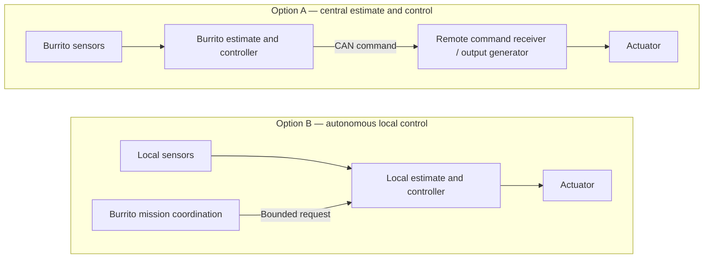

# 4. Local servos and remote control

**Next-review answers:** [18 September investigation](2026-09-18-review-investigations.md#4-can-fd-and-servo-investigation) supplies recommendations and supporting comparisons for this chapter.

## 13 September review direction

**Two local servo channels were agreed.** The preserved CAD still has three;
final-stack reconciliation is pending. Central estimation/control is favored
for remote actuators, with CAN FD as the communication direction. Neither bus
rates nor mechanism requirements are settled. A remote node still needs PWM,
command validation and defined stale-command behavior.

Trace sample/filter delay → estimator → queue → CAN → remote scheduling → PWM
update → mechanical response. Occupancy is not maximum latency. Obtain canard
loop rate, tolerable command age/jitter, sensing and mechanism requirements;
a volunteered contact is not evidence of a sent request or reply. Simultaneous
current and stall duration remain unknown; capacitance cannot settle them.

**Preserved draft:** three local command channels sharing a battery-derived
servo supply. **Review target:** two local channels. **Open:** where remote loops run and which
actuators/power envelope the vehicles actually require.

## Start with the mechanism

A servo command expresses a requested position. The mechanism determines the
required speed, torque, travel, update rate and safe response to failure. The
board cannot infer those from a three-pin connector.

The draft uses direct timer-generated PWM signals: repeated pulses whose width
encodes the command. Suppose the flight MCU is on while servo power is off.
A high PWM signal can otherwise inject current into the unpowered electronics
through their input circuitry. The signal buffer separates that signal boundary;
its powered-off behavior must be checked with servo power absent. It does not
regulate the motor supply. That is the concrete reason for the buffer, not a
generic claim that adding a buffer makes the system safe.

All three current channels share protection and supply. One stalled servo may
affect the others. The provisional 2 A group limit is not a qualification for
three loaded grid fins.

## Which outputs belong near Burrito?

The 10 September meeting questioned the third local channel. On 13 September,
the team agreed a two-channel target; the exact mechanism envelope remains open. List each function, its position
in the rocket and its load before retaining or removing a channel.

A distant fin or canard assembly could use a local output controller instead
of long PWM wiring or a second entire flight computer. That opens a separate
question: who computes the command?

## The two arguments from the room

These are candidate allocations, not an approved additional CAN node.

**Anav's argument:** Burrito already computes an estimate. Reusing it avoids
duplicate sensors and another estimator. A remote processor can turn commands
into outputs and handle missing messages.

**Seán's argument:** local sensing/control reduces dependence on CAN timing
and keeps optional control work away from the essential flight schedule.

| Question | Central route | Autonomous local route |
| --- | --- | --- |
| What crosses the bus? | Time-sensitive actuator commands | Higher-level coordination, subject to the chosen design |
| What is duplicated? | Less sensing/estimation | Local sensing, calibration and possibly estimation |
| What must be bounded? | End-to-end age, jitter, traffic and central execution | Local execution plus validity of coordination |
| What happens on link loss? | Defined local command-loss response | Defined autonomous behaviour within its own limits |

Neither argument wins without the actual task. “CAN is too slow” was not
demonstrated. “The estimate already exists” does not establish that its age
and content suit the actuator. A third possibility—central estimation with a
local controller consuming state—is worth comparing if it changes the trade;
it is an added review suggestion, not a decision from the meeting.

Returning to neutral on silence was suggested. Neutral is not universally safe
for every mechanism and flight phase. “Optional” also does not mean an actuator
cannot destabilise the vehicle.

### Classical CAN comparison baseline — not the selected FD budget

At the existing 500 kbit/s, budget **0.270 ms per full eight-byte standard-ID
frame**, including conservative stuffing/intermission allowance. Assume, solely
for comparison, 100 other frames/s for engine/health traffic. This is not an
observed traffic rate or an allocated message contract.

| Update rate | 2 frames/update | 4 frames/update | 6 frames/update |
| --- | --- | --- | --- |
| 100 Hz | 8.1% | 13.5% | 18.9% |
| 200 Hz | 13.5% | 24.3% | 35.1% |
| 500 Hz | 29.7% | 56.7% | 83.7% |
| 1 kHz | 56.7% | 110.7%: impossible | 164.7%: impossible |

Columns count all new traffic, both directions. Two frames might be one compact
command plus one status message. More channels, timestamps, validity and state
vectors may require more frames. A 32-byte state vector needs at least four
frames, or six if two bytes per frame are reserved for fragment/sequence fields;
feedback would be extra. Fragmented state must be reassembled coherently.

This makes **central control a credible starting comparison at 100–200 Hz**.
It does not justify a second sensor/estimator set merely by saying CAN is slow.
Autonomous local control becomes more attractive when a demonstrated fast loop,
local sensing requirement or link-independent behaviour justifies the added work.
The hybrid may send more data than central actuator commands, not less.

Wire time is only part of command age. One already-transmitting frame can add
another 0.270 ms; higher-priority messages, software queues and errors add more.
A 200 Hz estimator can already be nearly 5 ms old before that bus wait begins.
Sensor/filter age and actuator update timing also count. No end-to-end deadline
has been proved from average bus utilisation.

**Recommendation:** use central estimate/control as the first inert comparison,
retaining a local stale-command response. Reverse that recommendation if the
mechanism requires a faster/local loop or cannot tolerate the measured age.
Select nothing until the actuator's allowable age/jitter, flight-phase response
and actual message inventory are known. Full calculation assumptions and
[latency cases](../power-recording-can-audit-2026-09-11.md#can-traffic-and-latency)
are available for the next session.

## Power follows the selected actuator

The existing local supply assumes compatible high-voltage servos on raw 2S.
A regulated supply could support other actuators, but needs conversion,
thermal, peak/stall and returned-energy checks. Vehicle-specific regulation
may belong on Churro; no voltage or converter was selected.

A command, a current increase and a measured angle are different evidence.
Loaded tests need travel, stall, reconnect, reset and deceleration behaviour,
not just a servo moving freely on a desk.

## Next pass through this chapter

Bring the proposed vehicle functions into this comparison. For each, establish
required update rate, maximum command/state age and jitter, sensing needs and
safe behaviour on reset, jam, link loss and power loss.

Then compare the allocations using a bounded timing calculation or inert
demonstrator. Only afterwards decide local channel count and the required
network. Keep all existing servo energy links unpopulated meanwhile.

[Next: service and status](05-service-status-time.md) · [Detailed current output implementation](implementation-reference/04-servos.md)
