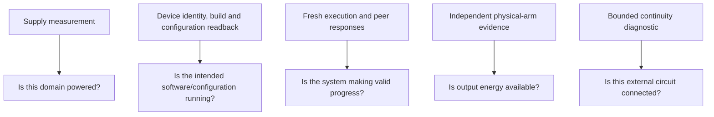

# 5. What the operator can know

**Next-review answers:** [18 September investigation](2026-09-18-review-investigations.md#5-indicators-and-operator-sequence) supplies recommendations and supporting comparisons for this chapter.

## 13 September review: diagnostic inventory first

Test/flight distinction and USB identity/configuration readback were supported.
Build the full inventory before reducing it to a few indicators. An I2C RGB
driver is a candidate, not a selected component.

| Candidate information | Source / drive path | What it establishes |
| --- | --- | --- |
| Source and rail power | Direct electrical indication where provided | Voltage at that point, not firmware health |
| Boot and essential progress | Firmware heartbeat/status | Reported progress; define reset/off appearance |
| Build, profile, test mode, config readback | Firmware via USB; optional summary lamp | Loaded/reported configuration, not independent correctness |
| Sensor validity and calibration | Acquisition diagnostics via USB | Reported data status; not physical calibration proof |
| Storage ready, failures and gaps | Recording firmware via USB | Recorder state and detected errors |
| GNSS/radio health | Comms reports with age | Local reported state; stale reports must be visible |
| CAN peers, age and errors | Flight bus diagnostics | Observed peer traffic and freshness |
| Physical arm and continuity | Actual sense paths; hardware indication where justified | Separate electrical conditions, not successful actuation |
| Reset/recovery history | Reset cause and retained records | Available evidence, subject to power-loss retention |

For each final lamp identify hardware versus firmware drive, connection, reset
behavior and cost. Start with separate power/arm meaning and a firmware health
summary; keep detail in USB. This is a candidate reduction, not a wiring change.
Do not advertise per-servo current telemetry that the draft does not contain.

**Retained:** USB service, independent debug access and simple local indication.
**Working direction:** verify running firmware/configuration without a fragile
on-board display. **Open:** the final indication set and physical-arm evidence.

## Five questions, not one green light

At a launch, people are distracted and the hardware may already be enclosed.
The interface must help distinguish states that are easy to conflate.

A voltage light answers the first question, not all five. A stale green light
may remain on after execution fails. Continuity does not establish arming,
correct load identity or physical operation.

## Make firmware identity observable

The group discussed an OLED, seven-segment display and existing USB tools.
The useful requirement is **knowing what is actually running**, not fitting a
screen. Fragility and the existing groundstation-display experience weigh
against adding one solely for version information.

**Recommendation:** have the configurator read back board identity, running
build, profile and configuration, and verify the outcome of an update. “File
sent successfully” is not the same result. Keep a detailed service view and a
small understandable local indication set.

USB belongs to the communications processor in the current allocation.
Independent **SWD** debug access remains available to each processor for
breakpoints and recovery when ordinary service fails. The connector's signal
contacts and mechanical alignment holes are different things; calling it
JTAG in conversation does not change the interface.

## The indicator options we raised

| Proposed indication | Useful meaning | Question before selecting it |
| --- | --- | --- |
| RGB health/readiness | Concise operating or fault state | Which states, reset defaults and GPIO/driver cost? |
| Independent arm indication | Physical output-energy state without depending solely on firmware | What is actually sensed, including broken wiring? |
| Separate flight/comms power lights | Identify which supplies exist | Are they visible and useful in the installed bay? |
| Per-channel continuity | Find a missing external connection | Can diagnostic energy remain safe in all relevant faults? |
| CAN activity | Notice traffic and possible intermittent wiring | How is activity made visible without implying healthy communication? |
| Required-peer health | Confirm fresh useful responses | What makes a response valid and when does it expire? |

CAN activity and peer health are different observations. Traffic from the wrong
device can blink an activity light; intermittent packets can look continuous
to a human. An activity display helps diagnosis, but cannot measure a high-rate
loss percentage by eye.

The existing draft has complementary red/green readiness, separate comms/power
indication and a piezo. None of the proposals has replaced it yet. Do not add
every suggested light: agree the operator questions and use the smallest
adequate interface. The current flight pin allocation has no free general
GPIO to spend casually.

## Sound and time

A passive piezo can make selectable startup tones. It must be silent before
calibration/active flight so its vibration and execution work do not interfere.
A closed bay may also make it difficult to hear; test the actual installation.

The internal real-time clock helps establish elapsed time across supported
resets while its supply survives. It is not a backup battery. Active deadlines
use a higher-resolution monotonic timer: a clock that does not jump when GNSS
wall-clock time is corrected.

For scale, 20 parts per million of clock error gives 18 ms over fifteen minutes.
Cold drift can be larger than room-temperature tolerance. Retention validity,
temperature and elapsed-time accuracy all need testing; a plausible displayed
time is not proof of continuity.

## Next pass through this chapter

Describe the normal operator sequence and what each indication can honestly
claim. Review stale, reset and unpowered states, USB-only operation and failed
communications. Keep physical arm evidence separate from software readiness.

[Next: GNSS and radio](06-gnss-radio.md) · [Detailed indication, debug and clock evidence](implementation-reference/05-service-status-time.md)
