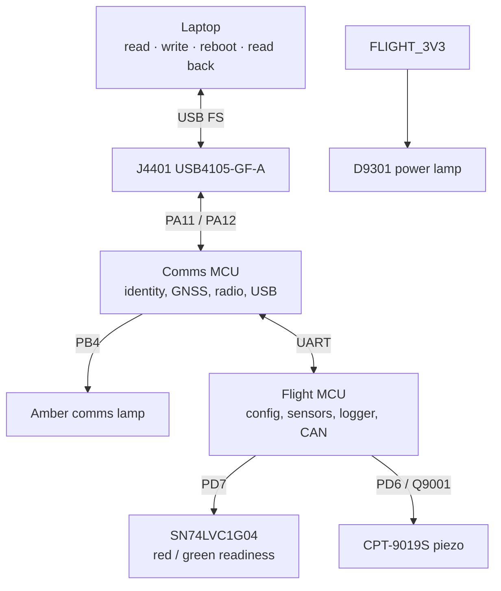

# 05 Service, status and time

Keep the simple hardware: a power lamp, flight red/green, comms amber and a
ground-only sounder. Everything detailed goes over USB. No display, no RGB
controller, no extra flight pins.

| Hardware | Job | What it can't tell you |
| --- | --- | --- |
| USB4105-GF-A | Configuration and log download | A finished transfer isn't the running build |
| TC2030-NL pads ×2 | Debug each MCU without USB firmware | VTref senses only; it doesn't power the board |
| Red/green via SN74LVC1G04 | Flight readiness on one pin | A frozen green can't prove the loop is running |
| Comms amber | Comms is running | Says nothing about flight |
| Power lamp | FLIGHT_3V3 has energy | Not the right voltage, not disarm |
| CPT-9019S piezo | Startup tones on the ground | Silent before calibration and in flight |
| ECS-160-10-36Q 16 MHz, each MCU | HSE clock | Accuracy depends on installation |
| ABS07 32.768 kHz, flight only | RTC while VBAT survives | VBAT's 100 µF bridges a dip, not total power loss (D-6.4) |

## What an operator can see

| Question | Where | Watch out |
| --- | --- | --- |
| Flight logic powered? | Power lamp | Dark could be no supply, a dead lamp or a blocked view |
| Firmware ready? | Red/green | Static; confirm the reset appearance on the board |
| Comms running? | Amber | Off or frozen doesn't name the fault |
| Right board, build, profile? | USB readback from both MCUs | A missing flight reply shows unknown, never last session's values |
| Acquisition and recording moving? | USB sample age, errors, committed sequence, drops | Show stalled ages explicitly |
| CAN peer healthy? | USB peer identity, heartbeat age, sequence loss, error counters | Bus activity alone isn't health |
| Armed? | USB and the 1 Hz pad telemetry: arm sense (U6103), continuity class per channel, staging latch (D-2Nov.10) | Lamps don't show arm state |
| Running on the umbilical or the pack? | USB and pad telemetry: AV pack voltage, bus voltage, live source (D-2Nov.7) | Close voltages make the source ambiguous; it's reported as such |
| Output diagnostics valid? | Separate USB fields with age | Unavailable stays unknown |

Ground service: power → read both identities, builds and config → check live
measurements and recorder progress → check the peer is fresh. After an update,
reboot and read back again; an acknowledged transfer isn't enough.

## USB fields

| Group | Fields |
| --- | --- |
| Identity | Board ID, both build IDs, profile, config checksum, flight or ground-test mode (D-2Nov.10) |
| Measurements | Sensor and calibration IDs, freshness, clipping and errors, voltage and current with age |
| Recorder | Prepared capacity, committed sequence, drops and gaps, reset epoch |
| Vehicle link | Peer identity, age, sequence loss, bus-off and error counters |
| GNSS and radio | Solution time and validity, packet direction and sequence, receiver RSSI/SNR, mode |
| Outputs | Arm sense, continuity (raw and class), staging latch, current, each with validity |

A timed-out flight reply is **unknown**, even with comms healthy. Service
queues stay bounded; log download never blocks acquisition. A two-MCU update
reads back both builds and protocol versions after reboot; an interrupted
update or mismatched peer is shown, never hidden behind an old "ready".

Report only what's actually wired. `BRANCH_FAULT_N` is an aggregate, not a
branch ID. Buck, core-input and LDO power-good nodes don't reach a flight GPIO,
so don't show them; show battery, ADC and INA readings with age instead.

## Reset and time

TPS3808G33 supervisors on both MCUs (20 ms nominal delay, 12–28 ms with CT
open); TPS3430 watchdog on flight, fed only after acquisition, estimation and
policy make progress. Radio, bulk recording and the magnetometer never gate it. Boot never waits
on a NOR scan, GNSS lock, peer discovery or USB.

Monotonic time for samples and deadlines; GNSS corrections never move an active
deadline. Keep reset cause, time validity and session identity. A comms reset
never restarts the flight state machine.

PPS goes to comms, not flight. Keep the comms epoch, PPS capture time, GNSS
validity, flight receive time and the uncertainty of the cross-MCU time
mapping; UART arrival time is not a GNSS timestamp. Comms VBAT runs off its
logic supply; flight VBAT has its own hold-up. Retention through a reset and
through total power loss are different claims.

First checks: USB-only boot, stale flight reply, failed update and readback,
comms reset during logging, lamp behaviour on reset in the installed bay.

Sources: [indicator inventory](../archive/architecture/2026-09-18-review-investigations.md#5-indicators-and-operator-sequence) ·
[service hardware](../archive/architecture/implementation-reference/05-service-status-time.md) ·
[reset contract](../../interfaces/reset-recovery-contract.md) ·
[firmware interface](../firmware-interface.md) ·
[USB modes](02-power.md#usb-modes) · [connectors](09-connectors-arming.md)
