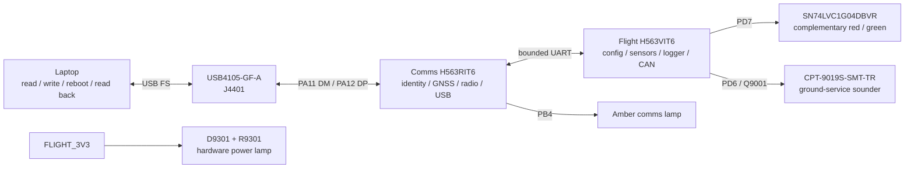

# Service and status

**19 September · proposal · retain the existing simple hardware.**

Use **USB readback for detail**, separate power and firmware lamps for local
status. No display, RGB controller or extra flight GPIO allocation.

## Justification and deeper detail

| Question | Follow through | Source status |
| --- | --- | --- |
| Why these indicators and clocks? | [Service alternatives and timekeeping rationale](implementation-reference/05-service-status-time.md#the-options-and-the-concrete-reasons-for-the-choices) | Earlier component research |
| Which signals drive each indication? | [Indicator wiring and operator sequence](2026-09-18-review-investigations.md#5-indicators-and-operator-sequence) | Detailed inventory; current recommendation below |

| Hardware | Why keep it | What it does not prove |
| --- | --- | --- |
| USB4105-GF-A | One service connection for configuration and logs | Successful transfer ≠ running the intended build |
| Two TC2030-NL debug patterns | Recover/debug each MCU independently of USB firmware | VTref is sense-only, not programmer power |
| Red/green + SN74LVC1G04DBVR | Existing one-pin flight readiness indication | Frozen green cannot prove continued execution |
| Comms amber | Distinguish comms execution/status | Does not establish flight readiness |
| Flight PWR lamp | Rail has energy without firmware | Does not establish correct voltage or disarm |
| CPT-9019S-SMT-TR | Passive piezo permits startup tones | Keep silent before calibration/active flight |
| ECS-160-10-36Q-ES-TR, each MCU | Existing 16 MHz HSE timing source | Clock accuracy still depends on installation |
| ABS07-32.768KHZ-7-T, flight only | RTC continuity while its supply survives | No backup cell; full power loss loses retention |

## What the operator can actually observe

| Question | Display / connection | Off, reset or stale behavior |
| --- | --- | --- |
| Is flight logic powered? | D9301 + resistor from FLIGHT_3V3; hardware-driven | Dark is ambiguous: no supply, failed lamp or obstructed view |
| Is firmware reporting readiness? | Flight PD7 → SN74LVC1G04 complementary red/green | Static state cannot prove progress; confirm reset appearance on board |
| Is comms running? | Comms PB4 → amber | Firmware-owned; off/frozen cannot distinguish every fault |
| Correct board/build/profile? | USB readback from both processors | Missing flight reply displayed unknown; never reuse prior session values |
| Are acquisition and recording progressing? | USB sample age, errors, committed sequence and drops | Show stalled age/sequence explicitly |
| Is the expected CAN peer healthy? | USB peer identity, heartbeat age, sequence loss, error counters | Bus activity alone is insufficient; no new CAN lamp selected |
| What is the physical arm state? | Requires independent assembly evidence | Existing lamp set does not answer it; unfinished hardware function |
| Are output diagnostics valid? | Separate USB diagnostic fields with validity/age | Unavailable remains unknown; not inferred from firmware readiness |

**Recommended indication set:** retain the existing three lamp functions and
USB detail. Reject an extra RGB controller for now: no added operator question
requires it, and a driver/bus would be another dependency. Physical arm indication
still requires separate hardware work; no allocation is hidden in the RGB decision.

Ground-service sequence: power → read both identities/builds/config → check live
measurement and recorder progress → check required peer freshness. After an
update, reboot and repeat readback; an acknowledged file transfer is insufficient.
This sequence covers electronics service, not physical output arming.

## USB view to implement

| Group | Return these fields |
| --- | --- |
| Identity | Board ID; both running build IDs; profile; config checksum; explicit test/flight mode |
| Measurements | Sensor ID/calibration ID; freshness; clipping/errors; voltage/current with age |
| Recorder | Prepared capacity; committed sequence; drops/gaps; reset epoch |
| Vehicle link | Expected peer identity; age; sequence loss; bus-off/error counters |
| GNSS / radio | Solution time/validity; packet direction/sequence; receiver RSSI/SNR; mode |
| Output diagnostics | Separate physical-arm evidence and valid channel diagnostic status; unavailable = unknown |

A timed-out flight response becomes **unknown**, even if comms remains healthy.
Read back both running builds/configurations after reboot. Keep service queue
sizes bounded; log download never blocks acquisition.

## Reset and time

Retain TPS3808G33DBVR supervisors on both MCUs and TPS3430WDRCR on flight.
Feed the external watchdog only after essential acquisition/estimation/policy
makes progress. Radio and bulk recording do not become unconditional feed gates.

Use monotonic time for samples/deadlines. GNSS wall-clock correction must not
move active deadlines. Preserve reset cause, time-validity and session identity.
A comms reset must not restart the flight state machine.

**Next check:** USB-only boot, stale flight response, failed update/readback,
comms reset during logging, and reset lamp appearance in the installed bay.

Sources: [indicator wiring and detailed inventory](2026-09-18-review-investigations.md#5-indicators-and-operator-sequence),
[existing service hardware](implementation-reference/05-service-status-time.md),
[reset contract](../../interfaces/reset-recovery-contract.md).

See [connectors and physical arming](09-connectors-arming.md) for the FC battery-enable plug, separate unresolved output-arm assembly and complete connector inventory.
