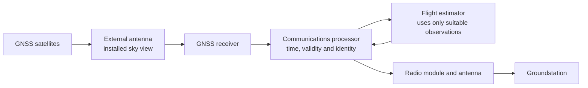

# 6. Position and the radio link

**Retained:** external GNSS reception for the carbon airframe, communications
owned by its processor, full-rate evidence recorded locally. **Open:** installed
antenna performance, actual link settings and full-envelope altitude evidence.

## The airframe is part of the radio system

Carbon can prevent an internal antenna from seeing the sky. The selected
draft therefore uses a GNSS receiver with an external antenna rather than
the earlier integrated patch. That change solves placement, not every
navigation limitation.

Both antennas need a real installation: retention, cable loss, strain relief,
clearance and a useful radiation pattern. A connector marked SMA does not
establish link quality. A passive GNSS antenna does not need an active-antenna
bias supply; changing to an active assembly would reopen that boundary.

## What counts as a new position?

Suppose the receiver repeats a one-second-old solution. The communications
processor receiving it now does not make the observation current.

Keep three things explicit:

- **Age:** when was the underlying measurement/solution produced?
- **Validity:** was it within the receiver's operating conditions, with a valid fix?
- **Datum:** what reference is height measured from?

GNSS height, pressure-derived altitude and height above the launch point are
not automatically the same quantity. A mixed-source estimate must not be
presented as independent GNSS proof.

The current MAX-M10S receiver's documented altitude envelope stops at 80 km.
An external antenna, more constellations or a faster message rate does not
remove that limit. The discussion about speed/altitude restrictions did not
select a workaround or a replacement receiver.

Above the useful GNSS/barometer envelope, inertial estimation accumulates
uncertainty. A constant 10 mg acceleration bias integrated for two minutes
alone produces roughly 706 m of position error. This is illustrative arithmetic,
not a prediction for our installed estimator. Full-envelope altitude evidence
for a space-shot mission needs its own justified approach.

## Radio rate versus range

The current draft uses a Wio-LR2021 sub-GHz module. The reason for a module is
to reuse its RF implementation rather than designing the entire radio frontend
on the flight board. The newer radio still requires its own driver and verified
groundstation compatibility.

Faster modes trade sensitivity for throughput. A long-range setting that takes
more than a second to transmit a packet cannot deliver ten fresh packets every
second. Conversely, selecting a high bitrate can spend the link margin needed
at distance.

**Recommendation:** begin with one conservative, mutually supported link and
keep full-rate evidence on board. Do not require a radio link to carry every
sensor sample, and do not assume an older ground receiver supports all new
radio modes. Antenna orientation, slant range, interference and permitted
transmit settings remain part of the actual link choice.

Detailed airtime, sensitivity, power and module comparisons remain available
below; they are dated calculations, not installed range tests.

## Failure must stay on the communications side

Missing GNSS, corrupt packets, a radio stuck busy or a disconnected laptop must
not stall the flight schedule. Receiver resets and parsers need bounded work.
The estimator must know when aiding becomes unavailable instead of silently
using stale values.

## Next pass through this chapter

Can the room explain what the external antenna fixes and what it does not?
Then define the first compatible radio configuration and the antenna test.
Verify fresh navigation solutions, invalid/absent GNSS, reacquisition, actual
transmit current and installed link quality.

[Next: sensors and recording](07-sensors-logging.md) · [Detailed devices, antennas and radio comparisons](implementation-reference/06-gnss-radio.md)
