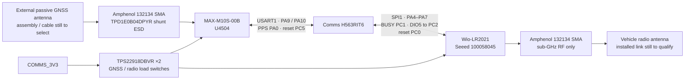

# GNSS and radio

**19 September · proposal · retain MAX-M10S and Wio-LR2021.**

## Justification and deeper detail

| Question | Follow through | Source status |
| --- | --- | --- |
| Why MAX-M10S? | [GNSS shortlist and external-antenna rationale](implementation-reference/06-gnss-radio.md#the-gnss-shortlist-and-why-the-answer-changed) | Earlier research and manufacturer links |
| Why Wio-LR2021? | [Radio options and link tradeoffs](implementation-reference/06-gnss-radio.md#radio-options-cost-and-link-tradeoffs) | Earlier research; receiver compatibility still needs testing |
| Where does packet airtime come from? | [Airtime calculation](../calculations/avionics-options-estimates.py) | Reproducible estimate, not measured link performance |

ESD device is a shunt at the RF input, not a series RF amplifier. Existing
TMUX1511 signal boundaries remain; the drawing omits their individual channels.

| Selected part | Reason | Limitation that changes use |
| --- | --- | --- |
| MAX-M10S-00B | Soldered receiver; antenna can sit outside carbon airframe | ≤4 g dynamics, 500 m/s velocity, 80 km altitude documented envelope |
| 132134 vertical SMA, both RF ports | Existing inspectable external antenna connection | Connector choice does not select antenna, cable loss or retention |
| TPD1E0B04DPYR | Low-capacitance GNSS input ESD part | Installed RF/ESD performance remains unmeasured |
| Wio-LR2021 868/915 module, 100058045 | Integrated RF frontend; existing selected module | Needs LR2021 driver and ground-receiver compatibility |
| TPS22918DBVR load switches | Independently restart receiver/radio | **Not individual current limiters**; upstream comms limiter bounds aggregate fault |

**GNSS use:** retain raw observations, validity, solution age and altitude datum.
No full-boost or above-80-km aiding claim. External reception cannot fix the
receiver's operating limits. Invalid or stale GNSS must not block flight work.

Keep MAX TIMEPULSE free of a startup pull-down: it is internally coupled to
SAFEBOOT. Backup/VIO_SEL wiring follows the existing checked installation.

## Which end measures link quality?

| Packet direction | Receiver owns RSSI/SNR | How the record obtains it |
| --- | --- | --- |
| Vehicle → ground | Groundstation | Ground log; return a sequence-tagged report if vehicle needs it |
| Ground → vehicle | Wio receiver | Comms record → flight NOR with packet sequence/time |

A transmitted packet supplies no measurement of its reception. Keep receiver
identity and packet direction with each metric. Missing reports are missing
evidence, not zero signal strength. Packet sequence gaps distinguish losses
from a link that merely shows activity.

## First radio interoperability configuration

Propose ordinary LoRa: **SF7, 125 kHz, coding 4/5, explicit header, CRC, eight-symbol
preamble; 64-byte test packet at 1 Hz**. Use the agreed band/channel and permitted
power of the actual ground receiver; verify with a controlled RF test setup.
No flight frequency/power or regulatory permission is selected here.

Calculated airtime is **118.016 ms/packet**. This is a short-range interoperability
profile, not a long-range flight profile or permission for continuous over-air use.
It also shows why this packet cannot run at 10 Hz. Choose flight cadence/link
margin from the installed antenna and range test; keep full-rate data in NOR.

The historic net `LORA_DIO1` reaches **module DIO5**. RXEN/TXEN reservations are
unused. Do not port an SX1262 driver by changing the device name.

**Next check:** identify the actual ground receiver/firmware; exchange the test
packet; measure TX current and reset recovery. Then measure installed reception,
GNSS solution age/reacquisition and antenna losses. Neither antenna assembly
has a justified exact part selection yet.

Sources: [u-blox MAX-M10S datasheet](https://content.u-blox.com/sites/default/files/MAX-M10S_DataSheet_UBX-20035208.pdf),
[Wio datasheet](https://files.seeedstudio.com/wiki/Wio-LR2021/res/Wio-LR2021%20Module%20Datasheet.pdf),
[RF installation and alternatives](implementation-reference/06-gnss-radio.md),
[airtime calculation](../calculations/avionics-options-estimates.py).
