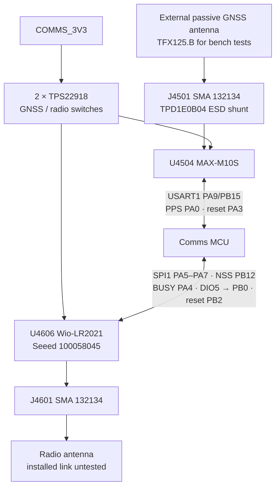

# 06 GNSS and radio

Keep the MAX-M10S GNSS receiver with an external passive antenna, and the
Wio-LR2021 sub-GHz radio. Both hang off the comms MCU, so neither can stall
flight. The radio link to the ground station is unproven: test it before ordering.

| Part | Why | Limit that matters |
| --- | --- | --- |
| MAX-M10S-00B | Soldered receiver; antenna can sit outside the carbon airframe | ≤4 g, 500 m/s, 80 km documented envelope |
| Amphenol 132134 SMA, both ports | Inspectable external connection | Says nothing about antenna, cable loss or retention; both ports identical, so they can be swapped |
| TPD1E0B04DPYR | Low-capacitance ESD shunt at the GNSS input | RF and ESD performance unmeasured |
| Wio-LR2021, 868/915 MHz | Integrated RF front end | Needs an LR2021 driver and a compatible ground receiver |

GNSS keeps raw observations, validity, solution age and altitude datum. It
never triggers a flight event and never blocks flight work. Keep MAX
TIMEPULSE free of a startup pull-down: it shares the SAFEBOOT function.

The old net `LORA_DIO1` reaches module DIO5. The RXEN/TXEN nets are E22
leftovers and unused. The LR2021 needs a new driver, not a renamed SX1262 one.

> **D-27Nov.2 (proposed):** the two TPS22918 load gates, the SN74LVC1G97 logic and the TMUX1511 isolators on GNSS and radio are removed. GNSS and radio sit directly on `COMMS_3V3` (the 351–449 mA comms limiter still bounds a fault); a restart is a comms MCU reset. Diagram below is the pre-squash drawing.

## Who measures the link

| Direction | Receiver owns RSSI/SNR | How it's recorded |
| --- | --- | --- |
| Vehicle → ground | Ground station | Ground log; sequence-tagged report back if the vehicle needs it |
| Ground → vehicle | Wio | Comms → flight NOR, with packet sequence and time |

A transmitter can't measure its own reception. Keep receiver identity and
direction with every metric; a missing report is missing evidence, not zero
signal. Sequence gaps show losses that "activity" hides.

## First link test

Plain LoRa: SF7, 125 kHz, coding 4/5, explicit header, CRC, 8-symbol preamble,
64-byte packet at 1 Hz. Airtime is 118.016 ms per packet (calculated), so this
packet can't run at 10 Hz. It's a bench interoperability profile, not a flight
profile: band, channel, power and permission follow the actual ground receiver
and a controlled RF setup. Keep full-rate data in NOR.

1. Exchange the test packet with a second Wio-LR2021.
2. Then with the real ground station; measure TX current and reset recovery.
3. Then installed reception, GNSS solution age and reacquisition, antenna losses.

Neither antenna assembly has a final part yet.

## Capture and power

Keep the board RF parts, passive antenna topology and interfaces; the
[reference test assembly](justifications/interfaces-and-installation.md#rf-reference-assembly)
covers first-board checks, not vehicle fit. No active-antenna bias circuit.

Start GNSS before high-power radio work. The MAX-M10S can draw up to 100 mA at
startup; the 300 mA comms allocation must cover the processor, interfaces and
radio peaks. If it doesn't, revise the branch budget and its upstream limit
together.

In boost and at altitude, GNSS and pressure can both be unavailable. Full
navigation needs the validated inertial solution. Comms-held-in-reset flight
tests also remove GNSS and PPS.

Sources: [MAX-M10S datasheet](https://content.u-blox.com/sites/default/files/MAX-M10S_DataSheet_UBX-20035208.pdf) ·
[Wio datasheet](https://files.seeedstudio.com/wiki/Wio-LR2021/res/Wio-LR2021%20Module%20Datasheet.pdf) ·
[RF alternatives](../archive/architecture/implementation-reference/06-gnss-radio.md) ·
[airtime calculation](../calculations/avionics-options-estimates.py)
