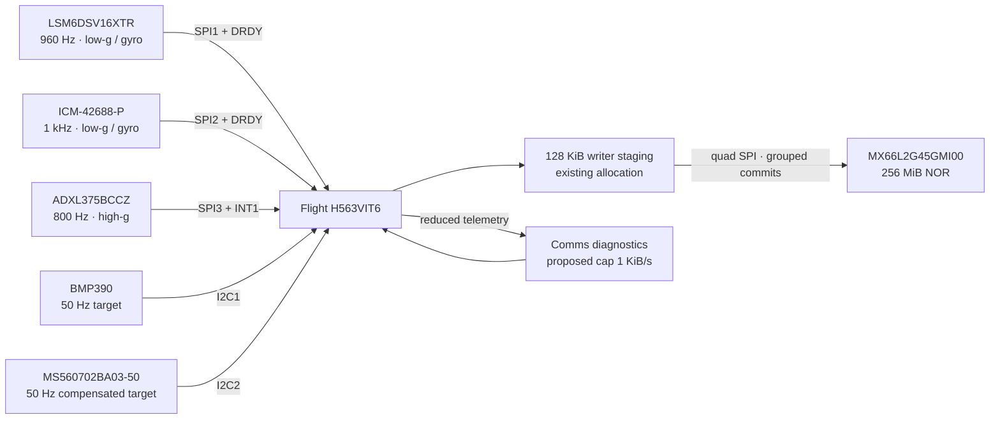
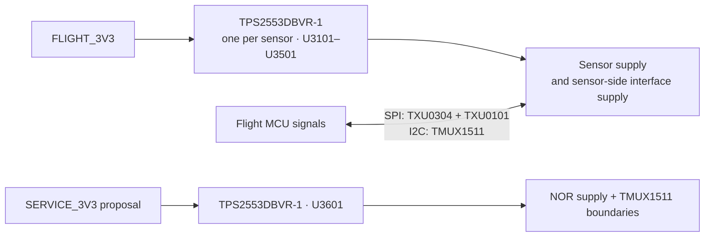

# Sensors and the flight record

**19 September · proposal · retain the five sensors and 256 MiB NOR.**

## Justification and deeper detail

| Question | Follow through | Source status |
| --- | --- | --- |
| Why these five sensors? | [Device-by-device selection rationale](implementation-reference/07-sensors-logging.md#the-selection-reasoning-device-by-device) | Ranges, alternatives and manufacturer sources |
| Why NOR rather than SD? | [Capacity and medium comparison](implementation-reference/07-sensors-logging.md#why-256-mib-nor-rather-than-smaller-flash-or-sd) | Earlier storage research |
| What supports rates and capacity? | [Power, recording and CAN audit](../power-recording-can-audit-2026-09-11.md); [current proposal calculations](../calculations/component-proposal-checks.py) | Baseline ledger plus current additions |

Rates are design allocations, not measured delivery. Each stream has its own
sample timestamp, axis transform, validity and clipping state.

| Part / bus | Why this part remains | Useful bound |
| --- | --- | --- |
| LSM6DSV16XTR / SPI1 | Low-g acceleration and higher-range gyro | ±16 g; up to ±4000°/s with required configuration |
| ICM-42688-P / SPI2 | Dissimilar second implementation | ±16 g, ±2000°/s; above that only ST may remain valid |
| ADXL375BCCZ / SPI3 | Preserve acceleration when both IMUs clip | Nominal ±200 g; specified minimum ±180 g |
| BMP390 / I2C1 | Compact lower-flight pressure measurement | 300–1250 hPa specified range |
| MS560702BA03-50 / I2C2 | Independent pressure conversion/compensation | 300–1100 mbar full-accuracy region; extended conversion range is not equal accuracy |
| MX66L2G45GMI00 / quad SPI | Capacity without removable-media socket | 2 Gbit = 256 MiB; program stalls still need buffering |

Diversity costs five drivers and more interfaces. It buys range and independent
observations, not a two-sensor vote that identifies truth. Shared mounting,
upstream power and blocked pressure vent remain common faults.

## Power and signal boundaries

Retain individually controlled sensor enables: a latch-off branch needs an
explicit restart path. Power switching alone cannot stop signal back-power.
Retries are bounded; persistent faults stay disabled.

Exact flight buses: ST PA5/6/7; TDK PB13/14/15; ADXL PC10/11/12;
BMP PB6/7; TE PB10/PB3. NOR: PB2 clock, PE11 select,
PD11 IO0, PD12 IO1, **PE2 IO2**, PD13 IO3. Control/interrupts remain in the
[pin CSV](../../hardware/croi2/libraries/inputs/flight-pinout.csv).

## Recording

**Recommend continuous prepared recording with event markers.** Retain at least
a proposed ten seconds before launch; use low-rate pad logging outside the
bounded full-rate window. No separate comms flash: forward bounded diagnostics
to the existing recorder, with source/time/reset identity and drop counters.

| Failure | Shared flight NOR proposal | Extra comms flash would change |
| --- | --- | --- |
| Radio link lost | Keep comms evidence over internal UART | No essential gain for this case |
| Comms resets | Flight records gap/reset; unsent tail lost | Can retain earlier local commits |
| Flight MCU/UART fails | New comms evidence cannot be stored | Independent comms recording while its supply survives |
| Whole board power loss | Prior commits retained; tail uncertain | Still shares power loss |

**Choice:** accept the flight/UART dependency for diagnostics and reuse NOR.
Add separate comms storage only for an explicit requirement to record through
that failure; it costs driver, pins, supply, format and readout work.

| Budget | Calculated result |
| --- | --- |
| Existing aggregate record rate | 96,672 B/s |
| 128 KiB writer staging | 1.356 s at that rate; not spare pre-trigger RAM |
| Thirty minutes of samples | 174,009,600 B |
| Existing mission ledger incl. allowances | 180,587,776 B |
| Capacity minus that ledger and 64 MiB reserve | 20,738,816 B |
| Additional 1 KiB/s diagnostics for 30 min + 10 s lead-in at full combined rate | 2,820,160 B |
| Remaining unallocated capacity after those additions | 17,918,656 B |

The ten-second line is conservatively additional; don't count it twice when
implementing the final record ledger. Full-rate pad recording cannot run for
hours. Prepared-space exhaustion must be visible before flight.

Proposed commit unit: sixteen 256-byte data pages, then one footer page.
At the researched 1.5 ms maximum page-program value, programming alone takes
25.5 ms per 4 KiB payload. Earlier quad-transfer arithmetic gives ~157 kB/s
before software overhead. **Exact device timing and measured sustained verified
throughput still control acceptance.** Pre-erase disarmed; reject torn tails;
never let an erase or logger fault stall essential flight work.

**Next check:** concurrent acquisition/write stress, interrupted writes,
address-boundary readback, sensor orientation/clipping/freshness and bus faults.
Hold-up protects flight execution only; it does not guarantee a final NOR commit.

Sources: [device datasheets and configuration rationale](implementation-reference/07-sensors-logging.md),
[storage arithmetic](../power-recording-can-audit-2026-09-11.md),
[configuration review](../sensor-configuration-review-2026-09-07.md).
