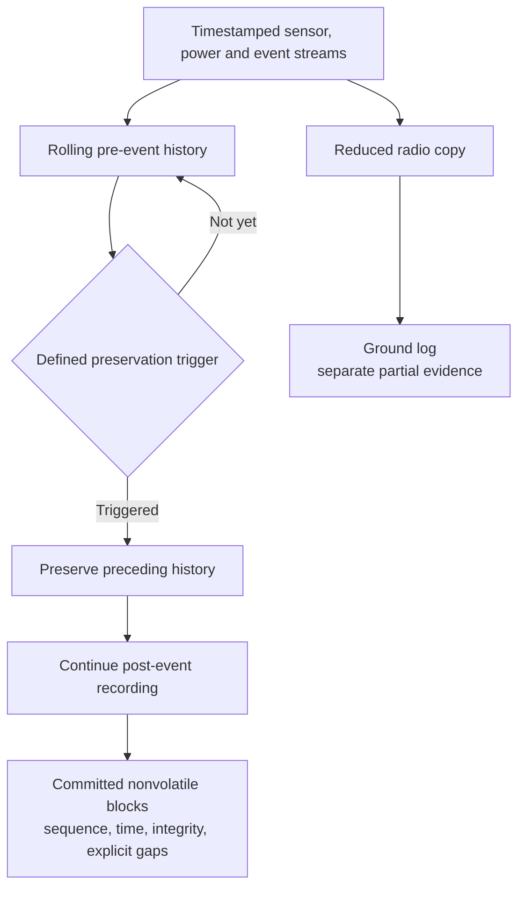
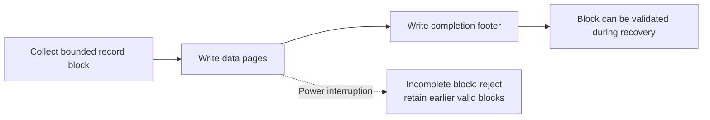

# 7. Measurements and a record we can recover

**Retained:** dissimilar sensing, bounded device failures and full-rate local
recording. **Working direction:** retain pre-event history. **Open:** its exact
duration/trigger, damage survivability and measured recording performance.

## Why these measurements?

| Measurement | Existing choice | Job and limit |
| --- | --- | --- |
| Two low-g accelerometers/gyroscopes | LSM6DSV16X and ICM-42688-P | Fine motion/rotation observations from different implementations; shared mounting and environment remain |
| High-g acceleration | ADXL375 | Preserve boost data when low-g channels clip; it is not a precision coast substitute |
| Two pressure measurements | BMP390 and MS5607 | Compare independent devices; a shared blocked vent can defeat both |
| Common battery current and voltage | Core input measurement | Diagnose electrical events, not prove mechanical outcomes |

Two disagreeing sensors do not automatically identify which is right. Use
status, freshness, saturation and consistency with other evidence. Different
manufacturers reduce some shared implementation risks but not a bad mounting
transform or a shared pressure path.

The starting streams run at different rates: approximately 960/1000 Hz for
the two IMUs, 800 Hz for high-g and target 50 Hz compensated pressure. Their
timestamps must remain independent. A nominal 200 g sensor has a specified
minimum range of 180 g; do not hide clipping behind the nominal label.

Pressure accuracy and useful range also differ. Both pressure devices' ordinary
full-accuracy ranges approach their limit near the upper workhorse envelope.
An extended conversion range is not the same accuracy guarantee.

## What Rev 1 taught us

Check exact device identity, package, orientation and axis transforms. Isolate
bus faults as well as supply faults. Keep pressure ports clear of coating and
adhesive; avoid placing inertial sensors where board flex, magnetics, actuator
currents or the sounder dominate the measurement.

Coast means low specific force, not low vehicle speed. An accelerometer in
ballistic flight is not simply a gravity-direction sensor. Reducing its range
can improve digital resolution without necessarily fixing bias or vibration.

The earlier reset around recovery still has no established cause. Preserve
enough synchronized evidence to distinguish supply trouble, reset, a requested
event and its actual aftermath.

## Keep the run-up, not just the event

This is proposed behaviour, not implemented firmware. A rolling buffer replaces
its oldest history while waiting. Once an event is detected, preserve the
lead-up and continue with the aftermath. That can expose a pad/ignition
transient which launch-triggered recording alone would miss.

Define its start condition, trigger, time window, repeated-trigger behaviour,
reset/abort handling and relationship to normal pad recording. “100 samples”
is not a duration specification: at 1 kHz it is only 100 ms.

**Recommendation:** calculate the window in seconds for each stream using the
existing record budget and available memory. Decide what must survive a reset
versus complete power loss before selecting a storage strategy. RAM alone
does not retain the pre-event history after its power disappears.

## Three different meanings of a black box

| Failure | Desired evidence | What remains unproved |
| --- | --- | --- |
| Power stops during a write | Earlier committed records remain readable; incomplete tail is rejected | Actual device interruption behaviour and bounded restart |
| The PCB is damaged | Surviving storage can be extracted or read | Mechanical damage case, placement and recovery method |
| The vehicle is lost | Ground receiver retains what it received | Link gaps, host flush behaviour and record completeness |

Soldered flash avoids a removable-media socket; it is not automatically a
crash-survivable recorder. Seán reported recording in the Mac application and
Arnav reported Cyberdeck recording. Those capabilities need inspection before
assuming equivalent formats, timestamps or durability.

## Make committed data distinguishable from a partial write

The existing research proposes grouped pages with a completion footer. Writing
a separate commit for every page would reduce worst-case throughput below the
draft logging demand. Pre-erase while disarmed; never wait for an erase or scan
the entire device before resuming essential flight work.

The draft budget is about 96.7 kB/s and uses 256 MiB of NOR. Thirty-minute
recording, pad/recovery data, metadata and reserve must fit together. These are
calculations awaiting measured write throughput, not a finalized record format.

If recording fails after launch, end transactions within a bound and preserve
essential flight operation. Before launch, unexplained logger failure stops
preparation. Never let a logging error create a flight reset loop.

## Next pass through this chapter

Agree the useful pre-event time and trigger semantics, and what each survival
claim actually covers. Test interrupted writes at different stages, full and
corrupt storage, timestamps, clipping, axis transforms and stuck devices.
Preserve explicit data gaps rather than producing an apparently continuous
but misleading plot.

[Next: vehicle power and expansion](08-foinse-can.md) · [Detailed sensor and NOR evidence](implementation-reference/07-sensors-logging.md)
