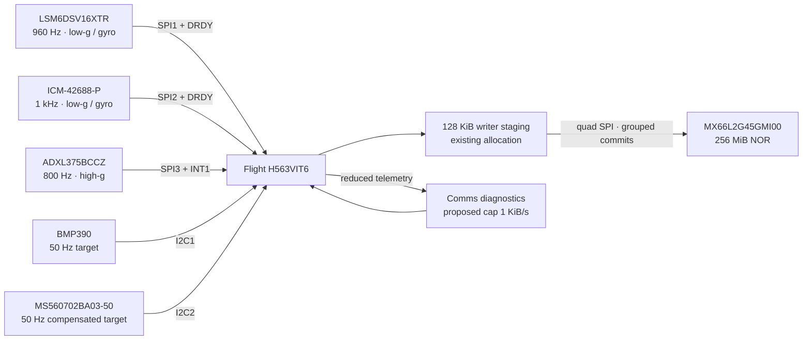
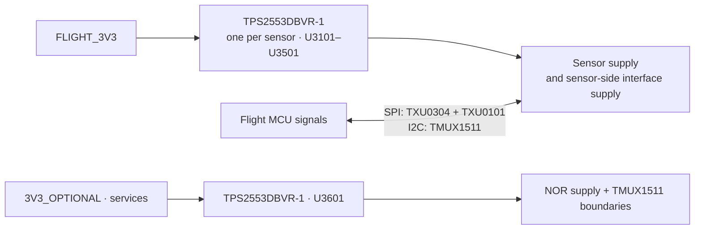

# Sensors and the flight record

**22 September · proposal · retain the five sensors and 256 MiB NOR.**

## Justification and deeper detail

| Question | Follow through | Source status |
| --- | --- | --- |
| What is the actual commit/preparation contract? | [Sector-aligned format and capacity justification](justifications/recording-and-service.md) | Current 15-page + footer proposal supersedes the 16-page candidate |
| Why these five sensors? | [Device-by-device selection rationale](implementation-reference/07-sensors-logging.md#the-selection-reasoning-device-by-device) | Ranges, alternatives and manufacturer sources |
| Why NOR rather than SD? | [Capacity and medium comparison](implementation-reference/07-sensors-logging.md#why-256-mib-nor-rather-than-smaller-flash-or-sd) | Earlier storage research |
| What supports rates and capacity? | [Power, recording and CAN audit](../power-recording-can-audit-2026-09-11.md); [current proposal calculations](../calculations/component-proposal-checks.py) | Baseline ledger plus current additions |

Rates are design allocations, not measured delivery. Each stream has its own
sample timestamp, axis transform, validity and clipping state.

| Part / bus | Why this part remains | Useful bound |
| --- | --- | --- |
| LSM6DSV16XTR / SPI1 | Low-g acceleration and higher-range gyro | ±16 g; up to ±4000°/s with required configuration |
| ICM-42688-P / SPI2 | Dissimilar second implementation | ±16 g, ±2000°/s; above that only ST may remain valid |
| ADXL375BCCZ / SPI3 | Preserve acceleration when both IMUs clip | Nominal ±200 g; specified minimum ±180 g |
| BMP390 / I2C1 | Compact lower-flight pressure measurement | 300–1250 hPa specified range |
| MS560702BA03-50 / I2C2 | Independent pressure conversion/compensation | 300–1100 mbar full-accuracy region; extended conversion range is not equal accuracy |
| MX66L2G45GMI00 / quad SPI | Capacity without removable-media socket | 2 Gbit = 256 MiB; program stalls still need buffering |

Diversity costs five drivers and more interfaces. It buys range and independent
observations, not a two-sensor vote that identifies truth. Shared mounting,
upstream power and blocked pressure vent remain common faults.

## Power and signal boundaries

Retain individually controlled sensor enables: a latch-off branch needs an
explicit restart path. Power switching alone cannot stop signal back-power.
Retries are bounded; persistent faults stay disabled.

Exact flight buses: ST PA5/6/7; TDK PB13/14/15; ADXL PC10/11/12;
BMP PB6/7; TE PB10/PB3. NOR: PB2 clock, PE11 select,
PD11 IO0, PD12 IO1, **PE2 IO2**, PD13 IO3. Control/interrupts remain in the
[proposed pin CSV](proposed-flight-pinout.csv).

## Recording

**Recommend continuous prepared recording with event markers.** Retain at least
a proposed ten seconds before launch; use low-rate pad logging outside the
bounded full-rate window. No separate comms flash: forward bounded diagnostics
to the existing recorder, with source/time/reset identity and drop counters.

| Failure | Shared flight NOR proposal | Extra comms flash would change |
| --- | --- | --- |
| Radio link lost | Keep comms evidence over internal UART | No essential gain for this case |
| Comms resets | Flight records gap/reset; unsent tail lost | Can retain earlier local commits |
| Flight MCU/UART fails | New comms evidence cannot be stored | Independent comms recording while its supply survives |
| Whole board power loss | Prior commits retained; tail uncertain | Still shares power loss |

**Choice:** accept the flight/UART dependency for diagnostics and reuse NOR.
Add separate comms storage only for an explicit requirement to record through
that failure; it costs driver, pins, supply, format and readout work.

| Budget | Calculated result |
| --- | --- |
| Samples / additional diagnostics | 96,672 B/s / ≤1024 B/s |
| 128 KiB writer staging at combined rate | 1.342 s when empty |
| Revised mission ledger, including diagnostics and ten-second lead-in | 183,407,936 B |
| Conservative sector-rounded storage, charging footer overhead again | **195,637,248 B** |
| Spare in 192 MiB recording region | **5,689,344 B**; final 64 MiB remains reserved |

**Commit unit: 15 data pages + one footer = one 4 KiB erase sector.** Program
footer last; accept only valid CRC/length/epoch/sequence, discard torn tails.
This replaces the 16-page candidate that crossed erase boundaries. Full footer
layout, timestamp/identity rules and byte accounting are in the
[recording specification](justifications/recording-and-service.md#use-one-erase-sector-per-commit).

Pre-erase/blank-check only in explicit ground service. Preparing all 192 MiB
with 64 KiB erases can take **102.4 minutes at the published maximum**, plus
verification. It cannot be a hidden boot prerequisite. No erase while acquiring;
reserve a full mission window before claiming recorder-ready. Waiting/aborted
attempts consume space. Full-rate pad logging for hours does not fit.

Proposed measured useful throughput target: **≥125 kB/s**, concurrently with
acquisition and CRC/commit work. The 1.5 ms maximum program-time calculation gives
160 kB/s before overhead; that is a desk bound, not a passed performance test.
[Source revisions and limitations](justifications/recording-and-service.md#evidence).

## Schematic handoff

Retain sensor/NOR hardware and individual enables/boundaries. Sensor ILIM tied
to IN intentionally selects 50–100 mA limits; it is not a missing resistor.
Local trips have bounded restart and cannot stall essential flight work. The
separate comms regulator now preserves NOR supply through a comms-LDO fault;
a service-regulator fault still removes it. Hold-up protects flight execution,
not a final flash commit.

Sensor mounting/axis transforms, venting and thermal placement follow the
[placement handoff](justifications/interfaces-and-installation.md#placement-handoff).
Firmware ranges/rates must account for conversion/filter delay, clipping and
freshness. Both low-g and both pressure channels can become unusable together;
component diversity is not full-envelope coverage.

Sources: [device/configuration rationale](implementation-reference/07-sensors-logging.md),
[retained configuration review](../sensor-configuration-review-2026-09-07.md),
[current format/calculation sources](justifications/recording-and-service.md).
