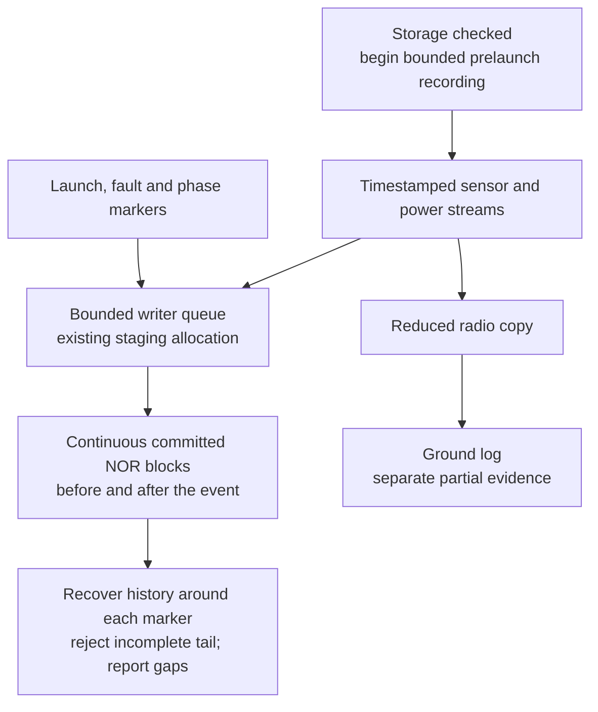
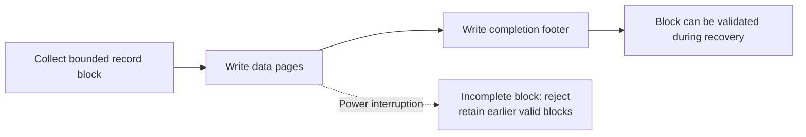

# 7. Measurements and a record we can recover

**Next-review answers:** [18 September investigation](2026-09-18-review-investigations.md#3-comms-evidence-gnss-and-radio) supplies recommendations and supporting comparisons for this chapter.

**13 September coverage:** this chapter was not reached. Related remarks are
recorded in the [session review](2026-09-13-session-review.md); they do not
establish acceptance of this chapter.

**Retained:** dissimilar sensing, bounded device failures and full-rate local
recording. **Working direction:** retain pre-event history. **Open:** its exact
duration/trigger, damage survivability and measured recording performance.

## Why these measurements?

| Measurement | Existing choice | Job and limit |
| --- | --- | --- |
| Two low-g accelerometers/gyroscopes | LSM6DSV16X and ICM-42688-P | Fine motion/rotation observations from different implementations; shared mounting and environment remain |
| High-g acceleration | ADXL375 | Preserve boost data when low-g channels clip; it is not a precision coast substitute |
| Two pressure measurements | BMP390 and MS5607 | Compare independent devices; a shared blocked vent can defeat both |
| Common battery current and voltage | Core input measurement | Diagnose electrical events, not prove mechanical outcomes |

Two disagreeing sensors do not automatically identify which is right. Use
status, freshness, saturation and consistency with other evidence. Different
manufacturers reduce some shared implementation risks but not a bad mounting
transform or a shared pressure path.

The starting streams run at different rates: approximately 960/1000 Hz for
the two IMUs, 800 Hz for high-g and target 50 Hz compensated pressure. Their
timestamps must remain independent. A nominal 200 g sensor has a specified
minimum range of 180 g; do not hide clipping behind the nominal label.

Pressure accuracy and useful range also differ. Both pressure devices' ordinary
full-accuracy ranges approach their limit near the upper workhorse envelope.
An extended conversion range is not the same accuracy guarantee.

## What Rev 1 taught us

Check exact device identity, package, orientation and axis transforms. Isolate
bus faults as well as supply faults. Keep pressure ports clear of coating and
adhesive; avoid placing inertial sensors where board flex, magnetics, actuator
currents or the sounder dominate the measurement.

Coast means low specific force, not low vehicle speed. An accelerometer in
ballistic flight is not simply a gravity-direction sensor. Reducing its range
can improve digital resolution without necessarily fixing bias or vibration.

The earlier reset around recovery still has no established cause. Preserve
enough synchronized evidence to distinguish supply trouble, reset, a requested
event and its actual aftermath.

## Keep the run-up, not just the event

This is the recommended behaviour, not implemented firmware. Recording begins
before the event; the event adds a marker rather than starting the recorder.
That can expose a pad/ignition transient which launch-triggered recording alone
would miss. A RAM ring which replaces its oldest history until a trigger is an
alternative, but the capacity calculation below shows its limit.

Define its start condition, trigger, time window, repeated-trigger behaviour,
reset/abort handling and relationship to normal pad recording. “100 samples”
is not a duration specification: at 1 kHz it is only 100 ms.

### The buffer arithmetic

The current aggregate allocation is **96,672 B/s**, including the current-monitor
records and existing framing allowance. Using that whole rate conservatively:

| RAM reserved exclusively for history | Maximum history before metadata/headroom |
| --- | --- |
| 32 KiB | 0.339 s |
| 64 KiB | 0.678 s |
| 96 KiB | 1.017 s |
| 128 KiB | 1.356 s |

The existing 128 KiB is **log staging**, not spare memory promised to a second
history buffer. Five seconds needs 483,360 bytes; ten needs 966,720 bytes.
Neither fits the current staging allocation. Do not consume critical stacks or
protected control-state memory to make this table fit.

**Recommendation:** start full-rate append-only NOR recording shortly before
arming, after storage/readiness checks. Preserve at least a proposed **10 seconds
before launch**, marking launch and faults in the same continuous record rather
than starting recording at the event. This is a candidate requirement for review,
not implemented behaviour. Its cost is pad storage and a defined readiness start;
it avoids holding a long history only in volatile RAM. Keep the existing staging
buffer available for flash stalls. Do not introduce in-flight circular erasing.

If the experiment specifically needs a RAM-only trigger window, a candidate
96 KiB history / 32 KiB writer split gives roughly one second of history and
0.339 seconds of empty-queue stall headroom. It is an alternative, not additional
memory. Pending data consumes that headroom; preserving a window cannot stop
new acquisition. Both strategies need reset/abort and repeated-trigger semantics.
Neither RAM nor the held flight rail guarantees recording after complete power loss.

## Three different meanings of a black box

| Failure | Desired evidence | What remains unproved |
| --- | --- | --- |
| Power stops during a write | Earlier committed records remain readable; incomplete tail is rejected | Actual device interruption behaviour and bounded restart |
| The PCB is damaged | Surviving storage can be extracted or read | Mechanical damage case, placement and recovery method |
| The vehicle is lost | Ground receiver retains what it received | Link gaps, host flush behaviour and record completeness |

Soldered flash avoids a removable-media socket; it is not automatically a
crash-survivable recorder. Seán reported recording in the Mac application and
Arnav reported Cyberdeck recording. Those capabilities need inspection before
assuming equivalent formats, timestamps or durability.

## Make committed data distinguishable from a partial write

The existing research proposes grouped pages with a completion footer. Writing
a separate commit for every page would reduce worst-case throughput below the
draft logging demand. Pre-erase while disarmed; never wait for an erase or scan
the entire device before resuming essential flight work.

The draft budget is about 96.7 kB/s and uses 256 MiB of NOR. Thirty-minute
recording, pad/recovery data, metadata and reserve must fit together. These are
calculations awaiting measured write throughput, not a finalized record format.

### Storage and write margin

Thirty minutes at the current rate uses **174,009,600 bytes**. The existing
mission allocation, including its pad/recovery/metadata allowance, is
**180,587,776 bytes**. After retaining 64 MiB untouched in a 256 MiB device,
**20,738,816 bytes remain**: about 214.5 seconds of additional full-rate data.
That is only 3.6 extra minutes, not hours of full-rate pad waiting. A new 10-second
lead-in costs 966,720 bytes if it was not already included. Cap the full-rate
prelaunch interval, mark aborted attempts and reprepare safely if necessary.

Sixteen 256-byte data pages plus one footer take 25.5 ms at the researched
1.5 ms maximum page-program time. Adding only data transfer at 16 MHz gives
about **157 kB/s with four lanes**, or **148 kB/s with one lane**, before commands,
polling, scheduling and verification overhead. Against 96.7 kB/s this leaves
roughly 38.5% or 34.7% of that simplified service capacity unused. It is a desk
budget, not a demonstrated recorder. The exact device revision and implemented
commit format must still be checked.

The useful surprise: single-lane SPI is not ruled out by this arithmetic, so
the two-pin saving raised in the MCU chapter deserves a measured comparison.
No pin or interface change is selected. A separate commit operation per data
page still falls below demand at the same worst-case program time.

[Reproducible calculations, assumptions and evidence](../power-recording-can-audit-2026-09-11.md).

If recording fails after launch, end transactions within a bound and preserve
essential flight operation. Before launch, unexplained logger failure stops
preparation. Never let a logging error create a flight reset loop.

## Next pass through this chapter

Agree the useful pre-event time and trigger semantics, and what each survival
claim actually covers. Test interrupted writes at different stages, full and
corrupt storage, timestamps, clipping, axis transforms and stuck devices.
Preserve explicit data gaps rather than producing an apparently continuous
but misleading plot.

[Next: vehicle power and expansion](08-foinse-can.md) · [Detailed sensor and NOR evidence](implementation-reference/07-sensors-logging.md)
