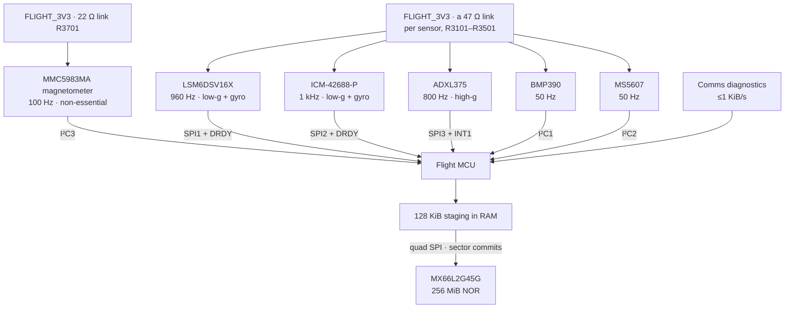

# 07 Sensors and recording

Five flight sensors on their own buses, each fed from FLIGHT_3V3 through a
47 Ω link; a magnetometer on its own bus that the flight decisions never depend
on; and a 256 MiB NOR flash owned by the flight MCU. Full-rate recording starts
at launch detect, with a RAM pre-trigger
([D-6.6, D-6.9, D-2Nov.3, D-2Nov.11](../../decisions.md)).

Rates are allocations, not measurements. Every stream keeps its own timestamp,
axis transform, validity and clipping flag.

| Part / bus | Why | Limit |
| --- | --- | --- |
| LSM6DSV16XTR / SPI1 | Low-g and high-range gyro | ±16 g; up to ±4000°/s configured |
| ICM-42688-P / SPI2 | A second, different implementation | ±16 g, ±2000°/s; above that only the ST stays valid |
| ADXL375BCCZ / SPI3 | Acceleration when both IMUs clip | ±200 g nominal, ±180 g minimum |
| BMP390 / I²C1 | Compact pressure for lower flight | 300–1250 hPa; at 9 km (≈308 hPa) it's at its floor |
| MS560702BA03-50 / I²C2 | Independent pressure conversion | Best accuracy 300–1100 mbar; extended range is less accurate |
| MMC5983MA / I²C3 | Heading and roll reference for roll control and the grid fins; attitude after a flight (D-2Nov.11) | ±8 G, 0.6 mG RMS at 100 Hz. Needs calibration in the assembled bay; never gates the watchdog or the estimator |
| MX66L2G45GMI00 / quad SPI | Capacity without a removable card | 256 MiB; program stalls need the RAM buffer |

Two of each sensor type gives range and independent observations, not a vote
that finds the truth. Shared mounting, power and a blocked vent stay common faults.

**Power (D-6.6, D-2Nov.3):** no per-sensor switches or isolators. They guarded a
rare sensor short or latch-up with 13 ICs, each one a new way to lose a sensor.
Instead each sensor's supply link is 47 Ω: a dead short draws at most ≈71 mA,
which the flight rail carries, and the 0603 may burn open, which isolates it.
In normal running the link drops ≤66 mV (MS5607 converting). Firmware recovers a
hung I²C bus by clocking SCL and resets a sensor with its soft-reset command. A
sensor it gives up on gets its bus pins parked (driven low or set as inputs), so
the MCU doesn't feed it through the 22 Ω damping. The magnetometer's link is
22 Ω because its minimum supply is 2.8 V. The NOR no longer has its own limiter or isolation (U3601 and its isolators removed by D-27Nov.2, proposed);
it sits on `FLIGHT_3V3`.

**Pins** (since D-22Nov.25)**:** ST PA5/PA6/PA7, select PD14; TDK PB13/PB14/PB15, select PC8; ADXL
PC10/PC11/PC12, select PD2; BMP PB6/PB7; TE PB10/PB3; magnetometer PA8 (SCL) / PC9 (SDA), INT on
PD3. NOR: PA3 clock, PE11 select, PD11 IO0, PD12 IO1, PE2 IO2, PD13 IO3. Interrupts and the rest:
[firmware interface](../firmware-interface.md#flight-mcu-pins).

## Recording

- On the pad: log at low rate.
- Keep about 1 s of full-rate samples, or about 10 s decimated, in a RAM ring;
  commit it at launch detect.
- Full rate from launch detect to LANDED plus a configured tail.
- Erase ahead of the write pointer is allowed until launch detect, never after.
- Comms diagnostics go to the same NOR over the UART, with source, time, reset
  identity and drop counters. No second flash on comms.

| If this fails | Shared NOR | A comms flash would add |
| --- | --- | --- |
| Radio link | Comms evidence still reaches NOR over the UART | Nothing |
| Comms resets | Flight records the gap; unsent tail lost | Earlier comms commits |
| Flight MCU or UART | New comms evidence can't be stored | Comms recording while its supply lasts |
| Whole board power | Earlier commits kept; tail uncertain | Nothing; same power |

Add a comms flash only for a real need to record through a flight-MCU failure.

**Format:** one commit = 15 data pages + 1 footer = one 4 KiB erase sector.
Program the footer last; accept only a valid CRC, length, epoch and sequence;
drop torn tails. [Footer and identity rules](justifications/recording-and-service.md#use-one-erase-sector-per-commit).

| Budget (calculated) | Value |
| --- | --- |
| Sensor data / diagnostics | 96,672 B/s / ≤1,024 B/s |
| Magnetometer, 100 Hz with 16-byte records (D-2Nov.11) | ≈1,600 B/s more |
| 128 KiB staging at the full rate | 1.320 s (1.342 s without the magnetometer) |
| Kármán mission ledger with 10 s lead-in | 186,303,936 B (183,407,936 B without the magnetometer) |
| Sector-rounded, footers charged again | 198,725,632 B (195,637,248 B) |
| Spare in the 192 MiB region | 2,600,960 B (5,689,344 B); last 64 MiB reserved |
| Throughput target, measured with acquisition running | ≥125 kB/s (desk bound 160 kB/s at 1.5 ms per page) |

The 192 MiB window and 30-minute full-rate figure are the Kármán overlay
(D-6.8); the workhorse window comes from the vehicle's flight time. Preparing
all 192 MiB with 64 KiB erases can take 102.4 minutes at the datasheet maximum:
a service job, never a boot step. Report recorder-ready only with a full
mission window erased.

## Capture and placement

Keep the sensors and NOR; remove the per-sensor switches and isolators and fit
the 47 Ω links and the magnetometer, per the
[capture delta](schematic-capture-spec.md#sensors-memory-and-can). Place the
magnetometer at the top end of the board, away from current and steel
([layout guide](../pcb-layout-guide.md#c09a-magnetometer)). The comms
regulator split keeps NOR powered through a comms-LDO fault; a services fault
still drops it. Hold-up protects flight execution, not a last flash commit.

Mounting, axis transforms, venting and thermal placement:
[placement notes](justifications/interfaces-and-installation.md#placement-handoff).
Both low-g and both pressure channels can be unusable at once; diversity isn't
full-envelope coverage.

Sources: [sensor selection](../archive/architecture/implementation-reference/07-sensors-logging.md) ·
[NOR versus SD](../archive/architecture/implementation-reference/07-sensors-logging.md#why-256-mib-nor-rather-than-smaller-flash-or-sd) ·
[configuration review](../archive/sensor-configuration-review-2026-09-07.md) ·
[recording audit](../archive/power-recording-can-audit-2026-09-11.md) ·
[proposal checks](../calculations/component-proposal-checks.py)
