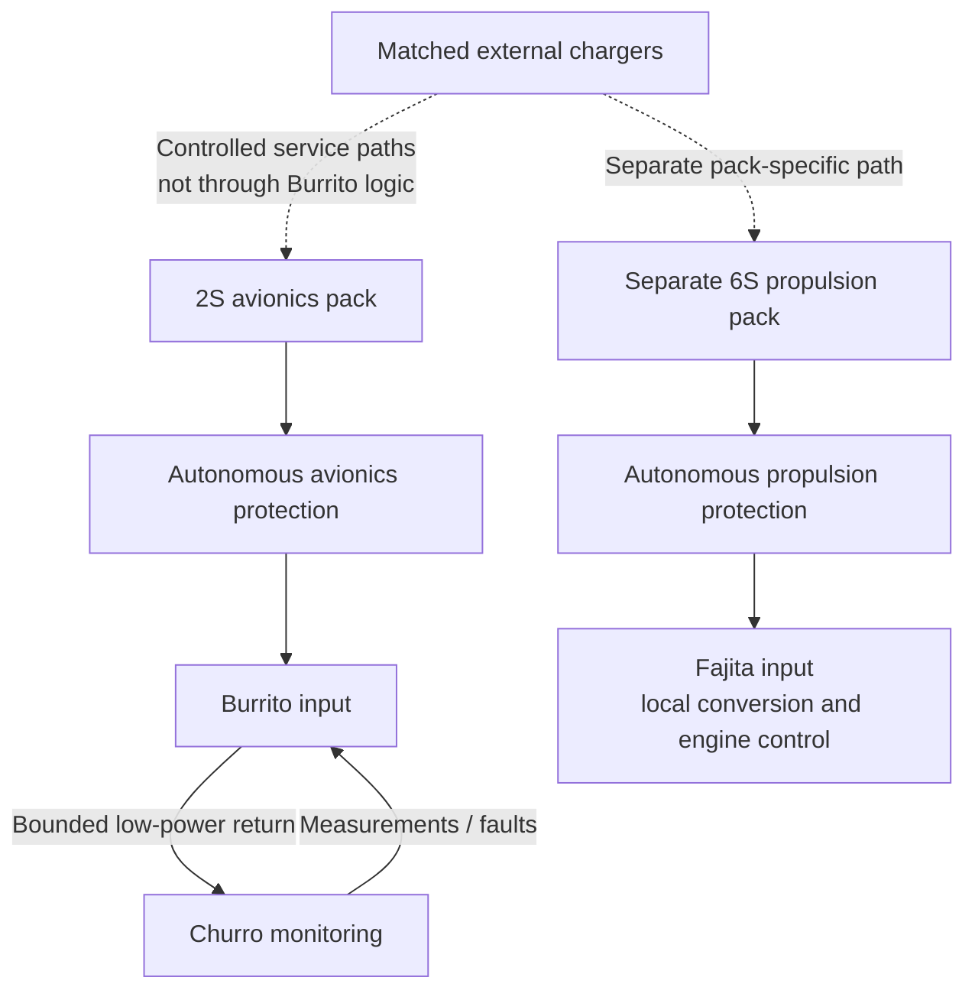
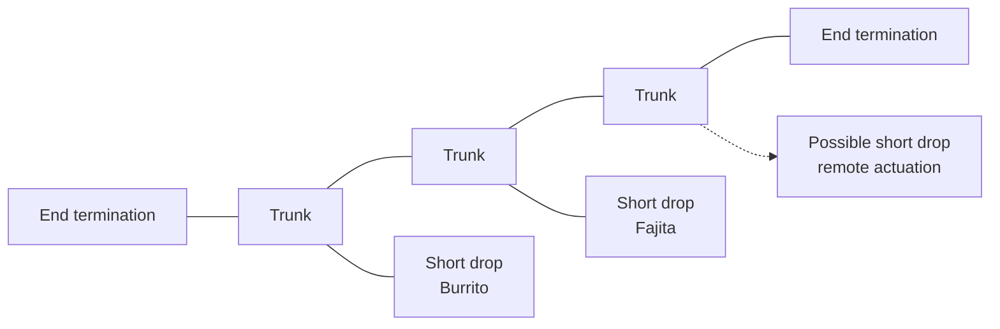

# 8. Churro, Fajita and the vehicle outside Burrito

**Retained:** autonomous source protection, engine-local safety and standalone
Burrito. **Open:** actuator supply needs, future CAN peers and pad-service
implementation. Experimental payload expansion is separately scoped.

## Why Churro is separate

Different vehicles need different battery branches, current capability and
possibly regulated actuator supplies. Keeping those decisions on a power
companion avoids redesigning the complete flight computer every time a
vehicle changes.

Churro's existing design has no processor. Source protection starts from its
own battery, without Burrito booting or answering a message. Returned low-power
supply and monitoring are conveniences, not permission to start delivering power.

The two pack positives never join. The diagram does not define charge wiring
or prove return-path isolation. The existing interboard connection carries
power, bounded auxiliary power, monitoring and fault signals; it is not a
general expansion bus.

A broken main return must not make actuator current flow through a small
signal-reference wire. Connector retention and complete return paths matter
as much as the supply's advertised rating.

## A nominal voltage is not a load specification

A nominal 24 V valve is not automatically compatible with a 6S pack across its
full discharge range. Likewise, a servo's stall current may dominate a branch
even when average demand looks small.

**Recommendation:** keep regulation conditional on actual selected loads.
Compare voltage range, simultaneous/stall demand, duty cycle, returned energy
and temperature before choosing a converter. Churro's flexibility is useful;
speculative regulation for unknown loads is not.

A battery-management system, source protection and charging each have different
jobs. No BMS was selected for Burrito. Define what the pack supplies, what
Churro protects and what the external charger does rather than saying one board
“handles the battery.”

## CAN: preserved connection versus proposed network

The current contract uses 500 kbit/s Classical CAN between Burrito and Fajita,
with fixed termination at the ends. The flight processor owns Burrito's CAN.

The meeting proposed a trunk with short drops so a board is not responsible for
passing the harness through to its neighbour:

This second diagram is a **candidate physical layout**, not permission to add
a third node. Termination location, removable-node behaviour, cable/stub lengths,
bus workload and transceiver compatibility need a reviewed contract. Selectable
termination was discussed; it is not installed.

CAN uses differential signalling to tolerate some common-mode disturbance
within device limits. It is not defined by the positive/negative voltages used
as an informal explanation in the room. CAN FD and Classical CAN also cannot
share assumed headline rates; bits per second are not bytes per second.

A valid checksum detects certain transmission errors. It does not prove a
command is current, appropriate or from the intended peer. Messages need
identity, sequence, age and permitted-state checks.

On the test stand, an adapter can temporarily occupy Burrito's position.
Adding a new vehicle peer must also reconcile that emulator arrangement.
The stand's GSE link is not silently bridged into the vehicle bus.

## Pad power and keeping a GNSS fix

The useful aim is to prepare/service the vehicle and acquire GNSS without
prematurely enabling output energy. Keep three distinct actions:

1. Supply or enable logic power.
2. Charge through an approved pack-specific service path.
3. Deliberately enable the permitted output-energy domains.

Removing a service plug is not automatic arming. The existing maintained
electronic-enable connection is open = OFF, closed = ON; OFF still leaves
upstream circuitry live. It is not physical battery isolation or proof of
energetic disarm.

The proposed common servo/energetic enable still needs the chapter 3 review.
On-rail charging is a useful investigation, not an approved circuit or a
reason to improvise battery wiring.

## A place for experiments that is not the flight core

The mikroBUS discussion led toward a **separate generic payload carrier**:
a small processor, suitable power, programming access, mounting and interfaces
for a named experiment. Storage or independent radio can be added when the
experiment needs them.

The current eight-contact power-board connection does not become a 16-contact
mikroBUS interface by analogy. Desired module pinouts need checking; do not
assume standardized Quad-SPI support.

Useful first projects include a small MCU/power board, a music/buzzer experiment,
a payload carrier, an inert remote-actuator demonstrator or a scoped pad-service
study. They can develop real owners without quietly making newcomers
responsible for flight safety.

The department can grow payload concepts toward nearer vehicle flights and
later programmes. That organizational aim does not add a REXUS commitment to
this computer or assign all integration work to Seán.

## Next pass through this chapter—and back to the whole system

Check whether the complete vehicle still makes sense with the choices discussed
in every preceding chapter. What must be local, what must be independent, and
what can remain a separately owned experiment?

Record each actual agreement in the relevant chapter and current-system.
Carry unresolved questions forward beside their mechanism. Then read the
**whole improved pack again** next session. Authorization to implement the
final stack is a separate explicit step.

[Back to overview](00-overview.md) · [Detailed power/interconnect evidence](implementation-reference/08-foinse-can.md) · [Vehicle contract](../../interfaces/ogma-foinse-propulsion-boundary.md)
