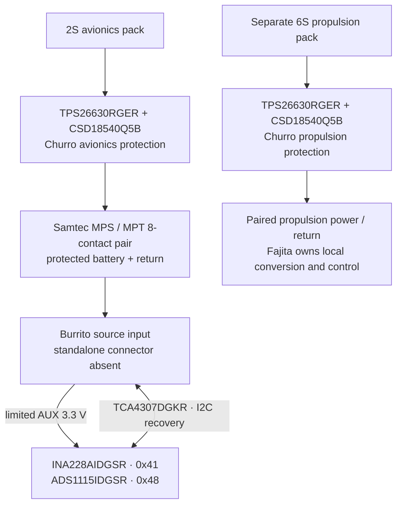
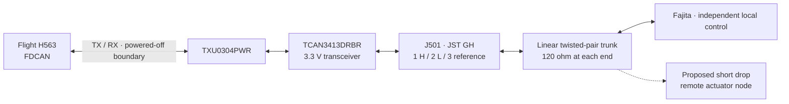

# Churro power and the vehicle link

**19 September · proposal · retain the MCU-less power companion.**

## Justification and deeper detail

| Question | Follow through | Source status |
| --- | --- | --- |
| Why this power companion? | [Churro component rationale](implementation-reference/08-foinse-can.md) | Preserved circuit and selection research |
| Where does the FD budget come from? | [CAN FD and end-to-end timing investigation](2026-09-18-review-investigations.md#4-can-fd-and-servo-investigation) | Proposed traffic assumptions; not the active peer contract |
| What is the active vehicle interface? | [Controlled Ogma/Foinse/propulsion boundary](../../interfaces/ogma-foinse-propulsion-boundary.md) | Preserved contract until joint revision |

## Source and monitoring connections

The two pack positives never join. Each protection circuit starts from its own
pack; AUX and I²C only support monitoring. Burrito's INA228 at 0x40 measures
avionics current, including standalone use; do not duplicate it on Churro.

| Part / interface | Reason / allocation |
| --- | --- |
| TPS26630RGER + CSD18540Q5B, each source | Autonomous source protection; existing design |
| MPT-08-01-01-L-RA-SD / MPS-08-01-01-L-RA-SD | One inspectable coplanar interface; independent mechanical support |
| INA228AIDGSR | Propulsion discharge measurement; no claim of valve motion |
| ADS1115IDGSR | Two temperatures + two voltages |
| TCA4307DGKR | Recover/isolate a stuck monitor bus; not a power-start prerequisite |
| Existing JST GH external enable loops | Close to enable; open to electronic OFF; no load current through switch |
| External pack-matched balance chargers | No onboard charger, BMS or speculative 24 V converter added |

Samtec contacts: **1 battery, 2 GND, 3 AUX 3.3 V, 4 GND, 5 SCL, 6 SDA,
7 fault, 8 NC**. Each ground path must tolerate the alternative fault return;
CAN reference must not become the propulsion power return.

A nominal 24 V coil does not establish direct 6S compatibility. Keep the
propulsion supply output defined by the actual load requirements; no converter
part is justified until those exist.

## Vehicle CAN

Retain **TCAN3413DRBR**, through **TXU0304PWR**, on flight FDCAN
PD1 TX / PD0 RX; PB5 standby, PB1 branch enable.

**Propose 500 kbit/s arbitration, 2 Mbit/s FD data, 11-bit IDs.** Existing contract
remains 500 kbit/s Classical CAN with two nodes until peers agree and are updated.
TCAN3413 supports FD; transceiver capability alone does not qualify the harness.
No extra node is installed by this drawing.

| Traffic assumption for one remote actuator | Payload / rate |
| --- | --- |
| Command + returned status | 16 B each, 200 Hz each |
| Aggregate health | 8 B, 20 frames/s |
| Fajita/background reservation | 8 B, 100 frames/s; placeholder pending peer agreement |
| Bulk service during active control | None |

Earlier conservative airtime model gives **13.3% utilisation**. One already-started
64 B frame plus the command takes ~0.77 ms before software/errors/PWM. This
supports evaluating central control; it does not prove an end-to-end deadline.
Command sequence/age and local expiry behavior remain mandatory design inputs.

**Next check:** peer FD support, agreed traffic/command-age contract and actual
longest harness. Churro separately needs source/AUX-absent startup and return-path
checks. Vehicle-specific motors, coils and charging remain outside this core proposal.

Sources: [existing Foinse implementation](implementation-reference/08-foinse-can.md),
[TI TCAN3413](https://www.ti.com/product/TCAN3413),
[FD budget](2026-09-18-review-investigations.md#4-can-fd-and-servo-investigation),
[controlled vehicle interface](../../interfaces/ogma-foinse-propulsion-boundary.md).
