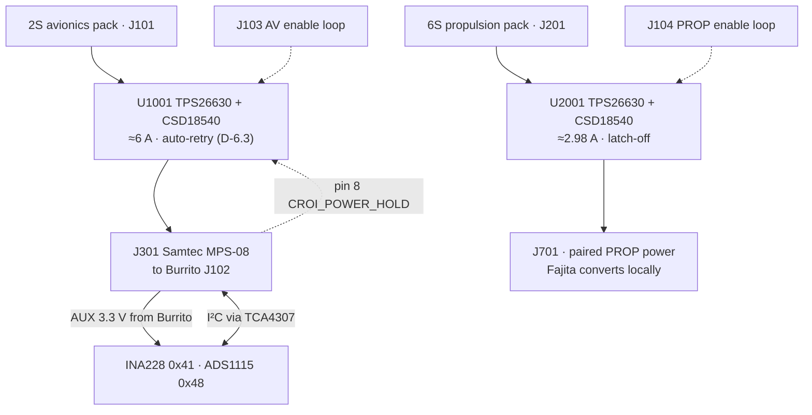
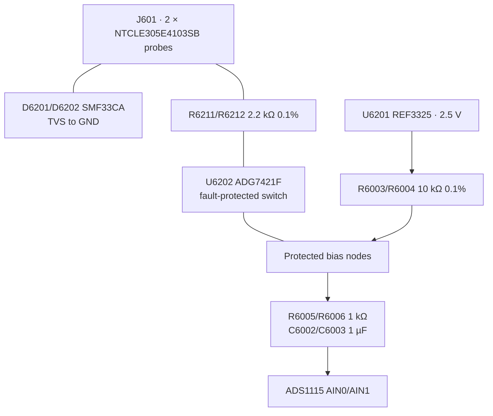
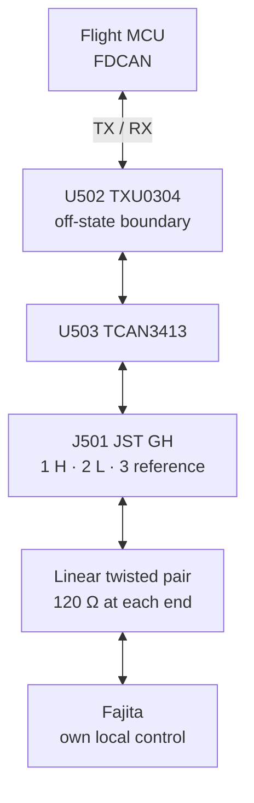

# 08 Churro and the vehicle CAN link

Churro (Foinse2) is a power board with no MCU: two independently protected
pack feeds, plus propulsion current, voltage and temperature monitoring that
Burrito powers and reads. The CAN link to Fajita stays two-node Classical CAN
at 500 kbit/s for Rev A.

## Power and monitoring

- The two pack positives never join; the grounds are common.
- Each protection circuit starts from its own pack. AUX and I²C only feed
  monitoring, so if Burrito or AUX is gone, protection still works and the
  readings go unknown.
- In flight Burrito holds the AV enable on over Samtec pin 8 (D-6.3). PROP is
  not held: that's the propulsion owner's call, as is U2001's latch-off.
- Burrito's INA228 (0x40) measures logic current; pyro and servo current come
  from the TPS1H100 sense lines. Addresses 0x40, 0x41 and 0x48 don't clash.
  Monitoring is on flight I²C4 (PB8/PB9) at 100 kHz.
- No charger, BMS, CAN endpoint or 24 V converter. Charging uses external
  pack-matched balance chargers. A 24 V coil isn't automatically 6S-compatible;
  size any converter from the real load.

Samtec J301/J102: 1 battery, 2 GND, 3 AUX 3.3 V, 4 GND, 5 SCL, 6 SDA, 7 fault,
8 `CROI_POWER_HOLD`. Each ground contact must carry the full fault return, and
the CAN reference must never become the propulsion power return.

| Block | Parts | Still to decide or measure |
| --- | --- | --- |
| AV entry | J101 Nano-Fit 1053111102; U1001 + CSD18540 | 3 A continuous ceiling, 5 A source fuse proposed; thermal and energy |
| AV thresholds | Start/stop 6.63/6.20 V, OVP 8.99 V; 3 kΩ ILIM (≈6 A); MODE to GND | Tolerance and sag; 6 A is not a connector or wire rating |
| PROP entry | J201 Micro-Fit 430450400; U2001 + CSD18540 | 2 A continuous ceiling, 5 A source fuse proposed |
| PROP thresholds | Start/stop 19.92/18.63 V, OVP 27.0 V; 6.04 kΩ ILIM (≈2.98 A) | Coil and controller input range, inrush |
| Transients | 22 nF dV/dt; SMBJ12A / SMBJ28A TVS to start | Fuse, TVS and eFuse coordination with real cables |
| Enables | J103 AV, J104 PROP, JST GH, each biased from its own pack | External switch, retention, labelling |
| PROP current | R2011 5 mΩ WSLP2512; INA228 U5001 | Kelvin routing; error over temperature |
| PROP bus voltage | INA228 VBUS after the reverse blocker, before the eFuse | Doesn't prove the output is on |
| Monitor bus | Burrito AUX → local rails; TCA4307 U3001 | Monitoring can vanish while both feeds stay live |
| Voltages | ADS1115; TMUX1511 U6101 isolates dividers when off; AV 22.1k + 22.1k / 10k, PROP 110k + 110k / 10k | Keep scaled readings separate from INA voltage |
| Temperatures | J601 GH 4-contact: AV probe, GND, PROP probe, GND | Dedicated probes, not charger-biased sensors |
| PROP output | J701 Micro-Fit 430450200 | Harness current; conversion at Fajita |

## Temperature inputs

The TVS is a shunt at the connector. The 10 kΩ bias connects after the
protected switch; the old connector-side pull-up would bypass it. Pin map,
bypass, fault test point and diagnostic windows:
[Churro justification](justifications/churro-monitoring.md#finish-the-two-temperature-inputs).

## Two protection stages in series

Keep both the Churro AV stage and Burrito's U101 so Burrito still runs
standalone. With similar ≈6 A settings and thresholds, which one trips first
isn't proven; Churro's output and interconnect drop appear at Burrito's input,
so Burrito's UVLO can trip with the pack still above its own. Either stage can
cut Burrito's power. Both now auto-retry.

Proposed source fuses: Littelfuse 0287005.PXCN (5 A) in FHAC0001ZXJ holders,
with the [wire and current assembly](justifications/churro-monitoring.md#keep-the-power-companion-small).
Check prospective fault current and time-current coordination; a limited
downstream fault may never clear the source fuse.

| Situation | What's true |
| --- | --- |
| Burrito or AUX absent, packs connected | Protection and enables work; no monitoring |
| I²C stuck or sensor reset | Readings unknown or stale; protection unaffected |
| Fault line high, monitor domain off | Not proof the sources are healthy |
| PROP disabled | Source-side VBUS can still read present |
| Shared return damaged | CAN reference, USB or other returns can carry current |

## Vehicle CAN

TCAN3413 behind a TXU0304 boundary on flight FDCAN (PD1 TX, PD0 RX); PB5
standby, PB1 branch enable.

Rev A: 500 kbit/s Classical CAN, two nodes. CAN FD (500 kbit/s arbitration,
2 Mbit/s data, 11-bit IDs) only as a migration agreed with Fajita; the TCAN3413
supports it, but that doesn't qualify the harness. FD needs both peers to agree
bitrate, IDs, message versions and units, periods and bursts, command age,
reboot epochs, expiry and bus-off recovery. What a peer does on lost power or
link belongs in its own contract.

Earlier comparison for one hypothetical remote actuator: 16 B command and
16 B status at 200 Hz, 8 B health at 20 Hz, 8 B Fajita reservation at 100 Hz,
no bulk traffic: 13.3% load, ≈0.77 ms worst wait before software. Not a
deadline proof, and no remote node is planned.

Next: Fajita's FD support, the message and command-age contract, the longest
real harness; Churro startup with AUX absent and return-path checks.

## Capture

Capture the source and monitoring changes in the
[capture specification](schematic-capture-spec.md#churro-changes). Draw
the Nano-Fit and ADG7421F footprints from manufacturer drawings. Stored
8 September results: zero ERC, 24 DRC findings, unrouted. Outline, mounting,
copper and connector fit are still to do.

Sources: [netlist](../../hardware/foinse2/output/full-netlist.xml) ·
[schematic status](../../hardware/foinse2/schematic-status.md) ·
[earlier circuit rationale](../../hardware/foinse2/history/pre-readable-2026-09-08/schematic-status.md) ·
[TPS2663](https://www.ti.com/lit/ds/symlink/tps2663.pdf) ·
[INA228](https://www.ti.com/lit/ds/symlink/ina228.pdf) ·
[ADS1115](https://www.ti.com/lit/ds/symlink/ads1115.pdf) ·
[TCAN3413](https://www.ti.com/product/TCAN3413) ·
[Foinse research](../archive/architecture/implementation-reference/08-foinse-can.md) ·
[FD study](../archive/architecture/2026-09-18-review-investigations.md#4-can-fd-and-servo-investigation) ·
[vehicle boundary](../../interfaces/ogma-foinse-propulsion-boundary.md)
