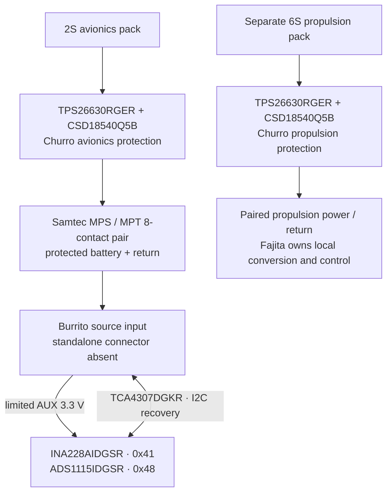
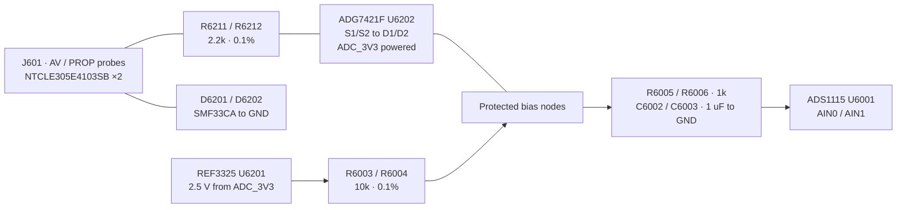

# Churro power and the vehicle link

**22 September · proposal · retain the MCU-less power companion.**

## Justification and deeper detail

| Question | Follow through | Source status |
| --- | --- | --- |
| What closes the unfinished Churro inputs? | [Exact probes, bias reference, cable protection, source envelope and fuses](justifications/churro-monitoring.md) | Current capture proposal, not installed/qualified hardware |
| Why this power companion? | [Churro component rationale](../archive/architecture/implementation-reference/08-foinse-can.md) | Preserved circuit and selection research |
| Where does the FD budget come from? | [CAN FD and end-to-end timing investigation](../archive/architecture/2026-09-18-review-investigations.md#4-can-fd-and-servo-investigation) | Proposed traffic assumptions; not the active peer contract |
| What is the active vehicle interface? | [Controlled Ogma/Foinse/propulsion boundary](../../interfaces/ogma-foinse-propulsion-boundary.md) | Preserved contract until joint revision |

## Source and monitoring connections

The two pack positives never join. Each protection circuit starts from its own
pack; AUX and I²C only support monitoring. Burrito's INA228 at 0x40 measures
avionics current, including standalone use; do not duplicate it on Churro.

| Part / interface | Reason / allocation |
| --- | --- |
| TPS26630RGER + CSD18540Q5B, each source | Autonomous source protection; existing design |
| MPT-08-01-01-L-RA-SD / MPS-08-01-01-L-RA-SD | One inspectable coplanar interface; independent mechanical support |
| INA228AIDGSR | Propulsion discharge measurement; no claim of valve motion |
| ADS1115IDGSR | Two temperatures + two voltages |
| TCA4307DGKR | Recover/isolate a stuck monitor bus; not a power-start prerequisite |
| Existing JST GH external enable loops | Close to enable; open to electronic OFF; no load current through switch. In flight, Burrito holds AV on over Samtec pin 8 (D-6.3) |
| External pack-matched balance chargers | No onboard charger, BMS or speculative 24 V converter added |

Samtec contacts: **1 battery, 2 GND, 3 AUX 3.3 V, 4 GND, 5 SCL, 6 SDA,
7 fault, 8 `CROI_POWER_HOLD`** (D-6.3). Each ground path must tolerate the alternative fault return;
CAN reference must not become the propulsion power return.

A nominal 24 V coil does not establish direct 6S compatibility. Keep the
propulsion supply output defined by the actual load requirements; no converter
part is justified until those exist.

## Temperature inputs — capture proposal

Two identical channels; lines show connections, arrows show bias or acquisition.
The TVS is a shunt at the connector. The 10 kΩ bias connects **after** the
protected switch; retaining the old connector-side pull-up would bypass it.

Full pin map, supply bypass, fault test point, diagnostic windows and error target:
[Churro justification](justifications/churro-monitoring.md#finish-the-two-temperature-inputs).
The other two ADC channels retain their separate voltage-divider isolation.

## Vehicle CAN

Retain **TCAN3413DRBR**, through **TXU0304PWR**, on flight FDCAN
PD1 TX / PD0 RX; PB5 standby, PB1 branch enable.

**Capture/commission at existing 500 kbit/s Classical CAN, two nodes.** Propose
500 kbit/s arbitration, 2 Mbit/s FD data, 11-bit IDs only as a coordinated peer
firmware migration. No new remote actuator node is part of this baseline.
TCAN3413 supports FD; transceiver capability alone does not qualify the harness.
No extra node is installed by this drawing.

| Earlier comparison only: one hypothetical remote actuator | Payload / rate |
| --- | --- |
| Command + returned status | 16 B each, 200 Hz each |
| Aggregate health | 8 B, 20 frames/s |
| Fajita/background reservation | 8 B, 100 frames/s; placeholder pending peer agreement |
| Bulk service during active control | None |

Earlier conservative airtime model gives **13.3% utilisation**. One already-started
64 B frame plus the command takes ~0.77 ms before software/errors/PWM. This
supports evaluating central control; it does not prove an end-to-end deadline.
Command sequence/age and local expiry behavior remain mandatory design inputs.

**Next check:** peer FD support, agreed traffic/command-age contract and actual
longest harness. Churro separately needs source/AUX-absent startup and return-path
checks. Vehicle-specific motors, coils and charging remain outside this core proposal.

Sources: [existing Foinse implementation](../archive/architecture/implementation-reference/08-foinse-can.md),
[TI TCAN3413](https://www.ti.com/product/TCAN3413),
[FD budget](../archive/architecture/2026-09-18-review-investigations.md#4-can-fd-and-servo-investigation),
[controlled vehicle interface](../../interfaces/ogma-foinse-propulsion-boundary.md).

## Churro circuit inventory

**Observed in the existing draft:** 12 schematic pages, 113 physical components,
112 assigned footprints; provisional 60 × 80 mm, four layers, unrouted. This is
already a source-protection/measurement board. It has no MCU, CAN endpoint,
onboard charger, cell-balancing BMS or regulated 24 V output.

| Block | Actual parts / connection | What remains a design input |
| --- | --- | --- |
| AV entry | J101 1053111102; U1001 TPS26630 + CSD18540 reverse blocker | Proposed 2S 8 Ah / ≥30 Wh usable; 3 A continuous assembly ceiling and 5 A source fuse; verify thermal/energy |
| Propulsion entry | J201 430450400; U2001 TPS26630 + CSD18540 | Protected raw 6S; proposed 2 A continuous ceiling and 5 A source fuse; load/thermal qualification |
| AV thresholds | Nominal start/stop 6.63/6.20 V, OVP 8.99 V; 3 kΩ ILIM (~6 A); MODE to GND for auto-retry (D-6.3) | Tolerance, sag and simultaneous downstream demand; 6 A is not a qualified connector/wire rating |
| PROP thresholds | Nominal start/stop 19.92/18.63 V, OVP 27.0 V; 6.04 kΩ ILIM (~2.98 A) | Coil/controller input range and inrush; raw 6S is not regulated 24 V |
| Source slew/transients | 22 nF dV/dt, SMBJ12A / SMBJ28A starting TVS parts | Fuse/TVS/eFuse coordination with actual source energy and cable transients |
| Source enable | J103 AV / J104 PROP, two-contact JST GH; each self-biased from its own source | External maintained-control assembly, retention and correct identification |
| Burrito interface | J301 MPS-08-01-01-L-RA-SD | Mating tolerance, independent mounting and both return paths |
| PROP current | R2011 WSLP2512R0050FEA, 5 mΩ; INA228 U5001, 0x41 | Kelvin routing and measured error over temperature/current |
| PROP bus voltage | INA228 VBUS sampled after reverse blocker, before eFuse | Does not by itself prove the protected output is energised |
| Monitor supply/bus | Burrito AUX → local filtered rails; TCA4307 U3001 | Monitoring may disappear while both source branches remain energised |
| Pack probes / voltages | ADS1115 U6001 0x48; TMUX1511 U6101 isolates voltage dividers with ADC off | [Proposed probe/reference/protection and diagnostics](justifications/churro-monitoring.md#finish-the-two-temperature-inputs) |
| Temperature connector | J601 BM04B-GHS-TBT(LF)(SN); AV probe/GND/PROP probe/GND | Dedicated two-wire probes, not shared charger-biased sensors |
| Protected PROP output | J701 430450200, positive plus paired return | Harness/load current and local conversion at Fajita |

AV current is measured by Burrito's INA228 at **0x40**, including standalone
operation. No duplicate Churro AV shunt is required. Addresses 0x40, 0x41 and
0x48 do not collide. Flight monitoring is **I2C4 PB8/PB9**, initially 100 kHz;
TCA4307 recovery is not permission to wait indefinitely in essential work.

ADC divider tops: 22.1 kΩ + 22.1 kΩ / 10 kΩ for AV; 110 kΩ + 110 kΩ /
10 kΩ for PROP. Keep scaled readings distinct from INA source-side voltage.
The proposal closes the NTC gap with NTCLE305E4103SB probes, REF3325 bias,
ADG7421F dual fault protection, SMF33CA connector TVS and defined filtering/
diagnostics. [Exact connections](justifications/churro-monitoring.md#finish-the-two-temperature-inputs).
No converter, charger or MCU is added.

## Source cascade and loss of monitoring

**Retain both protection stages for now** so Burrito still operates standalone.
Churro AV protection and Burrito entry are in series, with similar ~6 A settings
and nominal UV thresholds. This does not establish selectivity. Churro output
and interconnect drop appear at Burrito's input, so its UVLO can trip while the
pack is above its own threshold. Either stage can remove Burrito power.

Propose 0287005.PXCN 5 A source fuses in FHAC0001ZXJ holders with the bounded
[wire/current assembly](justifications/churro-monitoring.md#keep-the-power-companion-small).
Qualification must verify prospective fault current and time/current/thermal
coordination; a downstream limited fault may not clear the source fuse. No
autonomous source-latch recovery claim is introduced.

| Case | Honest system state |
| --- | --- |
| Burrito/AUX absent, packs connected | Source protection/enable can still operate; monitoring unavailable |
| I²C stuck, TCA4307 disconnected or sensor reset | Measurements unknown/stale; protection remains autonomous |
| Fault line high with monitor domain absent | Not proof of healthy sources; pull-ups/boundary availability matter |
| PROP disabled | Source-side VBUS can remain present; output voltage/current must be interpreted at their actual taps |
| Shared return damaged | Positives remain separate but CAN/reference/USB can become unintended return paths |

Both pack positives stay separate; grounds are common. Pair each source/load
with its intended return, and evaluate open-return alternatives before assuming
CAN reference can remain a light signal conductor. No galvanic isolation is
created by naming two batteries. Monitoring cannot command valve behavior;
Fajita remains the local controller.

## Schematic handoff

**Capture the explicit source/monitoring proposal after acceptance.** The
[capture specification](schematic-capture-spec.md#churro-capture-delta) names every
new part/value/net and preserves source authority. Exact Nano-Fit/ADG footprints
are Codex library work from manufacturer drawings, not another team synthesis task.
Board ordering still needs completed routing and assembly/qualification review. The stored 8 September reports show
zero ERC findings, 24 DRC findings and unrouted connections; those are historical
results, not a new physical validation. Final outline, mounting, copper/thermal
paths and connector fit still need implementation.

For CAN, retaining the transceiver and pins allows schematic work before the
protocol migration. Activate FD only after both peers agree on bitrate, IDs,
message/version/units, periods/bursts, command age, reboot epochs, expiry and
bus-off recovery. Average utilisation cannot establish control deadlines. A
peer's response to lost power/link belongs in its local contract, not a guessed
safe command from Burrito.

Evidence: [native Churro netlist](../../hardware/foinse2/output/full-netlist.xml),
[engineering status](../../hardware/foinse2/schematic-status.md),
[retained detailed circuit rationale](../../hardware/foinse2/history/pre-readable-2026-09-08/schematic-status.md),
[TI TPS2663](https://www.ti.com/lit/ds/symlink/tps2663.pdf),
[INA228](https://www.ti.com/lit/ds/symlink/ina228.pdf),
[ADS1115](https://www.ti.com/lit/ds/symlink/ads1115.pdf).
