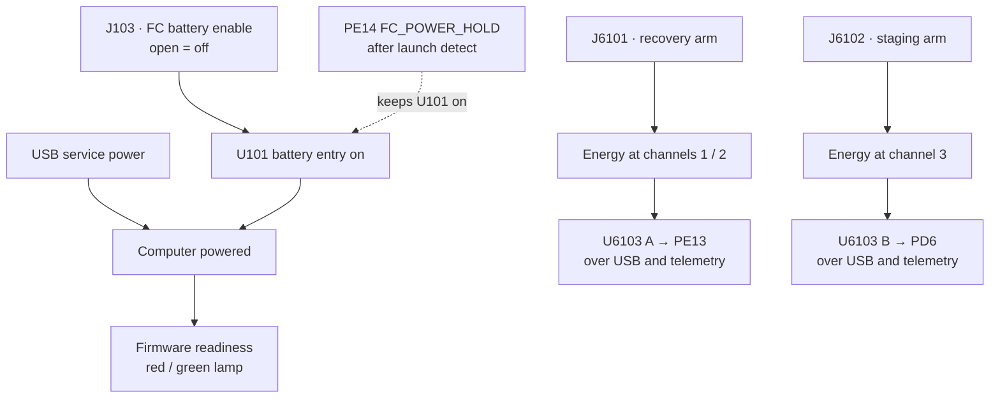

# 09 Connectors, enable and arm

Separate operator actions: **switch the computer on** (J103 enable), **arm
recovery** (J6101) and **arm staging** (J6102, D-7.2). A powered computer or a
green lamp never means the outputs are armed, and an open enable never means
they're safe.

## FC battery enable (J103)

| Item | Definition |
| --- | --- |
| Connector | JST GH BM02B-GHS-TBT(LF)(SN), housing GHR-02V-S, wire-matched crimps |
| Contacts | 1 `BAT_SWITCH_3V`, 2 `BAT_SHDN_N` |
| Closed | Battery entry on |
| Open or unplugged | Battery entry commanded off; upstream circuits stay live |
| With USB | Logic can stay powered with J103 open |
| Churro-fed | Keep a closed plug in Croí J103; switch at Churro |
| In flight | Firmware holds the enable on from launch detect until after LANDED (D-6.3) |

It carries control current, not board current. Unplugging the battery always
powers down, even if firmware is holding the enable.
[Contract](../../interfaces/power-contract.md#source-enables-j103-and-j104).

## Pyro arms (J6101, J6102)

| Item | Decision |
| --- | --- |
| Connector | 2-contact, rated above its fuse (F6101 / F6102), to an external maintained switch. Part chosen at capture. It must not mate Churro J701 (Micro-Fit 430450200, raw 6S PROP) or the JST GH enable loops, so a crossed harness can't put propulsion voltage on the pyro rail. Proposed (19 Nov): single-row Micro-Fit 3.0, recovery 2-way, staging 3-way with one cavity empty, so they can't swap; confirm by trying the real housings |
| Recovery | `ENERGY_TAP` → F6101 → J6101 → `RECOVERY_ARMED_VBAT` → channels 1 and 2 |
| Staging (D-7.2, D-2Nov.2) | Its own fuse and arm: `ENERGY_TAP` → F6102 → J6102 → `STAGING_ARMED_VBAT` → channel 3. J6102 is 2-contact, keyed so it can't mate J6101, J701 or the GH loops |
| Open or unplugged | No energy at the output switches, whatever firmware does |
| Servos | None on Burrito (D-19Nov.2) |
| Indication | Arm sense U6103 → PE13 (recovery, D-5Nov.3) and PD6 (staging, D-22Nov.25), over USB and the 1 Hz pad telemetry (D-2Nov.10); no lamp |
| Switch parts | Open: maintained, rated above the fuses at 8.4 V DC, operable from outside the airframe |
| Where they go | EuRoC: on the airframe, reachable from the ground with the rocket on the rail, no ladders or stools, on the side away from the rail (LV-0260–0280, 0540–0550). The av-bay sits above the tanks, so the switches may need to sit low with a harness up to Burrito; open with Jay. The active board's arm key (D-18Nov.1) and the CATS Vega's switch and cell (D-18Nov.2) go with them |

The output harness J6601 is not an arm connector: 1/2 recovery high sides, 3
staging high side, 4/5/6 igniter returns, each switched to ground by its own low
side (D-2Nov.1). Links R6310 / R6410 / R6510 stay DNP until the igniter and
continuity values close.

## Inventory

| Ref | Part | Job | Status |
| --- | --- | --- | --- |
| J101 | Molex Nano-Fit 1053111102 | Standalone 2S | Footprint to draw from the Molex drawing; never fitted with J102 |
| J102 | Samtec MPT-08-01-01-L-RA-SD | To Churro | Pin 8 now `BURRITO_POWER_HOLD` ([08](08-foinse-can.md)) |
| J103 | Harwin Gecko 2-contact (was JST GH, D-19Nov.5) | FC battery enable | Series and lock at capture |
| J6101 | 2-contact, keyed apart from J701 | Recovery arm switch | Function decided; connector and switch parts open |
| J6102 | 2-contact, keyed apart from J6101 and J701 | Staging arm switch | Function decided (D-7.2); connector and switch parts open |
| J6601 | Micro-Fit 430450600 | Pyro outputs | 1/2 recovery high, 3 staging high, 4/5/6 switched returns |
| J6602 | Removed | Was three servos | D-19Nov.2 |
| J501 | Harwin Gecko 3-contact (was JST GH) | CAN bus 1 H / L / reference, to Fajita | No power contact; series and lock chosen at capture; Fajita's end has to match (D-18Nov.4) |
| Bus 2 (ref at capture) | Harwin Gecko 3-contact | CAN bus 2 H / L / reference, to the active board | No power contact (D-5Nov.3, D-18Nov.4) |
| J4401 | GCT USB4105-GF-A | USB-C service | Library footprint is KiCad's GCT USB4105 pad for pad; the regenerated PCB uses it (capture step 11) |
| J4501 / J4601 | Amphenol 132134 SMA | GNSS / radio | Identical; can be swapped |
| J2301 / J4201 | TC2030-NL-FP | Flight / comms debug | Development only |

Churro adds J101 (2S), J201 (6S), J103/J104 (enables), J301 (to Burrito), J601
(temperature probes), J701 (PROP output) and J801 (ground umbilical, D-2Nov.7;
part chosen with the vehicle owner); see [08](08-foinse-can.md#power-and-monitoring).
The umbilical plug falls under the same EuRoC access rule as the arm switches.

## Mix-ups to design out

- **Two batteries:** fit J101 or J102, never both. A note beside two fitted
  connectors doesn't make them exclusive; use assembly variants.
- **Servo vs output harness:** moot since D-19Nov.2; J6602 is gone.
- **GNSS vs radio SMA:** identical; radio transmit into the GNSS input may
  damage it. Use a different connector type or gender for GNSS, or retained,
  labelled leads.
- **Enable loops vs arm:** three 2-contact Gecko plugs (D-19Nov.5; Croí J103, Churro J103,
  J104) look alike; J6101 and J6102 must stay physically distinct from them,
  from each other and from Churro J701.

For every external harness, release the mating part, cavity-numbered drawing,
wire and contact, retention, strain relief and mounting together. Include
ground-return faults and USB-attached cases in the installed review.

## Capture

Draw J101 from the [Nano-Fit drawing](justifications/interfaces-and-installation.md#source-variants-and-harness-construction);
a rectangle isn't a land pattern. Add J6101, J6102, F6101 and F6102 per
the [capture delta](schematic-capture-spec.md#burrito-changes), and Churro's J801
per the [Churro changes](schematic-capture-spec.md#churro-changes). Codex
captures and places after the go-ahead; Seán routes.

Sources: [netlist](../../hardware/croi2/output/full-netlist.xml) ·
[connector revision](../archive/connector-servo-readiness-revision-2026-09-07.md#connectors) ·
[meeting extraction](../archive/architecture/2026-09-18-meeting-change-ledger.md) ·
[outputs](03-energetic-outputs.md)
