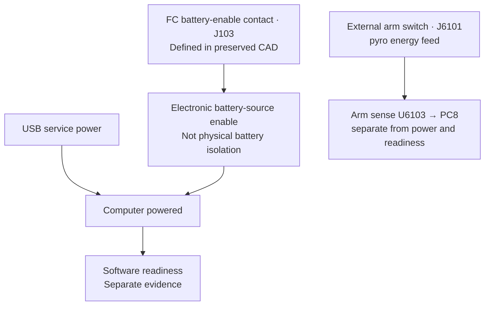

# Connectors and physical arming

**22 September inventory · arm decided 6 October ([D-6.1–D-6.3](../../decisions.md)) · parts still to select.**

Two distinct operator functions: **enable computer battery power**, then
**separately establish the physical output-arm state**. Neither a powered FC nor
software readiness proves output energy is isolated or armed.

## Justification and deeper detail

| Question | Follow through | Source status |
| --- | --- | --- |
| Which assembly decisions are now proposed? | [Source variants, mates, exact Nano-Fit drawing and retained leads](justifications/interfaces-and-installation.md#source-variants-and-harness-construction) | Current capture/placement baseline; arm topology in D-6.1 |
| Where is FC enable defined? | [Source-enable contract](../../interfaces/power-contract.md#8-september-source-enable-implementation) | Installed connector/contact behavior |
| Why these connector families? | [Connector and service revision](../archive/connector-servo-readiness-revision-2026-09-07.md#connectors) | Preserved parts/harness rationale; output-arm assembly remains incomplete |

## Computer enable — defined in the preserved CAD

| Item | Existing definition |
| --- | --- |
| Croí J103 | JST GH BM02B-GHS-TBT(LF)(SN), GHR-02V-S housing; wire-matched crimp |
| Contact 1 / 2 | BAT_SWITCH_3V / BAT_SHDN_N |
| Maintained contact closed | Enables the battery entry electronically |
| Contact open / plug absent | Battery entry commanded off; upstream circuitry remains live |
| USB connected | Logic can remain powered with J103 open |
| Churro/Foinse-fed installation | Retained closed enable plug at Croí J103; source switching at the distribution board |

Call this **FC battery enable**, not “flight armed.” It carries control current,
not the board supply current. After launch detect, firmware holds the enable on
through a diode (`FC_POWER_HOLD`), so an open J103 loop in flight does not
switch the computer off; it releases after LANDED. Unplugging the battery always
powers down. The existing [power contract](../../interfaces/power-contract.md#8-september-source-enable-implementation)
owns this definition and the separate distribution-board source enables.

## Physical output arm — decided topology

| Item | Decision |
| --- | --- |
| Arm connection | J6101, two-contact Molex Micro-Fit 430450200 (mate 430250200), wired to an external maintained arm switch |
| What it switches | Pyro energy only: `ENERGY_TAP` → F6101 → J6101 → `RECOVERY_ARMED_VBAT` |
| Physical isolation | Switch open or plug absent = no energy at the output switches, whatever firmware does |
| Recovery versus staging | One recovery arm; staging has no feed while its channel is DNP |
| Servo sharing | Not shared: servos have their own fuse and no arm |
| Indication | U6103 arm sense to PC8, reported over USB and telemetry; lamps don't show arm state |
| Switch part | Open: maintained, rated above F6101 at 8.4 V DC, operable from outside the airframe |

The output harness **J6601 is not an arming connector**. Contacts 1/2 carry the
recovery high sides, 4/5 the igniter returns to ground; 3/6 stay unwired while
staging is DNP. The R6310/R6410 links stay DNP until the igniter and values close.

## Operator boundaries

This is a boundary diagram. The output wiring is in the [output chapter](03-energetic-outputs.md).

## Connector inventory — review together

| Connector | Preserved part / function | Review status |
| --- | --- | --- |
| J101 | 1053111102 · standalone battery | Alternative to J102; source exclusion required |
| J102 | Samtec MPT-08-01-01-L-RA-SD · distribution-board connection | Power + monitoring; pin 8 now `CROI_POWER_HOLD` (D-6.3); [power/CAN page](08-foinse-can.md) |
| J103 | Two-contact JST GH · FC battery enable | Defined above; retained external contact |
| J6101 | Molex 430450200 · external pyro arm switch | Decided (D-6.1); switch part open |
| J6601 | Molex 430450600 · output harness | 1/2 high sides, 4/5 returns to GND, 3/6 unwired (D-6.2) |
| J6602 | Molex 430451000 · three-servo harness | [Proposal](04-servos.md): retain ten-contact connector, use two servo groups |
| J501 | Three-contact JST GH · CAN H/L/reference | [Vehicle link](08-foinse-can.md); no power contact |
| J4401 | USB4105-GF-A · USB-C service | Logic service, not output arming |
| J4501 / J4601 | Amphenol 132134 · GNSS / radio SMA | Distinct labels and retained antenna leads |
| J2301 / J4201 | TC2030-NL-FP · flight / comms debug | Development access; not arm connections |

**Mating review:** retain the ten-contact servo connector; withdraw the
six-contact substitution that would match J6601. Distinguish the two SMA ports
and externally accessible enable plugs in the installation drawing.

For every external harness, release the mating part, cavity-numbered drawing,
wire/contact selection, retention, strain relief and accessible mounting together.
The table is an inventory, not a released harness drawing.

Evidence: [native netlist](../../hardware/croi2/output/full-netlist.xml),
[power contract](../../interfaces/power-contract.md),
[connector revision](../archive/connector-servo-readiness-revision-2026-09-07.md),
[meeting extraction](../archive/architecture/2026-09-18-meeting-change-ledger.md),
[output boundary](03-energetic-outputs.md).

## Schematic handoff

**Burrito's board-side inventory is defined; the complete vehicle harness is not.**
Churro also requires J101 (2S), J201 (6S), J103/J104 (source enables), J301
(board pair), J601 (temperature probes) and J701 (protected propulsion output).
The [Churro chapter](08-foinse-can.md#churro-circuit-inventory) now inventories
these together with their actual source roles.

Two sources cannot be made mutually exclusive by a note beside two populated
connectors. Recommend an assembly variant: standalone J101 or Churro-fed J102,
with the unused source connection physically unavailable. Preserve power-pin
assignments. The exact [Nano-Fit drawing is located](justifications/interfaces-and-installation.md#source-variants-and-harness-construction);
create and independently check that footprint during capture. A rectangular
reservation is not a land pattern. Codex owns this library/placement work after
the green light; Seán owns routing.

SMA GNSS/radio and the repeated two-contact GH enable connectors remain
misconnection cases despite the ten-contact servo fix. Resolve them with
installation access, physical differentiation where necessary, retained leads
and cavity-numbered harness drawings. A label alone is not proof against every
credible cross-connection. Include ground-return faults and USB attached in the
installed assembly review, and keep J6101's arm harness physically distinct from
the enable loops.
