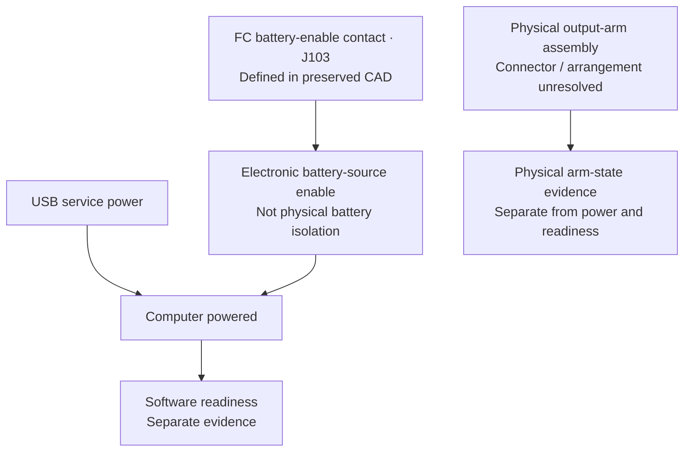

# Connectors and physical arming

**19 September · installed connector inventory; unresolved arm assembly explicit.**

Two distinct operator functions: **enable computer battery power**, then
**separately establish the physical output-arm state**. Neither a powered FC nor
software readiness proves output energy is isolated or armed.

## Justification and deeper detail

| Question | Follow through | Source status |
| --- | --- | --- |
| Where is FC enable defined? | [Source-enable contract](../../interfaces/power-contract.md#8-september-source-enable-implementation) | Installed connector/contact behavior |
| Why these connector families? | [Connector and service revision](../connector-servo-readiness-revision-2026-09-07.md#connectors) | Preserved parts/harness rationale; output-arm assembly remains incomplete |

## Computer enable — defined in the preserved CAD

| Item | Existing definition |
| --- | --- |
| Croí J103 | JST GH BM02B-GHS-TBT(LF)(SN), GHR-02V-S housing; wire-matched crimp |
| Contact 1 / 2 | BAT_SWITCH_3V / BAT_SHDN_N |
| Maintained contact closed | Enables the battery entry electronically |
| Contact open / plug absent | Battery entry commanded off; upstream circuitry remains live |
| USB connected | Logic can remain powered with J103 open |
| Churro/Foinse-fed installation | Retained closed enable plug at Croí J103; source switching at the distribution board |

Call this **FC battery enable**, not “flight armed.” It carries control current,
not the board supply current. The existing [power contract](../../interfaces/power-contract.md#8-september-source-enable-implementation)
owns this definition and the separate distribution-board source enables.

## Physical output arm — required, assembly unresolved

| Review item | Current status |
| --- | --- |
| Removable shorting plug / maintained arm connection | Requested operator function; exact assembly, connector and contact assignment are not selected |
| Physical isolation | Separate from J103 and software permission; no completed assembly in the present CAD |
| Recovery versus staging | Existing separate arm-sense inputs describe evidence; they do not establish the physical assembly or imply one shared plug |
| Servo sharing | Shared servo/energetic enable was discussed, not accepted |
| Indication | FC power lamp and software “ready” cannot substitute for independently established physical arm state |
| Unplugged state | Must be established for the complete installed assembly; an absent sense voltage alone is insufficient evidence |

The energetic output harness **J6601 is not an arming connector**. No jumper
across its output contacts is specified here. Existing DNP energy links are not
operator arm plugs and remain unchanged.

The review must settle the physical assembly, whether recovery/staging share an
operator control, how its state is independently established, and its accessible
mounting, retention and labelling. Until then, no selected short-to-arm pinout or
completed physical isolation claim belongs in this pack.

## Operator boundaries

This is a boundary diagram, not an energetic wiring diagram. The unresolved
assembly remains visible beside the defined computer-enable connection.

## Connector inventory — review together

| Connector | Preserved part / function | Review status |
| --- | --- | --- |
| J101 | 1053111102 · standalone battery | Alternative to J102; source exclusion required |
| J102 | Samtec MPT-08-01-01-L-RA-SD · distribution-board connection | Power + monitoring; [power/CAN page](08-foinse-can.md) |
| J103 | Two-contact JST GH · FC battery enable | Defined above; retained external contact |
| Physical output arm | No selected connector | Open assembly decision; not J6601 |
| J6601 | Molex 430450600 · output harness | Preserved; service-end assembly unresolved |
| J6602 | Molex 430451000 · three-servo harness | [Proposal](04-servos.md): retain ten-contact connector, use two servo groups |
| J501 | Three-contact JST GH · CAN H/L/reference | [Vehicle link](08-foinse-can.md); no power contact |
| J4401 | USB4105-GF-A · USB-C service | Logic service, not output arming |
| J4501 / J4601 | Amphenol 132134 · GNSS / radio SMA | Distinct labels and retained antenna leads |
| J2301 / J4201 | TC2030-NL-FP · flight / comms debug | Development access; not arm connections |

**Mating review:** retain the ten-contact servo connector; withdraw the
six-contact substitution that would match J6601. Distinguish the two SMA ports
and externally accessible enable plugs in the installation drawing.

For every external harness, release the mating part, cavity-numbered drawing,
wire/contact selection, retention, strain relief and accessible mounting together.
The table is an inventory, not a released harness drawing.

Evidence: [native netlist](../../hardware/croi2/output/full-netlist.xml),
[power contract](../../interfaces/power-contract.md),
[connector revision](../connector-servo-readiness-revision-2026-09-07.md),
[meeting extraction](2026-09-18-meeting-change-ledger.md),
[output boundary](03-energetic-outputs.md).
