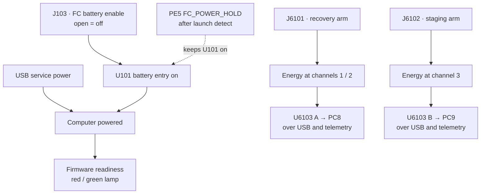

# 09 Connectors, enable and arm

Separate operator actions: **switch the computer on** (J103 enable), **arm
recovery** (J6101) and **arm staging** (J6102, proposed in D-7.2). A powered computer or a green
lamp never means the outputs are armed, and an open enable never means they're
safe.

## FC battery enable (J103)

| Item | Definition |
| --- | --- |
| Connector | JST GH BM02B-GHS-TBT(LF)(SN), housing GHR-02V-S, wire-matched crimps |
| Contacts | 1 `BAT_SWITCH_3V`, 2 `BAT_SHDN_N` |
| Closed | Battery entry on |
| Open or unplugged | Battery entry commanded off; upstream circuits stay live |
| With USB | Logic can stay powered with J103 open |
| Churro-fed | Keep a closed plug in Croí J103; switch at Churro |
| In flight | Firmware holds the enable on from launch detect until after LANDED (D-6.3) |

It carries control current, not board current. Unplugging the battery always
powers down, even if firmware is holding the enable.
[Contract](../../interfaces/power-contract.md#source-enables-j103-and-j104).

## Pyro arms (J6101, J6102)

| Item | Decision |
| --- | --- |
| Connector | 2-contact, rated above F6101, to an external maintained switch. Part chosen at capture. It must not mate Churro J701 (Micro-Fit 430450200, raw 6S PROP) or the JST GH enable loops, so a crossed harness can't put propulsion voltage on the pyro rail. Candidate: single-row Micro-Fit 3.0; confirm by trying the real housings |
| Switches | Recovery energy only: `ENERGY_TAP` → F6101 → J6101 → `RECOVERY_ARMED_VBAT` |
| Open or unplugged | No energy at the output switches, whatever firmware does |
| Staging (proposed, D-7.2) | Separate arm: F6101 → J6102 → `STAGING_ARMED_VBAT` → channel 3. J6102 is 2-contact, keyed so it can't mate J6101, J701 or the GH loops. Sense U6103 B → PC9. Alternative to weigh: one two-pole switch on a single connector |
| Servos | Not behind the arm; own fuse |
| Indication | Arm sense U6103 → PC8 (recovery) and PC9 (staging), reported over USB and telemetry; no lamp |
| Switch parts | Open: maintained, rated above F6101 at 8.4 V DC, operable from outside the airframe |

The output harness J6601 is not an arm connector: 1/2 recovery high sides, 3
staging high side, 4/5/6 igniter returns to ground. Links R6310 / R6410 / R6510
stay DNP until the igniter and continuity values close.

## Inventory

| Ref | Part | Job | Status |
| --- | --- | --- | --- |
| J101 | Molex Nano-Fit 1053111102 | Standalone 2S | Footprint to draw from the Molex drawing; never fitted with J102 |
| J102 | Samtec MPT-08-01-01-L-RA-SD | To Churro | Pin 8 now `CROI_POWER_HOLD` ([08](08-foinse-can.md)) |
| J103 | JST GH 2-contact | FC battery enable | Defined |
| J6101 | 2-contact, keyed apart from J701 | Recovery arm switch | Function decided; connector and switch parts open |
| J6102 | 2-contact, keyed apart from J6101 and J701 | Staging arm switch | Proposed (D-7.2) |
| J6601 | Micro-Fit 430450600 | Pyro outputs | 1/2 recovery high, 3 staging high, 4/5/6 return |
| J6602 | Micro-Fit 430451000 | Three servos | [04](04-servos.md); 10 unwired |
| J501 | JST GH 3-contact | CAN H / L / reference | No power contact |
| J4401 | GCT USB4105-GF-A | USB-C service | Footprint mismatch with the local library to fix |
| J4501 / J4601 | Amphenol 132134 SMA | GNSS / radio | Identical; can be swapped |
| J2301 / J4201 | TC2030-NL-FP | Flight / comms debug | Development only |

Churro adds J101 (2S), J201 (6S), J103/J104 (enables), J301 (to Burrito), J601
(temperature probes) and J701 (PROP output); see [08](08-foinse-can.md#power-and-monitoring).

## Mix-ups to design out

- **Two batteries:** fit J101 or J102, never both. A note beside two fitted
  connectors doesn't make them exclusive; use assembly variants.
- **Servo vs output harness:** J6602 has 10 contacts, J6601 has 6, so they
  can't mate.
- **GNSS vs radio SMA:** identical; radio transmit into the GNSS input may
  damage it. Use a different connector type or gender for GNSS, or retained,
  labelled leads.
- **Enable loops vs arm:** three 2-contact GH plugs (Croí J103, Churro J103,
  J104) look alike; J6101 and J6102 must stay physically distinct from them,
  from each other and from Churro J701.

For every external harness, release the mating part, cavity-numbered drawing,
wire and contact, retention, strain relief and mounting together. Include
ground-return faults and USB-attached cases in the installed review.

## Capture

Draw J101 from the [Nano-Fit drawing](justifications/interfaces-and-installation.md#source-variants-and-harness-construction);
a rectangle isn't a land pattern. Add J6101, J6102 (if D-7.2 is accepted), F6101
and F6801 per the
[capture delta](schematic-capture-spec.md#burrito-changes). Codex
captures and places after the go-ahead; Seán routes.

Sources: [netlist](../../hardware/croi2/output/full-netlist.xml) ·
[connector revision](../archive/connector-servo-readiness-revision-2026-09-07.md#connectors) ·
[meeting extraction](../archive/architecture/2026-09-18-meeting-change-ledger.md) ·
[outputs](03-energetic-outputs.md)
