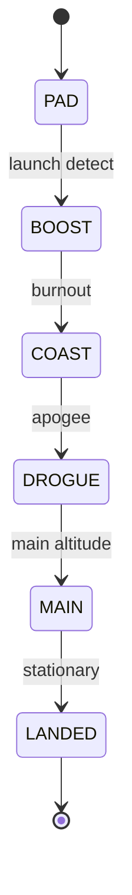

# 10 Recovery logic

**6 October · draft for Anav's review ([D-6.11](../../decisions.md)). The pad
datum, ground-test mode and pad telemetry were decided on 2 November (D-2Nov.10);
the power-hold rules come from D-2Nov.4. Values marked "proposed" are starting
points; values marked "per vehicle" are not chosen.**

Deploy the drogue near apogee and the main at a set altitude, never early, and
do the right thing after a reset. Rev 1 reached DROGUE from its apogee vote,
reset at T+14.976 s about 696 m up, then recalibrated as if on the pad
([Rev 1 closure](../../sources/project/ogma-rev1/ogma-rev1-flight-closure.md)).
This spec is written against that failure.

## Events

| Event | Primary condition | Confirmation | Lockout and backup |
| --- | --- | --- | --- |
| Launch detect | Axial acceleration above 3 g for 100 ms on both low-g IMUs, or the high-g channel when they clip (proposed) | Barometric altitude rising within 1 s | None. Launch detect freezes the pad datum, starts full-rate recording and asserts `FC_POWER_HOLD` |
| Burnout | Axial acceleration below 0 g for 100 ms (proposed) | — | Starts the Mach lockout timer |
| Apogee → drogue | Fused vertical velocity ≤ 0 | Barometric altitude below its running maximum for 3 consecutive samples at 50 Hz (proposed) | No barometric apogee while fused speed exceeds 0.8 Mach or within 2 s of burnout (proposed). Backup: fire at launch + simulated apogee time + margin (per vehicle). Neither fires until the barometric altitude has passed 100 m above the pad datum, or inertial evidence shows flight if both barometers are invalid (proposed), so a false launch detect on the pad can't fire the drogue |
| Main | Barometric altitude above the pad datum ≤ main altitude while descending (per vehicle) | 3 consecutive samples (proposed) | Backup timer after drogue (per vehicle). Never above the main altitude |
| Landed | Altitude change < 2 m over 10 s and acceleration ≈ 1 g (proposed) | — | Ends full-rate recording after a tail; releases `FC_POWER_HOLD` after a delay. A configured maximum flight time releases the hold even if LANDED never comes |

Fire one output at a time ([output rules](03-energetic-outputs.md#firmware-rules)).
GNSS never triggers an event; it is evidence and position only.

## Sensors behind each event

| Measurement | Source | Limit that matters |
| --- | --- | --- |
| Axial acceleration | LSM6DSV16X and ICM-42688-P (±16 g); ADXL375 (±200 g) when they clip | Both low-g IMUs clip in boost on most motors |
| Pressure altitude | BMP390 and MS5607 | At 9 km (≈308 hPa) the BMP390 is at its 300 hPa floor; above that rely on the MS5607 and inertial velocity |
| Vertical velocity | IMU integration fused with barometric rate | Transonic pressure spikes; hence the Mach lockout |

## Pad datum (D-2Nov.10)

EuRoC arms on the pad before filling, then holds for hours. Weather can move
the pressure by 1 hPa in an hour, about 8 m of altitude, so a datum taken at
arming could put the main deployment tens of metres off.

- On the pad, track the barometric datum with a slow filter (minutes).
- Hold the filter while the pressure changes faster than weather can (proposed:
  0.5 hPa a minute) or the acceleration isn't ≈1 g. An undetected launch can't
  be tracked as weather.
- Checkpoint the datum every 10 s.
- Freeze it at launch detect. After that, nothing changes it.
- After a reset on the pad, restore the last checkpointed datum and resume
  tracking only once 10 s of stationary data agree with it. After a reset in
  flight, restore the frozen one. A reset never creates a new datum.

## After a reset

The first act after any reset: record the reset cause and supply evidence,
then read the checkpoint ([reset contract](../../interfaces/reset-recovery-contract.md)).

| Checkpoint state | Action |
| --- | --- |
| Valid, phase PAD | Normal boot |
| Valid, in flight | Re-assert `FC_POWER_HOLD` within 50 ms of reset. Restore phase, launch time and datum; continue that phase's events. Staging stays inhibited |
| Invalid or absent, arm sense reads armed | Assume possibly in flight. No calibration, no new datum. Fire drogue on barometric descent plus near free-fall acceleration; main on absolute pressure from the last stored datum, or not at all |
| Invalid or absent, disarmed | Normal boot |

This is what Rev 1 lacked: it recalibrated aloft.

On the pad, the armed row without a checkpoint means a cold boot with an arm
closed. That path can't deploy the main, and the phase in the pad telemetry
shows it: disarm, let the board boot normally, then re-arm.

Open for Anav: a reset after launch detect but before the first in-flight
checkpoint boots as PAD. Launch detect fires again only while the motor still
burns; after burnout nothing would. Proposed: write the in-flight checkpoint
before anything else at launch detect, and add a missed-launch backup in PAD
(armed, barometric altitude more than 50 m above the datum for 2 s) that takes
the armed row above. That row must then be unable to fire the main from a pad
pressure transient.

## Pad telemetry (D-2Nov.10)

Once armed, nobody is within 600 m of the rocket, so the radio is the only view
of it. At 1 Hz, from arming to launch detect:

- recovery and staging arm sense;
- continuity per channel, as the raw reading and its class (present, open, low
  side closed, high side leaking);
- the staging latch;
- AV pack voltage, bus voltage and which source is live (umbilical or pack);
- phase, fault flags and the configuration identity.

The same frame goes to USB. It is evidence for the crew, never a command path.

## Ground-test mode (D-2Nov.10)

For EuRoC's recovery ground test (LV-0520), which simulates the triggers and
needs a signed annex. A vacuum chamber drives both barometers through a flight
profile while the board sits still.

| Item | Rule |
| --- | --- |
| Enable | A flag in the per-flight configuration, loaded over USB and shown in the readback before arming. Never from the radio or CAN |
| Launch | The operator declares it over USB; the IMUs can't see a launch on a bench |
| Events | Apogee and main come from the barometric logic alone. The inertial confirmations are bypassed, and the record says so |
| Who fires | The flight MCU's own event logic, as in flight |
| Outputs | Recovery channels 1 and 2 only. Staging stays disarmed and its latch cleared |
| Power hold | Not asserted: J103 must still switch the board off |
| Exit | Clears at power-off and at any reset; never carried into a flight. A checkpoint written in ground-test mode never reads as in flight, so a reset mid-test comes back on the pad with nothing firing (proposed) |
| Record | Every use logged with its configuration, for the annex |

## Per-flight configuration

Main altitude, backup timers, simulated apogee time, pulse length per output,
Mach lockout threshold, landed tail, hold-release delay, maximum flight time and
the ground-test flag. If J103's loop broke in flight, releasing the hold
switches the board off and ends the GNSS beacon, so set the release delay with
recovery in mind. Read back over USB before arming; the running build and
configuration are recorded at launch detect.

## Tests

1. Replay the Rev 1 flight log; drogue must fire at its recorded apogee window.
2. Hardware-in-the-loop with simulated trajectories, including transonic pressure spikes.
3. Reset injection in every phase on the bench, outputs on inert loads,
   including a reset in the first second after launch detect.
4. A six-hour pad hold with a pressure drift profile: the datum follows the
   weather and freezes at launch detect.
5. The LV-0520 ground test in ground-test mode, inert loads first.
6. A forced false launch detect on the pad, arms closed on inert loads: nothing
   fires, including after every backup timer.

Where these sit among the other campaigns: [11 Verification](11-verification.md).
