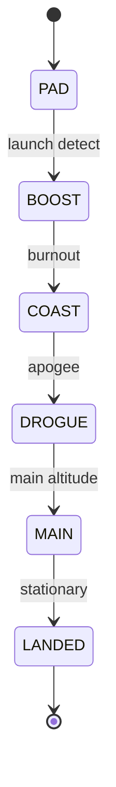

# Recovery logic

**6 October · draft for Anav's review ([D-6.11](../../decisions.md)).
Values marked "proposed" are starting points; values marked "per vehicle" are not chosen.**

Deploy the drogue near apogee and the main at a set altitude, never early, and
do the right thing after a reset. Rev 1 reached DROGUE from its apogee vote,
reset at T+14.976 s about 696 m up, then recalibrated as if on the pad
([Rev 1 closure](../../sources/project/ogma-rev1/ogma-rev1-flight-closure.md)).
This spec is written against that failure.

## Events

| Event | Primary condition | Confirmation | Lockout and backup |
| --- | --- | --- | --- |
| Launch detect | Axial acceleration above 3 g for 100 ms on both low-g IMUs, or the high-g channel when they clip (proposed) | Barometric altitude rising within 1 s | None. Launch detect starts full-rate recording and asserts `FC_POWER_HOLD` |
| Burnout | Axial acceleration below 0 g for 100 ms (proposed) | — | Starts the Mach lockout timer |
| Apogee → drogue | Fused vertical velocity ≤ 0 | Barometric altitude below its running maximum for 3 consecutive samples at 50 Hz (proposed) | No barometric apogee while fused speed exceeds 0.8 Mach or within 2 s of burnout (proposed). Backup: fire at launch + simulated apogee time + margin (per vehicle) |
| Main | Barometric altitude above the pad datum ≤ main altitude while descending (per vehicle) | 3 consecutive samples (proposed) | Backup timer after drogue (per vehicle). Never above the main altitude |
| Landed | Altitude change < 2 m over 10 s and acceleration ≈ 1 g (proposed) | — | Ends full-rate recording after a tail; releases `FC_POWER_HOLD` after a delay |

Fire one output at a time ([output rules](03-energetic-outputs.md#firmware-rules)).
GNSS never triggers an event; it is evidence and position only.

## Sensors behind each event

| Measurement | Source | Limit that matters |
| --- | --- | --- |
| Axial acceleration | LSM6DSV16X and ICM-42688-P (±16 g); ADXL375 (±200 g) when they clip | Both low-g IMUs clip in boost on most motors |
| Pressure altitude | BMP390 and MS5607 | At 9 km (≈308 hPa) the BMP390 is at its 300 hPa floor; above that rely on the MS5607 and inertial velocity |
| Vertical velocity | IMU integration fused with barometric rate | Transonic pressure spikes; hence the Mach lockout |

## Pad datum and arming

Capture the barometric pad datum when the outputs are armed, not at boot, and
store it in the checkpoint. A reset never creates a new datum.

## After a reset

The first act after any reset: record the reset cause and supply evidence,
then read the checkpoint ([reset contract](../../interfaces/reset-recovery-contract.md)).

| Checkpoint state | Action |
| --- | --- |
| Valid, phase PAD | Normal boot |
| Valid, in flight | Restore phase, launch time and datum; continue that phase's events. Staging stays inhibited |
| Invalid or absent, arm sense reads armed | Assume possibly in flight. No calibration, no new datum. Fire drogue on barometric descent plus near free-fall acceleration; main on absolute pressure from the last stored datum, or not at all |
| Invalid or absent, disarmed | Normal boot |

This is what Rev 1 lacked: it recalibrated aloft.

## Per-flight configuration

Main altitude, backup timers, simulated apogee time, pulse length per output,
Mach lockout threshold and landed tail. Read back over USB before arming; the
running build and configuration are recorded at launch detect.

## Tests

1. Replay the Rev 1 flight log; drogue must fire at its recorded apogee window.
2. Hardware-in-the-loop with simulated trajectories, including transonic pressure spikes.
3. Reset injection in every phase on the bench, outputs on inert loads.
