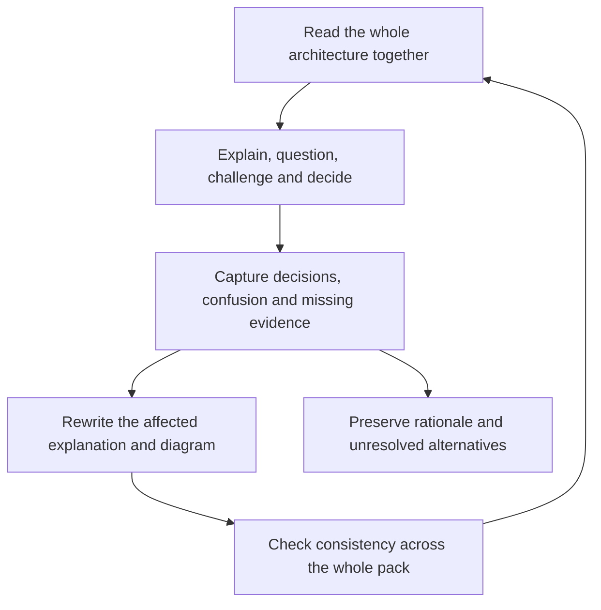

# Ogma 2 architecture — the next whole-system pass

**Start next review here:** [Investigated answers and decision table](2026-09-18-review-investigations.md).

Updated 14 September 2026. Requirements and architecture are open for review.
**No schematic, PCB or firmware changes are authorized by this pack.**
Existing CAD and electrical contracts remain the preserved draft until Seán
explicitly authorizes the final stack.

Start at [0. The whole system](00-overview.md). Briefly revisit understood sections, focus on changed assumptions, then continue
through unread chapters. On 13 September, chapters 0–5 were discussed; 6–8
were not reached. Comprehension is not design acceptance. See the
[latest review and learnings](2026-09-13-session-review.md).

## Reading order

| Order | Chapter | What we need to understand |
| --- | --- | --- |
| 0 | [Whole system](00-overview.md) | Jobs, ownership, mission scope and failure boundaries |
| 1 | [MCUs and execution](01-mcus.md) | Timing separation, processor sizing and reset behaviour |
| 2 | [Power](02-power.md) | Every rail's actual load, startup dependency and fault isolation |
| 3 | [Energetic outputs](03-energetic-outputs.md) | Physical permission, bounded activation and what remains unreviewed |
| 4 | [Servos and remote actuation](04-servos.md) | Local channel needs and where estimation/control should run |
| 5 | [Service, status and time](05-service-status-time.md) | What an operator can know, and what each indication actually proves |
| 6 | [GNSS and radio](06-gnss-radio.md) | Position limits, antennas, communications and stale information |
| 7 | [Sensors and recording](07-sensors-logging.md) | Useful measurements, pre-trigger history and evidence survival |
| 8 | [Power companion and vehicle boundary](08-foinse-can.md) | Pack protection, charging, CAN peers and payload expansion |

Burrito means the core/Croí2, Churro the power companion/Foinse2, and Fajita the
separate propulsion controller. These are canonical names confirmed on 13 September; CAD and net
names have not changed.

## How to read the status

Italic review notes mark a specifically evidenced explanation as understood;
they do not approve its implementation. Unmarked text is not silently accepted.
The [18 September exhaustive change ledger](2026-09-18-meeting-change-ledger.md)
tracks requested work separately from whether its wording was summarized.

- **Retained:** existing requirement or boundary carried into this review.
  Not a claim of measured performance or flight qualification.
- **Working direction / recommendation:** a candidate with reasons, not permission
  to implement it.
- **Open:** the team has not settled the choice.
- **Evidence pending:** the calculation, inspection or physical test is still needed.

The text separates an installed draft feature from a proposed replacement.
A diagram explains function and ownership; it is not a wiring diagram or a
complete safety case. Dashed branches are labelled where optional or proposed.

## The feedback loop

The output of a session is an improved reading pack, not just another transcript
summary. If a term needed explaining aloud, put that explanation where the next
reader needs it. If a diagram hid ownership or a startup dependency, redraw it.
If two people argued for different allocations, preserve both arguments and the
evidence that would distinguish them.

Each pass still covers the whole architecture. Briefly revisit retained choices
and their reasons, spend the discussion where understanding or decisions remain
open, then continue. Do not make one unresolved choice prevent seeing its
downstream consequences. Do not treat a skipped chapter as approved.

Bring a recommendation, its cost and a useful next check when evidence supports
one. Do not disguise an unknown as a decision just to make the document tidy.
After the session, reconcile changed decisions across chapters and interfaces;
record explicit acceptance separately from discussion.

## Detail without interrupting the read

Component designators, exact pin allocations, extensive part comparisons and
older calculations are outside the main chapters. The
[implementation-reference index](implementation-reference/README.md) preserves
that material. It is optional lookup, not required preparation.

The [10 September session record](2026-09-10-session-review.md) holds the
source-backed extraction and review history. It is not the first chapter.
[Current system](../../current-system.md) identifies the preserved implementation
and open deltas; [interfaces](../../interfaces/README.md) carry exact boundaries.
The [review procedure](../design-review-operating-procedure.md) governs the loop.

## Next session and release boundary

Begin at chapter 0 and continue to chapter 8. Capture what changed in both the
architecture and the way it needs explaining. Then improve this same pack.

The first full engineering PCBA remains the planned functional-block test
article. Nothing here reintroduces separate mandatory mini-PCBs, authorizes
ordering, or qualifies flight or live energetic operation. Existing inhibits and
unpopulated energetic links remain in force.
