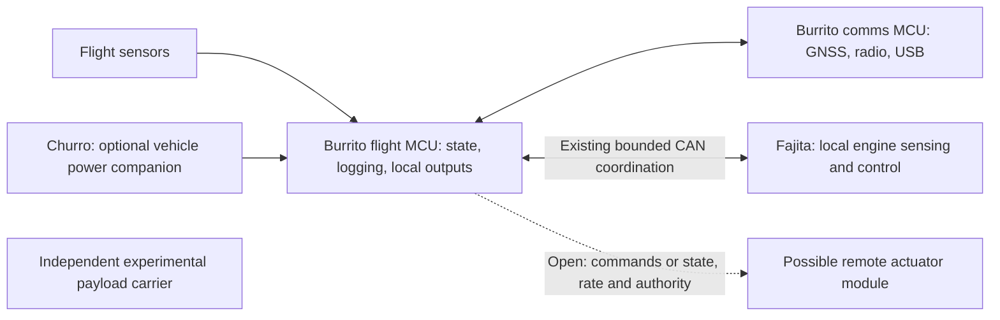

# Preserved reference — not the session reading path

Snapshot retained before the 11 September full-pack rewrite. Detailed component,
pin and calculation evidence follows. Current review status lives in the
[reading pack](../README.md); this snapshot does not authorize implementation.

# 0. What we are building

## 10 September review: understand the allocation first

Working names: **Burrito** core / **Churro** power / **Fajita** engine control.
The [session record](../2026-09-10-session-review.md) controls review status. The
three-servo, identical-MCU and two-node details below are the existing draft,
not final-stack approval. Schematics and PCBs remain untouched.



This is a responsibility map, not power wiring. Churro is unnecessary for
standalone core use. The dashed actuator boundary is under review; it does not
add a peer to the existing CAN contract. Experimental payloads do not obtain
flight authority merely by being part of the department.

The next architectural decision is which vehicle functions are local and
which are remote. That drives channel counts, bus workload, processors, power
and connectors. Separately, every diagram must explain where energy flows and
what happens when its source, processor or communication link disappears.

Ogma 2 is the computer we maintain for ordinary HiPR launches, then qualify for
specific harder missions. Croí2 works alone. Foinse2 adds vehicle power
distribution without adding a processor or another flight-state machine.

The useful difference is integration with our vehicles: three energetic
channels, three servo channels, measured power, dissimilar sensors, a bounded
propulsion link and serviceable wiring. A newer chip is useful only when it
improves one of those jobs.

## Power and information

```text
Standalone 2S OR Foinse protected 2S
                 │
       Croí protection + current shunt
          ┌──────┴───────────┐
       logic rails      physical output-energy breaks
          │                  │
  flight MCU U201       3 energetic + 3 servo channels
    │   │    │
 sensors NOR vehicle CAN ─────── propulsion controller
    │
 bounded UART
    │
 comms MCU U401 ─── GNSS / radio / USB

Foinse: separate 6S pack ── protected paired power ── propulsion
        Croí auxiliary 3.3 V ── monitoring only
```

The drawing shows responsibilities, not a finished power or arm schematic.
USB service does not power the outputs. Only one Croí battery source may be
connected. Propulsion owns local valves, redlines and abort; CAN carries
coordination rather than a remote substitute for its control loop.

## Previously accepted implementation reference

Two role-separated H563 MCUs; separate flight/comms/optional power domains;
five flight sensors; fixed local NOR; three energetic and three servo channels;
MCU-less Foinse; keyed connectors; independent debug; first-full-PCBA testing.
The current review is not permission to silently remove these choices.
It is also not approval to continue implementing them before the reopened
questions and final stack have been reviewed.

The carbon airframe changes the GNSS installation: reception must move outside
it. External power-switch connections are also authorised. Exact implementation
remains separate from these requirements. Computer power and energetic arming
must remain distinguishable electrically and to the operator.

## What the split buys, and what it does not

Comms can reset without taking essential flight work with it. A failed optional
device should be isolated locally; a failed peripheral must not stall the
scheduler. These are testable containment claims.

Both MCUs still share a board and upstream power path. The flight processor,
core conversion, installation, software defects and common environment remain
common failure points. Two MCUs are not two independent recovery systems.

Ordinary flights use the workhorse outputs after qualification. The bounded
Kármán configuration has those energy paths physically absent/DNP; independent
vehicle systems own recovery, actuation and full-envelope altitude proof.

## How the research shaped this design

The design is not justified by having more components than another flight
computer. The earlier research kept returning to a few observed integration
failures and the evidence that would make them diagnosable next time.

| Earlier finding or constraint | Architectural consequence | Remaining cost or limit |
| --- | --- | --- |
| Rev 1 supply/reset cause was not established by the available record | Voltage/current evidence, reset capture, independent supervision and explicit source tests | More diagnostic circuitry does not identify a cause until data is captured correctly |
| Shared-bus, orientation and exact-part mistakes | Separate acquisition buses, exact package/pin checks, explicit sensor identity and axis transforms | More drivers and boundaries; common mounting/environment faults remain |
| GNSS fix/age and reconstructed altitude could be confused | Preserve source time, validity and datum; do not label a mixed-source track independent GNSS proof | Estimator and log consumers must honour those distinctions |
| Carbon blocks the chosen onboard-antenna installation | External GNSS antenna arrangement | RF launch, coax loss and retention replace the old cable-free advantage |
| Need a reusable computer across ordinary and liquid vehicles | Standalone Croí plus MCU-less Foinse and a bounded propulsion CAN contract | More interfaces than a dedicated recovery-only board; their failure behaviour must be tested |
| Short suborbital exposure, not orbital lifetime | Commodity parts with explicit fault containment and mission qualification | No claim of radiation hardness or years of unattended space operation |

The Rev 1 reset was not proved to be a connector, hot-plug, sensor or radiation
fault. The earlier reviews deliberately separated candidate precursors from
causation. That discipline is part of the design: record enough to distinguish
a command, an electrical response, a valid measurement and an actual outcome.
[Rev 1 lessons carried forward](../../rev1-external-review-lessons.md),
[reset and evidence contract](../../../interfaces/reset-recovery-contract.md).

### The real simplicity trade

One processor, one regulator and a shared sensor bus would be simpler to draw.
They would also place more failures in the same path. Every additional branch
in this design needs a named containment or measurement job. Conversely,
separate regulators do not make separate flight computers when their source,
PCB and flight processor remain shared. The chapters explain both sides.

The earlier model found storage to be a major priced component, while the
additional quiet regulator was a small line item by comparison. Signal-domain
protection was a major component-count/layout burden. Those are better places
for an honest cost/function review than treating chip age or total part count
as a proxy for quality. No complete current delivered BOM quote exists.

Adapting an established flight computer remains a legitimate alternative. The
dated CATS comparison did not establish that Ogma is more reliable, nor verify
the claimed 100 km rating. Our reason to build is the combined HiPR mission,
interfaces, service and owned control policy. Novel radio hardware earned a
place through a concrete module comparison; novelty alone was not the argument.
[Dated comparison](../../avionics-options-review-2026-09-07.md#5-cats-compare-the-vehicle-job-not-a-chip-age-contest).

### What kind of evidence is in this pack?

Part ranges, package constraints and reference circuits came from manufacturer
documentation. Storage, timing, energy and link examples are calculations with
stated assumptions. Selection and containment arguments are engineering
judgments. Native CAD checks demonstrate specified identity/connectivity
properties. None of those substitutes for measurements on the assembled board.

The expanded chapters recover the 6–7 September study and reconcile it with
the 8 September installation changes. They are not a new market survey or a
claim that every competing sensor was benchmarked. Historical selections such
as E22, SAM, two servos and pre-order coupons remain historical; the current
Wio, external MAX, three servos and first-full-PCBA sequence control.

## Next decision

Can Seán and Anav point to every source, decision owner and unsafe failure path
on the drawings? If not, improve the drawing or resolve that boundary before
packing the PCB. Keep the previous routing study separate.

Evidence: [current system](../../../current-system.md),
[accepted baseline](../../architecture-acceptance-2026-09-07.md),
[vehicle boundary](../../../interfaces/ogma-foinse-propulsion-boundary.md).
