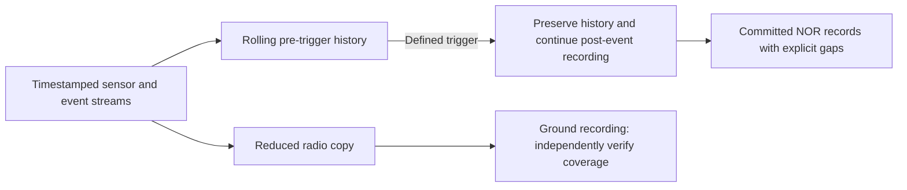

# Preserved reference — not the session reading path

Snapshot retained before the 11 September full-pack rewrite. Detailed component,
pin and calculation evidence follows. Current review status lives in the
[reading pack](../README.md); this snapshot does not authorize implementation.

# 7. Sensors and local recording

## Job and current review

Preserve what the vehicle measured and did—including the lead-up to an
incident—without letting recording stall control. The review requested a
pre-trigger rolling history and recoverable records after interrupted writes.

This is the proposed recording behaviour, not implemented firmware. Define
duration in seconds per stream, trigger/start conditions, reset/abort handling,
buffer ownership and bounded commit/restart behaviour. A hundred samples at
1 kHz is only 100 ms, not an accepted incident window.

Separate three claims: surviving a torn write, extracting data from a damaged
board, and retaining a partial ground copy after a lost vehicle. NOR is not
automatically a crash-survivable black box; volatile history is lost without
retained power. Mac/Cyberdeck recording was reported in the room, not inspected
in this pass. [Full logging extraction](../2026-09-10-session-review.md#8-logging-three-different-survival-problems).

No sensor, storage part or memory allocation changed. The figures below remain
the existing draft budget, to be reconciled with the proposed behaviour.

## Selected measurements

| Device | Role | Starting configuration |
| --- | --- | --- |
| U3104 ST LSM6DSV16XTR | Low-g acceleration and rotation | 960 Hz, ±16 g / ±4000°/s, SPI1 |
| U3204 TDK ICM-42688-P | Dissimilar low-g/rotation measurement | 1 kHz, ±16 g / ±2000°/s, SPI2 |
| U3304 ADI ADXL375 | Boost/high-g evidence | 800 Hz, nominal ±200 g, SPI3 |
| U3403 Bosch BMP390 | Lower-flight pressure | 50 Hz target, I²C1 |
| U3503 TE MS5607 | Dissimilar pressure measurement | 50 Hz compensated target, I²C2 |
| U3604 MX66L2G45GMI00 | Full local flight record | 256 MiB NOR, quad interface |

Rates are initial budgets, not measured delivery or a demand that all samples
arrive synchronously. ADXL375 minimum specified range is ±180 g; do not conceal
saturation behind the ±200 g nominal label.

## Why five sensors

The two low-g IMUs provide finer-range coast measurements and dissimilar
manufacturer implementations. The separate high-g sensor covers acceleration
that saturates both IMUs. The two pressure devices expose disagreement and
device-specific failure. This is purposeful measurement diversity, not a
claim that any arbitrary two readings identify the truth.

Each sensor has a separately controlled limited supply and bus boundary.
The cost is more passives, isolation parts, firmware health logic and testing.
A smaller sensor set is simpler but removes these named diagnostic/range
capabilities; no deletion is authorised in this pass.

They still share the board, mounting, temperature, vibration, estimator and
some upstream power. Pressure devices also share an installation/vent failure.
Different manufacturers do not remove those common causes.

## The selection reasoning, device by device

The 6 September study checked a proposed sensor set against the required ranges,
independent buses, timing and physical integration. The 7 September follow-up
challenged whether low-g sensing was missing and whether newer parts were needed.
It did **not** record an exhaustive priced comparison of every competing IMU or
barometer. The evidence below supports these choices; it does not claim that
each is the best device available at any price.

### ST LSM6DSV16X: primary low-g and rotation channel

The useful combination is a small six-axis device, dedicated SPI and a gyro
range reaching ±4000°/s. That additional rotation headroom matters because a
rocket can saturate a ±2000°/s gyro even when its accelerometer remains useful.
The starting 960 Hz rate is this device's rate, not an approximation to the
TDK's 1 kHz clock. Software must preserve independent acquisition timestamps.

The study selected ordinary raw acquisition. Embedded fusion, sensor-hub,
Qvar and OIS functions do not acquire a mission role simply because the chip
contains them. The ±4000°/s setting requires the gyro OIS chain to be disabled.
There is no dedicated reset pin: recovery uses the documented software reset
or the separately switched branch. Those details affect actual driver work.
[ST datasheet](https://www.st.com/resource/en/datasheet/lsm6dsv16x.pdf).

The trade is useful rotation range and integration against configuration
complexity. This is not a laboratory-grade bias guarantee. Installation strain,
vibration, filter delay and temperature still need measurement.

### TDK ICM-42688-P: a second implementation, not a voting system

The TDK supplies another six-axis observation on SPI2, with its own oscillator,
interrupt and power boundary. Different silicon and a separate bus help with
device-specific faults and a stuck interface. A second identical ST would
simplify drivers but provide less implementation diversity. The two devices
still share mounting, temperature and upstream power.

Its ±2000°/s gyro is the limiting rotational range of the pair. Beyond that,
there is one potentially valid gyro, not two. The device has selectable low-g
ranges, but the initial ±16 g setting avoids a phase-transition configuration
change. The reference decoupling differs from ST; their similar-sized LGA
packages are not interchangeable pin maps.
[TDK datasheet](https://invensense.tdk.com/wp-content/uploads/2020/04/ds-000347_icm-42688-p-datasheet.pdf).

The cost is another driver, calibration transform, timestamp stream and fault
boundary. That cost buys an independent observation; it does not let two
disagreeing readings identify which one is right. Diagnosis needs status,
freshness, clipping and consistency with other valid evidence.

### ADXL375: preserve boost data without sacrificing coast sensing

Both IMU accelerometers can clip above ±16 g. ADXL375 supplies the separate
high-g record on SPI3. Its nominal scale at the proposed 800 Hz mode is about
49 mg/LSB: it is plainly not the replacement for low-g coast measurements.
The specification's minimum range is ±180 g despite the nominal ±200 g name.
A 200 g mechanical shock screen is also not a guarantee of measuring that
shock accurately. [ADI datasheet](https://www.analog.com/media/en/technical-documentation/data-sheets/ADXL375.PDF).

The alternative is accepting clipped boost acceleration, or reopening the
high-g part/range requirement if the vehicle needs guaranteed coverage beyond
the specified minimum. No alternate high-g part was fully qualified in the
original study. The first check is overlap with the low-g channels, scale,
orientation and clipping behaviour; mission simulation must then set the
required range with margin.

### Do we need another low-g accelerometer or ±2 g coast mode?

Both IMUs already support ±2/4/8/16 g. Lowering the range improves digital
quantisation; it does not automatically improve bias, vibration rejection or
installed noise. Switching range adds settling, scaling and transition evidence
to the estimator. Keep the initial fixed ranges until measured data shows a
useful gain from switching or from a separate precision sensor.

Coast means near-zero specific force, not low vehicle speed. An accelerometer
in ballistic flight is not a reliable gravity-direction reference for a simple
tilt correction. A sixth sensor cannot repair an incorrect motion model.
[Accepted configuration review](../../sensor-configuration-review-2026-09-07.md).

### BMP390: the compact lower-flight pressure channel

BMP390's specified pressure range is 300–1250 hPa. The lower limit is around
9 km in a standard atmosphere, close to the upper ordinary-flight envelope.
That makes it useful lower-flight evidence, not a full-trajectory altimeter.
The 50 Hz target must be checked against the chosen oversampling/conversion
time; an advertised maximum output rate does not apply to every filter setting.
[Bosch datasheet](https://www.bosch-sensortec.com/media/boschsensortec/downloads/datasheets/bst-bmp390-ds002.pdf).

Its compact package reduces area but needs correct interface/address straps,
clean assembly and a characterised static-pressure path. Once pressure leaves
the established valid range, retain the raw record with an invalid flag rather
than treating a floor value as an apogee measurement.

### MS5607: different pressure implementation, qualified range matters

The TE part brings a different conversion and compensation implementation.
Its full-accuracy region is 300–1100 mbar; the extended ADC range is
10–2000 mbar. The latter does not extend the best error specification down to
10 mbar. It may provide useful higher-altitude aiding after chamber
characterisation, but the selected part alone does not establish that accuracy.
[TE datasheet](https://www.te.com/commerce/DocumentDelivery/DDEController?Action=srchrtrv&DocNm=MS5607-02BA03&DocType=Data+Sheet&DocLang=English).

At OSR4096, D1 and D2 conversions can each take 9.04 ms. Acquiring both afresh
every 20 ms spends 18.08 ms on conversion, leaving only 1.92 ms for transfers
and scheduling. The flight loop must start a conversion and return later,
not busy-wait for it. PROM CRC protects calibration data, not every pressure
sample; compensation needs the specified arithmetic and temperature handling.

Two identical TE devices would simplify implementation. The chosen Bosch/TE
pair instead provides a more diverse comparison, at the expense of two drivers,
different delay models and more board area. A shared blocked vent still defeats
both. The review did not establish a universal accuracy ranking between them.

### Sensor faults and physical layout are part of the selection

The Rev 1 review recorded shared-bus and orientation mistakes. That is why the
new parts have separate buses, named axis transforms and accessible supply/
signal probes. Power switching alone is insufficient: driven signal pins can
back-power an unpowered sensor. TXU paths and bidirectional TMUX boundaries
must be checked through actual ramps and shorts, not just at zero supply.

Place IMUs in a stiff, supported area away from board strain, sounder vibration,
magnetics and actuator current loops. Do not substitute uncharacterised foam
mounting for a vibration test. Keep pressure ports free of wash, coating,
adhesive and charge residue. A neat PCB with a bad vent remains a bad altimeter.

## Recording

NOR is soldered rather than socketed. Pre-erase while disarmed; flight recording
must not wait for an erase or scan the entire chip during restart. Records need
sequence, time, identity, integrity and explicit losses. Telemetry is a reduced
copy, never the sole evidence.

The current planning estimate is 96,672 B/s including the added current record;
30-minute storage budget is about 180.6 MB with previous allowance, below the
256 MiB capacity while retaining the stated 64 MiB reserve. These are budget
calculations, not measured worst-case write throughput.

Removable SD would simplify physical extraction but adds a socket, media and
field-handling boundary. It is not selected for flight logging. USB extraction
must remain bounded and must not interfere with active essential logging.

### Why 256 MiB NOR rather than smaller flash or SD?

The original budget used 78,960 B/s of records plus 20% framing/commit allowance,
giving 94,752 B/s. Adding bulk current records raised the current estimate to
96,672 B/s. Thirty minutes, low-rate pad/recovery records and metadata account
for about 180.6 MB; a 64 MiB capacity reserve still fits. Keep byte/MiB units
explicit: this is a 2 Gbit part, not a 2 GB part. The exact record sizes are
allocations for Anav to validate, not an imposed binary format.

| Option explored | Benefit | Cost / reason not selected |
| --- | --- | --- |
| One MX66L2G45GMI00 | Capacity in one soldered, inspectable package; no media socket | Expensive BOM line; program stalls, addressing and torn writes still need handling |
| Smaller total NOR | Lower cost and potentially smaller footprint | Requires a new duration/rate/reserve budget; not a drop-in saving |
| Two 1 Gbit NOR parts | Possible procurement saving or separate storage domains | Requires priced parts, chip-select/resource audit and new reset/address/throughput checks; not completed |
| Removable SD | Convenient extraction and large capacity | Socket retention, media/controller behaviour and field handling add failure boundaries |

The 6 September procurement snapshot put the selected NOR around US$55 at
single quantity. That was a dated listing, not a current quote or complete BOM.
It explains why storage deserves an honest cost review before squeezing away
small protection components. [Part listing used in the study](https://www.digikey.com/en/products/detail/macronix/MX66L2G45GMI00/24773871).

### The write-time calculation changed the proposed commit format

The researched maximum page-program time was 1.5 ms for 256 bytes. One program
per page gives about 170.7 kB/s before bus overhead. A second program solely to
commit every page drops that to about 85.3 kB/s, below the log allocation.
The study therefore proposed sixteen data pages plus one footer page per
4 KiB: 25.5 ms of programming, about 160.6 kB/s useful data before overhead.
This is a concrete throughput trade, not merely advice to add CRCs.
[Macronix datasheet used by the study](https://www.macronix.com/Lists/Datasheet/Attachments/8959/MX66L2G45G%2C%203V%2C%202Gb%2C%20v1.1.pdf).

The original source access for this timing was cached manufacturer text;
exact fitted-revision timing and behaviour still need confirmation. Pre-erase
disarmed, use explicit full-density addressing and exercise 16 MiB, 128 MiB
and final-address boundaries. Measure sustained verified writes with all
acquisition active. An interrupted footer may lose that block, but must not
invalidate earlier committed blocks or hold up flight control.

## Next review

Show each actual sensor and its local power, bypass and signal isolation as a
connected circuit. Prove axis transforms, timestamps, saturation/freshness,
pressure validity, start/stop behaviour and stuck-bus isolation. Never average
a known-invalid pressure reading into a trustworthy altitude claim.

Test interrupted NOR writes, full/corrupt storage and bounded logger recovery.
Logging failure may degrade evidence after launch; it must not create a flight
reset loop. Keep current monitoring explicitly separate from mechanical proof.

Evidence: [sensor configuration](../../sensor-configuration-review-2026-09-07.md),
[firmware handoff](../../firmware-handoff-2026-09-07.md),
[fault contract](../../../interfaces/flight-fault-contract.md).
