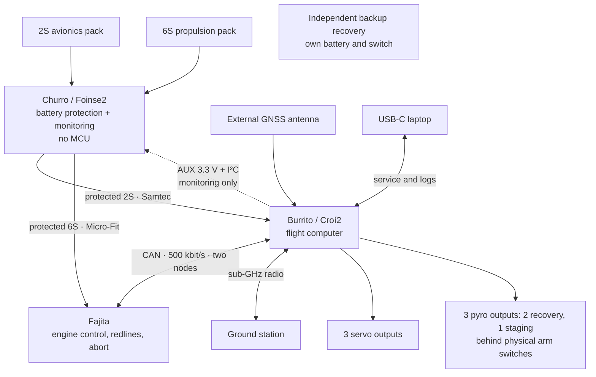
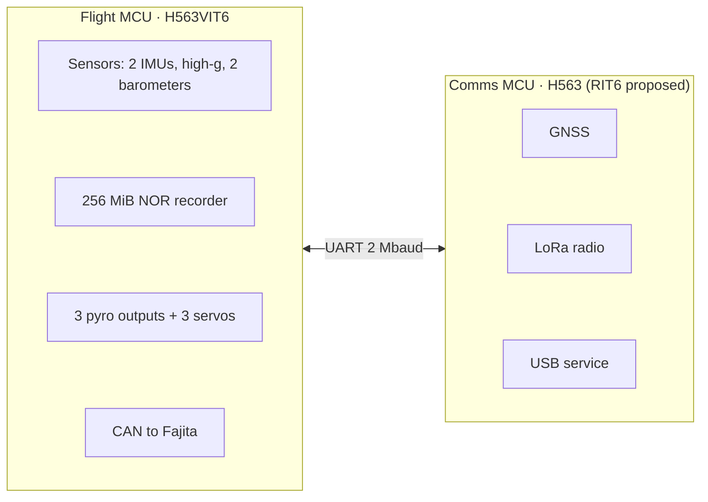
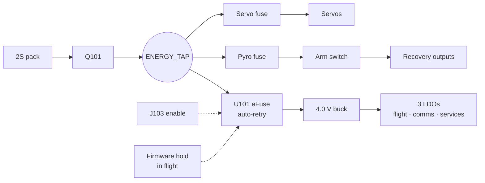

# System tour

Start here. Ogma2 is HiPR's workhorse flight computer: two boards we own,
**Burrito** (Croí2) and **Churro** (Foinse2), talking to **Fajita**, the
propulsion team's engine controller. It exists as a capture specification and
two unrouted KiCad drafts; nothing is built or flown. What's settled is in
[decisions](../../decisions.md).

## The vehicle

The dashed line powers and reads Churro's monitors; it never controls Churro's
protection. The two packs keep separate positives and share ground.
Standalone, Burrito takes its own 2S pack on J101 instead of Churro: one or the
other, never both. USB is service power only.

## The boards

| Board | Job | State |
| --- | --- | --- |
| **Burrito / Croí2** | Sensing, estimation, flight state, recording, three pyro outputs, three servos, CAN; a comms processor for GNSS, radio and USB | 44 sheets, 643 parts, unrouted, 80 × 230 mm working outline |
| **Churro / Foinse2** | Two separately protected and enabled pack feeds; propulsion current, voltage and temperature | 12 sheets, 113 parts, unrouted, 60 × 80 mm |
| **Fajita** | Engine-side sensing, valves, permissives, redlines, abort, its own recording | Owned by propulsion; Ogma only defines the boundary |

Burrito and Churro sit side by side and mate through the 8-contact Samtec pair
(7.39 mm edge gap, 52.63 mm connector envelope); separate supports take the
load. Those are placement references, not fit or vibration evidence.

## Inside Burrito

| Block | Parts | Why |
| --- | --- | --- |
| Flight processor | STM32H563VIT6 | Owns deadlines and every vehicle action; runs with comms held in reset |
| Comms processor | STM32H563 (VIT6 in CAD, RIT6 proposed) | Keeps GNSS, radio and USB off the flight schedule (two processors decided, D-6.12) |
| Sensors | LSM6DSV16X + ICM-42688-P (±16 g), ADXL375 (±200 g), BMP390 + MS5607 | Independent buses; each has range limits |
| Recording | 256 MiB NOR, flight-owned | Evidence survives losing the radio |
| GNSS | MAX-M10S, external passive antenna | Position and time when valid; 80 km / 4 g / 500 m/s limits |
| Radio and service | Wio-LR2021 on SMA; USB-C on comms | Telemetry and ground service; ground link not yet tested |
| Supervision | TPS3808 supervisors, TPS3430 watchdog, internal RTC | Reset evidence; not a redundant computer |

Two processors on one board still share the battery, buck, ground and PCB.
Independent backup recovery is a separate vehicle job.

## Power

Logic goes through U101, a 4.0 V buck and three LDOs: flight, comms and
services (NOR, CAN, monitors), so a comms fault can't take the recorder.
Pyro and servo energy leave before U101 through their own fuses, so a shorted
igniter or a stalled servo can't switch the computer off. In flight, firmware
holds the enable on; the eFuses restart after an over-current instead of
latching off; the flight MCU's backup memory has its own hold-up. Detail in
[02 Power](02-power.md).

Churro protects raw packs; it doesn't regulate 6S to 24 V or charge anything.
Proposed continuous ceilings: AV 3 A, PROP 2 A. Its protection works without
Burrito; its monitoring doesn't.

## Switching on and arming

| Action | Connector | What it does | What it doesn't |
| --- | --- | --- | --- |
| Switch on | J103 enable loop | Turns on Burrito's battery entry | Disarm anything; isolate the pack |
| Arm recovery | J6101 external switch | Connects energy to pyro channels 1 and 2 | Switch the computer on |
| Arm staging | J6102 external switch (proposed) | Connects energy to channel 3, which also needs the reset latch set | Arm recovery |
| In flight | Firmware hold | Keeps the computer on if J103's wire breaks | Override a pulled battery |

The arm switch parts aren't chosen yet. Arm state comes from sense lines over
USB and telemetry; no lamp shows it. [09 Connectors](09-connectors-arming.md).

## What changes from the 8 September CAD

| Topic | CAD now | At capture |
| --- | --- | --- |
| Comms MCU | H563VIT6, 100 pins | H563RIT6, 64 pins (proposed) |
| Rails | Three 3.3 V domains | Three at 3.352 V; services restartable from flight |
| Servos | Three channels | Three (D-7.1), raw 2S, own fuse, ≥220 µF |
| Outputs | Three channels with one-shots, gates, high and low sides; no energy source | Three channels, TPS1H100 high side ≈2.0 A: two recovery behind one arm, one staging behind its own arm and the reset latch |
| Power path | Outputs after U101; latch-off eFuses; enable open = off | Energy tapped before U101; auto-retry; firmware hold; VBAT hold-up |
| Sensors | Per-sensor switches and isolators | Direct from FLIGHT_3V3 |
| Recording | Earlier format | 15 data pages + footer per sector; full rate from launch detect |
| Battery entries | Both provisions; J101 footprint missing | Fit one; draw the Nano-Fit footprint |
| CAN | 500 kbit/s Classical, two nodes | Unchanged for Rev A |

No target firmware exists yet; the 12 host checkpoint tests are a model, not
firmware. A full 256 MiB download over the inter-MCU UART takes at least
22.4 minutes.

## Connectors

Manufacturer photos and renders, not our hardware. Part numbers and cavity
drawings govern the harness.

| Visual | Selected part and use |
| --- | --- |
|  | **Nano-Fit, 2.5 mm, two contacts.** Burrito J101 standalone 2S and Churro J101 AV pack. Board **1053111102**, mate **1053071202**. Exact footprint missing on both boards. [Molex](https://www.molex.com/en-us/products/part-detail/1053111102) |
|   | **Samtec, 5 mm, eight contacts.** Burrito J102 **MPT-08-01-01-L-RA-SD** ↔ Churro J301 **MPS-08-01-01-L-RA-SD**. Protected 2S, two grounds, returned AUX 3.3 V, I²C, fault and `CROI_POWER_HOLD` on pin 8. [Header](https://www.samtec.com/products/mpt-08-01-01-l-ra-sd) / [receptacle](https://www.samtec.com/products/mps-08-01-01-l-ra-sd) |
|  | **JST GH, 1.25 mm.** Two-contact **BM02B-GHS-TBT(LF)(SN)** / **GHR-02V-S**: Burrito J103 and Churro J103/J104 source enables. Three-contact **BM03B-GHS-TBT(LF)(SN)** / **GHR-03V-S**: Burrito J501 CAN H/L/ground, no power. Four-contact **BM04B-GHS-TBT(LF)(SN)** / **GHR-04V-S**: Churro J601 probes. [JST family and exact variants](https://www.jst-mfg.com/product/index.php?series=105) |
|  | **Micro-Fit 3.0.** Photo: Burrito J6602 ten-contact **430451000**, mate **430251000**, three-servo harness. Other exact variants: J6601 six-contact **430450600 / 430250600**, three-pyro output harness; Churro J201 four-contact **430450400 / 430250400**, PROP input; J701 two-contact **430450200 / 430250200**, protected PROP output. The pyro arms J6101 / J6102 must not use this same two-contact part. [Ten-contact part](https://www.molex.com/en-us/products/part-detail/430451000) |
|  | **GCT USB4105-GF-A**, USB-C USB 2.0 service socket, Burrito J4401. Logic/data service, no pack charging. Current PCB/library footprint mismatch needs reconciliation. [GCT](https://gct.co/connector/usb4105) |
|  | **Amphenol 132134**, vertical through-hole, 50 Ω standard SMA jack. Burrito J4501 GNSS and J4601 radio. Passive GNSS baseline; identical sockets need distinct retained leads. [Amphenol](https://www.amphenolrf.com/en-us/part/132134/662/) |
|  | **TC2030-NL-FP** six-pad/locating-hole patterns at J2301/J4201, separate MCU debug. No mounted header. Shown **TC2030-CTX-NL** cable connects six spring contacts to Cortex ten-contact debug. [Tag-Connect](https://www.tag-connect.com/product/tc2030-ctx-nl-6-pin-no-legs-cable-with-10-pin-micro-connector-for-cortex-processors) |

Same family isn't a safety key: the three 2-contact GH enable plugs and the two
SMA sockets can be swapped, and the pyro arm connector must not mate with
Churro's J701. Harnesses need cavity-numbered drawings, wire-matched contacts
and strain relief. [Connector inventory](09-connectors-arming.md) ·
[assembly notes](justifications/interfaces-and-installation.md).

## What's next

1. Settle the open rows in [decisions](../../decisions.md): igniter, arm switch,
   backup altimeter, recovery logic, ground radio, bay size.
2. Capture the [specification](schematic-capture-spec.md), with a human
   reviewer per page; place; Seán routes.
3. First board on inert loads; firmware bring-up; radio range test.
