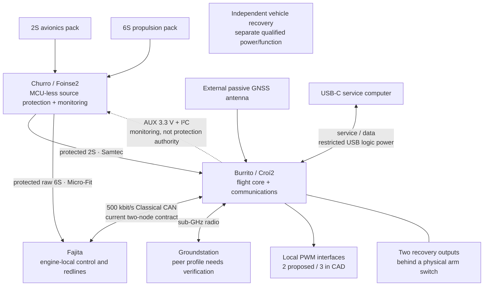

# Ogma2 — system tour

6 October 2026. **A capture specification and two unrouted CAD projects; not a
fabrication release or a tested flight system.** Native CAD holds the 8 September
draft; the 22 September proposal and the 6 October [decisions](../../decisions.md)
change it at capture.

## The whole vehicle

Ogma2 owns **Burrito and Churro**. Fajita is the separate propulsion controller,
owned by its propulsion project. A radio groundstation and independent recovery
are external systems; neither is another selected Ogma2 PCB. No payload carrier
or additional actuator node has been selected.

Solid arrows show power or the labelled interface. The dashed path supplies and
reads Churro's monitor electronics; it does not control the source protection.
Both battery branches share ground but have separate positives. This drawing
does not imply galvanic isolation or a selected energetic wiring arrangement.

**Standalone Burrito:** use its own 2S battery entry instead of Churro. The
proposal makes the two battery entries exclusive population variants. Do not
connect two packs to Burrito's alternative entries. USB is service power, not a
battery charger or output-energy source.

## The boards and their jobs

| Board | What belongs to it | Present state |
| --- | --- | --- |
| **Burrito / Croí2** | Flight sensing/estimation, mission state, local recording, CAN, local outputs; separate comms processor for GNSS/radio/USB | 44 schematic sheets; 643 components, 642 footprints; unrouted four-layer 80 × 230 mm working canvas, not approved vehicle fit |
| **Churro / Foinse2** | Two independently enabled protected battery branches; propulsion-current, voltage and temperature monitoring | 12 sheets; 113 components, 112 footprints; unrouted four-layer 60 × 80 mm working canvas; no MCU or CAN endpoint |
| **Fajita** | Engine-local acquisition, valves, permissives, redlines, abort and local recording | External ownership. Ogma contracts define the boundary; this audit did not qualify its implementation |

The two Ogma boards mate **coplanar, side by side**, using the eight-contact
Samtec pair. Supports carry mechanical loads. The nominal board-edge gap is
7.39 mm; the connector envelope is 52.63 mm wide. Those are placement references,
not vibration or airframe-fit evidence.

## Inside Burrito

| Owner / block | Main parts and connections | Why it exists |
| --- | --- | --- |
| Flight processor | STM32H563VIT6, LQFP100 | Owns essential deadlines and vehicle authority; must start/run with comms held in reset |
| Comms processor | STM32H563VIT6 in CAD; **H563RIT6, LQFP64 proposed** | GNSS, radio and USB stay off the flight processor's critical timing path |
| Five sensor branches | LSM6DSV16XTR + ICM-42688-P low-g IMUs; ADXL375 high-g accelerometer; BMP390 + MS5607 pressure sensors | Independent acquisition/limited branches, with explicit validity/range limits |
| Recording | MX66L2G45GMI00, **256 MiB NOR**, flight-owned | Local evidence survives loss of the radio link; no second comms flash selected |
| Position/time | MAX-M10S-00B, UART + PPS, external passive GNSS antenna | Navigation and timing when valid; its 80 km / 4 g / 500 m/s limits do not establish full mission coverage |
| Radio/service | Wio-LR2021 / Seeed 100058045, SPI and external SMA; USB-C on comms | Telemetry and ground servicing; exact groundstation compatibility still needs verification |
| Processor link | 2 Mbaud UART with partial-power signal boundaries | Comms records/telemetry exchange without making comms a flight boot prerequisite |
| Supervision | TPS3808 supervisors, TPS3430 earned flight watchdog; internal RTC, no backup cell | Reset/recovery evidence; no claim of an independent redundant flight computer |

Two processors on one PCB still share source, preregulator, ground and physical
board. Independent recovery remains a separate vehicle function. Low-g IMUs and
pressure sensors also have measurement limits; extra parts do not remove the
need for a mission-specific validity/altitude/recovery assessment.

## Follow the power

**Protected 2S → battery/USB selection → common 4.0 V buck → three LDO domains.**
The proposal retains all three TPS7A91 regulators, each set to nominal
**3.352 V**. Three domains isolate regulator/load failures, not three voltage
requirements or three batteries.

| Domain | Feeds | Boundary / consequence |
| --- | --- | --- |
| Flight, 200 mA continuous allocation | Flight MCU, supervisors, five sensors (no per-sensor switches) | Flight-only held input; a short interruption may be bridged, but no measured hold-up guarantee exists |
| Comms, 300 mA allocation | Comms MCU/USB; switched GNSS and radio | Comms regulator/output fault need not remove flight or recording/CAN |
| Services, 200 mA allocation | NOR, CAN, Burrito current monitor, Churro AUX monitoring, sounder | Services fault can lose recording/CAN/monitoring together; flight remains. Proposed PD10 control permits bounded recovery |

Common source/buck failure can still lose all three. Held flight power does
**not** hold up the NOR, and the RAM writer buffer is only about **1.34 s** at
the proposed rate. These are distinct failure cases.

Pyro and servo energy leave **before** U101's switch, each through its own fuse;
pyro then passes the external arm switch. An output or servo fault can blow its
fuse but can't pull down logic power. In flight, firmware holds the battery
enable on, and the eFuses auto-retry instead of latching off.

The workhorse pack is sized from measured first-PCBA loads. The **2S 8 Ah,
≥30 Wh** reference belongs to the 100 km overlay. USB alone powers the flight
core and comms at reduced clock for log download, not the full 700 mA allocation.

Churro protects raw battery rails; it does not regulate 6S to 24 V, charge packs
or provide a BMS. Proposed continuous envelopes are AV **3 A** and PROP **2 A**.
Present CAD uses different provisional limiter settings, and cascading AV
protection has no demonstrated selectivity. Its pack-powered protection still
works without Burrito; its INA228/ADS1115 monitoring loses power when Burrito's
AUX supply is unavailable. A fault line alone is not proof of overall health.

## Proposed changes versus CAD

| Topic | Preserved CAD | Current review proposal |
| --- | --- | --- |
| Comms MCU | H563VIT6, 100 pads | H563RIT6, 64 pads; complete electrical map, UART port migration |
| Rails | Three nominal 3.3 V domains | Keep three, set 3.352 V; retune limits and add flight-controlled services restart |
| Local PWM interfaces | Three groups on ten-contact J6602 | Two raw-2S interfaces with 3.3 V PWM; 1.5 A combined normal motor allocation; contacts 7–10 unused |
| Source/harness construction | Both battery entry provisions; J101 footprints absent | Populate exactly one Burrito battery entry; complete exact connector/hold-up-capacitor placement and harness release |
| Recording | 256 MiB device, earlier format assumptions | 192 MiB recording + 64 MiB reserve; 15 data pages + footer per sector; measured ≥125 kB/s target |
| Churro analog/source details | Existing draft protection and monitoring | Defined source fuses, probe/reference and cable-protection changes; still no MCU/charger/converter |
| Vehicle CAN | Two-node Classical CAN, 500 kbit/s | Unchanged for Rev A; FD only with both peers and a message contract |
| Outputs (6 Oct) | Three channels; one-shots, gates, high- and low-side switches; no energy source | Two recovery channels, TPS1H100 high side ≈2.0 A, physical arm in the feed; staging DNP |
| Power path (6 Oct) | Outputs and servos after U101; latch-off eFuses; enable open = off | Energy tapped before U101 with own fuses; auto-retry; firmware holds enable in flight; VBAT hold-up |
| Sensors (6 Oct) | Per-sensor switches and isolators | Direct from FLIGHT_3V3 |

No target firmware implementation is tracked here. The host reset/replay model
has 12 passing tests; that is not firmware, driver or target-reset validation.
Flash preparation is a ground operation: conservative full 192 MiB erase is
**102.4 minutes**. A full 256 MiB UART transfer has an ideal lower bound of
**22.4 minutes**, before protocol/USB overhead. These matter for servicing.

## Connectors — see the actual families

Manufacturer product photographs/renders below are visual references, not
photos of assembled Ogma2 hardware. Exact part numbers and controlled cavity
drawings govern the harness. JST's image is a family example; Samtec's rendered
image may be representative of the configured family.

| Visual | Selected part and use |
| --- | --- |
|  | **Nano-Fit, 2.5 mm, two contacts.** Burrito J101 standalone 2S and Churro J101 AV pack. Board **1053111102**, mate **1053071202**. Exact footprint missing on both boards. [Molex](https://www.molex.com/en-us/products/part-detail/1053111102) |
|   | **Samtec, 5 mm, eight contacts.** Burrito J102 **MPT-08-01-01-L-RA-SD** ↔ Churro J301 **MPS-08-01-01-L-RA-SD**. Protected 2S, two grounds, returned AUX 3.3 V, I²C and fault; final contact unused. [Header](https://www.samtec.com/products/mpt-08-01-01-l-ra-sd) / [receptacle](https://www.samtec.com/products/mps-08-01-01-l-ra-sd) |
|  | **JST GH, 1.25 mm.** Two-contact **BM02B-GHS-TBT(LF)(SN)** / **GHR-02V-S**: Burrito J103 and Churro J103/J104 source enables. Three-contact **BM03B-GHS-TBT(LF)(SN)** / **GHR-03V-S**: Burrito J501 CAN H/L/ground, no power. Four-contact **BM04B-GHS-TBT(LF)(SN)** / **GHR-04V-S**: Churro J601 probes. [JST family and exact variants](https://www.jst-mfg.com/product/index.php?series=105) |
|  | **Micro-Fit 3.0.** Photo: Burrito J6602 ten-contact **430451000**, mate **430251000**, local PWM harness. Other exact variants: J6601 six-contact **430450600 / 430250600**, output harness; Churro J201 four-contact **430450400 / 430250400**, PROP input; J701 two-contact **430450200 / 430250200**, protected PROP output. [Ten-contact part](https://www.molex.com/en-us/products/part-detail/430451000) |
|  | **GCT USB4105-GF-A**, USB-C USB 2.0 service socket, Burrito J4401. Logic/data service, no pack charging. Current PCB/library footprint mismatch needs reconciliation. [GCT](https://gct.co/connector/usb4105) |
|  | **Amphenol 132134**, vertical through-hole, 50 Ω standard SMA jack. Burrito J4501 GNSS and J4601 radio. Passive GNSS baseline; identical sockets need distinct retained leads. [Amphenol](https://www.amphenolrf.com/en-us/part/132134/662/) |
|  | **TC2030-NL-FP** six-pad/locating-hole patterns at J2301/J4201, separate MCU debug. No mounted header. Shown **TC2030-CTX-NL** cable connects six spring contacts to Cortex ten-contact debug. [Tag-Connect](https://www.tag-connect.com/product/tc2030-ctx-nl-6-pin-no-legs-cable-with-10-pin-micro-connector-for-cortex-processors) |

The same connector family is not an electrical safety key. Repeated source-enable
plugs and SMA sockets require reviewed installation/retention and an explicit
harness drawing; part selection is not that drawing. Mate housings need
wire-matched contacts and strain relief. See the
[connector/arming inventory](09-connectors-arming.md) and
[assembly justification](justifications/interfaces-and-installation.md).

## Computer enable versus energetic arming

Burrito J103's maintained contact enables **battery entry electronically**.
Open means that entry is commanded off; upstream circuitry remains live and USB
can still power logic. Churro has separate AV/PROP source enables. None is proof
of physical energetic disarm, and the output harness J6601 is not an arm plug.

**The physical arm is J6101**, a two-contact Micro-Fit to an external maintained
switch in the pyro energy feed (D-6.1). Open means no energy at the output
switches. The switch part is still to choose. Anav's shared low-side idea was
considered; on the recovery side one open part would stop every deployment, so
each channel has its own current-limited high side instead (D-6.2).

## What must close next

1. **Decisions:** accept D1–D3, D5 and the recovery-logic draft; answer the open
   rows in [decisions.md](../../decisions.md), including the igniter and arm switch.
2. **CAD:** implement accepted deltas, both missing Nano-Fit footprints and exact
   capacitor package; reconcile USB geometry; review native ERC/DRC; route and
   release the harness/mechanical assembly.
3. **System evidence:** implement/validate firmware, source/fault/load behavior,
   logger throughput and recovery, vehicle fit, antenna/groundstation profile,
   Fajita peer contract and mission measurement/recovery coverage.

[Decisions](../../decisions.md) ·
[Exact capture specification](schematic-capture-spec.md) ·
[Decision justifications](justifications/README.md) ·
[Current system](../../current-system.md)
