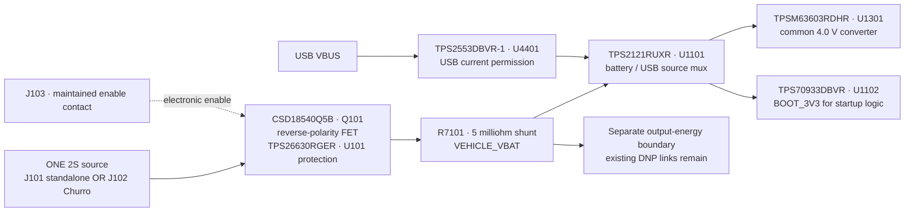
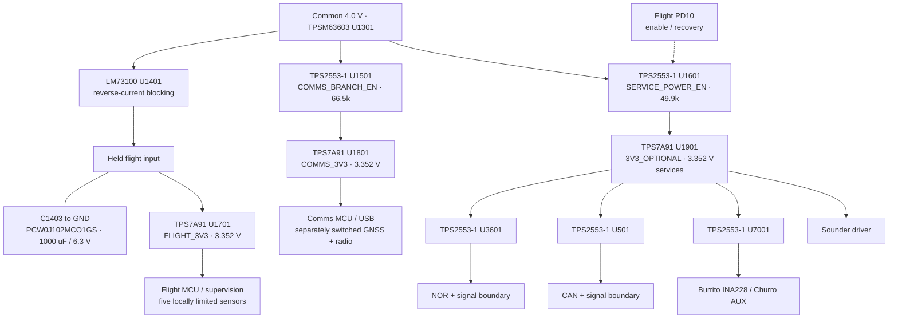
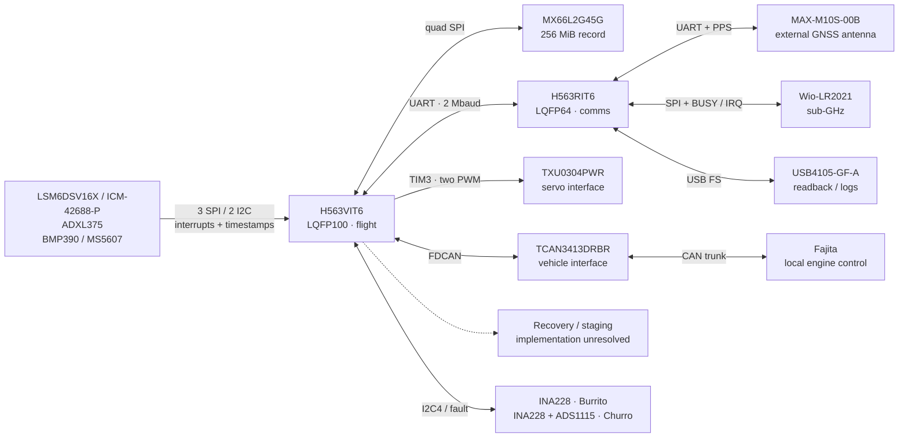

# Ogma 2 — component review

**22 September · schematic-readiness review. CAD/contracts remain the preserved
implementation.** Burrito = Croí2; Churro = Foinse2; Fajita = propulsion controller.

This page contains the source path, regulated branches, signal connections,
connector choices and disputed decisions. Detailed chapters supply pin maps,
calculations and datasheets. **Output circuitry/physical arming is incomplete**;
that omission prevents calling this a complete hardware design.

[Power](#power-from-source-to-load) · [Signals](#signals-and-processors) ·
[Connections](#external-connections) · [Operation](#power-and-service-states) ·
[Choices](#choices-to-settle)

## Can this become schematics?

**The ordinary electronics now have a proposed capture baseline.** The complete
platform still excludes the unfinished energetic-output/physical-arm block.
The [capture specification](../../architecture/schematic-capture-spec.md) defines exact deltas and
the handoff: **Codex captures and places; Seán routes, after his green light**.
[Justifications](../../architecture/justifications/README.md) are linked beside the choices.

| Section | Proposed baseline | Later evidence |
| --- | --- | --- |
| [01 Processors](../../architecture/01-mcus.md) | H563 100/64-pin pair, complete proposed maps | Package/library checks; concurrent firmware build |
| [02 Power](../../architecture/02-power.md) | Three LDOs, 3.352 V; independent comms/services, PD10 service restart; 2S 8 Ah reference | Startup, fault selectivity, usable energy and thermal measurements |
| [03 Outputs](../../architecture/03-energetic-outputs.md) | **Incomplete/excluded; DNPs preserved** | Responsible output/physical-arm design and validation |
| [04 Servos](../../architecture/04-servos.md) | Two raw-2S, 3.3 V PWM interfaces, combined 1.5 A allocation; no remote node | Actual mechanism must fit the bounded interface |
| [05 Service](../../architecture/05-service-status-time.md) | Restricted USB modes; connected/fresh evidence only | Reset, update, stale-state and current tests |
| [06 RF/GNSS](../../architecture/06-gnss-radio.md) | Retained parts; passive GNSS and matched Wio test peer | Installed antenna/link and GNSS-envelope validation |
| [07 Recording](../../architecture/07-sensors-logging.md) | 192 MiB region; sector-aligned commits; explicit preparation and byte budget | Concurrent sustained throughput and power-cut recovery |
| [08 Churro](../../architecture/08-foinse-can.md) | Exact probes/bias/protection; source fuses and 3 A AV / 2 A PROP envelope | Source/thermal/lead-fault and measurement accuracy tests |
| [09 Connectors](../../architecture/09-connectors-arming.md) | Source population variants; exact Nano-Fit drawing; retained mating inventory | Footprint/fit and installed harness restraint checks |

## Whole-system consequences

| Failure / operating case | What remains | What is lost or cannot be assumed |
| --- | --- | --- |
| Comms MCU, branch or regulator failure | Flight, sensors and separately regulated NOR/CAN/AUX | GNSS, radio and USB; common buck must sustain the limited fault |
| Service regulator / aggregate limiter lost | Flight, sensors and comms | NOR, CAN, monitoring and sounder; PD10 permits bounded restart |
| Flight MCU reset | Comms may remain powered; prior commits | Fresh flight state; flight-owned enables return to defaults |
| Brief source dip inside measured hold-up | Flight computation may continue | Continuous NOR/CAN/GNSS or a final flash flush |
| Source/ground/common buck failure | Only independently supplied external systems | Three LDOs and two MCUs are not redundant computers |
| AUX absent | Churro source protection | Measurements; released fault line is not proof of health |

The revised recommendation keeps the third LDO because a comms-supply fault
should leave the flight record and CAN available. It also makes services
restartable without rebooting flight. These are explicit fault boundaries,
not claims of measured reliability. A missing physical-arm design remains a
design gap; throughput/thermal/installed-fit validation remain later evidence.

## Power from source to load

**Solid arrows = power; dashed = enable control.** Common ground throughout;
the capacitor is a shunt to ground. Output circuitry is outside these logic paths.

### Entry and the FC enable plug

J101 standalone **or** J102 from Churro: one 2S source, 8.4 V fully charged.
Nominal protection thresholds: 6.63 V start / 6.20 V stop / 8.99 V overvoltage;
tolerances and sag still determine the usable range.

**J103:** maintained two-contact JST GH enable. Closing it enables the electronic
battery entry; opening it commands that entry off. USB can still power logic.
The connector carries control current; upstream battery circuitry remains live.
On Churro-fed builds, retain the closed Croí enable plug and switch at Churro.

### The shared buck and three regulated branches

**Three TPS7A91s remain:** flight, comms, services. No U1601 relocation or U1901
deletion. All set points become 3.352 V; switches precede the LDOs. R1504 66.5 kΩ
limits comms to 351–449 mA; R1604 49.9 kΩ limits services to 470–588 mA.
PD10 becomes SERVICE_POWER_EN with an off-default pulldown.

Allocate 200/300/200 mA flight/comms/services. USB uses restricted modes.
Reference source: 2S 8 Ah, ≥30 Wh usable for the stated logic endurance budget;
actuator energy additional. [Exact connections and calculations](../../architecture/02-power.md),
[fault/alternative justification](../../architecture/justifications/power-domains.md).

## Signals and processors

**Solid arrows = signals; dashed = control or proposed extension, labelled.**
The named supply nodes above power these same devices.

| Choice | Work it performs | Reason / conceded limit |
| --- | --- | --- |
| Flight STM32H563VIT6, 100 pins | 3 sensor SPI + 2 pressure I²C; NOR; CAN; timing/local interfaces | Existing dense map fits; servo3 pin becomes service enable |
| Comms STM32H563RIT6, 64 pins | 2 UARTs, radio SPI, PPS, USB, enables/status | Complete map; same software family. 640 KiB is headroom, not a measured need |
| Separate MCUs | Keep USB/radio work outside flight scheduling | Shared power/PCB; no independent recovery |
| Two low-g IMUs + ADXL375 | Dissimilar observations plus high-g record | Two agreeing sensors do not establish truth; both low-g channels can clip |
| BMP390 + MS5607 | Pressure record through separate interfaces | Range/vent limitations; not full-envelope altitude evidence |
| MX66L2G45GMI00 NOR | 256 MiB local record, flight-owned | Comms recording depends on flight MCU and UART |
| MAX-M10S + Wio-LR2021 | Position/time and external telemetry | GNSS ≤4 g / 500 m/s / 80 km; matched Wio reference peer; installed link to verify |
| TCAN3413 + TXU0304 | External vehicle bus with powered-off signal boundary | FD requires peer agreement; remote-control timing depends on mechanism |
| TXU0304 servo interface | Two direct timer PWM outputs; prevent signal back-power when supply is off | Raw-2S, 3.3 V PWM, 1.5 A combined allocation; mechanism must fit |

Flight recording: 96,672 B/s plus ≤1 KiB/s comms diagnostics; 128 KiB staging.
Fifteen data pages + one footer per 4 KiB sector, within a 192 MiB prepared region.
Conservatively charging footers again leaves **5,689,344 B** beyond the mission
ledger and 64 MiB reserve. No second comms flash; flight/UART loss loses new
comms records. [Format, preparation and throughput contract](../../architecture/justifications/recording-and-service.md).

Service: two 4 KiB payload buffers and backpressure; no requirement to hold a
whole log or 32 KiB block. At 2 Mbaud, full NOR download takes **at least 22.4 min**.
A faster disarmed service mode needs a measured implementation.

Radio RSSI/SNR belongs to the **receiver**. Ground measures vehicle transmissions;
vehicle measures ground transmissions. Log direction, sequence and receiver.

## External connections

| Connection | Part / retained arrangement | Decision visible here |
| --- | --- | --- |
| Standalone battery J101 | 1053111102 | Exclude simultaneous J102 source |
| Churro J102 | Samtec MPT/MPS-08-01-01-L-RA-SD | Battery/return + AUX + I²C/fault; no Churro MCU |
| FC enable J103 | BM02B-GHS-TBT(LF)(SN) + GHR-02V-S | Maintained contact; electronic battery enable described above |
| Physical output arm | Assembly incomplete | Separate operator function; not supplied by J103 or output-harness plug |
| Output harness J6601 | Existing Molex 430450600 | Retained interface; output/arming implementation incomplete |
| Servos J6602 | **Retain 430451000 + 430251000**, ten contacts | Two groups used; avoid six-contact substitution matching J6601 |
| CAN J501 | Three-contact JST GH | H / L / reference; no power contact |
| USB J4401 | USB4105-GF-A | Comms service + logic supply |
| GNSS J4501 / radio J4601 | Amphenol 132134 SMA each | Passive GNSS / sub-GHz; reference test assembly selected, vehicle installation to qualify |
| Flight/comms debug | TC2030-NL-FP ×2 | Independent access if USB firmware fails |

Two-servo harness: contacts 1/2/3 = PWR1/PWM1/GND1; 4/5/6 = PWR2/PWM2/GND2;
7–10 unwired in the proposal. Existing third-channel CAD remains until revision.
[Connector details and evidence](../../architecture/09-connectors-arming.md).

## Power and service states

| Situation | Expected behavior / useful observation |
| --- | --- |
| Battery, FC enable open, no USB | Entry commanded off; upstream circuitry still live |
| Battery enabled | Flight starts independently; flight controls comms enable |
| USB only, before configuration | Comms enumerates; flight/sensors/NOR/CAN/GNSS/radio off; startup current must fit allowance |
| USB configured | Restricted readback/download mode; no assumption that the full battery-mode load fits |
| Battery + USB | Battery-valid logic preserves flight control of comms |
| Comms reset / branch cycle | Flight task continues; already-enabled NOR/CAN remain supplied; record reset/gap |
| Flight reply stale while USB works | Show unknown/stale flight state; a responsive comms MCU is insufficient |
| Power lamp on / firmware green | Rail presence / reported readiness respectively; neither establishes physical output-arm state |

Retain simple power + flight red/green + comms amber + ground-only sounder.
USB supplies the detailed sensor, logger, peer, timing and configuration view.
An independent physical-arm indication is **not implemented by those lamps**.

## Choices to settle

| Decision | Recommended answer | Boundary that must be recorded |
| --- | --- | --- |
| D1 — Core parts and fault domains | H563 100/64; three 3.352 V LDOs; PD10 service restart | [Power justification](../../architecture/justifications/power-domains.md); comms and service regulator faults separated |
| D2 — Source and Churro | 2S 8 Ah reference, ≥30 Wh usable logic energy; exact NTC/reference/protection and fuse assembly | [Churro justification](../../architecture/justifications/churro-monitoring.md); limits and assumptions stated |
| D3 — Local interfaces / CAN | Two raw-2S PWM interfaces, 1.5 A total; no remote node; existing Classical CAN commissioning | [Interface justification](../../architecture/justifications/interfaces-and-installation.md); FD migration coordinated with peer |
| D4 — Energetic outputs / physical arm | Keep unfinished block explicitly excluded | Separate design closure; no invented assembly or changed DNPs |
| D5 — Record / service / installation | Sector-aligned NOR, bounded USB, source variants, passive RF reference assembly | [Recording](../../architecture/justifications/recording-and-service.md), [placement handoff](../../architecture/schematic-capture-spec.md#what-green-for-capture-must-mean) |

Accept or amend each decision once, then authorize the corresponding schematic
scope. The excluded output block need not stop implementing the
agreed processor, sensor and service sections. Manufacturing and mission release
remain separate gates, with actual physical evidence.
