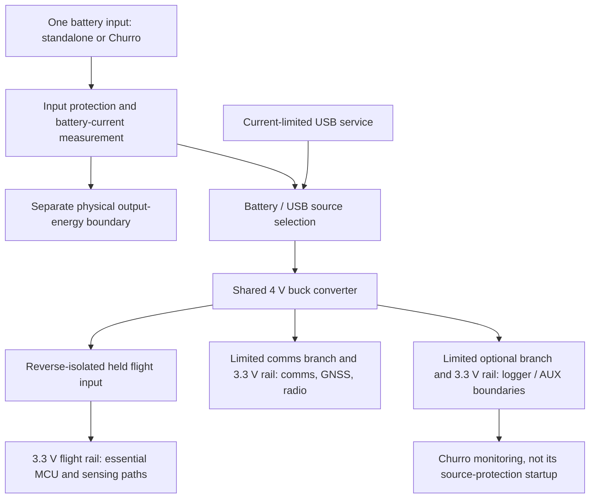

# Preserved reference — not the session reading path

Snapshot retained before the 11 September full-pack rewrite. Detailed component,
pin and calculation evidence follows. Current review status lives in the
[reading pack](../../../architecture/README.md); this snapshot does not authorize implementation.

# 2. Croí power

## Job and current review

Keep essential flight logic supplied while bounding other loads and preserving
useful evidence of supply trouble. Output energy is a separate path from logic.
The [session review](../2026-09-10-session-review.md#5-power-expose-each-job-before-selecting-its-part)
questions the optional rail's purpose, not authorizes its deletion.



Diagram describes the existing responsibility boundaries, not complete wiring
or proof of fault isolation. Audit each actual load before reallocating rails.
Startup bias lets source selection start before dependent firmware is running;
it is not adequately explained by a generic MOSFET bootstrap example. Hold-up
stores energy, reverse blocking keeps it local, and a limiter bounds fault
current. These are different functions with different tests.

At ideal first order the 4-to-3.3 V LDO stage is 82.5% efficient; system losses
depend on the operating point. A budget is a calculation, not a measurement.
No regulator, capacitor or rail change is authorized by this explanation.

## Circuit

```text
exclusive Nano-Fit J101 / Samtec J102 battery input
  → reverse protection + TPS26630 U101
  → 5 mΩ R7101 shunt → protected battery loads

protected battery ─┐
USB service limit ─┴→ TPS2121 U1101 → TPSM63603 U1301, 4.0 V
                                         ├→ held flight input → TPS7A91
                                         ├→ limited comms input → TPS7A91
                                         └→ limited optional input → TPS7A91
```

U1102 supplies bootstrap bias. LM73100 U1401 isolates the held flight input.
C1403 is an unresolved capacitor volume allowance, not a qualified 1000 µF part.
Battery output energy takes off after the common shunt and through separately
defined physical arm paths; it does not come from the 3.3 V logic rails.

U7101 INA228 measures common battery current. PA0 reads protected battery voltage.
Its INA voltage measurement is before the eFuse, so the two voltage readings
must remain separately named. USB current is outside the battery measurement.

## Why this topology

The preregulator handles the battery voltage efficiently; the LDOs provide the
accepted quiet-rail approach and separate fault domains. That cascade follows
the Rev 1 review and Seán's explicit choice. A direct-buck design is a real
alternative, not the current baseline. No boost is added merely to run a
depleted pack further down.

Limits and powered-off signal boundaries aim to stop a shorted optional device
from removing flight power. They add parts and dropout and require partial-rail
testing. A low-noise regulator does not excuse poor return paths or layout.
Shared source, preregulator and a shorted core LDO remain common failure points.

## Options explored and why this one survived

| Option | Useful gain | What decided the trade |
| --- | --- | --- |
| Linear regulation directly from 2S | Few switching components | At useful load it spends the battery-to-3.3 V drop as heat. Rev 1 also exposed mechanically unsuitable large packages |
| Discrete buck | Potential recurring-cost and footprint optimisation | More responsibility for magnetics, hot-loop layout and EMI. Not proved cheaper as a complete first-board implementation |
| Integrated buck module followed by quiet LDOs | Concentrates switching integration and retains the accepted low-noise approach | Extra cost, LDO heat and a shared preregulator failure point; selected with those costs visible |
| Low-noise LDO with VIOC-controlled preregulator | Can regulate LDO headroom and reduce dissipation | Adds a control loop and compatibility/stability work. Investigated after the Rev 1 advice, not selected |
| Logic buck-boost | Could extend operation into a lower source-voltage region | No named valid 2S operating condition required it. Extra conversion complexity is not a substitute for battery acceptance |
| Separate converter per MCU | Removes one shared conversion dependency | More magnetics, area, emissions and start/fault interactions. Current board retains the common-source risk |

The Rev 1 reviewer recommended integrated switchers and a genuinely low-noise
post-regulator, with LT3045 as an example. The requirement retained was the
topology and noise concern, not an obligation to fit that exact example part.
LT3045-1 is the VIOC variant; confusing it with the ordinary LT3045 would create
a false implementation assumption. [Recorded external-review lessons](../../rev1-external-review-lessons.md),
[power contract and VIOC distinction](../../../../interfaces/power-contract.md).

### Why 4.0 V, and what the module rating does not mean

The earlier 3.8 V placeholder became 4.0 V to leave more margin for protection
drop, load transients and the held-core path before the 3.3 V LDO. At 200 mA,
that extra 0.2 V costs about 40 mW; at 600 mA, 120 mW. It is a measurable
headroom-versus-heat choice, not free reliability.

TPSM63603 contains its inductor but still needs its prescribed input/output
capacitors, feedback, switching-frequency choice, thermal copper and hot-loop
placement. The original desk check distinguished its 3 V running-input figure
from its 3.95 V startup requirement. It cannot be treated as a universal
low-voltage source simply because one line of the table says 3 V.
[TI module datasheet](https://www.ti.com/lit/ds/symlink/tpsm63603.pdf).

TPS7A91 provides the selected quiet post-regulation. The dropout specification
applies at stated current/temperature conditions; actual minimum headroom must
include switch resistance, trace drop, converter tolerance and transient dips.
Three regulators separate flight, comms and optional loads. Removing the third
saves its support circuit but changes the logger/AUX fault boundary.
[TI LDO datasheet](https://www.ti.com/lit/ds/symlink/tps7a91.pdf).

### Hold-up and current limiting solve different faults

LM73100 blocks held-core energy from flowing back into a collapsed upstream
rail. A branch current limiter is not automatically a sufficiently fast reverse
blocker. C1403 is still a volume allocation, not a selected capacitor or proved
hold-up time. Effective capacitance, ESR, voltage headroom and actual load
determine the interval. A capacitor does not fix a permanent core short.

The TPS2553 **-1 latch-off** variants bound optional/sensor fault current.
Selecting an auto-retry variant changes repeated-fault behaviour. Likewise,
powered-off signal isolation is necessary alongside supply switching: a live
data pin can bypass the supposedly disabled supply. These boundaries add
component count because they address different current paths.
[LM73100](https://www.ti.com/lit/ds/symlink/lm73100.pdf),
[TPS2553](https://www.ti.com/lit/ds/symlink/tps2553.pdf).

### The power arithmetic is a budget, not a measurement

The 6 September model allocated 200 mA at 3.3 V to held flight/sensors,
300 mA to comms/GNSS/radio, and 100 mA to optional loads. That totals 1.98 W
delivered. Ideal 4.0-to-3.3 V LDO loss adds 0.42 W; with assumed 85–90% buck
efficiency, about 2.67–2.82 W enters the converter before other losses.
Roughly 3 W was therefore a useful initial active test point, not a peak rating.

The endurance estimate used a different quantity: 2 W average over eight hours,
0.5 W for four recovery hours and 1 Wh of events, totalling 19 Wh. A continuous
3 W workload fails that estimate. Measure duty cycle and source current rather
than adding peak limits as if they were normal consumption. Camera and
propulsion loads are not hidden inside this logic budget.

USB-only startup is another mode again. Comms must enumerate before requesting
configured current; flight permission cannot be required to start that process.
The bootstrap bias and source-selection logic resolve that circular dependency.
On a valid battery, comms cannot withdraw essential flight power. USB neither
charges the pack nor supplies the output-energy rails.

## New external switch

The installed 8 September draft adds Croí J103, a two-contact vertical JST
GH `BM02B-GHS-TBT(LF)(SN)` with `GHR-02V-S` housing. Pin 1 supplies bounded
3.0 V bias; pin 2 returns to `BAT_SHDN_N`. Close the maintained external
contact to enable; open/unplug to disable. The switch carries control current,
not the battery load. No on-board mechanical switch is added.

Bias path: input battery → BAS116 → two 4.7k/2010 resistors → LM4040 3.0 V
shunt, clamped before the connector. R1006 becomes a local 22.1k pull-down;
C1006 adds 100nF at SHDN. Protection thresholds and MCU pins stay unchanged.
Standalone uses an external switch. With Foinse, a deliberate retained Croí
enable plug closes J103; Foinse operates its separate source loops.

OFF is electronic disable, not physical isolation. Bias and pack entry remain
live; USB can still power service logic. Bias alone draws about 0.5 mA from
nominal 2S and is upstream of Croí's current shunt. Unplug packs for storage.
Neither an enable contact nor a power LED proves pyro disarm.

Native checks pass; installation is tracked in the current-system
and change record. Cold/minimum-pack startup, switch retention/bounce, cable
ESD, clamp faults and assembled thermal/surge margins still require tests.
100nF is an edge filter, not a debounce guarantee; bouncing SHDN can restart
the board and reset a latched protection fault.

## Remaining electrical work

Existing nominal battery thresholds are approximately 6.63 V start / 6.20 V
stop, 8.99 V overvoltage and 6 A limiting; tolerances and load margins matter.
The general 6 V planning envelope does not prove operation down to 6 V.

Verify minimum-USB-VBUS regulation, startup/inrush, source exclusion/backfeed,
hold-up effective capacitance, LDO shutdown/reverse voltage, fault selectivity
with pack fuses, and external-switch open/short/bounce behaviour. The battery
connector footprint and real C1403 remain pre-order closure items.
Test on the first complete PCBA with current-limited supplies.

Evidence: [power contract](../../../../interfaces/power-contract.md),
[Rev 1 power rationale](../../rev1-external-review-lessons.md),
[sensing revision](../../sensing-indication-time-review-2026-09-07.md).
