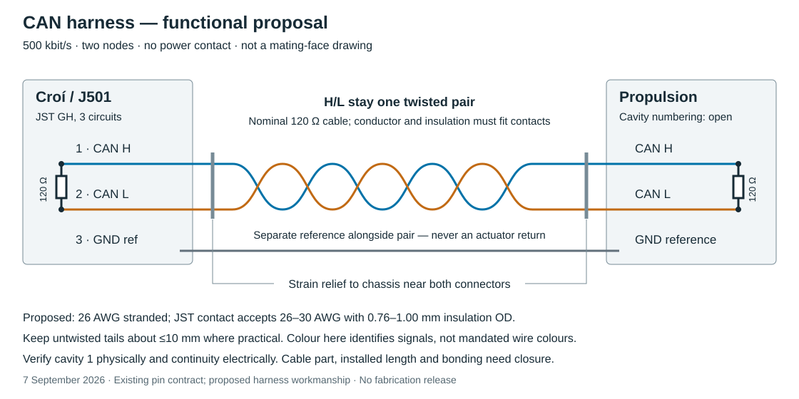

# Ogma 2 — six actions from the Seán/Anav review

7 September 2026. Dated research and recommended answers.

**Later acceptance:** Seán accepted these recommendations and authorised the
[Wio implementation and handoff](radio-change-2026-09-07.md). The original
proposal wording below records the research-stage state; it no longer means
E22 remains selected. Step 6 is still non-binding. Current native CAD and
current-system control implementation status.

Seán authorised this investigation, including a non-binding look at height
estimation above 80 km. He has not accepted the new component proposals below.
The [current system](../current-system.md), physical MCU pins, accepted firmware
handoff and both boards are unchanged. Anav owns firmware implementation.

## Recommended answers

| Step | Recommendation | Consequence now |
| --- | --- | --- |
| 1. Radio | Wio-LR2021 is the leading upgrade candidate; retain E22/SX1262 until a replacement is explicitly accepted | A worthwhile bounded parts decision, not a board redesign |
| 2. GNSS | Retain SAM-M10Q for the workhorse; do not buy a newer receiver merely to inherit the same altitude limit | Resolve its actual configuration and installed antenna performance |
| 3. Sensors | Keep the two existing low-g IMUs and dissimilar pressure sensors | Give Anav the configuration/validity checklist; add no sensor |
| 4. CAN harness | Twist H/L, crimp them separately into the existing three-way JST GH; third wire is reference ground | Concrete harness proposal below; cable part and installed length remain open |
| 5. CATS comparison | Keep Ogma justified by named HiPR interfaces, evidence and control needs | No claim that newer parts or more components establish reliability |
| 6. Above 80 km | Explore supported high-dynamic GNSS plus inertial bridging and independent evidence | [Separate study](height-estimation-above-80km-2026-09-07.md); no new requirement or hardware selection |

One engineering PCBA remains the plan. The flight board already has removable
power links, probe pads and debug access. A separate custom evaluation board is
not reinstated as a pre-order gate. Pre-order schematic, footprint, rating and
assembly checks still matter; block behaviour is tested on the first full PCBA.

## 1. Radio: newer hardware can earn its place

The clean Rev 1 idea survives: use a small solder-down RF module with matching
and clocking already handled, controlled by our comms MCU. We do not need a bare
RF IC or another general-purpose processor to get a newer radio.

### Shortlist

| Module | Body / integration | Finding |
| --- | --- | --- |
| Ebyte E22-900M22S, SX1262 | 14 × 20 mm; SPI; currently uses its module IPX connector | Accepted baseline. Existing symbol, footprint, pins and driver contract |
| **Seeed Wio-LR2021, 868/915 variant** | About 17.07 × 10.42 × 2.8 mm; 22-pad solder-down SPI module | Leading candidate. Published KiCad and STEP assets. Store listed US$6.99 and in stock on review date; not a delivered-price quote |
| NiceRF LoRa2021, 22 dBm version | 19.72 × 15 × 2.2 mm; SPI module | Credible alternative; exact band/clock option, purchasing price and supply need confirmation |
| LPRS eRIC-LR2021-HCI | 20 × 15 mm; host-controlled variant, with a dual-u.FL option documented | Useful if supplier support and on-module coax connectors outweigh area/cost; quote required |

Primary sources: [Ebyte](https://www.cdebyte.com/products/E22-900M22S/3),
[Seeed introduction and CAD downloads](https://wiki.seeedstudio.com/wio_lr2021_introduction/),
[Seeed store](https://www.seeedstudio.com/Seeed-Studio-Wio-LR2021-Wireless-module-868-915MHz-Tape-reel-p-6831.html),
[NiceRF module and field-test details](https://www.nicerf.com/news/lr2021-lora2021-range-test-results.html),
[LPRS](https://lprs.co.uk/products/easyradio-ism-modules/eric-lr2021/).

Wio's module body is approximately **36.5% smaller in area** than E22's. That is
not a 36.5% saving in the whole radio block: add the host RF launch, connector,
decoupling and assembly clearance. Avoid the much larger high-power LR2021
modules unless a link budget actually requires them.

LR2021 adds faster LoRa modes and FLRC up to 2.6 Mbit/s. It can also use ordinary
compatible LoRa settings. Higher-rate modes need a compatible ground receiver;
an old SX1272 ground station does not become an FLRC receiver. Even ordinary
LoRa interoperability requires matching supported PHY settings, frequency and
packet format. [Semtech LR2021](https://www.semtech.com/products/wireless-rf/lora-plus/lr2021).

### Bandwidth is useful, but not free range

Calculated example: 64 bytes per packet, explicit header, CRC, coding 4/5,
eight-symbol preamble. These are illustrations, not our frozen packet format.

| Ordinary LoRa mode | Airtime / packet | Occupancy at 10 packets/s |
| --- | ---: | ---: |
| SF7, 125 kHz | 118.016 ms | 118.0% — impossible |
| SF7, 250 kHz | 59.008 ms | 59.0% |
| SF7, 500 kHz | 29.504 ms | 29.5% |
| SF12, 125 kHz | 2,793.472 ms | 2,793.5% — impossible |

This excludes application acknowledgements, retries, turnaround and regulatory
constraints. A mode fitting in time is not necessarily permitted at that duty
cycle or bandwidth. Select lawful regional frequency, EIRP and access rules
before transmitting. Manufacturer maximum output power is not permission.

The Wio datasheet lists sub-GHz sensitivity of −141.1 dBm for SF12/125 kHz,
−110 dBm for 260 kbit/s FLRC, and −100.5 dBm for 2.6 Mbit/s FLRC. Conditions
include boosted RX and PER ≤10%; uncorrected test-cable loss is noted. These
are not equivalent reliability points. [Module datasheet, p. 10](https://files.seeedstudio.com/wiki/Wio-LR2021/res/Wio-LR2021%20Module%20Datasheet.pdf).

Illustrative 915 MHz, 100 km line-of-sight link: 22 dBm TX, 0 dBi at each end,
3 dB combined losses gives approximately **−112.7 dBm received power**.
That leaves about 28 dB against the slow LoRa figure, but is already below
both quoted FLRC thresholds. Ground antenna gain helps; vehicle pattern nulls,
polarisation, interference and motion consume margin. Slant range is not height.
The calculation is neither a link qualification nor a radio configuration.

Recommendation: keep full-rate evidence in NOR. Use bounded summaries over RF.
If LR2021 is accepted, start with one conservative LoRa mode. Add faster service
transfer or close-range telemetry only for a named use. Do not make live video
or an automatic mode-switching protocol a dependency of this board.

### What changing to Wio would require

- Replace the radio symbol/footprint and audit the supplied library against the
  mechanical drawing. No second radio footprint or permanent adapter PCB.
- Keep the comms MCU and existing SPI allocation. Audit each control signal,
  interrupt and powered-off path before changing the module-end connections.
- Wio BUSY is open-drain and needs the specified pull-up. Its internal TCXO
  setting is 3.0 V, not the current E22 driver's 2.2 V. Treat it as a new driver,
  not a renamed SX1262. Use the exact module configuration from the
  [Seeed integration documentation](https://wiki.seeedstudio.com/wio_lr2021_introduction/).
- Route the required sub-GHz 50 Ω host launch; Wio does not preserve E22's
  on-module IPX convenience. Do not add the unused high-band antenna path just
  because the chip supports it. Confirm the unused-port treatment with its reference.
- Follow the [manufacturer PCB guide](https://wiki.seeedstudio.com/wio_lr2021_pcb_design_guide/):
  continuous RF reference, controlled impedance and ground stitching. Calculate
  geometry from our actual stack-up. The PDF's 470 Ω digital-series recommendation
  needs a rise-time/SPI timing check; do not transplant its example trace width.
- Budget roughly 120 mA typical at maximum sub-GHz output, plus tolerance and
  transient margin. The PDF's 2.6 Mbit/s current table is not usable as a continuous
  TX budget: its 12.07 mA at +22 dBm would imply about 40 mW input for 158 mW RF
  output at 3.3 V. Duty-cycle or measurement conditions need clarification.
  [Module datasheet, pp. 8, 11, 14, 17](https://files.seeedstudio.com/wiki/Wio-LR2021/res/Wio-LR2021%20Module%20Datasheet.pdf).

There is official [Semtech driver/example support](https://github.com/Lora-net/usp),
including direct-driver access and packet-error tests. The published validation
target is an L476/Wio evaluation setup, not our H563 board. We need not adopt
its entire multiprotocol scheduler or LoRaWAN stack.

Concrete software caveats exist: the current
[USP limitations](https://github.com/Lora-net/usp/blob/main/doc/KNOWN_LIMITATIONS.md)
include scheduling drops, invalid-frequency handling, unsupported narrow-band
settings causing exceptions, and a nonfunctional CAD/LBT example mode. These
are stack issues, not proof the silicon is unreliable. Pin a reviewed driver
revision; validate parameters ourselves; keep radio failure within comms.

**Recommended decision:** accept Wio as the preferred upgrade only after its
exact orderable revision, clock/interface details and host RF integration are
reviewed. E22 remains a sound fallback. First-PCBA acceptance should include
packet loss versus attenuation, reset/BUSY recovery, supply transients and GNSS
desensitisation during TX. No custom pre-order coupon required.

## 2. GNSS: retain the clean workhorse integration

| Option | Useful gain | What it does not solve |
| --- | --- | --- |
| SAM-M10Q, selected | Integrated patch, low power, no host antenna-check/bias/coax circuit | Specified 80 km, 500 m/s and ≤4 g operational envelope |
| MAX-F10S | L1/L5 dual-band reception; worth considering if measured multipath/interference needs it | Still specifies 80 km, 500 m/s and ≤4 g; separate antenna integration |
| ZED-X20P | All-band precision/RTK platform | Its airborne model still lists an 80 km altitude limit; higher complexity does not buy full-envelope space-shot navigation |
| Vendor-supported sounding-rocket receiver | Potentially real high-altitude/high-dynamic coverage | Different integration, price and qualification problem; step 6 explores it |

Sources: [SAM-M10Q R05](https://content.u-blox.com/sites/default/files/documents/SAM-M10Q_DataSheet_UBX-22013293.pdf),
[MAX-F10S R03](https://content.u-blox.com/sites/default/files/documents/MAX-F10S_DataSheet_UBXDOC-963802114-12732.pdf),
[ZED-X20P integration manual, dynamic-platform table](https://content.u-blox.com/sites/default/files/documents/ZED-X20P_IntegrationManual_UBXDOC-963802114-12901.pdf).

**Keep SAM-M10Q for Rev A.** The meaningful next work is installed antenna
clearance, RF-transparent sky view, TX coexistence, startup and reacquisition.
None is replaced by a more impressive receiver name. No higher-cost GNSS
purchase is justified by this review alone; comparable delivered quotes were
not established.

One real configuration detail: R05 covers SAM-M10Q-00B-01 / ROM SPG 5.10.
Its four-constellation navigation maximum is **4 Hz in default mode, 10 Hz in
high-performance mode**. GPS+Galileo supports 10 Hz in default mode. Therefore
the existing 10 Hz target is plausible, but not a factory-default guarantee.
Identify the actual device/firmware and read back configuration; verify sustained
rate, power and message latency. Do not equate the 37 mW typical tracking
headline with every high-performance setting. [SAM datasheet, pp. 2, 4–5](https://content.u-blox.com/sites/default/files/documents/SAM-M10Q_DataSheet_UBX-22013293.pdf).

A standalone horizontal CEP figure is not an airborne vertical-accuracy bound.
Exceeding an operational limit means unqualified navigation, not a predictable
clean cutoff followed by a guaranteed recovery. The estimator must accept loss
of GNSS validity well before 80 km during boost.

## 3. Sensors: no missing low-g accelerometer

Both selected IMUs already contain ±2/4/8/16 g accelerometers: ST
LSM6DSV16X and TDK ICM-42688-P. ADXL375 is the separate high-g channel.
We already have different manufacturers for low-g measurements.
[ST](https://www.st.com/en/mems-and-sensors/lsm6dsv16x.html),
[TDK](https://www.invensense.tdk.com/en-us/products/6-axis/icm-42688-p).

Keep ±16 g initially. Coast means low specific force, not necessarily low
velocity. Switching range can improve quantisation without improving actual
bias/noise; it also introduces settling and scaling transitions. Measure the
installed noise and bias before adding phase-dependent range switching or a
sixth sensor. Saturation of either low-g channel during boost remains explicit.

The dissimilar barometers offer comparison and partially diverse failure modes.
They do not vote by majority, and a shared bad vent can fool both.
BMP390 specifies 300–1250 hPa operation. TE's March 2024 MS5607-02BA03 sheet
distinguishes **300–1100 mbar full-accuracy range** from **10–2000 mbar extended
ADC range**; its calculation example still says 10–1200 mbar. Do not turn the
extended range or a 24-bit output into guaranteed high-altitude accuracy.
[Bosch datasheet](https://www.bosch-sensortec.com/media/boschsensortec/downloads/datasheets/bst-bmp390-ds002.pdf),
[TE datasheet](https://www.te.com/commerce/DocumentDelivery/DDEController?Action=srchrtrv&DocNm=MS5607-02BA03&DocType=Data+Sheet&DocLang=English).

The practical output is the [Anav checklist](sensor-configuration-review-2026-09-07.md).
It preserves the accepted hardware allocation and separates source facts from
proposed firmware behaviour. Bench configuration/noise/fault tests belong on
the first engineering PCBA. These have not been executed on hardware.

## 4. CAN: twisted wire does not require a special connector

The pair is twisted along the cable, separated briefly at each end, then each
conductor gets its own crimp. JST GH does not carry the pair in one contact.

| Item | Current contract / proposed workmanship |
| --- | --- |
| Croí board connector | J501, BM03B-GHS-TBT(LF)(SN) |
| Cable housing / terminal | GHR-03V-S / SSHL-002T-P0.2 |
| Croí pin 1 | CAN_H → propulsion CAN H |
| Croí pin 2 | CAN_L → propulsion CAN L |
| Croí pin 3 | GND reference → propulsion CAN reference |
| Cable proposal | 26 AWG stranded, nominal 120 Ω H/L twisted pair; compatible insulated reference conductor alongside |
| Contact fit | Manufacturer range 26–30 AWG; insulation OD 0.76–1.00 mm |
| End treatment proposal | Keep untwist to about 10 mm or less where practical; chassis strain relief near each plug; service slack without a large unsupported loop |
| Termination | Existing fixed 120 Ω at Croí, 120 Ω at propulsion; two nodes, no third terminator |

Sources: [current interface](../interfaces/ogma-foinse-propulsion-boundary.md),
current Croí exported netlist J501/R510/U503, [JST drawing pp. 1–3](https://www.jst-mfg.com/product/pdf/eng/eGH.pdf),
[TI physical-layer guidance](https://www.ti.com/lit/an/slla270/slla270.pdf).

The drawing is a **functional map, not a mating-face/cavity-orientation drawing**.
Verify cavity 1 against the actual housing and board drawing. Propulsion's
physical connector numbering is not frozen by this document. Do not mirror a
plug by eye or assume wire colours establish pin identity.

The 10 mm untwist target is our workmanship proposal, not a JST rating. A final
cable part has **not** been qualified: many 120 Ω industrial cables are too thick
for GH contacts. Both conductor gauge and insulation diameter must fit. Do not
trim insulation to force a wrong cable into the crimp, or assume any twisted
hookup wire has 120 Ω impedance. Shielding and its termination depend on the
installed bonding/EMC design; no shield-to-pin-3 instruction is implied.

Keep actuator supply/return pairs separate. This CAN interface is not isolated.
Its reference must not become the propulsion power return after a broken main
return. If the actual bonding cannot contain that fault, review the complete
isolation boundary. A 0 Ω link does not provide isolation.

Smallest verification: confirm point-to-point identity and no shorts before
connecting boards; inspect/pull-check representative crimps; with the unpowered
complete bus expect approximately 60 Ω H–L, subject to connected circuitry;
scope the longest installed harness at both ends under inert load-switching
noise. Exercise disconnection, bus-off and wrong termination. Retention, errors
and common-mode behaviour matter more than a cable looking neat.

## 5. CATS: compare the vehicle job, not a chip-age contest

Published Vega interfaces/specifications versus our proposed implementation:

| Need | CATS Vega published baseline | Ogma 2 current baseline |
| --- | --- | --- |
| Normal flight/recovery | Configurable events; two pyro and two servo channels | Three energetic and two servo channels; custom policy still needs qualification |
| Servo power | Regulated 5 V output | Battery-derived 2S: selected servos must tolerate actual pack voltage |
| Inertial/pressure sensing | LSM6DSO32 and MS5607 | ST + TDK IMUs, ADXL375, Bosch + TE pressure paths |
| Recording | 16 MB flash | 256 MiB NOR; useful only with bounded, recoverable recording software |
| Telemetry | 2.4 GHz, 10 Hz; published flight-tested radio range 10 km | Sub-GHz E22 baseline; LR2021 proposal; installed link unqualified |
| Liquid vehicle integration | Our Foinse mate and propulsion CAN contract are not published Vega interfaces | Named power/data boundary with Foinse and self-governing propulsion |

[CATS Vega product specifications](https://www.catsystems.io/vega).

CATS is open hardware/software with an established configurator and ground
system; its manufacturer reports EuRoC tracking/logging use since 2023.
Adapting it is a legitimate engineering alternative, not something to dismiss.
[CATS project](https://www.catsystems.io/).

**The “100 km+ rated” claim remains unverified.** The inspected product page says
10 km flight-tested *radio range*. That neither establishes a 100 km altitude
rating nor proves a 10 km altitude ceiling. The download index was accessible,
but its manual link did not resolve in this retrieval. Ask for the exact claim,
hardware/firmware revision and supporting flight evidence before repeating it.
Do not infer CATS's full processor topology from one marketing MCU row either.

Ogma's justification is the combined HiPR job: maintainable standalone computer,
defined liquid-vehicle interface, Foinse integration, electrical event evidence,
sensor disagreement handling, local data and owned failure policy. None is
automatically unique, and none is validated just because it appears in KiCad.
Three outputs alone do not qualify two-stage operation. Bulk current indicates
electrical load activity, not proof that a servo moved or an energetic device worked.

There is also a cost to our choices: the current draft has 625 physical symbols
and a provisional 80 × 230 mm board. Every protection/buffer boundary must earn
its area and testing burden. A smaller radio is worthwhile; it cannot by itself
resolve whole-board complexity or replace the circuit/layout audit.

Recommended answer to the novelty question: adopt new parts when they improve
a named capability at acceptable integration cost. Reliability comes from the
implemented assembly and evidence. Age is neither qualification nor disqualification.

## 6. Accurate height above 80 km — exploratory only

The [separate study](height-estimation-above-80km-2026-09-07.md) covers receiver
limits, height reference, antennas, inertial drift, ground tracking and the
evidence needed to claim accuracy. It does not move space-shot recovery or
full-envelope altitude proof back onto ordinary Croí.

## Review closure and next decision

Research produced a useful radio candidate, confirmed that low-g sensing already
exists, exposed GNSS-mode and barometer-accuracy qualifications, and made the
CAN wiring concrete. Open items are explicit: exact radio revision/integration,
delivered prices, compatible CAN cable/length, real trajectory and required
height accuracy. They do not require reopening either MCU selection.

Next review choice: **retain E22, or authorise the bounded Wio-LR2021 change**.
My preference is Wio, with the integration checks above. Seán decides; Anav
reviews the driver impact. No message or task has been sent to him.

The [calculation](calculations/avionics-options-estimates.py) uses only Python's
standard library. Airtime reference values, inverse-square coast energy and
half-step convergence checks pass. It is illustrative arithmetic, not firmware,
flight simulation, RF testing or a probability-of-failure estimate.
