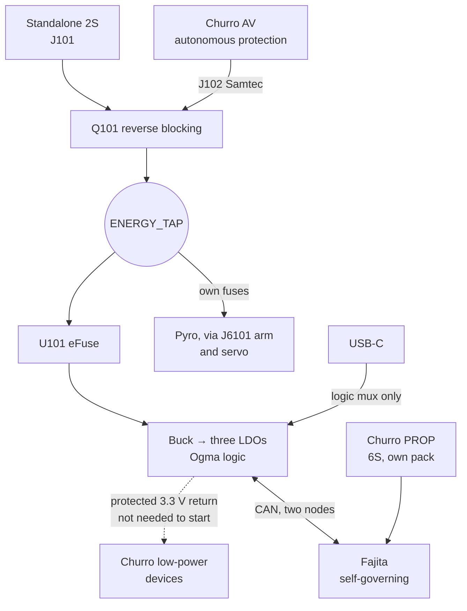

# Ogma 2 power contract

**Status, 6 October 2026, amended 2 November: controlling contract.** Electrical
detail describes the 8 September CAD. Decided changes are in [decisions.md](../decisions.md) and
the [capture specification](../docs/architecture/schematic-capture-spec.md).
Capture waits for Seán's go-ahead. No hardware has run, no part has been bought
and nothing is released for flight.

This is a contract, not a finished schematic or a qualification result. See
also the [current system](../current-system.md), the
[flight fault contract](flight-fault-contract.md) and the
[Ogma / Foinse / propulsion boundary](ogma-foinse-propulsion-boundary.md).

## The power chain

Accepted 7 September ([batch acceptance](../docs/archive/architecture-acceptance-2026-09-07.md)),
amended 6 October:

- 2S source → TPS2121 battery/USB selection for logic → TPSM63603RDHR buck at
  4.0 V → three TPS7A9101DSKR regulators (flight, comms, services) at 3.352 V
  proposed. A TPS70933 bootstrap supply. No logic boost and no VIOC loop.
- The LM73100 sits in front of the held flight-core regulator input. A short
  from that regulator's input to output is not contained, and that's stated
  openly.
- Hold-up: C1403 1000 µF gives about 2 ms. It covers brief dips, not outages,
  and it isn't a test result. (The 7 September figure was about 1 ms at 204 mA
  and 800 µF effective.)
- USB enters the logic mux only. U4401 limits it to 387–491 mA from attach
  (D-6.5). USB never powers pyro or servo energy and never charges the battery.
- Flight-core power depends on source presence only (D-6.5), never on the
  comms processor.
- Pyro and servo energy leave before U101 at `ENERGY_TAP`, after Q101 (D-6.1,
  D-2Nov.5), each through its own fuse: F6101 recovery, F6102 staging, F6801
  servos. Pyro energy then passes the J6101 / J6102 arm switches.

Foinse (Churro):

- Autonomous TPS26630 / CSD18540 source protection, a protected auxiliary
  monitor return, INA228 and ADS1115 monitoring.
- One protected Croí feed with a provisional 6 A aggregate ceiling.
- Liquid propulsion has its own 6S pack and domain. It is not a load on Croí's
  logic rail.
- External matched balance chargers do the charging, with the packs off the
  vehicle. Physical charge/arm exclusion is still required.
- On the rail, a ground umbilical feeds both branches through per-source ideal
  diodes ahead of the eFuses; pulling it hands each branch to its pack. It never
  charges a pack (D-2Nov.7).
- Each Samtec ground path must carry the full 6 A as an alternate fault return.

All branch limits, energy estimates and rail-sequencing requirements in the
accepted power appendix stand. Separate power coupons before ordering are no
longer required: run the bounded tests on the first full PCBA. Nothing here
reopens the selected parts or brings back the old ≈3.8 V intermediate.

## Accepted decisions

1. **Foinse powers up without Ogma.** Its protected source path starts and keeps
   delivering basic power without Ogma software or the returned 3.3 V. The
   protected return stays for bounded low-power devices. If their real
   dependencies can't meet this cleanly, bring back local Foinse regulation for
   review rather than hiding a circular startup or protection dependency. Foinse
   has no MCU or firmware.
2. **Bounded branches.** Comms and RF, bulk storage and the Foinse auxiliary
   return each have a bounded electrical branch. Their declared faults must not
   remove essential flight power or execution. That covers signal back-power and
   bus clamps, not just current limits. One regulator per chip is not required.
3. **Buck then LDO.** A switching preregulator followed by a low-noise LDO is the
   baseline. Direct-buck logic power is a comparison option, not the default.
   The exact intermediate voltage follows headroom, noise and thermal evidence.
4. **USB is service only.** USB alone supports configuration, readback and log
   download, with no USB path able to power pyro or servo loads. Battery plus USB
   must not backfeed or charge either source. Charging stays external, with the
   packs off the vehicle (D-2Nov.7); standalone servicing must not add an
   implicit Ogma charger.
5. **Hold-up is for brief dips.** Core hold-up covers short interruptions, not
   flying on after a broken source connection. No extra battery or large
   supercapacitor by default. Longer outages follow EX-01's restart or
   primary-unavailable policy. Endurance: the workhorse is sized from measured
   loads and the vehicle timeline; 8 h operating plus 4 h reduced-duty recovery
   is the Kármán overlay (D-6.8).

Servo and pyro power and returns stay out of the logic supply path. Accepting a
containment requirement doesn't prove a given regulator, fuse, switch or battery
protection meets it. The common source, the core conversion chain and the PCB
remain common failure points.

## Source enables (J103 and J104)

Installed in the 8 September native CAD
([change record](../docs/archive/installation-change-record-2026-09-08.md)).
Battery limits, autonomous protection, source exclusion, MCU pins and physical
arming requirements are unchanged by it.

| Board / connector | Pin 1 | Pin 2 | Operation |
| --- | --- | --- | --- |
| Standalone Croí J103 | Bounded 3.0 V source bias | `BAT_SHDN_N` | Close a maintained external contact to enable |
| Foinse J103 | Avionics bounded 3.0 V bias | `AV_SHDN_N` | Close the avionics pole to enable |
| Foinse J104 | Propulsion bounded 3.0 V bias | `PROP_SHDN_N` | Close the separate propulsion pole to enable |

**Hardware.** Vertical JST GH `BM02B-GHS-TBT(LF)(SN)` with `GHR-02V-S` and a
crimp matched to the real wire gauge. Control current only. A Foinse-fed Croí
uses a deliberate retained closed plug in Croí J103. One maintained two-pole
switch can run Foinse; the two positive bias wires stay separate. The thermistor
connector is a different four-contact harness.

**Circuit.** Each source feeds its own BAS116 → 4.7 k + 4.7 k → LM4040 3.0 V
shunt, so the bias is clamped before the cable. SHDN has 22.1 k to GND and
100 nF. An open contact or unplugged lead means OFF, with no MCU, I²C or AUX
power needed. Croí R1006 and Foinse R1006 / R2006 become those 22.1 k
pull-downs. The MODE, UVLO, OVP, limit and slew networks are otherwise unchanged.

**What OFF means.**

- OFF does not disconnect the pack. Entry, bias and sensing stay live, and USB
  can still run Croí service logic.
- Bias alone draws about 0.5 mA at nominal 2S and 2.3 mA at nominal 6S, plus
  existing leakage, sensing and shutdown currents. These are upstream of the
  discharge shunts, so they aren't measured. Unplug packs for storage.
- Power indication and the source enable never prove the vehicle is disarmed.

**What it isn't.** The source enable is not an energy break. Pyro energy is
broken by the J6101 arm switch (D-6.1); charging exclusion is a separate
assembly. A shorted contact forces enable. A contact stuck open or a
semiconductor fault isn't contained by this circuit.

**Still to test.** Diode headroom with a cold or minimum pack; assembled thermal
and surge response; cable ESD; open-wire leakage; retained-contact vibration and
bounce. The 100 nF filter doesn't guarantee debounce.

**Enable hold (D-6.3, D-2Nov.4).** Cycling SHDN resets a latched eFuse fault and
can cause repeated board resets. So from 6 October, firmware holds SHDN high in
flight through `FC_POWER_HOLD`: Croí directly, Churro AV over Samtec pin 8. U101
and U1001 auto-retry. The hold RC keeps SHDN above 2 V for ≥1 s after the GPIO
lets go, sized with both 22.1 kΩ pull-downs; keep those values, or resize the
RC. Firmware asserts the hold only after launch detect, re-asserts it within
50 ms of a reset in flight, and releases it at LANDED plus a delay or at a
maximum flight time.

**Limits.** The 6 A Croí / avionics, ≈3 A propulsion and 2 A shared-servo
starting limits are unchanged, provisional and not load-qualified. The switch
doesn't widen the declared battery range or allow a depleted-pack boost.

## Servos and current sensing

**Servos.** Three servo channels, a core requirement (D-7.1); servo 3 stays on
PD10 and the service power enable moves to PE8. All three share the one 2 A
servo switch. Servo energy now comes from
`ENERGY_TAP` through F6801 with R6804 fitted and ≥220 µF local bulk (D-6.1,
D-6.7). The nominal shared 2 A limit doesn't prove capacity for any particular
servo or grid-fin load. Actuator voltage, simultaneous and stall demand,
regeneration and upstream selectivity still need closing on the bench. No Foinse
power-boundary change follows. History:
[servo revision](../docs/archive/connector-servo-readiness-revision-2026-09-07.md).

**Current sensing** (7 September, [revision](../docs/archive/sensing-indication-time-review-2026-09-07.md)):

- Croí owns the protected AV discharge shunt and INA228 0x40, standalone too.
  Foinse keeps propulsion INA228 0x41 and ADS1115 0x48.
- Power authority is unchanged. The Samtec pinout is unchanged except pin 8,
  now `CROI_POWER_HOLD`.
- `FOINSE_RETURN_EN` must also enable Croí-local monitoring when Foinse isn't
  there.
- No duplicate Foinse AV shunt. Croí logic takeoffs come after its shunt.
- Pyro and servo energy leave before U101 and bypass the shunt (D-6.1).
  Per-channel current comes from the TPS1H100 sense outputs.
- USB, charging and propulsion are outside the measured path.
- Monitoring never enables autonomous protection.

## Source dependencies

Functional view, not a pin or part choice. Every arrow still needs a reviewed
voltage and current, return path, startup default and fault definition before
schematic release.

Rules the drawing implies:

- USB joins only the logic supply. It must work across the permitted USB voltage
  and current and every battery state, and must not feed back into the battery
  or actuator paths through conversion or signals.
- The returned auxiliary supply is never needed to start. Foinse source and
  protection defaults must stay correct with that return absent, shorted within
  the declared containment case, or late. Essential protection devices need
  their own autonomous bias.
- Propulsion is never powered from Ogma logic, and its local authority is
  unchanged. Shared-battery protection, return impedance and ground faults still
  need analysis; separate branch names don't prove independence.
- This contract doesn't change the LTS implementation or assign another
  project's work.

## Branch contract

| Domain | Required behaviour | Still needed |
| --- | --- | --- |
| Flight core and minimum recovery sensing | Valid supply and supervised essential execution. If the common or core supply fails beyond the accepted envelope, primary loss is acknowledged | Current modes, rail-valid window, supervisor tolerance, transient and restart budget |
| Comms and RF | Contain declared overload or short; bounded safe restart if possible; persistent failure disabled without resetting flight | Startup and transmit current, limit tolerance, disconnect and retry bounds, discharge, signal isolation |
| Bulk storage | An electrical or protocol failure leaves degraded flight running (FF-02) | Program and erase peaks, isolation, bus ownership, timeout, remaining evidence path |
| Foinse 3.3 V return | Bounded load and fault energy; losing it doesn't stop basic source delivery | Actual devices, current budget, isolation, signal and pull-up paths, autonomous defaults |
| Pyro and servo power | No USB or logic-rail source; deliberate high-current routes with paired returns | Selected loads, battery and rail ratings, arm path, peak, stall and pulse currents, transient limits |

Protection must be selective. A contained branch fault must not trip the upstream
battery protection or sag the shared chain past the flight limit before the
branch isolates. Hold-up energy must not drain into the failed branch. Check
power and signal paths in every powered and unpowered combination.

## Source states

| State | Behaviour | Still needed |
| --- | --- | --- |
| No source | Nothing powered; output defaults stay defined | Discharge, retained-domain state, output bias |
| Standalone battery only | Starts on its own into the right validated mode | Battery envelope, inrush, input protection, startup |
| Foinse source only | Same Ogma logic chain; source path doesn't depend on the returned auxiliary power | Device dependency drawing; absent-return test |
| USB only | Configuration, readback, log download. No actuator power from USB | USB budget, entry point, rail sequencing, backfeed tests |
| One vehicle source plus USB | Servicing works with no contention, backfeed or unintended charging | Priority / ORing mechanism; attach and remove tests |
| Umbilical on the rail (Churro-fed) | The umbilical carries the load through its own ideal diode; the pack's diode stops it charging the pack. Pulling it hands each branch to its pack with no reset (D-2Nov.7) | Switchover transient, diode heating, source reporting threshold |
| Charging | Not on the vehicle: external balance chargers with the packs removed (D-2Nov.7) | Operator procedure |
| Standalone battery and Foinse together | Not allowed. Physically exclude it, or review and protect it explicitly first | Exact connector and source arrangement |
| Source removed or interrupted | Carry on only within proven hold-up; otherwise a defined reset or unavailable outcome | Interruption envelope; EX-03 retention classes |
| Auxiliary or comms rail off while its interfaces stay connected | No damaging injection, half-powered running or defeated isolation | Exact pin limits, pull-ups, discharge, bus ownership |

This table doesn't quietly choose source priority or charging combinations.
Adopting a policy doesn't authorise any live energetic or charging operation.

## Regulator evidence

The buck-then-LDO chain came from the Rev 1 external review, which Seán passed
on again on 6 September: efficient preregulation, then a genuinely low-noise
post-regulator, in packages that suit the board. Provenance and packaging
feedback: [external-review note](../docs/archive/rev1-external-review-lessons.md).

Considered and not selected: the LT3045-1 with VIOC (the LDO steering its
upstream converter to hold headroom). Plain LT3045 has no VIOC; the -1 variant
is rated 500 mA and its documented VIOC differential starts at 1 V, so a
3.8 V → 3.3 V chain couldn't assume it. That limit is specific to that part.
Sources: [ADI variant table](https://www.analog.com/en/products/lt3045-1.html),
[VIOC guidance](https://www.analog.com/en/resources/technical-articles/voltage-input-output-control-linear-regulators-part-1.html),
[LT3045-1 datasheet pp. 23–24](https://www.analog.com/media/en/technical-documentation/data-sheets/30451fa.pdf).

Measurements the chosen chain still needs: intrinsic noise and rejection at the
frequencies that matter, separate from DC regulation; load steps; branch faults;
startup and restart; thermal behaviour; and sensor performance with the radio at
its busiest. Keeping an LDO doesn't waive any of these.

## Numbers

| Quantity | Now | Next evidence |
| --- | --- | --- |
| Logic output | 3.352 V nominal proposed; 3.310–3.394 V calculated corners ([power domains](../docs/architecture/justifications/power-domains.md)) | Exact MCU, sensor and storage limits on the built board |
| Intermediate | TPSM63603 at 4.0 V | Measured LDO headroom and PSRR; buck worst-case output |
| Input and source impedance | 2S; envelope still open | Chosen pack, protection, harness, USB service envelope |
| Continuous, startup and peak branch currents | Allocations only; nothing measured on Ogma 2 | Exact-part estimates, then branch measurements |
| Operating duration | Workhorse from measured loads (D-6.8); Kármán overlay 8 h | Measured mode and duty schedule, conversion losses |
| Reduced-duty recovery | Kármán overlay: a further 4 h | Beacon, retained state, log protection, quiescent currents |
| Flight-core hold-up | ≈2 ms with C1403 1000 µF | EX-01/03 interruption allocation; measured core load |
| Temperature | Powered −20 to +70 °C accepted | Junction and PCB thermal model, then installed measurements |

**Energy.** At the battery, `E_required = sum(P_battery,mode × time_mode)` over
the whole mission sequence. Count conversion and protection loss, quiescent
current and event loads once each. Usable pack energy must allow for
temperature, age, droop and protection cutoff; nominal amp-hours alone don't
close the budget.

**Hold-up.** Usable capacitor energy is `0.5 × C × (V_start² − V_min²)`; compare
it with load energy over the allowed interruption. Count conversion efficiency,
effective capacitance at voltage and temperature, ESR, isolation loss and every
attached load. No capacity or flight endurance is claimed here.

## First test and closure

Run PWR-01 ([11 Verification](../docs/architecture/11-verification.md#campaigns);
[full procedure](../docs/archive/reliability-execution-plan.md#experiment-pwr-01-source-transition-and-branch-containment))
on blocks of the first full PCBA with current-limited supplies and inert loads.
No separate pre-order coupon.

1. Cold start with the Foinse return absent.
2. Controlled faults on optional branches.
3. Source transitions, including pulling the umbilical under load.
4. Servo back-drive at 8.4 V, watching `BAT_EFUSE_IN` and the logic input.

Capture input, core rail, the faulted branch, reset and an essential-loop marker
on one external timebase. Before any fault, write down the real parts and
fixture, normal load, instrument ratings, numerical stimulus and stop limits,
and pass limits. An emulator test characterises the emulator and harness, not a
real pack. No unknown battery hard short, no energetic load, no unbounded fault.

EX-02 closes only with the real source-state drawing, numerical budgets, the
selected topology, an owner and reviewer, and measured corner cases. The
protected Foinse return is the accepted starting point; device feasibility still
needs checking with its owner. EX-03's [reset contract](reset-recovery-contract.md)
is accepted at policy level; its host-model results don't prove hardware
retention. Next: libraries and schematic under the accepted baseline, then the
first-PCBA tests.
