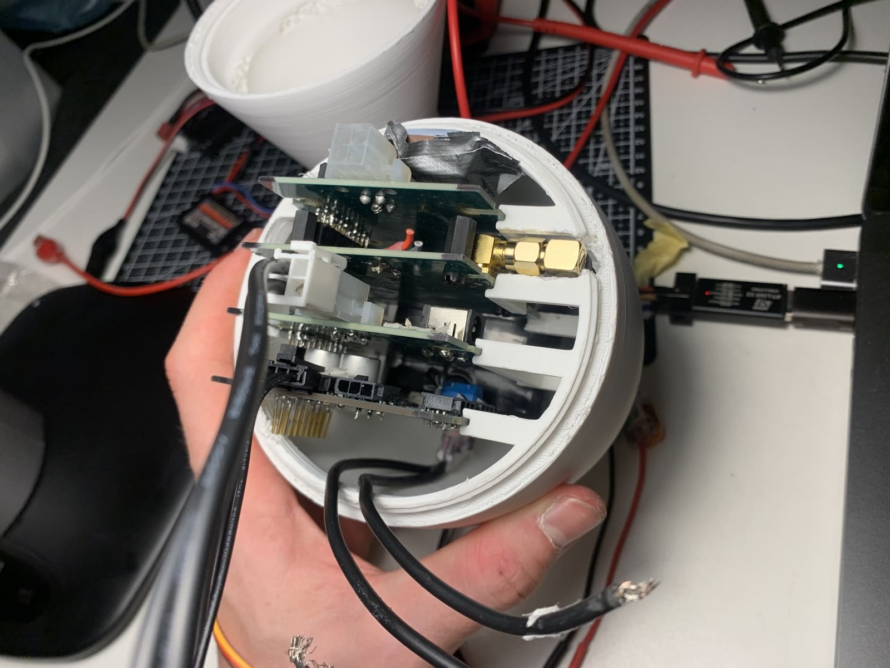
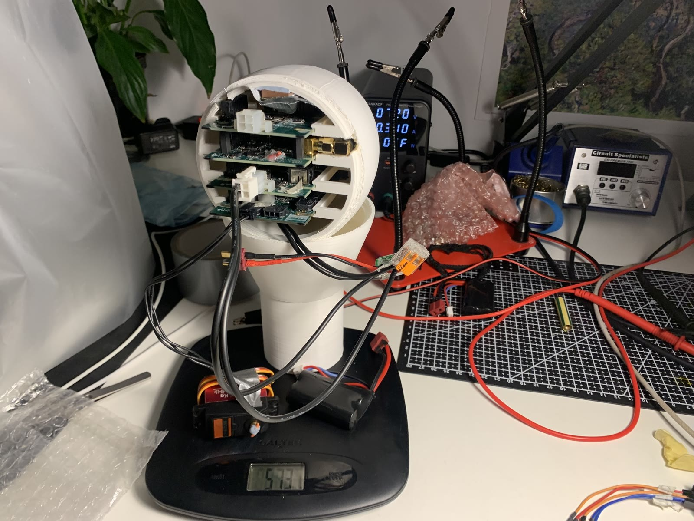
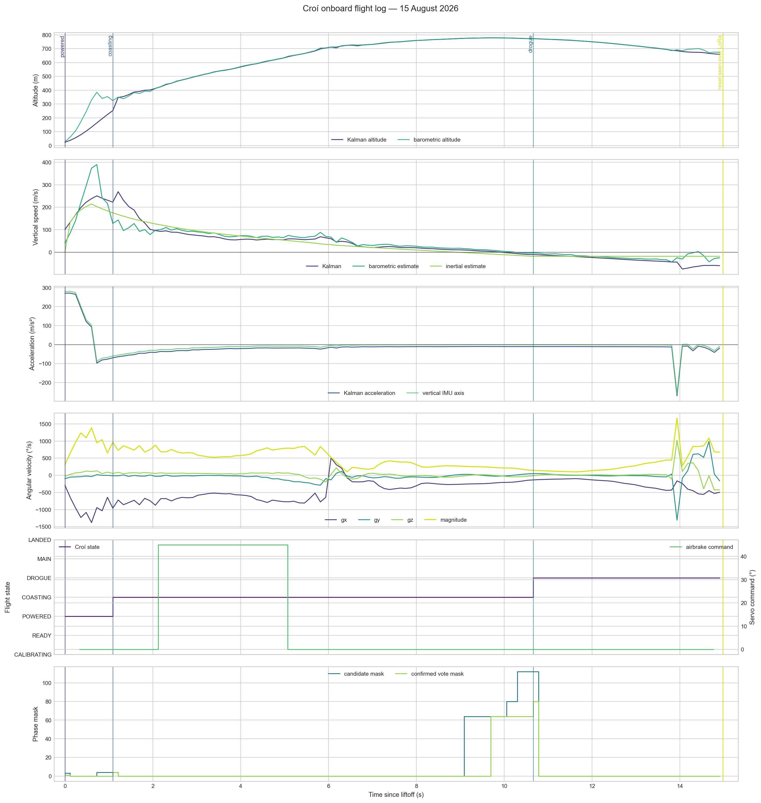
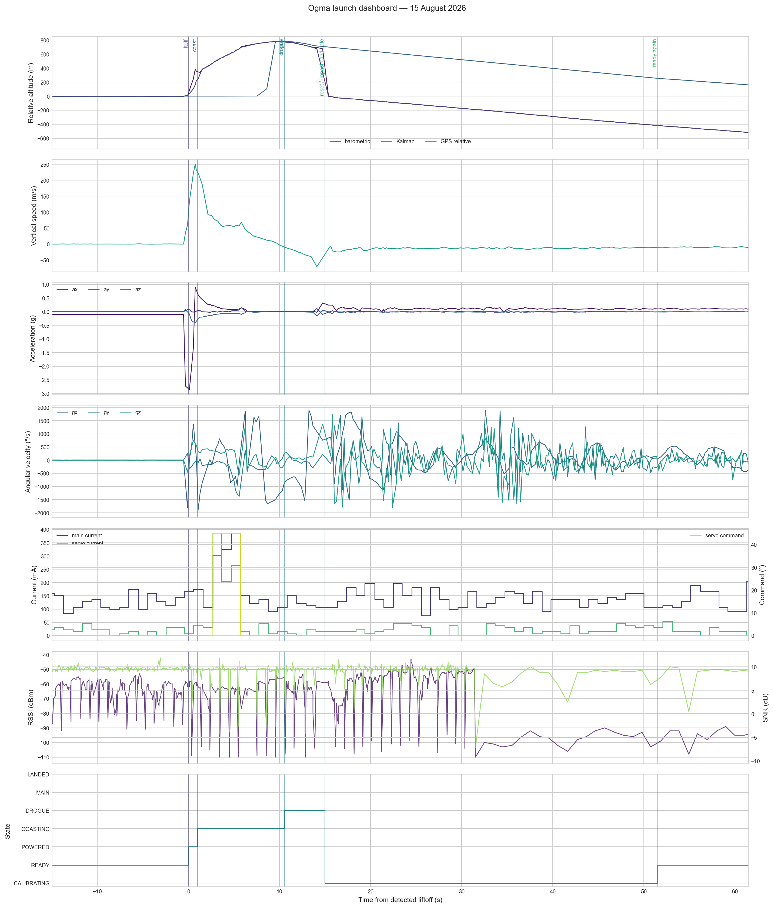
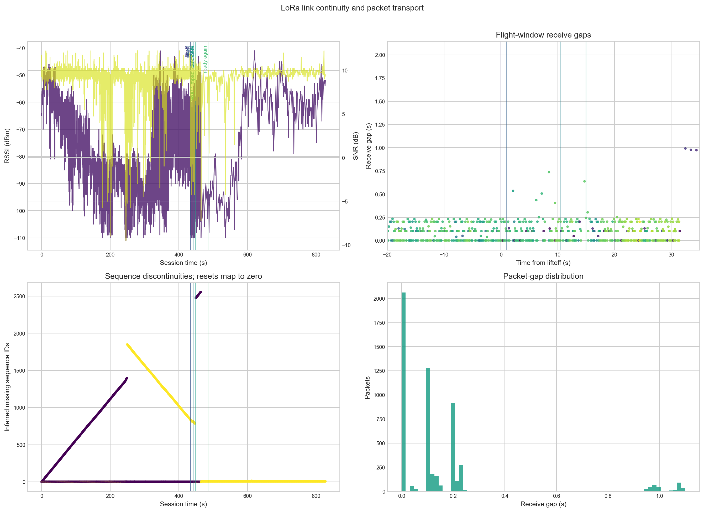
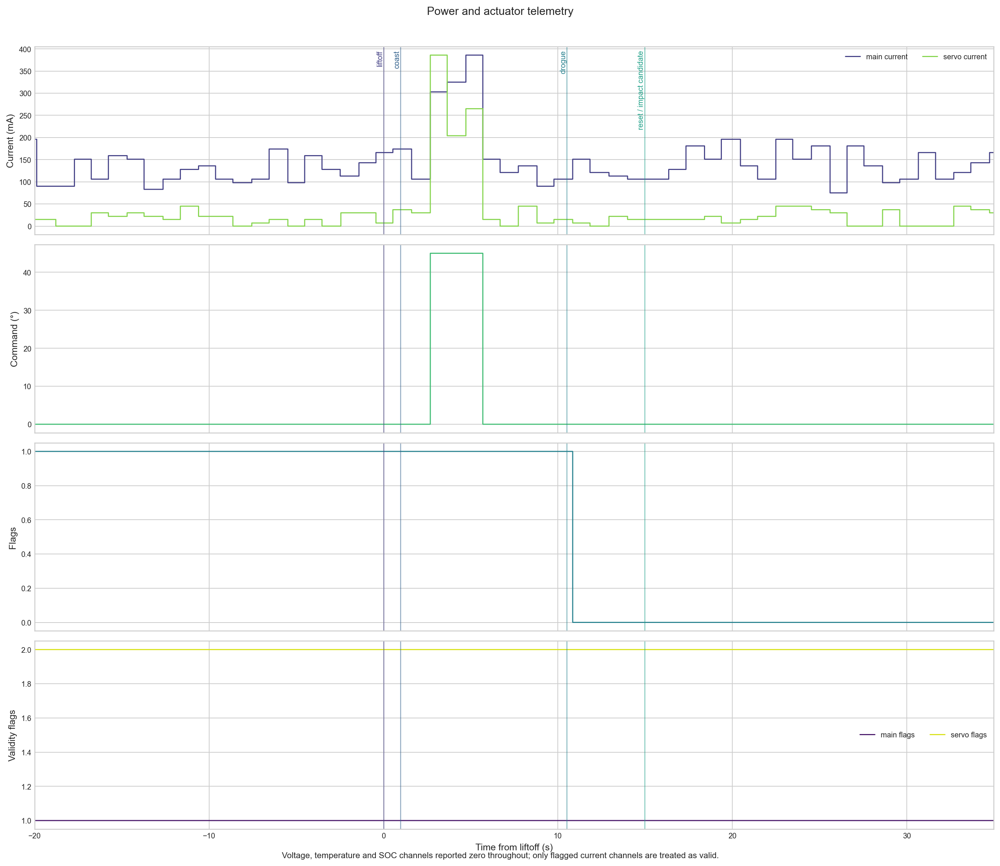
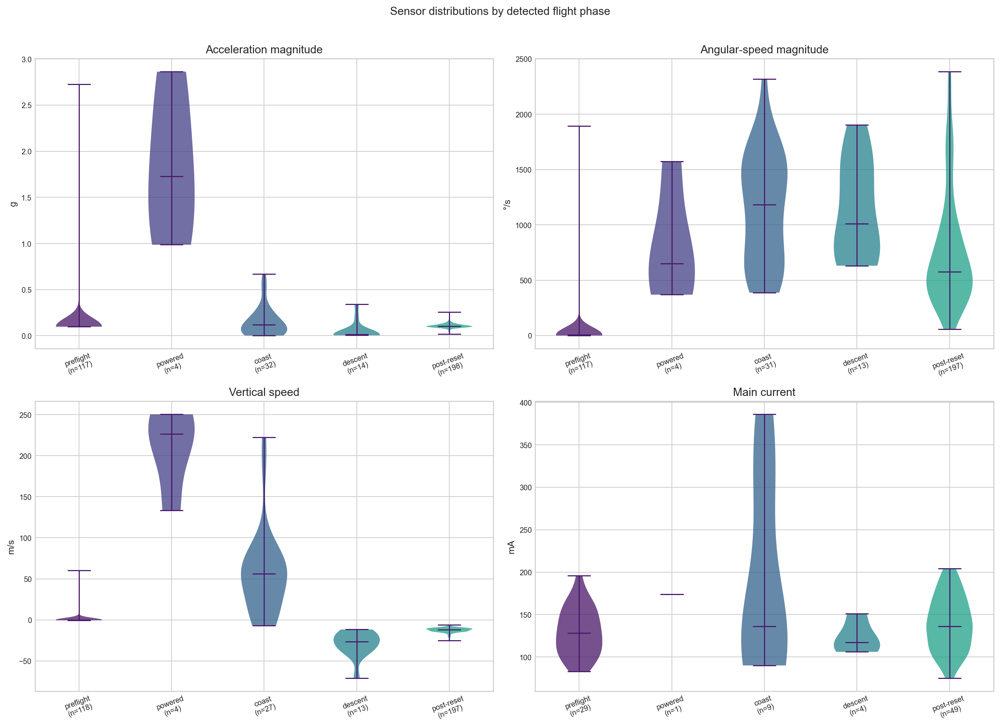
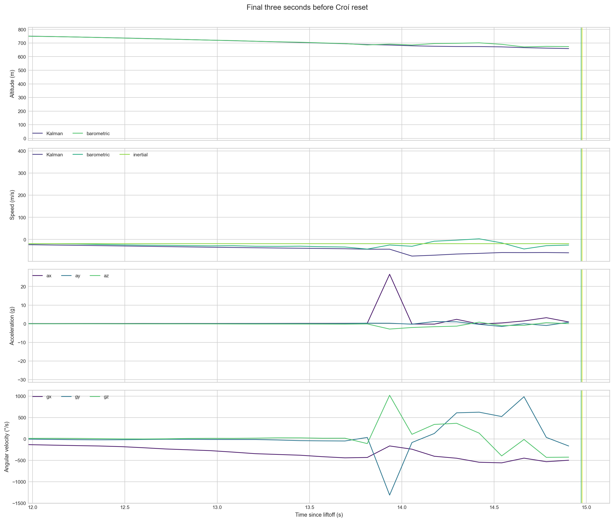
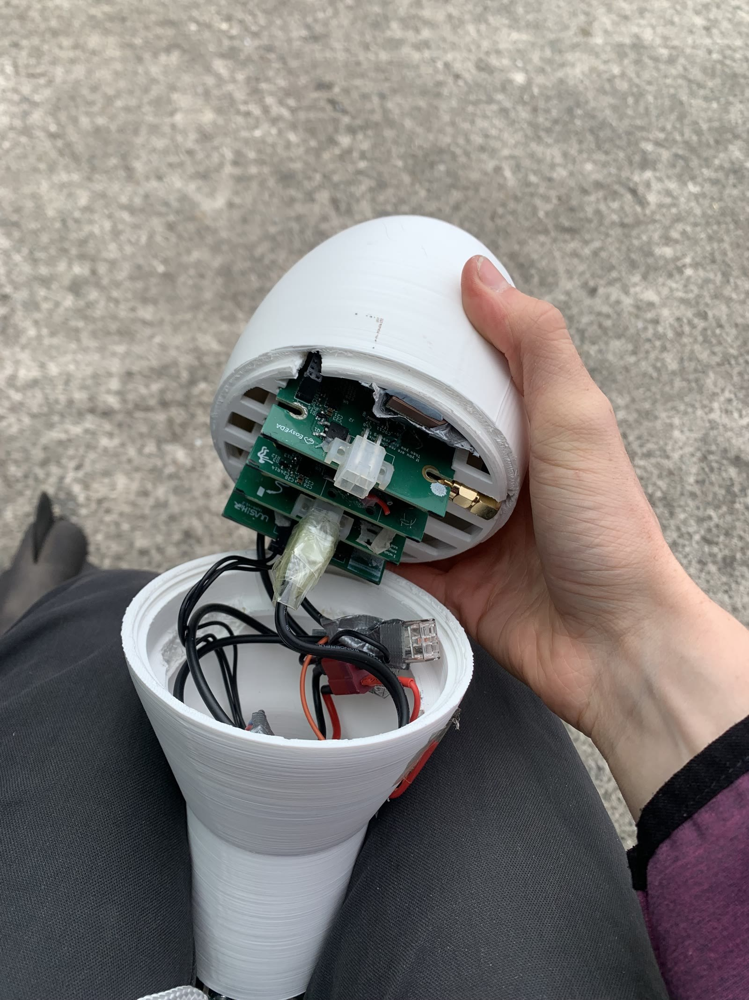

# Ogma Rev 1 flight closure

## 15 August 2026 L1 flight and requirements for the next stack

Prepared by Seán O'Sullivan

Flight date: 15 August 2026

Report date: 16 August 2026
Corrected: 17 August 2026

## Result

Ogma Rev 1 flew as a four-board stack and returned usable data from both the groundstation and Croí's onboard flash. Croí detected liftoff, burnout and apogee in flight. It generated the programmed servo commands, logged the flight, and sent live data through Teachtaire for the entire ascent and part of the descent. Teachtaire also obtained a GPS fix before launch. Foinse powered the stack and Lámh stayed present on CAN.

Croí reset 14.976 seconds after liftoff while the rocket was still about 696 metres above the launch datum. It recalibrated and later returned to READY over LoRa. The reset cause is unknown. A large inertial event appeared 1.042 seconds before the reset, but timing alone does not establish cause.

The flight exercised the distributed architecture, flight-state logic, logger, radio link and field software together. It also exposed enough hardware, packaging, firmware and operating problems that the next stack should be a new design rather than another cleanup of these boards.

## Flown configuration

The payload contained:

- Croí: flight state, inertial and barometric sensing, command generation and external-flash logging.
- Teachtaire: SX1272 LoRa telemetry and u-blox GNSS.
- Foinse: battery input, regulated rails and current sensing.
- Lámh: CAN-connected servo controller.
- A servo used as a witnessed actuator load. The flight did not carry a complete aerodynamic airbrake mechanism.
- Mu as a separately powered science payload. Mu did not share Ogma's CAN bus.

Pléasc was not flown. Its optocoupler population and full bring-up were incomplete, and the rocket retained its conventional recovery system. Both programmed pyro channels were disabled in Croí's mission configuration.

The assembled rocket weighed 969 g excluding the motor. The checked OpenRocket configuration had 1.13 calibres of stability. Ogma and Mu were fed from the same 7.4 V nominal battery through separate raw-battery branches into their intended power inputs.

*The four-board stack in its printed rail. The loose programming lead beside it was part of the Rev 1 SWD workflow.*

*The payload during final fit and mass checks.*

## Flight timeline

Times below are relative to Croí's detected liftoff.

| Time | Recorded event |
| ---: | --- |
| 0.000 s | Croí entered POWERED from the liftoff-acceleration vote. |
| 1.090 s | Croí entered COASTING from the burnout-acceleration vote. |
| 2.126 s | First logged 45° servo command. |
| 5.072 s | First logged 0° stow command. |
| 9.814 s | Peak onboard Kalman altitude, 778.55 m. Peak onboard barometric altitude was 778.44 m at the same sample. |
| 10.662 s | Croí entered DROGUE from the apogee vote. |
| 13.934 s | 26.68 g and 1,670°/s inertial event. This is a candidate precursor to the reset. |
| 14.971 s | Last committed onboard-flash record. |
| 14.976 s | Croí reappeared as CALIBRATING over LoRa, establishing a reset. |
| 51.510 s | Croí returned to READY after recalibration. |

The last onboard sample was in DROGUE at 659.04 m Kalman altitude, 673.52 m barometric altitude and -60.19 m/s Kalman vertical speed. Mu independently placed Croí's reset at about 695.6 m relative altitude. This rules out ground impact as the reset event.

## What the flight proved

### Flight state and sensing

Croí's state machine made the expected POWERED, COASTING and DROGUE transitions from real flight data. Both phase-detector sensors remained healthy in every onboard sample. The detector stayed in IMU-plus-barometer mode throughout the recovered log.

The logger recovered 155 committed records: 124 flight records and 31 secondary records. Sequence numbers were contiguous from 0 to 154. Every header and payload checksum passed, and the parser produced no warnings. The final flash commit landed 4.9 ms before the reset transition received over LoRa.

*Croí's recovered flight record. The onboard log begins at detected liftoff and ends immediately before the aloft reset.*

### Telemetry, CAN and GNSS

The groundstation captured 828.153 seconds of data, including 18,986 decoded CAN frames and 804 GPS records. It reported 446 fixed GPS records, no unknown CAN frames and no parser warnings. The maximum packet gap in the flight window was 0.736 seconds. The link preserved the state transitions, sensor data, current data and reset/recovery sequence without losing LoRa lock during flight.

*Groundstation telemetry across launch, ascent, descent, Croí reset and recovery.*

*RSSI, SNR, receive gaps and packet sequencing from the field capture.*

### Servo command

Croí logged a 45° command from T+2.126 s to T+5.072 s, then logged the 0° stow command. The groundstation also recorded servo-current values of 386 mA, 204 mA and 265 mA inside the commanded interval, above the low current seen before and after it.

There was no position sensor. The data proves that Croí generated the command and that the servo branch drew current. It does not prove the shaft angle or mechanical travel. Finding the servo at home after recovery is expected because the flight program stowed it at T+5 s and Lámh also returns to a safe position after command loss or reset.

*Servo current and the commanded angle. Voltage, temperature and state-of-charge fields remained zero and are not treated as measurements.*

### Flight phases

*Linear acceleration, angular rate, altitude, vertical speed and current grouped by Croí's detected flight phases.*

## What failed or remained unresolved

### Croí reset aloft

The reset is the main flight failure. The recovered data fixes its timing, but it does not identify the electrical or software cause. The 26.68 g and 1,670°/s event 1.042 seconds earlier may be relevant. Other credible possibilities remain open, including an intermittent power connection, brownout, a watchdog event, a mechanical short or another firmware fault.

Reset flags read later on the bench describe a later debugger or power cycle and cannot be used as launch evidence. Rev 1 also did not persist the reset cause early enough for post-flight recovery.

*The final four seconds of Croí's onboard record. The marked shock precedes the reset but does not explain it.*

### The flight never reached MAIN or LANDED

Croí reset during DROGUE, so the recovered run does not qualify the MAIN and LANDED transitions. It also exposed a logger bug: `flight_data.time` was zero in all 124 flight records. Header time and `core_time_ms` remained valid, so the flight analysis was unaffected. The logger passed the zero field into its 60-second post-landing window check, which would prevent that timeout from advancing after a normal LANDED transition.

### Launch-day power connection

The chosen Foinse board had passed battery operation on the bench. At the launch site, the external battery connector became intermittent and initially powered the stack only when pressed. The contacts were compressed and repositioned, and glue was added during attempted repair. The connector remained plugged in. A twisted joint through a drilled access hole connected the battery to a Wago terminal so the closed stack could be powered.

The resulting power connection worked for the flight, but it was an improvised arrangement that had not been tested for vibration, repeated mating or representative load. It did not bypass the intermittent connector or destroy the post-flight evidence. The connector adjustment, glue and twisted joint form part of the flown configuration and must be accounted for during follow-up testing.

### Groundstation operator mode

The groundstation receiver and Ogma Console captured the launch successfully. The local display caused confusion because the high-fidelity USB mode intentionally suspends LCD updates so the shared SPI bus and interpreter can service the SX1272 faster. A screen that appears frozen can therefore coexist with a healthy laptop stream. Field software should show that mode explicitly, and the next receiver should support useful local status and lossless host capture at the same time.

### Mechanical recovery

The printed rail kept the boards together through launch and recovery, but the recovered payload showed impact damage. The electrical stack also depended on loose programming leads, hand-routed battery wiring and local padding. The next enclosure needs positive board retention, strain relief, protected connectors and a clear service path that survives repeated assembly without loading solder joints.

## Rev 1 board findings

### Croí

Croí flew and produced the strongest evidence in the system. It also needed the most board surgery.

- One early Croí had a hard 3.3 V-to-ground short. Heat was first localized around the TLV75533 supply and MCU area. The MCU was eventually replaced, and flux contamination made the repair harder to isolate.
- Excess solder and flux around the 20-pin stack connector required cleaning. Conductive debris was also found between ADXL375 pins during rework.
- SWD was marginal until the clock path received a small damping-capacitance repair. Rev 2 needs a short grounded debug route and an optional damping footprint.
- The practical buzzer supply did not match the available rail. The flight board used the PB0 buzzer bodge. The next board needs a known buzzer type, a guaranteed supply and an exposed drive node.
- The LSM6DSO32 MOSI connection was missing and required a wire from the sensor input to PA7.
- Flash and ADXL375 SPI directions were swapped and required rerouting.
- A BME680 on one board held the shared SPI bus in a bad state and was removed. The BME680 worked on a later Croí. That board's shared-bus fault came from an MS5607 installed 180 degrees and shorting SCK to 3.3 V.
- A damaged BAT54C collapsed a local rail to about 1.8 V and had to be replaced.
- The fitted flash reported a Macronix-class JEDEC identity rather than the identity assumed by early firmware. The logger was rewritten around the actual device and append-only records.
- One flash verification failed around address `0x00301740`. The logger was changed to retry verification three times, and its later endurance test passed.
- Spare buses and GPIO were not exposed. Adding or isolating a sensor often required soldering directly to small package pins or traces.

The next Croí must isolate every SPI branch, expose every chip select and bus, include rail indicators and keep debug and recovery points away from hidden package pads.

### Teachtaire

Teachtaire delivered the live radio and GPS evidence used in this report.

- The LT3045 low-noise regulators were missing from the original component order. After they were fitted, both 3.3 V rails remained at 0 V because the hidden package joints had not reflowed. More heat and firm pressure seated them and brought up `3V3D` and `3V3RF`.
- The Q1 MOSFET pinout did not match the schematic assumption. It pulled a GNSS control connection low and put the receiver into safe-boot behaviour.
- Active-antenna power required a Q3 pad-1-to-pad-3 bodge. The first blinking GNSS LED observed afterward was TIMEPULSE/1PPS and was not evidence of a position fix.
- The SX1272 initially appeared dead because firmware held RESET in the wrong state. The correct active-high reset pulse followed by release produced RegVersion `0x22`. No SX1272 replacement was required.
- Blocking, byte-at-a-time UART handling lost GNSS data. Continuous nonblocking receive made the path reliable; Rev 2 should use DMA and a ring buffer.
- The fitted radio is an SX1272, while stale notes and schematic references named SX1261/SX1262 devices.
- Sync word and radio parameters existed in conflicting notes. Flight and ground firmware now use an explicit versioned packet with sequence, length and CRC, but the physical radio configuration still needs one controlled source.
- Early GPS transport multiplied coordinates by one million and then truncated them into signed 24-bit fields. Normal latitude values overflowed. The current encoding maps the full coordinate range into signed 24-bit values.
- CAN ID `0x040` meant Kalman data in some firmware and pyro arm in other firmware. The shared contract was corrected before flight.
- Polling CAN receive accumulated four FIFO overruns in 394 seconds. IRQ draining and a 16-frame queue removed them in the later test.
- Early groundstation testing lost 11.6% of packets because the receiver shared SPI time between the SX1272 and display. Faster polling and a host-capture mode fixed the tested path.
- RF switch, reset, DIO, SPI, GNSS UART and PPS signals were not easy to probe.

The next Teachtaire needs one checked-in radio profile, counters at every receive/transmit layer and accessible RF/GNSS signals.

### Foinse

The flown board powered the stack and supplied valid main and servo-current data. Other Rev 1 units exposed several independent power-path faults.

- During early stack bring-up, connecting a flux-heavy Lámh was followed by Foinse's nominal 5 V logic rail rising to about 8.7 V. The fault persisted after Lámh was removed. The intended 30 kΩ and 220 kΩ feedback resistors measured incorrectly and were replaced with available 33.2 kΩ and 240 kΩ parts. Cleaning and reflow returned the rail to about 4.9 V. Contamination was the working explanation. The exact mechanism was not captured.
- The Foinse CAN transceiver had been exposed to the high rail and was later confirmed dead by scope testing. Replacing it restored CAN. The record does not establish whether the overvoltage caused the failure.
- On another Rev 1 board, the battery ORing path failed while alternate input continued to run the downstream regulators. Battery voltage reached U17 and Q1, Q1 gate stayed high and `pwr_s` decayed. The failed component was U17, the LTC4412 ORing controller.
- The cause of U17's failure remains unknown. Hot-plug ringing is credible because the input used low-ESR ceramic capacitance without measured damping or surge control, but it was never captured on a scope.
- A separate early Foinse produced 0 V on 3.3 V and about 0.15 V on 5 V. The exact cause and physical board identity were not retained.
- The flown board's external battery connector failed intermittently at the field but remained plugged in and in circuit. A twisted joint through a drilled access hole connected the battery to the Wago terminal so the closed stack could be powered.
- The launch-day connection worked, but it had not been tested for vibration, repeated mating or representative load. The connector adjustment, glue and twisted joint must remain part of any reconstruction of the flown configuration.
- Foinse recorded valid main-rail and servo-rail current. Voltage, temperature and state-of-charge telemetry remained zero.
- Alternate input could mask a failed battery path during diagnosis.

The launch record shows current draw but cannot establish whether the Croí reset was caused by power. Follow-up testing must instrument the battery input, Wago connection, intermittent connector, ORing nodes and regulated rails during hot-plug, cold-start and representative load steps.

The next Foinse needs protected and keyed power entry, controlled inrush, measured transient behaviour, accessible ORing nodes, rail indicators, branch protection, valid voltage/temperature/state-of-charge telemetry and a documented safe laboratory bypass. The battery connector and every high-current joint need mechanical retention and a repeated mate/cycle test.

### Lámh

Lámh accepted the flight commands and the servo branch drew current during the deployment window.

- SWDIO and SWCLK were routed to PC13 and PC14 instead of the STM32's PA13 and PA14 debug pins. PA13 and PA14 were left unconnected. The board required trace work and microsoldered bodges before it could be programmed normally.
- The CAN transceiver supply was named `5VLOGIC`, while the stack rail was named `5V_LOGIC`. KiCad treated them as separate nets. The transceiver was replaced before the missing supply connection was found and bodged; the original transceiver may have been healthy.
- An incorrectly fitted connector required prolonged desoldering and made the board very hot. One electrolytic bulk capacitor on the 5 V servo rail failed from that heating. Isolating the failed capacitor required surgery around the bulk-capacitor bank. Its reference designator was not recorded.
- The 20-pin stack connector also required cleaning and solder repair during bring-up.
- The PCA9685 was unavailable through the original supply path and had to be salvaged from a breakout board.
- Missing SysTick/FreeRTOS integration sent the MCU into a default interrupt handler during bring-up.
- Early I2C wrappers could hide errors while higher layers reported plausible progress.
- Inactive traffic generated 324 unnecessary I2C writes from 81 frames over about nine seconds. Repeated lease renewals also rewrote unchanged PWM values. Both paths were reduced before HIL.
- A successful PCA9685 write did not prove power, OE state, connector orientation, PWM at the header or servo travel. Bare probes and physical HIL were required.
- PCA9685 OE is tied low. Software moves to safe positions early and uses a 500 ms command lease, but PWM can persist while the Lámh MCU resets.
- An early debug mailbox could command servo output without the normal safety lease. It was brought under the same lease and state controls as the flight path.
- Spare GPIO, debug UART, I2C, PWM, OE, arm input and rails were not exposed cleanly.

On the next Lámh, OE must be MCU-controlled and hardware-default-disabled. The complete command-loss-to-safe-position path then needs to be measured under load.

### Pléasc

Pléasc did not fly. The correct optocouplers still need to be populated and the board has not completed full bring-up.

- Through-hole LTV-817 optocouplers were ordered for an SMD board. Inspection then showed that the PCB used the `SO4_TOS` footprint, and TLP291-GB-TP-SE was selected as the compatible replacement. The replacement parts were not populated before this flight.
- Rev 1 has no MCU-readable physical arm or remove-before-flight input.
- Software leases and finite pulses cannot replace a hardware-visible safe state for energetic outputs.

The next Pléasc needs a physical arm input visible to firmware, hard default-low output gates, separated logic and energetic power, continuity test points and inert-load HIL before any live deployment test.

### Groundstation and Ogma Console

The groundstation and laptop application made the flight legible in real time. They also need a stricter field workflow.

- Adapter-board pin mappings and display assumptions had drifted during bring-up.
- Shared receiver/display SPI time created measurable packet loss before the USB capture mode was added.
- GPS coordinates, flight state and receiver health were not all obvious in the first field view. Several UI changes were made at the launch site.
- The useful flight record initially lived in an open Python session. Capture should be durable from the first received byte, independent of the visible UI.
- SWD worked well as a board service interface, but Rev 1 reached it through an ST-Link V2 and five loose leads pushed into small crimp contacts. Boards often needed a power cycle before the probe reattached.
- A two-probe programming session selected the wrong ST-Link and flashed a Lámh image onto Teachtaire. Both boards were restored, and the console was changed to build first and invoke OpenOCD directly against the selected probe serial.
- Bench CAN termination depended on Teachtaire being present. Tests without it could resemble failed CAN hardware.
- Historical repairs were not consistently tied to board serial numbers. Several records identify only "the first board", "the second Croí" or "this Foinse", so every repair cannot be assigned confidently to the flown hardware.

The next system needs a standard keyed 10-pin ARM Cortex debug header, a spare UART, explicit field modes, automatic raw capture and one preflight screen that distinguishes READY, GPS fix, CAN peers, radio health, mission identity and storage state.

## Firmware architecture

The flight firmware grew through bring-up and still carries too much board-specific hardware work in application files. A post-flight design review with Anav identified four layers that need explicit boundaries:

1. STM32 HAL and interrupt handling.
2. Peripheral drivers with errors and counters that can be tested independently.
3. Per-board pin, bus and device configuration.
4. Flight and node logic that never reaches hardware registers or HAL calls directly.

`comheadan` should own shared protocols and transport interfaces. `braiteoiri` should own reusable peripheral drivers. Board applications should compose those pieces and contain the minimum board-specific policy.

FreeRTOS should remain only where measured timing, priority or concurrency requirements justify it. The Rev 1 SysTick fault showed the cost of carrying an RTOS before those boundaries were clean. The next architecture review should compare a small interrupt-driven main loop with a corrected RTOS design against the actual deadlines for sensing, CAN, logging, radio and actuation.

The flight source also needs release discipline. After recovery, Croí, groundstation and Ogma Console contained uncommitted flight-related changes. A commit hash alone therefore cannot reconstruct the exact images and field UI used on 15 August. Every flight release must preserve:

- clean source commit hashes for every node and tool;
- built binary hashes;
- compiler, library and board-package versions;
- the mission manifest and CRC;
- calibration data and board serial numbers;
- an explicit dirty-tree check;
- the flashed-image verification result.

## Rev 2 release requirements

### Platform and interfaces

- Keep the 500 kbit/s distributed CAN architecture.
- Define one keyed node connector with power, CAN, grounding and reserved expansion contacts.
- Make new sensor or actuator boards ordinary CAN nodes instead of forcing every future peripheral onto Croí.
- Expose spare GPIO, UART, I2C and SPI through labelled pads or compact headers on every MCU board.
- Use a standard keyed 10-pin SWD header with NRST, reference voltage and ground returns.
- Show power, boot, CAN, logging and fault state with simple LEDs that can be disabled where current or darkness matters.
- Keep four-layer boards. Evaluate two-sided placement against enclosure access, automated assembly, inspection and rework instead of assuming one-sided placement.

### Hardware observability and correctness

- Add labelled test points for every rail, bus, chip select, reset, enable, CAN transceiver pin and external signal.
- Put reversible 0 Ω isolation links or series footprints on each shared-bus branch.
- Check the exact manufacturer part number, package suffix, symbol, footprint, pin 1 and exposed pad twice before release.
- Run an independent schematic-to-layout net audit that checks MCU alternate-function pins and near-identical net names such as `5VLOGIC` and `5V_LOGIC`, followed by an automated clean build before manufacture.
- Order fully assembled PCBAs and define incoming inspection, first-power and fixture tests. Hand stencilling every Rev 1 board consumed too much time and made variation difficult to separate from design faults.
- Keep a rework record against each board serial. After high-heat connector work, repeat rail isolation, capacitor leakage and first-power checks before reconnecting the stack.

### Power and reset evidence

- Replace the field-repaired battery interface with a keyed, retained connector rated for repeated mating and launch vibration.
- Add controlled inrush, measured surge protection and brownout margin based on captured attach/crossover waveforms.
- Protect and isolate external 5 V branches.
- Make battery, alternate input, ORing gate/sense nodes and every regulated rail directly measurable.
- Test the battery and alternate-input paths independently so one cannot hide failure of the other.
- Store reset flags and a short pre-reset fault record before normal initialization overwrites them.
- Log valid voltage, current and temperature on every flight.
- Test repeated cold starts, brownouts, connector disturbance and servo/radio load steps on the assembled stack.

### Safety and actuation

- Default-disable Lámh's PWM in hardware and control OE from the MCU.
- Give Pléasc a physical arm/RBF input readable by hardware and firmware.
- Retain watchdogs, bounded command leases, finite pyro pulses, one-shot deployment state and event logging.
- Add servo position or a simple witnessed end-state sensor when physical movement is a qualification claim.
- Qualify actuation with the real mechanism, load and supply, then interrupt CAN and reset each relevant MCU during the command window.

### Mechanical system

- Design the board stack, connector access, battery retention and cable strain relief as one assembly.
- Positively retain every board and cover. Do not load castellations, headers or solder joints during nosecone assembly.
- Leave a service route for power and debug that does not require loose leads or reopening structural joints.
- Repeat full assembly, power-on and disassembly before flight. The field configuration must match the rehearsed configuration.
- Test the closed payload against representative acceleration, rotation and impact before another rocket flight.

### Software and operations

- Separate HAL, drivers, board configuration, transport and application logic.
- Put CAN and LoRa message definitions in one versioned source used by every producer, receiver and analysis tool.
- Keep flight logic testable without hardware and keep peripheral drivers testable with bare probes.
- Add state-machine replay tests through POWERED, COASTING, DROGUE, MAIN, LANDED and reset recovery.
- Fix `flight_data.time` and prove the complete post-landing logging window.
- Save groundstation raw data automatically from connection onward. UI state must never be the only copy.
- Freeze and verify a clean flight release before the payload is closed. No launch-site feature work unless it fixes a launch blocker and is followed by the full acceptance replay.

## Rev 2 acceptance sequence

1. Independent schematic, footprint, connector and power review.
2. Factory PCBA plus incoming visual, continuity and rail checks.
3. Bare peripheral and bus probes on every board.
4. Clean firmware release with binaries, hashes, mission manifest and calibration bundle.
5. Each node qualified alone, including power cycles and fault reporting.
6. Full CAN stack HIL with command loss, node reset, bus fault and logger endurance tests.
7. Loaded servo tests and inert Pléasc tests with measured safe-state timing.
8. Radio range, GNSS acquisition and simultaneous local-display/host-capture tests.
9. Closed-payload mechanical, connector-disturbance, brownout and shock testing.
10. A complete field rehearsal using the exact battery, wiring, groundstation and release intended for flight.

## Evidence and provenance

The board findings combine current CAD, bench measurements, bring-up notes and the physical repair record. Historical notes did not consistently retain board serial numbers or component references. This report keeps those gaps visible instead of assigning every repair to the flown unit.

The analysis was performed read-only. The groundstation bundle contains 902,939 bytes captured from `/dev/cu.usbmodem1101` at 115200 baud. Its raw capture SHA-256 is `8a1cfa1ab68f73baa71466cae29ffa22f919024d0ba9836afec7bc38bbd4e7f9`.

Croí's immutable 21,080-byte flash copy has SHA-256 `3bc179d67c2489cb20eec305fd99b11ea0394d34e24ec0ffa2e069a2f3fc13e7`. The recovered records have contiguous sequence numbers and valid checksums.

The full plotbooks below are part of this report. They retain figures that were not needed in the main text so the reader can inspect the complete decoded record.

## Appendix A: complete groundstation telemetry plotbook

The distributed PDF appends the complete groundstation plotbook after this page. Source: [`ogma_launch_plotbook-groundstation.pdf`](plotbooks/ogma_launch_plotbook-groundstation.pdf).

## Appendix B: complete Croí onboard-flash plotbook

The distributed PDF appends the complete Croí onboard plotbook after Appendix A. Source: [`croi_onboard_plotbook.pdf`](plotbooks/croi_onboard_plotbook.pdf).
